Your Notion workspace lives on Notion's servers. Offline mode is limited, sync is a black box, and if their API or pricing changes, your carefully linked databases go with it. AppFlowy — the AGPL-licensed open-source Notion alternative — takes the opposite trade: the same kind of workspace, but the backend is a Rust library compiled into your app, documents are CRDT files on your own disk, and the server is strictly optional. The whole thing is one repository you can clone and read.

This post walks the [AppFlowy-IO/AppFlowy](https://github.com/AppFlowy-IO/AppFlowy) source at its `main` branch with two generated architecture diagrams. The first is a 12-node overview that follows the stack from Flutter widgets down to SQLite. The second is a 32-node detail map of the pieces that actually matter: the FFI bridge, the event dispatcher, the eight domain plugins, the yrs CRDT layer, and the optional AppFlowy Cloud sync. Every node in the SVGs links to the real file on GitHub, and every symbol quoted below was verified against the tree at commit time.

By the end you'll know how a keystroke in the editor becomes a protobuf event, crosses `dart:ffi` into Rust, gets routed to one of eight plugins, lands in either Diesel-managed SQLite or a yrs CRDT document, and — only if you opted in — syncs over a WebSocket. If you've followed our earlier source tours of [Rust](/rust/) codebases or [TypeScript](/typescript-source/) web apps, this one is interesting precisely because it refuses to be a web app.

<em>Overview: the Flutter UI talks protobuf over FFI to the Rust core, which routes events through plugins into SQLite and the yrs collab layer, with cloud sync as a detachable group on the right.</em>

Reading the overview from left to right:

- **The root container is one struct.** [AppFlowyCore, L61](https://github.com/AppFlowy-IO/AppFlowy/blob/main/frontend/rust-lib/flowy-core/src/lib.rs#L61) holds managers for users, folder, documents, databases, search, AI and storage, plus the `event_dispatcher` and a `server_provider`. Its `init` at [AppFlowyCore::new, L86](https://github.com/AppFlowy-IO/AppFlowy/blob/main/frontend/rust-lib/flowy-core/src/lib.rs#L86) assembles every dependency before the UI renders a single widget.
- **The Dart side boots Rust first.** [InitRustSDKTask, L13](https://github.com/AppFlowy-IO/AppFlowy/blob/main/frontend/appflowy_flutter/lib/startup/tasks/rust_sdk.dart#L13) serialises paths, device id and cloud config into a JSON `AppFlowyConfiguration`, and [FlowySDK.init, L37](https://github.com/AppFlowy-IO/AppFlowy/blob/main/frontend/appflowy_flutter/packages/appflowy_backend/lib/appflowy_backend.dart#L37) registers two Dart ports before calling `init_sdk` natively.
- **There is exactly one C entry point for startup.** [init_sdk, L114](https://github.com/AppFlowy-IO/AppFlowy/blob/main/frontend/rust-lib/dart-ffi/src/lib.rs#L114) parses that JSON, spawns a dedicated OS thread running a Tokio runtime inside a `LocalSet`, and constructs the whole `AppFlowyCore` there.
- **Everything after startup is request/response over FFI.** Dart's [Dispatch.asyncRequest, L53](https://github.com/AppFlowy-IO/AppFlowy/blob/main/frontend/appflowy_flutter/packages/appflowy_backend/lib/dispatch/dispatch.dart#L53) writes a protobuf request to bytes, allocates an FFI buffer, and hands over a completion port; Rust's [async_event, L175](https://github.com/AppFlowy-IO/AppFlowy/blob/main/frontend/rust-lib/dart-ffi/src/lib.rs#L175) picks it up and posts the response bytes back to the same port.
- **One dispatcher, no routing framework.** [AFPluginDispatcher, L63](https://github.com/AppFlowy-IO/AppFlowy/blob/main/frontend/rust-lib/lib-dispatch/src/dispatcher.rs#L63) keeps a map of plugins and, via [async_send, L79](https://github.com/AppFlowy-IO/AppFlowy/blob/main/frontend/rust-lib/lib-dispatch/src/dispatcher.rs#L79), finds whichever plugin registered the event id on the request.
- **Eight plugins cover the whole product.** [make_plugins, L12](https://github.com/AppFlowy-IO/AppFlowy/blob/main/frontend/rust-lib/flowy-core/src/module.rs#L12) returns user, folder, database, document, date, search, AI and file-storage plugins — and each one takes only `Weak` references to the managers, so the dispatcher never owns domain state.
- **Events are protobuf enums, not strings.** [DocumentEvent, L59](https://github.com/AppFlowy-IO/AppFlowy/blob/main/frontend/rust-lib/flowy-document/src/event_map.rs#L59) declares 21 numbered events from `CreateDocument = 0` to `GetDocumentText = 20`, each with typed protobuf input and output declared via derive macros.
- **Metadata lives in SQLite under Diesel.** [init, L32](https://github.com/AppFlowy-IO/AppFlowy/blob/main/frontend/rust-lib/flowy-sqlite/src/lib.rs#L32) opens `flowy-database.db` (named at [DB_NAME, L30](https://github.com/AppFlowy-IO/AppFlowy/blob/main/frontend/rust-lib/flowy-sqlite/src/lib.rs#L30)) and runs embedded Diesel migrations on every launch.
- **Content lives in CRDT collabs, not SQLite.** [AppFlowyCollabBuilder, L76](https://github.com/AppFlowy-IO/AppFlowy/blob/main/frontend/rust-lib/collab-integrate/src/collab_builder.rs#L76) builds one yrs-backed `Collab` per document, grid or board, flushed to disk by [write_collab_to_disk, L363](https://github.com/AppFlowy-IO/AppFlowy/blob/main/frontend/rust-lib/collab-integrate/src/collab_builder.rs#L363).

<em>Detail: the full round trip — Dart launch tasks and blocs, the generated FFI bindings, the Rust dispatch loop, the plugin registries, the managers behind them, and the collab/cloud groups where edits become CRDT updates.</em>

## The Rust core: one dispatcher, eight plugins

`frontend/rust-lib` is a Cargo workspace of ~25 crates: `lib-dispatch` is the event bus, `flowy-core` is the composition root, and the rest are domain crates (`flowy-folder`, `flowy-document`, `flowy-database2`, `flowy-user`, `flowy-ai`, `flowy-search`, `flowy-storage`) plus plumbing (`flowy-error`, `flowy-sqlite`, `dart-ffi`). The plugin model is refreshingly small: [AFPlugin, L64](https://github.com/AppFlowy-IO/AppFlowy/blob/main/frontend/rust-lib/lib-dispatch/src/module/module.rs#L64) is a name, a state (the manager as `Weak`), and a list of handlers bound with an `.event()` builder at [.event, L107](https://github.com/AppFlowy-IO/AppFlowy/blob/main/frontend/rust-lib/lib-dispatch/src/module/module.rs#L107). Registration reads like a table of contents: the folder plugin wires ~45 handlers from [FolderEvent, L66](https://github.com/AppFlowy-IO/AppFlowy/blob/main/frontend/rust-lib/flowy-folder/src/event_map.rs#L66) (view creation, moving nested views, trash, favorites), the database plugin from [DatabaseEvent, L11](https://github.com/AppFlowy-IO/AppFlowy/blob/main/frontend/rust-lib/flowy-database2/src/event_map.rs#L11) (fields, rows, cells, filters, sorts), the document plugin from `DocumentEvent` above.

Two details make this design hold up. First, errors are uniform: every handler returns `FlowyResult<T>`, where [FlowyError, L17](https://github.com/AppFlowy-IO/AppFlowy/blob/main/frontend/rust-lib/flowy-error/src/errors.rs#L17) wraps a numeric [ErrorCode, L10](https://github.com/AppFlowy-IO/AppFlowy/blob/main/frontend/rust-lib/flowy-error/src/code.rs#L10) that survives the FFI hop as protobuf. Second, handlers never reach each other directly — the document plugin asks the database plugin's manager through resolved dependencies in `flowy-core/src/deps_resolve/`, keeping the event graph acyclic. This is the same "thin framework, fat domain crates" pattern we liked in our Rust tour at [/rust/](/rust/), just with a Flutter front door.

## The Dart side: protobuf bytes over dart:ffi

AppFlowy does not use method channels for its event traffic. The generated `ffi.dart` looks up `async_event` directly in `libdart_ffi`, and `dispatch.dart` does the wire format by hand: `request.writeToBuffer()` (protobuf), a `calloc.allocate` buffer, and `ffi.async_event(port.nativePort, input, bytes.length)` at [dispatch.dart, L130](https://github.com/AppFlowy-IO/AppFlowy/blob/main/frontend/appflowy_flutter/packages/appflowy_backend/lib/dispatch/dispatch.dart#L130). On the Rust side the bytes become an `AFPluginRequest`, the `Runner` loop spawns it as a local task, and the response goes back through [post_to_flutter, L258](https://github.com/AppFlowy-IO/AppFlowy/blob/main/frontend/rust-lib/dart-ffi/src/lib.rs#L258), which posts FFI-encoded bytes onto the `allo_isolate` port Dart is awaiting.

That mechanism also runs backwards, continuously. `FlowySDK.init` registers a stream port at [set_stream_port, L38](https://github.com/AppFlowy-IO/AppFlowy/blob/main/frontend/appflowy_flutter/packages/appflowy_backend/lib/appflowy_backend.dart#L38), and Rust pushes notifications — document changes, sync state, user events — through a registered `NotificationSender` ([register_notification_sender, L22](https://github.com/AppFlowy-IO/AppFlowy/blob/main/frontend/rust-lib/flowy-notification/src/lib.rs#L22)). The Flutter layer is then classic `flutter_bloc`: [DocumentBloc, L47](https://github.com/AppFlowy-IO/AppFlowy/blob/main/frontend/appflowy_flutter/lib/plugins/document/application/document_bloc.dart#L47) owns one open document, throttles selection sync at 250 ms, and funnels editor transactions into the same dispatch round trip. Every Dart call site is generated per module — `dispatch.dart` literally `part`s in `dart_event/flowy-*/dart_event.dart` files that mirror the Rust event maps, which is why adding an event means touching both sides and regenerating.

## Where your data lands: SQLite for metadata, CRDT for content

AppFlowy splits persistence deliberately. Relational, queryable state — user profiles, workspace/view metadata, KV preferences — goes to SQLite through Diesel 2.1 (`diesel` with `sqlite` and `r2d2` pool features at [Cargo.toml, L75](https://github.com/AppFlowy-IO/AppFlowy/blob/main/frontend/rust-lib/Cargo.toml#L75)). Migrations are compiled into the binary ([MIGRATIONS, L29](https://github.com/AppFlowy-IO/AppFlowy/blob/main/frontend/rust-lib/flowy-sqlite/src/lib.rs#L29)) and applied in `init` before any handler runs, so a user upgrading the app always lands on the current schema. The per-user connection comes straight from the user session — [get_sqlite_db, L370](https://github.com/AppFlowy-IO/AppFlowy/blob/main/frontend/rust-lib/flowy-core/src/lib.rs#L370).

Document content never touches those tables. Each document, grid, board or calendar is a yrs CRDT whose updates are encoded and flushed by `CollabPersistenceImpl` ([CollabPersistenceImpl, L417](https://github.com/AppFlowy-IO/AppFlowy/blob/main/frontend/rust-lib/collab-integrate/src/collab_builder.rs#L417)): `write_collab_to_disk` encodes the doc, then `flush_doc` writes the state vector and doc state inside one transaction ([flush_doc, L384](https://github.com/AppFlowy-IO/AppFlowy/blob/main/frontend/rust-lib/collab-integrate/src/collab_builder.rs#L384)). `DocumentManager` keeps open documents in a `DashMap<Uuid, Arc<RwLock<Document>>>` at [DocumentManager, L54](https://github.com/AppFlowy-IO/AppFlowy/blob/main/frontend/rust-lib/flowy-document/src/manager.rs#L54), with `open_document` at [open_document, L327](https://github.com/AppFlowy-IO/AppFlowy/blob/main/frontend/rust-lib/flowy-document/src/manager.rs#L327). Undo/redo is a CRDT feature: `collab.enable_undo_redo()` is called when a document collab is built ([enable_undo_redo, L169](https://github.com/AppFlowy-IO/AppFlowy/blob/main/frontend/rust-lib/collab-integrate/src/collab_builder.rs#L169)), which is why undo survives restarts. If you want the general pattern — when to keep data in SQLite versus beside it — we cover it in the SQLite post at [/sqlite/](/sqlite/).

## Sync: yrs CRDT updates over an optional WebSocket

The local-first claim is enforced in code, not marketing. A workspace is either local or cloud — `DocumentBloc` checks `WorkspaceTypePB.LocalW` at [isLocalMode, L102](https://github.com/AppFlowy-IO/AppFlowy/blob/main/frontend/appflowy_flutter/lib/plugins/document/application/document_bloc.dart#L102), and the Dart auth layer picks `BackendAuthService(AuthTypePB.Local)` versus `AppFlowyCloudAuthService` in one switch at [currentCloudType, L107](https://github.com/AppFlowy-IO/AppFlowy/blob/main/frontend/appflowy_flutter/lib/startup/deps_resolver.dart#L107). With local auth, no network client is even constructed.

When you do enable sync, the pieces are conventional but cleanly separated. `AppFlowyCloudServer::new` at [AppFlowyCloudServer, L62](https://github.com/AppFlowy-IO/AppFlowy/blob/main/frontend/rust-lib/flowy-server/src/af_cloud/server.rs#L62) builds a REST client (base URL, WebSocket URL, Auth0-style `gotrue_url` at [AFCloudClient::new, L76](https://github.com/AppFlowy-IO/AppFlowy/blob/main/frontend/rust-lib/flowy-server/src/af_cloud/server.rs#L76)) and the [WSClient::new, L91](https://github.com/AppFlowy-IO/AppFlowy/blob/main/frontend/rust-lib/flowy-server/src/af_cloud/server.rs#L91) WebSocket client; `spawn_ws_conn` at [spawn_ws_conn, L97](https://github.com/AppFlowy-IO/AppFlowy/blob/main/frontend/rust-lib/flowy-server/src/af_cloud/server.rs#L97) re-establishes the socket as tokens refresh. Open documents get one `WebSocketChannel` per object id via [collab_ws_channel, L245](https://github.com/AppFlowy-IO/AppFlowy/blob/main/frontend/rust-lib/flowy-server/src/af_cloud/server.rs#L245). The CRDT engine itself is [yrs, L98](https://github.com/AppFlowy-IO/AppFlowy/blob/main/frontend/rust-lib/Cargo.toml#L98) — the Rust port of Yjs — pinned at 0.21.0, and `finalize()` attaches cloud sync plugins to a collab only when `sync_enable` is set ([finalize plugins, L341](https://github.com/AppFlowy-IO/AppFlowy/blob/main/frontend/rust-lib/collab-integrate/src/collab_builder.rs#L341)). Because edits merge as CRDT updates rather than OT on a central server, offline edits replay cleanly when the socket returns.

## From a TypeScript web app to a Flutter-first repo

One structural fact worth knowing before you dig in: earlier AppFlowy versions carried an in-tree TypeScript web client, but today's `main` branch contains **no `package.json` anywhere** — the web frontend is no longer part of this repository, and the entire shipped frontend is the Flutter app plus the Rust workspace. That makes the repo unusual among Notion alternatives: instead of "web app first, Electron shell later", every desktop and mobile target compiles the same Dart UI against the same native Rust library (README lists macOS, Windows and Linux downloads plus App Store and Play Store listings). The cost is visible in the numbers: `git ls-tree -r HEAD` on `main` counts ~2,700 files under `frontend/appflowy_flutter` and ~950 under `frontend/rust-lib`, with generated protobuf Dart under `packages/appflowy_backend/lib/protobuf` acting as the contract between them. If you are porting a web-first product, the [TypeScript](/typescript-source/) archives on this blog show the pattern AppFlowy moved away from — and the diagrams above show what a native-first split looks like instead.

## Honest Limits

- **`sync_event` is a stub.** The synchronous FFI entry point logs `unimplemented sync_event` and returns empty bytes at [sync_event, L230](https://github.com/AppFlowy-IO/AppFlowy/blob/main/frontend/rust-lib/dart-ffi/src/lib.rs#L230) — every real interaction takes the async path, so there is no synchronous escape hatch for tools embedding the core.
- **Conflict handling admits gaps.** The document bloc's own comment says the logic "is not fully implemented yet" and forces state reloads via a sync timer ([conflict comment, L98](https://github.com/AppFlowy-IO/AppFlowy/blob/main/frontend/appflowy_flutter/lib/plugins/document/application/document_bloc.dart#L98)). CRDTs merge text reliably, but UI-level conflict UX is still defended with timers.
- **Undo/redo is not uniform across object types.** It is enabled for document collabs at creation (`enable_undo_redo` above), but the folder builder path ([create_folder, L200](https://github.com/AppFlowy-IO/AppFlowy/blob/main/frontend/rust-lib/collab-integrate/src/collab_builder.rs#L200)) does not enable it, so workspace-tree edits behave differently from document edits.
- **The AGPL core and the cloud are different codebases.** The README pins this repo to AGPL-3.0 ([license badge, L16](https://github.com/AppFlowy-IO/AppFlowy/blob/main/README.md#L16)); the server that powers AppFlowy Cloud sync lives elsewhere, so self-hosting the full stack means deploying a second project.
- **Everything above reflects `main` on 2026-11-17** — commit-verified line numbers, not documentation. AppFlowy moves fast; treat exact line anchors as a snapshot.

