Your team hits it every quarter: the Airtable base that runs operations crosses its API rate limit, automation scripts start failing with 429s, and the export button offers you a ZIP of CSVs instead of a database. The rows live in a proprietary cloud, the schema you carefully built cannot be reached with plain SQL, and pricing scales with collaborators rather than with data. Baserow attacks exactly that pain: it is the open-source, self-hostable Airtable alternative where every "base" is a real Postgres schema you own, every row is a real row, and the grid workflow your team already knows runs on infrastructure you control.

This post walks through Baserow's source (the `develop` branch of `baserow/baserow`) with two architecture diagrams. The overview diagram traces the full loop of one request: the Nuxt frontend calls the Django REST API, registries dispatch the work to plugins, a runtime-generated Django model turns it into SQL against Postgres, and Redis fans the resulting change back out to every connected browser. The detail diagram zooms into the four mechanisms that make that loop possible: the field type plugin contract, the dynamic model engine, the view/filter layer, and the websocket broadcast path.

By the end you will know how a click in the grid becomes a SQL statement, how Baserow manufactures Django models at runtime for tables users created seconds ago, what a field type plugin must implement, and how an edit in Berlin shows up in a colleague's browser in Tokyo without any polling. All line references point into the real repository, so you can click through and verify every claim.

<em>Baserow overview architecture: the browser talks to a Django REST API; field and view plugins feed the dynamic model engine that maps every table onto Postgres, and a Redis-backed websocket layer pushes changes back to the client.</em>

Reading the overview from left to right:

- **A database is just one application type.** Baserow's core layer manages workspaces, and a "database" is a pluggable application attached to one. [Database, L80](https://github.com/baserow/baserow/blob/develop/backend/src/baserow/contrib/database/models.py#L80) extends the shared `Application` model, so permissions, trash and templates behave identically across application kinds.
- **Every column is a plugin instance.** The [FieldType contract, L100](https://github.com/baserow/baserow/blob/develop/backend/src/baserow/contrib/database/fields/registries.py#L100) defines what a field must implement, and [FieldTypeRegistry, L2689](https://github.com/baserow/baserow/blob/develop/backend/src/baserow/contrib/database/fields/registries.py#L2689) resolves type strings like `text` or `link_row` to those plugins. At startup, [field registration, L241](https://github.com/baserow/baserow/blob/develop/backend/src/baserow/contrib/database/apps.py#L241) registers the whole catalog.
- **Plugins mint real Django columns.** [TextFieldType.get_model_field, L529](https://github.com/baserow/baserow/blob/develop/backend/src/baserow/contrib/database/fields/field_types.py#L529) returns an actual `models.TextField(...)` — the same class you would type by hand — so a user-created "Name" column becomes a genuine Postgres column.
- **A table manufactures its own model.** [Table.get_model, L1012](https://github.com/baserow/baserow/blob/develop/backend/src/baserow/contrib/database/table/models.py#L1012) builds a temporary Django model per table: a unique `uuid` app label for thread safety at [L1081](https://github.com/baserow/baserow/blob/develop/backend/src/baserow/contrib/database/table/models.py#L1081), and a `Meta.db_table` binding at [L1105](https://github.com/baserow/baserow/blob/develop/backend/src/baserow/contrib/database/table/models.py#L1105) that points at the physical `database_table_<id>` table named by [USER_TABLE_DATABASE_NAME_PREFIX, L2](https://github.com/baserow/baserow/blob/develop/backend/src/baserow/contrib/database/table/constants.py#L2).
- **Generated models are cached, not rebuilt.** [generated_models_cache, L31](https://github.com/baserow/baserow/blob/develop/backend/src/baserow/contrib/database/table/cache.py#L31) stores the manufactured field attributes in Redis keyed by table id and Baserow version, and a pre-migrate hook clears the whole cache at [L1425](https://github.com/baserow/baserow/blob/develop/backend/src/baserow/contrib/database/apps.py#L1425).
- **Row work flows through the manufactured model.** [RowHandler.get_rows, L2819](https://github.com/baserow/baserow/blob/develop/backend/src/baserow/contrib/database/rows/handler.py#L2819) and [RowHandler.create_row, L792](https://github.com/baserow/baserow/blob/develop/backend/src/baserow/contrib/database/rows/handler.py#L792) are plain Django ORM operations against the generated model — no bespoke SQL layer, which is why filters and sorts compose naturally.
- **Views are query decorators, not separate storage.** [ViewHandler.apply_filters, L1915](https://github.com/baserow/baserow/blob/develop/backend/src/baserow/contrib/database/views/handler.py#L1915) folds the active view's filters and sorts into the row queryset. The open-source view catalog is exactly three plugins — [GridViewType, L79](https://github.com/baserow/baserow/blob/develop/backend/src/baserow/contrib/database/views/view_types.py#L79), [GalleryViewType, L390](https://github.com/baserow/baserow/blob/develop/backend/src/baserow/contrib/database/views/view_types.py#L390) and [FormViewType, L627](https://github.com/baserow/baserow/blob/develop/backend/src/baserow/contrib/database/views/view_types.py#L627) — registered at [L407](https://github.com/baserow/baserow/blob/develop/backend/src/baserow/contrib/database/apps.py#L407), each persisting its options in typed models such as [GridView, L603](https://github.com/baserow/baserow/blob/develop/backend/src/baserow/contrib/database/views/models.py#L603).
- **Edits fan out through Redis, not polling.** Handlers broadcast through [PageType.broadcast, L116](https://github.com/baserow/baserow/blob/develop/backend/src/baserow/ws/registries.py#L116) scoped by [TablePageType, L24](https://github.com/baserow/baserow/blob/develop/backend/src/baserow/contrib/database/ws/pages.py#L24), the events travel over the [RetryingRedisChannelLayer, L63](https://github.com/baserow/baserow/blob/develop/backend/src/baserow/ws/channel_layer.py#L63) wired in as the Django Channels backend at [CHANNEL_LAYERS, L285](https://github.com/baserow/baserow/blob/develop/backend/src/baserow/config/settings/base.py#L285), and the browser's [RealTimeHandler, L25](https://github.com/baserow/baserow/blob/develop/web-frontend/modules/core/plugins/realTimeHandler.js#L25) keeps one reconnecting WebSocket alive to patch the Vue stores.

<em>Baserow internals: the generic registry pattern, the four jobs of a field type plugin, the get_model → GeneratedTableModel → Redis cache engine, the view/filter layer, and the broadcast path from handler to browser store.</em>

## Why the Table Model Is Built at Runtime

Django models are Python classes resolved at import time, but Baserow's core product is letting end users create tables long after the server booted. A static `models.py` cannot know that a customer will add a "Churn Risk" table on Tuesday afternoon. Baserow therefore manufactures the model on demand: [Table._get_model, L1025](https://github.com/baserow/baserow/blob/develop/backend/src/baserow/contrib/database/table/models.py#L1025) documents itself as "Generates a temporary Django model based on available fields", and the construction is exactly the `type()` dance every Django developer has seen in metaprogramming tutorials — attributes dict, `Meta` inner class, app label.

Two details show the engineering care. First, each generation gets a unique app label built from a `uuid4` at [L1081](https://github.com/baserow/baserow/blob/develop/backend/src/baserow/contrib/database/table/models.py#L1081) so two threads building models for the same table never collide in Django's global app registry. Second, the `Meta` at [L1105](https://github.com/baserow/baserow/blob/develop/backend/src/baserow/contrib/database/table/models.py#L1105) sets `ordering` to `["order", "id"]` and creates a composite index on `(order, id)` at [L1091](https://github.com/baserow/baserow/blob/develop/backend/src/baserow/contrib/database/table/models.py#L1091) — the trick that makes drag-to-reorder rows an index scan instead of a table sort. Cross-table `link_row` relations are handled with a many-to-many model cache threaded through the generation call at [L1054](https://github.com/baserow/baserow/blob/develop/backend/src/baserow/contrib/database/table/models.py#L1054) to break the recursion that appears when two tables reference each other.

This is the same dynamic-model technique that powers [Django](/django/) itself under the hood — Baserow just industrialises it: one model per user table, per request path, cached aggressively in between.

## The FieldType Contract: One Plugin, Four Jobs

Open [field_types.py](https://github.com/baserow/baserow/blob/develop/backend/src/baserow/contrib/database/fields/field_types.py) and you find 32 `FieldType` classes in one file, from [TextFieldType, L506](https://github.com/baserow/baserow/blob/develop/backend/src/baserow/contrib/database/fields/field_types.py#L506) to [FormulaFieldType, L6675](https://github.com/baserow/baserow/blob/develop/backend/src/baserow/contrib/database/fields/field_types.py#L6675). The base contract at [FieldType, L100](https://github.com/baserow/baserow/blob/develop/backend/src/baserow/contrib/database/fields/registries.py#L100) forces each plugin to answer four distinct questions:

1. **API shape** — `get_serializer_field` builds the DRF serializer that validates incoming JSON; TextFieldType constructs a `CharField` with the configured default and max length at [L516](https://github.com/baserow/baserow/blob/develop/backend/src/baserow/contrib/database/fields/field_types.py#L516).
2. **Storage** — `get_model_field` returns the Django column: `models.TextField` for text at [L529](https://github.com/baserow/baserow/blob/develop/backend/src/baserow/contrib/database/fields/field_types.py#L529), a decimal-aware field for [NumberFieldType, L1273](https://github.com/baserow/baserow/blob/develop/backend/src/baserow/contrib/database/fields/field_types.py#L1273), a through-model relation for [LinkRowFieldType, L3137](https://github.com/baserow/baserow/blob/develop/backend/src/baserow/contrib/database/fields/field_types.py#L3137).
3. **Query behaviour** — methods like `contains_query` and `starts_with_query` at [L541](https://github.com/baserow/baserow/blob/develop/backend/src/baserow/contrib/database/fields/field_types.py#L541) teach the filter system what SQL each operator means for this type; that is how the view layer stays type-agnostic.
4. **Formula integration** — `to_baserow_formula_type` at [L550](https://github.com/baserow/baserow/blob/develop/backend/src/baserow/contrib/database/fields/field_types.py#L550) declares how the type participates in Baserow's formula language, which is also how [FormulaFieldType, L6675](https://github.com/baserow/baserow/blob/develop/backend/src/baserow/contrib/database/fields/field_types.py#L6675) computes values from other columns.

[FieldHandler.create_field, L285](https://github.com/baserow/baserow/blob/develop/backend/src/baserow/contrib/database/fields/handler.py#L285) dispatches through the registry by type string, alters the Postgres schema via the plugin's column definition, and invalidates the generated model. The consequence is Baserow's most valuable architectural property: adding a new column type — a rating field, a phone field, a duration field — is one new subclass plus one registration line, with zero edits to the row engine or the view layer. Every downstream mechanism consumes plugins through the same generic [Registry, L763](https://github.com/baserow/baserow/blob/develop/backend/src/baserow/core/registry.py#L763) base that all of Baserow's plugin systems share.

## Views as Plugins: Grid, Gallery, Form

A view in Baserow is not a copy of the data; it is a saved set of decorators over one shared row stream. The open-source core registers exactly three: grid, gallery and form (see the registration at [L407](https://github.com/baserow/baserow/blob/develop/backend/src/baserow/contrib/database/apps.py#L407)). [GridViewType, L79](https://github.com/baserow/baserow/blob/develop/backend/src/baserow/contrib/database/views/view_types.py#L79) carries the spreadsheet behaviour — filters, aggregations, ordering — while [GalleryViewType, L390](https://github.com/baserow/baserow/blob/develop/backend/src/baserow/contrib/database/views/view_types.py#L390) renders the same rows as cards and [FormViewType, L627](https://github.com/baserow/baserow/blob/develop/backend/src/baserow/contrib/database/views/view_types.py#L627) exposes a public submission surface that writes rows. Options live in typed Django models like [GridView, L603](https://github.com/baserow/baserow/blob/develop/backend/src/baserow/contrib/database/views/models.py#L603), so a view survives restarts and exports cleanly.

When rows are fetched, [ViewHandler.apply_filters, L1915](https://github.com/baserow/baserow/blob/develop/backend/src/baserow/contrib/database/views/handler.py#L1915) asks each filter's field type for its query method and folds everything into one queryset — the grid, the gallery and a REST API caller can therefore share identical filter semantics without duplicating logic. On the client, the rendering is a [Node](/node/)-powered Nuxt/Vue application (`web-frontend/nuxt.config.ts`), whose per-concern stores in `web-frontend/modules/database/store/` — `field.js`, `view.js`, `table.js` — are the landing zone for realtime patches rather than re-fetching the world on every change.

## From Postgres DDL to Live Cells: Build Facts You Can Verify

Every user table is a real [Postgres](/postgres/) table named `database_table_<id>` ([constants, L2](https://github.com/baserow/baserow/blob/develop/backend/src/baserow/contrib/database/table/constants.py#L2)). [TableHandler.create_table, L364](https://github.com/baserow/baserow/blob/develop/backend/src/baserow/contrib/database/table/handler.py#L364) creates it together with its first fields via [create_table_and_fields, L432](https://github.com/baserow/baserow/blob/develop/backend/src/baserow/contrib/database/table/handler.py#L432), which means `psql` access to your own data is guaranteed by construction, not by an export feature.

A few more facts you can check directly in the tree: the manufactured class is named `Table<id>Model` ([L1006](https://github.com/baserow/baserow/blob/develop/backend/src/baserow/contrib/database/table/models.py#L1006)); the Redis cache entry key embeds the Baserow version (`full_table_model_<id>_<version>` at [L34](https://github.com/baserow/baserow/blob/develop/backend/src/baserow/contrib/database/table/cache.py#L34)) so an upgrade can never serve a stale model; the channel layer serialises websocket payloads with a compressed MsgPack codec ([L23](https://github.com/baserow/baserow/blob/develop/backend/src/baserow/ws/channel_layer.py#L23)) to cut Redis memory per broadcast; and the `ws` module ships event history and replay machinery (`ws/history.py`, `ws/replay.py`, plus migrations `0002_realtime_event_indexes` and `0003_realtime_event_history`), which is what lets a browser that dropped offline catch up on reconnect. The generated model itself defaults to `managed=False` ([L1033](https://github.com/baserow/baserow/blob/develop/backend/src/baserow/contrib/database/table/models.py#L1033)) — Baserow owns the schema lifecycle through its own schema editor instead of Django migrations, which is why the pre-migrate signal clears the model cache.

## Honest Limits

- **The view catalog is deliberately small in OSS.** Core registers exactly three view types; richer visualisations live in the `premium/` and `enterprise/` trees of the same repository, so the open-source grid is the full picture only if you ignore those directories.
- **Plugin registration is boot-time only.** All field and view types are registered during `AppConfig.ready()` ([L241](https://github.com/baserow/baserow/blob/develop/backend/src/baserow/contrib/database/apps.py#L241)), so adding a field type is a Python restart, not a hot plugin load.
- **Realtime is Redis-dependent.** Connection defaults live in [settings, L174](https://github.com/baserow/baserow/blob/develop/backend/src/baserow/config/settings/base.py#L174); a self-hosted deployment without Redis loses live sync, though REST still works.
- **The client trusts reconnect, not a queue.** The browser's [delayedReconnect, L246](https://github.com/baserow/baserow/blob/develop/web-frontend/modules/core/plugins/realTimeHandler.js#L246) retries the socket on drop, and correctness during downtime rests on the server-side replay tables noted above — there is no client-side event buffer.

