Confluence bills per seat, hides its best features behind paid tiers, and somehow still feels slow on a five-person team. Notion locks your notes in a proprietary cloud. MediaWiki is powerful but overkill for internal docs. BookStack is the counter-offer: a free, self-hosted wiki built on the [Laravel](/laravel/) framework, MIT-licensed, with content organized the way humans actually think — **Books** hold **Chapters**, Chapters hold **Pages**. One PHP app, one MySQL database, no JavaScript framework required to understand it. That simplicity is exactly why its source code is worth reading.

We cloned the `development` branch of BookStackApp/BookStack and traced how each request really flows. The two diagrams below were generated directly from the repository structure — every node links to the actual source file on GitHub, so you can click through while reading.

By the end of this tour you will know how BookStack stores page content in three formats at once (HTML, Markdown and plain text), why it abandoned MySQL FULLTEXT for a hand-rolled scored index, how it avoids permission checks that recurse up the hierarchy on every query, and how one `PageRepo::update()` call fans out into revisions, search indexing, reference tracking and audit logs.

<em>Overview of BookStack's architecture: controllers delegate to repositories, repositories shape content into three Eloquent models, and every listing is filtered through the permission engine and the scored search index.</em>

Reading the overview from left to right:

- **HTTP entry is one flat file.** Nearly every page route lives in [routes/web.php, L34](https://github.com/BookStackApp/BookStack/blob/development/routes/web.php#L34), wrapped in a single `Route::middleware('auth')->group(...)` — there is no per-module routing magic to decode.
- **Controllers are thin on purpose.** [PageRepo, L44](https://github.com/BookStackApp/BookStack/blob/development/app/Entities/Repos/PageRepo.php#L44) shows `getNewDraftPage()` doing the real work: forcing `draft => true`, stamping ownership, and assigning the editor from [PageEditorType::getSystemDefault, L32](https://github.com/BookStackApp/BookStack/blob/development/app/Entities/Tools/PageEditorType.php#L32).
- **The hierarchy is three Eloquent models, not nested sets.** [Book, L51](https://github.com/BookStackApp/BookStack/blob/development/app/Entities/Models/Book.php#L51) declares `pages()` as a plain `hasMany`, [Book, L68](https://github.com/BookStackApp/BookStack/blob/development/app/Entities/Models/Book.php#L68) adds `chapters()`, and [Chapter, L30](https://github.com/BookStackApp/BookStack/blob/development/app/Entities/Models/Chapter.php#L30) orders its pages by a `priority` column. No materialized path, no closure table — just `book_id` and `chapter_id` foreign keys.
- **Every page row carries three content columns.** [Page, L31](https://github.com/BookStackApp/BookStack/blob/development/app/Entities/Models/Page.php#L31) extends the abstract [BookChild, L15](https://github.com/BookStackApp/BookStack/blob/development/app/Entities/Models/BookChild.php#L15) and its docblock lists `html`, `markdown` and `text` properties plus a `revision_count`.
- **Dual editors converge on one normalizer.** [PageContent::setNewHTML, L40](https://github.com/BookStackApp/BookStack/blob/development/app/Entities/Tools/PageContent.php#L40) stores HTML and blanks the Markdown column at [L52](https://github.com/BookStackApp/BookStack/blob/development/app/Entities/Tools/PageContent.php#L52), while [setNewMarkdown, L58](https://github.com/BookStackApp/BookStack/blob/development/app/Entities/Tools/PageContent.php#L58) converts through CommonMark at [L62](https://github.com/BookStackApp/BookStack/blob/development/app/Entities/Tools/PageContent.php#L62) — so rendering never has to care which editor wrote the page.
- **Permissions are pre-computed, not recursed.** [JointPermissionBuilder::rebuildForAll, L32](https://github.com/BookStackApp/BookStack/blob/development/app/Permissions/JointPermissionBuilder.php#L32) truncates a cache table and re-derives visibility per role, chunking books five at a time at [L40](https://github.com/BookStackApp/BookStack/blob/development/app/Permissions/JointPermissionBuilder.php#L40).
- **Listings filter through that cache.** [PermissionApplicator::restrictEntityQuery, L99](https://github.com/BookStackApp/BookStack/blob/development/app/Permissions/PermissionApplicator.php#L99) attaches a `whereHas('jointPermissions', ...)` with a `havingRaw` status check at [L108](https://github.com/BookStackApp/BookStack/blob/development/app/Permissions/PermissionApplicator.php#L108) — one subquery replaces tree-walking in PHP.
- **Search is a scored term table.** [SearchIndex::indexEntity, L35](https://github.com/BookStackApp/BookStack/blob/development/app/Search/SearchIndex.php#L35) deletes and re-inserts terms with weights, and [SearchRunner, L191](https://github.com/BookStackApp/BookStack/blob/development/app/Search/SearchRunner.php#L191) joins that subquery back onto entities sorted by `score`.
- **Revisions are eager, not lazy.** [RevisionRepo::storeNewForPage, L19](https://github.com/BookStackApp/BookStack/blob/development/app/Entities/Repos/RevisionRepo.php#L19) snapshots name, HTML, Markdown, text and slug on every qualifying save.

<em>The detailed view adds the collaboration layer: activity logging with queued webhooks, theme-event hooks fired during content conversion, and the three-engine PDF export path.</em>

## The Book → Chapter → Page Hierarchy Is Just Foreign Keys

BookStack's data model refuses to be clever. `Book` is a container with `hasMany` relations to both `Page` and `Chapter` ([Book, L51](https://github.com/BookStackApp/BookStack/blob/development/app/Entities/Models/Book.php#L51), [L68](https://github.com/BookStackApp/BookStack/blob/development/app/Entities/Models/Book.php#L68)); a `Page` may point at a `chapter_id` or sit directly under a book via `directPages()` at [Book, L59](https://github.com/BookStackApp/BookStack/blob/development/app/Entities/Models/Book.php#L59). Shelves sit above books as a plain pivot: [Book::shelves, L76](https://github.com/BookStackApp/BookStack/blob/development/app/Entities/Models/Book.php#L76) uses `belongsToMany` through `bookshelves_books`. Ordering within a book is handled by `getDirectVisibleChildren()` at [Book, L84](https://github.com/BookStackApp/BookStack/blob/development/app/Entities/Models/Book.php#L84), which concatenates pages and chapters and sorts by `priority` — a manual, deterministic ordering scheme that makes drag-and-drop sort trivial to persist. URL slugs are regenerated on rename by `BaseRepo::refreshSlug()` at [BaseRepo, L168](https://github.com/BookStackApp/BookStack/blob/development/app/Entities/Repos/BaseRepo.php#L168), with a `SlugHistory` table catching old links.

## One Save Flow Serves Both WYSIWYG and Markdown Editors

BookStack ships three editors — the enum at [PageEditorType, L7](https://github.com/BookStackApp/BookStack/blob/development/app/Entities/Tools/PageEditorType.php#L7) defines `WysiwygTinymce = 'wysiwyg'`, `WysiwygLexical = 'wysiwyg2024'` and `Markdown = 'markdown'`, with `isHtmlBased()` at [L13](https://github.com/BookStackApp/BookStack/blob/development/app/Entities/Tools/PageEditorType.php#L13) deciding which column wins. The branching happens in `PageRepo::updateTemplateStatusAndContentFromInput()`: markdown input forces the Markdown editor and routes through `setNewMarkdown()` at [PageRepo, L170](https://github.com/BookStackApp/BookStack/blob/development/app/Entities/Repos/PageRepo.php#L170), while HTML input resolves the editor through a fallback chain ending in `WysiwygTinymce` at [L174](https://github.com/BookStackApp/BookStack/blob/development/app/Entities/Repos/PageRepo.php#L174). Switching editors is a guarded permission (`userCan(Permission::EditorChange)`) at [L178](https://github.com/BookStackApp/BookStack/blob/development/app/Entities/Repos/PageRepo.php#L178), and the choice is persisted per page in the `editor` column — not per session. Markdown conversion is not a regex toy: [MarkdownToHtml::convert, L23](https://github.com/BookStackApp/BookStack/blob/development/app/Entities/Tools/Markdown/MarkdownToHtml.php#L23) builds a league/commonmark environment with table, task-list and custom strikethrough extensions, and hands it to theme code at [L30](https://github.com/BookStackApp/BookStack/blob/development/app/Entities/Tools/Markdown/MarkdownToHtml.php#L30) before rendering. Even base64-pasted images are extracted and re-uploaded by `extractBase64ImagesFromHtml()` at [PageContent, L77](https://github.com/BookStackApp/BookStack/blob/development/app/Entities/Tools/PageContent.php#L77) so pages never embed megabyte data URIs.

## Permissions Are a Materialized Cache, Not a Runtime Walk

This is the most instructive subsystem in the codebase. A naive wiki would check "does this role allow view on the page? if not, the chapter? if not, the book?" on every row. BookStack instead materializes the answer. Role-level rules live in `EntityPermission` rows (queried with a `role_id = 0` fallback in [PermissionApplicator, L80](https://github.com/BookStackApp/BookStack/blob/development/app/Permissions/PermissionApplicator.php#L80)), and `JointPermissionBuilder` flattens them into a `joint_permissions` table per role-and-entity. The rebuild is surgical: [rebuildForEntity, L54](https://github.com/BookStackApp/BookStack/blob/development/app/Permissions/JointPermissionBuilder.php#L54) regenerates rows for one entity plus its parent chain, and it is triggered from the models themselves — `Entity::rebuildPermissions()` at [Entity, L395](https://github.com/BookStackApp/BookStack/blob/development/app/Entities/Models/Entity.php#L395) fires inside `BaseRepo::create()` at [BaseRepo, L64](https://github.com/BookStackApp/BookStack/blob/development/app/Entities/Repos/BaseRepo.php#L64) and inside `publishDraft()` at [PageRepo, L94](https://github.com/BookStackApp/BookStack/blob/development/app/Entities/Repos/PageRepo.php#L94). At read time, [EntityPermissionEvaluator::evaluateEntityForUser, L17](https://github.com/BookStackApp/BookStack/blob/development/app/Permissions/EntityPermissionEvaluator.php#L17) collects the page→chapter→book chain built by `gatherEntityChainTypeIds()` at [L139](https://github.com/BookStackApp/BookStack/blob/development/app/Permissions/EntityPermissionEvaluator.php#L139) and resolves explicit allow/deny versus implicit fallback at [L35](https://github.com/BookStackApp/BookStack/blob/development/app/Permissions/EntityPermissionEvaluator.php#L35). Listing queries never evaluate in PHP at all — they join the cache with the `havingRaw('status IN (1, 3)...')` filter shown earlier. Drafts get their own guard: `restrictDraftsOnPageQuery()` at [PermissionApplicator, L117](https://github.com/BookStackApp/BookStack/blob/development/app/Permissions/PermissionApplicator.php#L117) keeps update drafts invisible to everyone except their author, layered into every page listing.

## Search: A Hand-Rolled Scored Index That Replaced MySQL FULLTEXT

The 2017 migration is the confession: `create_search_index_table` builds the custom `search_terms` table at [migration, L15](https://github.com/BookStackApp/BookStack/blob/development/database/migrations/2017_03_19_091553_create_search_index_table.php#L15) and then drops the old `FULLTEXT search(...)` indexes on pages, books and chapters at [L28](https://github.com/BookStackApp/BookStack/blob/development/database/migrations/2017_03_19_091553_create_search_index_table.php#L28) — BookStack stopped trusting [MySQL](/mysql-server/) relevance ranking and rolled its own. Indexing scores each term: heading elements weight h1 at 10× down to h6 at 1.5× ([SearchIndex, L148](https://github.com/BookStackApp/BookStack/blob/development/app/Search/SearchIndex.php#L148)), tag names get 3× and values 5× ([L192](https://github.com/BookStackApp/BookStack/blob/development/app/Search/SearchIndex.php#L192)), and the entity name is multiplied by 40× at [L250](https://github.com/BookStackApp/BookStack/blob/development/app/Search/SearchIndex.php#L250). Query time is equally explicit: `applyTermSearch()` at [SearchRunner, L166](https://github.com/BookStackApp/BookStack/blob/development/app/Search/SearchRunner.php#L166) builds a subquery over `search_terms` with prefix `LIKE` matches, and `selectForScoredTerms()` at [L207](https://github.com/BookStackApp/BookStack/blob/development/app/Search/SearchRunner.php#L207) walks backwards to assemble a nested `IF(term like ?, score * ..., ...)` chain wrapped in `SUM(...)` at [L221](https://github.com/BookStackApp/BookStack/blob/development/app/Search/SearchRunner.php#L221). It even adjusts for rarity — `getTermAdjustments()` at [L233](https://github.com/BookStackApp/BookStack/blob/development/app/Search/SearchRunner.php#L233) counts term frequency and down-weights common words. Tokenization is custom as well: the delimiter set at [SearchIndex, L19](https://github.com/BookStackApp/BookStack/blob/development/app/Search/SearchIndex.php#L19) splits on whitespace and punctuation, while the "soft delimiters" `.-` at [L25](https://github.com/BookStackApp/BookStack/blob/development/app/Search/SearchIndex.php#L25) mean hyphenated compounds get indexed both whole and split, so a query for either half still hits. Everything stays inside plain SQL so the whole thing runs on stock MySQL or MariaDB.

## Revisions, Activity and PDF Export

Every content change snapshots first. `PageRepo::update()` increments `revision_count` at [PageRepo, L132](https://github.com/BookStackApp/BookStack/blob/development/app/Entities/Repos/PageRepo.php#L132) and calls `RevisionRepo` when HTML, name, Markdown or a changelog actually changed at [L143](https://github.com/BookStackApp/BookStack/blob/development/app/Entities/Repos/PageRepo.php#L143). The revision number is collision-safe too: `storeNewForPage()` takes the max of the page's count and any in-flight update draft's version at [RevisionRepo, L34](https://github.com/BookStackApp/BookStack/blob/development/app/Entities/Repos/RevisionRepo.php#L34), so concurrent drafts cannot fork the sequence. Pruning is configurable: `deleteOldRevisions()` respects `config('app.revision_limit')` at [RevisionRepo, L49](https://github.com/BookStackApp/BookStack/blob/development/app/Entities/Repos/RevisionRepo.php#L49), which defaults to 100 via `env('REVISION_LIMIT', 100)` in [app/Config/app.php, L28](https://github.com/BookStackApp/BookStack/blob/development/app/Config/app.php#L28). Activity is a first-class domain: `ActivityLogger::add()` at [ActivityLogger, L27](https://github.com/BookStackApp/BookStack/blob/development/app/Activity/Tools/ActivityLogger.php#L27) persists an `Activity` row with user and IP, flashes a session notification, and fans out to webhooks — `DispatchWebhookJob` implements `ShouldQueue` at [DispatchWebhookJob, L20](https://github.com/BookStackApp/BookStack/blob/development/app/Activity/DispatchWebhookJob.php#L20), so webhook delivery never blocks a save. The constants tell the story of what is tracked: `PAGE_CREATE` and `PAGE_UPDATE` at [ActivityType, L7](https://github.com/BookStackApp/BookStack/blob/development/app/Activity/ActivityType.php#L7). Export is equally layered: `PdfGenerator` at [PdfGenerator, L36](https://github.com/BookStackApp/BookStack/blob/development/app/Exports/PdfGenerator.php#L36) picks between three engines — a custom shell command if `exports.pdf_command` is set, WKHTML via Snappy only when untrusted fetching is explicitly allowed, and otherwise DomPDF, the zero-configuration default, rendered at [L59](https://github.com/BookStackApp/BookStack/blob/development/app/Exports/PdfGenerator.php#L59).

## From Laravel Scaffold to Self-Hosted Wiki: Build Facts

Reading [composer.json](https://github.com/BookStackApp/BookStack/blob/development/composer.json) explains a lot of the design. The app targets [PHP](/php-src/) 8.3+ and Laravel 13, but the dependency list is deliberately short for something this featureful: `dompdf/dompdf` for default PDF output, `league/commonmark` for Markdown, `ssddanbrown/htmldiff` for revision diffs, `ezyang/htmlpurifier` plus `xemlock/htmlpurifier-html5` for sanitizing stored HTML, and `knplabs/knp-snappy` only as the optional WKHTML bridge. There is no SPA framework — [routes/web.php, L34](https://github.com/BookStackApp/BookStack/blob/development/routes/web.php#L34) serves server-rendered Blade views, which is why a single VPS with PHP and MySQL is the entire deployment story. Extensibility comes from the theming system rather than plugins: `ThemeService` maintains a listener registry with `listen()` and `dispatch()` at [ThemeService, L36](https://github.com/BookStackApp/BookStack/blob/development/app/Theming/ThemeService.php#L36), and named events like `PAGE_CONTENT_PRE_STORE` and `COMMONMARK_ENVIRONMENT_CONFIGURE` are fired from inside the content-normalization code you saw above — meaning a theme can rewrite page HTML before it ever touches the database.

## Honest Limits

Everything above is verifiable in the repository, but so are the trade-offs. Search indexing rewrites all terms for an entity on every save — `indexEntity()` deletes then re-inserts ([SearchIndex, L35](https://github.com/BookStackApp/BookStack/blob/development/app/Search/SearchIndex.php#L35)) with 500-row chunks ([L112](https://github.com/BookStackApp/BookStack/blob/development/app/Search/SearchIndex.php#L112)) — so there is no incremental diffing for large pages. A full permission rebuild is chunked but unbounded in scope: [rebuildForAll, L32](https://github.com/BookStackApp/BookStack/blob/development/app/Permissions/JointPermissionBuilder.php#L32) processes every role against every book and shelf, and it runs synchronously during entity saves rather than on a queue. Activity rows are written inline in the request ([ActivityLogger, L39](https://github.com/BookStackApp/BookStack/blob/development/app/Activity/Tools/ActivityLogger.php#L39)); only webhooks are queued. And the WKHTML PDF engine is intentionally crippled — `getActiveEngine()` requires `allow_untrusted_server_fetching === true` before selecting it at [PdfGenerator, L42](https://github.com/BookStackApp/BookStack/blob/development/app/Exports/PdfGenerator.php#L42) — because fetching remote resources during PDF rendering is an SSRF risk the developers chose to default away from.

