Every e-reader speaks its own dialect: a Kindle wants AZW3, a Kobo prefers EPUB with covers it re-derives itself, and a PDF refuses to reflow on all of them. Metadata is worse — the title lives inside one format's binary header, the author sort in a sidecar file, the cover wherever that format happens to store it. Calibre's answer is architectural, not incremental: every imported book becomes a row in one SQLite database, every format conversion funnels through one normalized internal book representation, and one Qt desktop shell drives the whole thing. That is why a twenty-year-old Python application still opens a hundred-thousand-title library without flinching.

This post is a source tour of [kovidgoyal/calibre](https://github.com/kovidgoyal/calibre) at `master`. The overview diagram maps the six subsystems that matter: Qt shell, SQLite library, conversion engine, plugin system, content server, device drivers. The detail diagram goes one level deeper into 29 concrete files and the 40 call paths between them.

By the end you will know where `metadata.db` gets its schema and its collations, how a MOBI file becomes an EPUB without either format knowing the other exists, why the content server is a hand-written HTTP implementation rather than a framework, how USB reader detection and eject actually work, and where the plugin seams are that make all of it extensible.

<em>Calibre at a glance: one Qt shell drives four subsystems over a single SQLite library, and the plugin registry is the seam every one of them resolves components through.</em>

Reading the overview from left to right:

- **[Main, L121](https://github.com/kovidgoyal/calibre/blob/master/src/calibre/gui2/ui.py#L121)** is more than a window: `initialize` (L248) binds the database, all toolbar actions, the device manager and the library views into one process, and `start_content_server` (L563) runs the web server inside the same GUI process on demand.
- **[Cache, L209](https://github.com/kovidgoyal/calibre/blob/master/src/calibre/db/cache.py#L209)** is the library's public API. Every access passes through the `api` decorator family (`api`, L113; `read_api`, L118; `write_api`, L123), which takes a read/write lock and touches an in-memory mirror of the data — that mirror is why sorting and searching tens of thousands of rows feels instant.
- **[DB, L694](https://github.com/kovidgoyal/calibre/blob/master/src/calibre/db/backend.py#L694)** owns the file itself. Its `Connection` (L511) subclasses `apsw.Connection` — apsw is a thin CPython C-extension binding that hugs SQLite's C API closely, the layering covered in our [CPython internals tour](/cpython/) — sets its pragmas at startup (L526) and registers a custom `icucollate` collation (L537) so author names sort the way humans expect.
- **[construct_path_name, L1888](https://github.com/kovidgoyal/calibre/blob/master/src/calibre/db/backend.py#L1888)** reveals the on-disk layout: books live as `Author/Title (id)` directories — the `({})` suffix comes from [BOOK_ID_PATH_TEMPLATE, L19](https://github.com/kovidgoyal/calibre/blob/master/src/calibre/db/constants.py#L19), and the joined result is returned at L1907 — so filesystem and database never disagree about where a format file sits.
- **[Plumber, L103](https://github.com/kovidgoyal/calibre/blob/master/src/calibre/ebooks/conversion/plumber.py#L103)** is the conversion engine. Its `run` method (L1224) resolves an input and an output plugin (L957), asks the input side to produce a normalized `OEBBook` via `create_oebbook` (L1510), then hands it to `output_plugin.convert` (L1491).
- **[plugin_for_input_format, L676](https://github.com/kovidgoyal/calibre/blob/master/src/calibre/customize/ui.py#L676)** shows how components are resolved: `initialize_plugins` (L884) instantiates every builtin and user plugin once at startup, and format lookup is a scan of that registry — 23 input and 17 output format plugins ship in the tree at HEAD.
- **[ServerLoop, L425](https://github.com/kovidgoyal/calibre/blob/master/src/calibre/srv/loop.py#L425)** is the content server's core: a hand-written HTTP loop multiplexing sockets with `select()` (L659), wrapping each client in a `Connection` state machine (L190). There is no web framework import anywhere in the server package.
- **[DeviceManager, L233](https://github.com/kovidgoyal/calibre/blob/master/src/calibre/gui2/device.py#L233)** is a daemon thread that repeatedly calls `detect_device` (L377), matching USB fingerprints from [DeviceScanner, L199](https://github.com/kovidgoyal/calibre/blob/master/src/calibre/devices/scanner.py#L199) against driver classes until one claims the hardware.
- **[viewer main, L214](https://github.com/kovidgoyal/calibre/blob/master/src/calibre/gui2/viewer/main.py#L214)** launches the reader as a separate process with single-instance messaging (L97); before a book opens, `prepare_book` (L243, `convert_book.py`) converts non-web formats in pooled worker processes (`do_convert`, L213) and caches the result by file hash.

<em>The detail view: 29 files, 40 edges. Everything converges on Cache — GUI, content server and viewer all touch the library through the same object, never through raw SQL.</em>

## One Library, One SQLite File

A calibre library is just a directory plus `metadata.db`. When a backend is constructed, `DB.__init__` (L704) computes `self.dbpath` as the join of `library_path` and `metadata.db` (L720) and opens or creates the file. Calibre deliberately skips Python's built-in `sqlite3` module here and uses apsw, a lower-level binding with fewer opinionated abstractions on top of SQLite's C interface — the engine underneath is the same one we dug into in the [SQLite source tour](/sqlite/).

The schema is versioned by SQLite's own `user_version` pragma: `DB.user_version` (L1843) reads and writes it, and upgrades run stepwise on open. Calibre also pushes real logic into the database: custom aggregate functions like `Concatenate` (L294) and `SortedConcatenate` (L315) build author strings inside SQL, and the case-insensitive `pynocase` (L265) plus ICU-backed `icucollate` (L285) collators handle text ordering across languages.

The important twist is that the database is not the whole truth at runtime. `Cache` (L209, `cache.py`) loads tables into memory and serves reads from there; writes go to SQLite first, then update the mirror. On-disk layout is part of the contract: `PathTable.set_path` (L173/L174, `tables.py`) writes the `books.path` column (L176), and `update_path` (L2370, `backend.py`) recomputes it whenever title or author changes, renaming the actual format files on disk in the same operation. `format_abspath` (L2029) is the resolver that turns a row into a real file path.

This is an embedded, file-per-library design — the opposite pole from a client-server engine like [PostgreSQL](/postgres/). There is no daemon, no port, no user management to forget; backing up a library means copying a folder. The price is that calibre owns concurrency itself: read/write locking around `Cache`, per-connection pragmas, and retry helpers exist because two processes may touch the same library directory at once.

## The Conversion Chain: 23 Inputs, 17 Outputs, One Hub

The conversion engine has exactly two plugin contracts. An `InputFormatPlugin` (L172, `conversion.py`) implements `convert` (L247), which receives the source bytes and returns either an `OEBBook` or HTML — it never learns what the target format will be. An `OutputFormatPlugin` (L330) implements `convert` (L380), which receives the OEB object and writes the output file. [EPUBOutput, L82](https://github.com/kovidgoyal/calibre/blob/master/src/calibre/ebooks/conversion/plugins/epub_output.py#L82) declares `file_type = 'epub'` (L88), carries an EPUB 2/3 version switch (L158), and builds its ZIP container in `create_container` (L370); MOBI, AZW3, PDF and DOCX plugins do the same on their side.

Everything in between happens inside `Plumber.run` (L1224): structure detection (L1362), cleaning (L1344), metadata merging (L1356), plus optional font embedding and subsetting. The OEB book object is the universal currency — because 23 input formats normalize into it and 17 output formats consume it, supporting a new format means writing one plugin file under `ebooks/conversion/plugins/`, nothing else. Resolution is registry work: `plugin_for_input_format` (L676) and `plugin_for_output_format` (L708) scan the initialized plugin list for a matching `file_type`.

## The Content Server: HTTP Without a Framework

The `calibre-server` entry point builds two objects: `Server` (L82, `standalone.py`) constructs a `Handler` and a `ServerLoop` (L103). The loop (L425, `loop.py`) accepts sockets itself, multiplexes them with `select()` (L659), and hands parsed requests to the handler on a worker pool. Routing is its own tiny layer: the `endpoint()` decorator (L125, `routes.py`) wraps plain Python functions taking a `Context` and `RequestData`, and `Router` (L294) matches path patterns with `{variables}` against its route table.

The handler layer is where server meets library. `Context` (L40, `handler.py`) resolves which library a request talks to through `get_library` (L97), backed by [LibraryBroker, L102](https://github.com/kovidgoyal/calibre/blob/master/src/calibre/srv/library_broker.py#L102), which opens and caches one `Cache` per library id. Long work — conversions, metadata downloads — goes through `start_job` (L65) instead of blocking the socket, and when a web client edits metadata, `notify_changes` (L61) pushes the event back toward any listening GUI. Content endpoints in `content.py` stream covers and book files with content-type sandboxing (`needs_sandboxing`, L237) so a malicious "book" cannot serve scripts from the server's origin.

The GUI reuses this exact server in-process (`start_content_server`, L563) — there is no separate server edition of the library logic, so a change made from a phone browser shows up in the desktop app live.

## Devices, the Viewer, and the Plugin Seams

Device support is plugin-driven too. `DevicePlugin` (L72, `interface.py`) defines the driver contract: `is_usb_connected` (L209) answers presence checks, `detect_managed_devices` (L257) claims hardware, `open` (L340) initializes it, `eject` (L368) unmounts it, and `post_yank_cleanup` (L378) handles the case where you just pulled the cable. `DeviceScanner` (L199, `scanner.py`) enumerates candidates through a libusb binding (L73) or Linux sysfs (L114) depending on platform. The `USBMS` base class (L192, `usbms/driver.py`) implements the whole mass-storage flow — `books` (L340) and `upload_books` (L469) — so vendor drivers only declare IDs, paths and quirks.

The viewer is its own process (`main`, L214, `viewer/main.py`), built on QtWebEngine with a custom URL scheme handler (L160, `web_view.py`). Its trick is the format cache: `prepare_book` (L243, `convert_book.py`) keeps a hash-keyed cache of converted copies produced by pooled worker processes (`create_worker`, L187), so an AZW3 book converts once and re-renders instantly afterwards. Those `do_convert` workers (L213) speak the same plugin contracts as the desktop app.

And because everything above is a `Plugin` subclass (L62, `customize/__init__.py`) — including device drivers — the customization layer cuts across all of it: `load_plugin` (L98, `customize/ui.py`) installs ZIP plugins at runtime, `FileTypePlugin.run` (L419) fires on import and conversion events, and `run_plugins_on_postimport` (L293) is the hook the add-books flow calls.

## From sqlite3 to apsw: The Rewrites That Built Today's Calibre

The tree keeps the archaeology visible. The 2008-era v1 backend still ships at `library/database.py` — docstring: storage of ebooks in an sqlite database — and it imports Python's `sqlite3` directly. The v2 era lives beside it in `library/database2.py`. Today's engine is the `db/` package: `backend.py` on apsw plus `cache.py` in memory, with `db/legacy.py` providing the compatibility bridge — its `create_backend` (L59) wires the new pair together and `LibraryDatabase` (L233) exposes the old API so a decade of GUI code keeps working while it migrates.

The content server was rebuilt the same way. The old `library/server` package is gone from the tree entirely; `src/calibre/srv/` is a from-scratch implementation with no HTTP framework dependency. The format plugin set has grown to 23 input and 17 output plugins at HEAD, and the storage layout — `Author/Title (id)` directories, id suffix defined in one constant (L19, `db/constants.py`) — has stayed stable across both rewrites, which is why old libraries still open.

## Honest Limits

Everything cited above was verified by reading the source tree at `master` (commit 8d119ee9e310, checked 2026-11-17); line numbers drift as the code moves. The tour is static analysis: no conversion runs, no server benchmarks, no viewer profiling. Several subsystems were left out on purpose — the news recipe engine, the metadata download sources under `ebooks/metadata/sources/`, full-text search (`db/fts`), the notes system (`db/notes`), the MTP driver path (`devices/mtp`), and server users and authentication (`srv/users.py`, `srv/auth.py`). The C-extension layer (`calibre_extensions`, `library/sqlite_custom.c`) is referenced but its build system is not covered. Performance claims reflect design intent in the code — in-memory caching, worker pools — not measured numbers.

