Zoom's free tier cuts group calls off at 40 minutes and gates recordings, custom branding, and admin controls behind paid plans; Microsoft Teams assumes a corporate tenant before it even shows you a join button. Jitsi Meet makes the opposite trade: the entire conferencing frontend is open source, meetings are unlimited, and when you self-host it, every audio and video stream can terminate on your own server instead of a vendor's region. A hobby project and a school district can run the exact same software.

The catch is that "just read the source" has become misleading advice for this repo. The historic layout everyone blogged about is gone: `modules/RTC` and `modules/XMPP` no longer exist, and lib-jitsi-meet — the media and signaling library — now ships as a prebuilt npm artifact loaded from GitHub releases. What remains in `jitsi/jitsi-meet` is a React + Redux frontend that configures, drives, and observes that library. I walked the current master tree and mapped it into two interactive diagrams: an overview from page load to embedded iframe, and a 33-file detail map covering bootstrap, XMPP connection, the join lifecycle, quality control, rendering, and the embedding API.

By the end of this tour you will be able to trace how a URL like `meet.example.com/MyRoom` becomes an XMPP connection and a joined conference, where the code decides how many remote videos your browser actually pulls, how the same core drives the Android and iOS apps, and how the iframe API turns a full conference UI into something you embed in your own page.

<em>Overview of the Jitsi Meet web frontend: browser entry on the left, the React shell and single Redux store in the middle, the lib-jitsi-meet bridge and quality control on the right, with the embedding API wrapping it all. Every node links into the live GitHub source.</em>

Reading the overview from left to right:

- **Two bundles, one global contract.** [index.html, L86](https://github.com/jitsi/jitsi-meet/blob/master/index.html#L86) requires `lib-jitsi-meet.min.js` and `app.bundle.min.js` before anything boots — the media/signaling library and the UI are separate deliverables, and the page fails loudly if either is missing.
- **A legacy global still rules.** [app.js, L57](https://github.com/jitsi/jitsi-meet/blob/master/app.js#L57) pins `window.APP = {API, conference, UI}`; React components, old jQuery-era modules, and the embedding API all communicate through this shared handle.
- **One store, many middlewares.** [BaseApp.tsx, L257](https://github.com/jitsi/jitsi-meet/blob/master/react/features/base/app/components/BaseApp.tsx#L257) builds the single Redux store with every feature middleware composed in, then [dispatches appWillMount, L115](https://github.com/jitsi/jitsi-meet/blob/master/react/features/base/app/components/BaseApp.tsx#L115) as the first action.
- **URL in, room out.** [appNavigate, L41](https://github.com/jitsi/jitsi-meet/blob/master/react/features/app/actions.web.ts#L41) parses the room URI, awaits `loadConfig` for the target domain, and dispatches `setConfig` and `setRoom` — the room name never lives in a component, only in the store.
- **Connection first, conference second.** [_connectInternal, L222](https://github.com/jitsi/jitsi-meet/blob/master/react/features/base/connection/actions.any.ts#L222) news up `JitsiMeetJS.JitsiConnection(appId, jwt, options)` and registers listeners for `CONNECTION_ESTABLISHED`, `CONNECTION_FAILED`, and redirect events before calling `connection.connect()`.
- **The room is created against the connection.** [_createRoom, L1053](https://github.com/jitsi/jitsi-meet/blob/master/conference.js#L1053) calls `APP.connection.initJitsiConference(roomName, options)`, and [room.join, L355](https://github.com/jitsi/jitsi-meet/blob/master/conference.js#L355) finally sends the presence that joins the XMPP MUC.
- **Quality is a Redux computation.** The [LastN middleware, L45](https://github.com/jitsi/jitsi-meet/blob/master/react/features/base/lastn/middleware.ts#L45) prefers `startLastN`, then `channelLastN`, then `-1`, forces `0` in audio-only mode and `1` with a collapsed filmstrip; the video-quality subscriber folds that into [receiverConstraints carrying lastN, L407](https://github.com/jitsi/jitsi-meet/blob/master/react/features/video-quality/subscriber.ts#L407).
- **Embeddable by design.** The [JitsiMeetExternalAPI constructor, L292](https://github.com/jitsi/jitsi-meet/blob/master/modules/API/external/external_api.js#L292) is the public contract: it builds the iframe, wires `executeCommand` (L1054) and `addEventListener` (L886) over postMessage, and `dispose()` tears it all down.

<em>The detail map: 33 files across eight subsystems, from the `createStore` call in BaseApp down to `LargeVideoManager.js` and the postMessage transport behind the iframe API.</em>

## Bootstrapping: two bundles and a shared global

The web app is really three layers stacked in one browser tab. The bottom layer is the prebuilt lib-jitsi-meet bundle, which exposes a `JitsiMeetJS` global; the repo's [lib-jitsi-meet wrapper, L13](https://github.com/jitsi/jitsi-meet/blob/master/react/features/base/lib-jitsi-meet/index.ts#L13) re-exports that global as typed constants — `JitsiConferenceEvents`, `JitsiConnectionEvents`, track errors — so the rest of the codebase never touches a bare string event name. The middle layer is the React tree: [index.web.js, L82](https://github.com/jitsi/jitsi-meet/blob/master/react/index.web.js#L82) exposes `renderEntryPoint`, and that call mounts `<App>` from `react/features/app` into the page. The top layer is legacy glue: `app.js` and the 89 KB `conference.js`, which still own the web join flow.

Once `BaseApp` mounts, [appWillMount, L27](https://github.com/jitsi/jitsi-meet/blob/master/react/features/base/app/actions.ts#L27) initializes `APP.API` — the embedding surface must exist before any component can notify a parent page. Then [initLib, L50](https://github.com/jitsi/jitsi-meet/blob/master/react/features/base/lib-jitsi-meet/actions.ts#L50) calls `JitsiMeetJS.init(config)` with the loaded deployment config, bracketed by `LIB_WILL_INIT` and `LIB_DID_INIT` actions. Every feature module under `react/features` follows the same TypeScript discipline of action types, reducers, and middleware — the same pattern we traced inside the TypeScript compiler itself in our [TypeScript source tour](/typescript-source/), just applied to a Redux app instead of a compiler.

## From URL to XMPP connection to a joined conference

The join flow is the best part of this architecture because it shows Redux and the imperative library cooperating. [appNavigate, L93](https://github.com/jitsi/jitsi-meet/blob/master/react/features/app/actions.web.ts#L93) resolves config and sets the room. `conference.js` `init()` then dispatches `connect()` — the web wrapper that reaches [_connectInternal, L215](https://github.com/jitsi/jitsi-meet/blob/master/react/features/base/connection/actions.any.ts#L215). That thunk builds the `JitsiConnection`, subscribes to connection events (L229–L246), and resolves only on `CONNECTION_ESTABLISHED`, at which point [connectionEstablished, L312](https://github.com/jitsi/jitsi-meet/blob/master/react/features/base/connection/actions.any.ts#L312) lands in the store with a connect-duration timestamp.

Here is the nuance most descriptions miss. The generic handler [_connectionEstablished, L585](https://github.com/jitsi/jitsi-meet/blob/master/react/features/base/conference/middleware.any.ts#L585) dispatches [createConference(), L606](https://github.com/jitsi/jitsi-meet/blob/master/react/features/base/conference/middleware.any.ts#L606) — but only when `typeof APP === 'undefined'`, which is the mobile and SDK path; the code even carries a FIXME admitting the web version is handled by `conference.js`. On web, `_createRoom` grabs `APP.connection` (installed by the [connection middleware, L23](https://github.com/jitsi/jitsi-meet/blob/master/react/features/base/connection/middleware.web.ts#L23)) and creates the `JitsiConference` imperatively. The portable [createConference, L644](https://github.com/jitsi/jitsi-meet/blob/master/react/features/base/conference/actions.any.ts#L644) does the same trio — `initJitsiConference`, `_addConferenceListeners`, `sendLocalParticipant` — before [conference.join(password), L659](https://github.com/jitsi/jitsi-meet/blob/master/react/features/base/conference/actions.any.ts#L659).

Local media enters the same store. [createLocalTracksA, L154](https://github.com/jitsi/jitsi-meet/blob/master/react/features/base/tracks/actions.any.ts#L154) wraps `getUserMedia` per device, and [trackAdded, L407](https://github.com/jitsi/jitsi-meet/blob/master/react/features/base/tracks/actions.any.ts#L407) publishes each `JitsiTrack` into `base/tracks` with pending flags so the UI can show spinners while GUM is still running. The conference reducer is a genuine little state machine: [joining, L46](https://github.com/jitsi/jitsi-meet/blob/master/react/features/base/conference/reducer.ts#L46) holds the conference while it joins, and `_conferenceWillJoin` / `_conferenceJoined` move it to the live `conference` slot (L652, L527). Failure handling lives in the middleware too — `CONFERENCE_RESTARTED`, max-users, auth errors, and offer/answer failures each get their own recovery branch at [_conferenceFailed, L206](https://github.com/jitsi/jitsi-meet/blob/master/react/features/base/conference/middleware.any.ts#L206).

## Quality control: LastN, receiver constraints, and assumed bandwidth

Video conferencing quality is mostly a problem of restraint: do not pull what you cannot display. The [lastn middleware, L25](https://github.com/jitsi/jitsi-meet/blob/master/react/features/base/lastn/middleware.ts#L25) recomputes the desired visible stream count whenever the app state, low-bandwidth mode, car mode, filmstrip visibility, or virtual screenshares change — debounced so it fires at most once per second (L74). Its preference chain is explicit: `startLastN`, then `channelLastN`, then unlimited (`-1`); audio-only mode drops it to `0` unless a pinned screenshare deserves `1` (L51–L64).

The [video-quality subscriber, L84](https://github.com/jitsi/jitsi-meet/blob/master/react/features/video-quality/subscriber.ts#L84) listens to the `lastN` slice, the visible filmstrip participants, the on-stage participant, and the track array, then rebuilds the full receiver-constraints object: per-source `maxHeight` values plus `lastN`, dispatched over the bridge data channel via [conference.setReceiverConstraints, L512](https://github.com/jitsi/jitsi-meet/blob/master/react/features/video-quality/subscriber.ts#L512). The sender side is capped too — [setSenderVideoConstraint, L362](https://github.com/jitsi/jitsi-meet/blob/master/react/features/video-quality/subscriber.ts#L362) tells the bridge how much resolution this client uploads, and `setVideoQuality` clamps user requests to `MAX_VIDEO_QUALITY` ([actions.ts, L125](https://github.com/jitsi/jitsi-meet/blob/master/react/features/video-quality/actions.ts#L125)). A `maxFullResolutionParticipants` config (default `2`) downgrades thumbnails to 180p once enough people are on screen (L201).

External parties can shape this too. The iframe command `set-assumed-bandwidth-bps` ([external_api.js, L67](https://github.com/jitsi/jitsi-meet/blob/master/modules/API/external/external_api.js#L67)) lands in [API.js, L428](https://github.com/jitsi/jitsi-meet/blob/master/modules/API/API.js#L428) as a redux dispatch, and the conference middleware forwards it to [conference.setAssumedBandwidthBps, L1094](https://github.com/jitsi/jitsi-meet/blob/master/react/features/base/conference/middleware.any.ts#L1094) — the estimator input the library uses before the first real bandwidth measurement arrives. When the network degrades anyway, the [media-connectivity middleware, L73](https://github.com/jitsi/jitsi-meet/blob/master/react/features/media-connectivity/middleware.ts#L73) listens for `MEDIA_CONNECTIVITY_CHANGED` and surfaces at-risk, degraded, failed, or interrupted states as notifications, with a five-second damping delay so P2P handovers do not flash warnings (L17).

## Rendering: React state drives a legacy layout engine

Who goes on stage is a redux decision. [selectParticipantInLargeVideo, L33](https://github.com/jitsi/jitsi-meet/blob/master/react/features/large-video/actions.any.ts#L33) resolves the on-stage participant from dominant-speaker and pinned state, but the actual DOM work on web still happens in the old UI layer: [subscriber.web.ts, L14](https://github.com/jitsi/jitsi-meet/blob/master/react/features/large-video/subscriber.web.ts#L14) imports `VideoLayout` from `modules/UI/videolayout` and calls `updateLargeVideo` on every relevant state change. That module owns a [LargeVideoManager instance, L44](https://github.com/jitsi/jitsi-meet/blob/master/modules/UI/videolayout/VideoLayout.js#L44), reacts to [lastN endpoint churn, L119](https://github.com/jitsi/jitsi-meet/blob/master/modules/UI/videolayout/VideoLayout.js#L119) so thumbnails entering or leaving the LastN window are re-attached, and delegates per-participant attachment to [LargeVideoManager, L468](https://github.com/jitsi/jitsi-meet/blob/master/modules/UI/videolayout/LargeVideoManager.js#L468). React computes; the legacy engine paints. On React Native the same state feeds a different component tree under `react/features/base/media/components/native` — nothing about the join or quality logic is duplicated.

## From browser-only to everywhere: React Native and the iframe API

The mobile apps are not a fork. `index.ios.js` and `index.android.js` are one-line imports of [index.native.js, L35](https://github.com/jitsi/jitsi-meet/blob/master/react/index.native.js#L35), which registers the same `App` component tree with React Native's `AppRegistry` — the base features, reducers, and the lib-jitsi-meet bridge are shared verbatim, with `actions.native.ts` / `middleware.native.ts` variants only where the platform differs. The whole thing builds through npm scripts and webpack on [Node.js](/node/), and the platform split is enforced by TypeScript file suffixes (`.native.ts` vs `.web.ts`) resolved at bundle time.

Embedding follows the same shape in reverse. The [JitsiMeetExternalAPI class, L255](https://github.com/jitsi/jitsi-meet/blob/master/modules/API/external/external_api.js#L255) creates the iframe ([_createIFrame, L375](https://github.com/jitsi/jitsi-meet/blob/master/modules/API/external/external_api.js#L375)), maps roughly eighty commands and dozens of events (L30, L114), and forwards `executeCommand` calls into the page (L1054). Inside the page, [initCommands, L211](https://github.com/jitsi/jitsi-meet/blob/master/modules/API/API.js#L211) registers handlers that turn each message into a real redux dispatch — so an external `setTileView` is indistinguishable from a user click — while the [external-api middleware, L52](https://github.com/jitsi/jitsi-meet/blob/master/react/features/external-api/middleware.ts#L52) pushes `APP.API.notify*` messages back out on every dominant-speaker, join, or feedback event. Your host page and the conference UI share one store, two processes apart.

## Honest Limits

- **This repo is the frontend only.** The SFU that actually forwards media is jitsi-videobridge, the conference focus is jicofo, the XMPP server is prosody, and recording is jibri — all sibling repos. Nothing here implements forwarding, transcoding, or recording — only config plumbing and event handling.
- **No Redis anywhere.** Some Jitsi server-side components use Redis, but a case-insensitive scan of this tree finds zero references; the browser client talks XMPP and bridge protocols exclusively.
- **Two UI eras coexist.** `modules/UI` is the pre-React DOM layout that still paints the large video on web; the React subscribers reach into it via direct imports. The replacement is unfinished, which is why `conference.js` still owns the web join path.
- **The library is external.** Symbol names like `JitsiConference` and `JitsiTrack` resolve inside the lib-jitsi-meet artifact, not this tree — reading this repo alone shows you the driver's seat, not the engine.
- **Self-hosting is the real unlock.** Unlimited minutes and private media come from pairing this frontend with your own videobridge and prosody; if that itch is what brought you here, we took the same source-level approach for Jellyfin in our [Jellyfin source tour](/jellyfin/).

The overall lesson is architectural: Jitsi Meet treats React as a state coordinator, pushes every irreversible action — connect, join, subscribe, mute — through Redux middleware onto a well-defined external library, and keeps a clean postMessage seam so the same system can be embedded or rendered on a phone.

