If your notes live in a proprietary cloud app, two things are true at once: you pay a monthly fee for the privilege of reading your own words, and getting them out means converting away from a private container format the vendor controls. Cloud note apps lock your notes in proprietary formats and charge monthly — Joplin keeps every note in open Markdown on SQLite and syncs to wherever you want: a local folder, a WebDAV or Nextcloud server, OneDrive, Dropbox, or the project's own hosted cloud. It is free, open source under AGPL-3.0-or-later, and written entirely in TypeScript, which means every architectural decision is sitting in the repo waiting to be read.

This post is a guided tour of the `laurent22/joplin` source tree (default branch `dev`). The two diagrams below were generated from the actual repository structure: the overview shows how three frontends — desktop, terminal CLI, and a self-hostable server — all lean on one shared core library, and the detail diagram zooms into the SQLite storage layer, the sync engine with its FileApi adapters, the markdown-it rendering rules, and the plugin sandbox. Every node links to the real source file on GitHub, so you can jump straight from picture to code.

By the end you will know exactly how a note travels: keystroke in a React editor, row in a SQLite table, serialized item in a three-phase sync loop, rendered HTML on screen — and how third-party plugins hook into all of it without ever getting direct access to your database.

<em>Joplin at a glance — three frontends extend one <code>BaseApplication</code>, all data flows through <code>BaseItem</code> models onto SQLite, and the <code>Synchronizer</code> pushes changes to interchangeable sync targets through a common <code>FileApi</code>.</em>

Reading the overview from left to right:

- **One `BaseApplication`, three frontends.** The shared bootstrap lives at [BaseApplication, L104](https://github.com/laurent22/joplin/blob/dev/packages/lib/BaseApplication.ts#L104) and the desktop app extends it at [Application, L85](https://github.com/laurent22/joplin/blob/dev/packages/app-desktop/app.ts#L85) — window management, auto-update checks and Redux wiring all hang off that single `start()` at [L818](https://github.com/laurent22/joplin/blob/dev/packages/app-desktop/app.ts#L818).
- **Notes are rows, not files.** The [Note, L72](https://github.com/laurent22/joplin/blob/dev/packages/lib/models/Note.ts#L72) model stores the raw Markdown body as a column value; [Note.save, L966](https://github.com/laurent22/joplin/blob/dev/packages/lib/models/Note.ts#L966) is the single write path every frontend uses.
- **Everything syncable funnels through `BaseItem`.** [BaseItem, L63](https://github.com/laurent22/joplin/blob/dev/packages/lib/models/BaseItem.ts#L63) is the parent of notes, folders, resources and tags; its [serializeForSync, L527](https://github.com/laurent22/joplin/blob/dev/packages/lib/models/BaseItem.ts#L527) flattens any item into the text format the sync layer uploads.
- **The sync engine is a three-step loop.** [Synchronizer, L87](https://github.com/laurent22/joplin/blob/dev/packages/lib/Synchronizer.ts#L87) — the comment above [start, L404](https://github.com/laurent22/joplin/blob/dev/packages/lib/Synchronizer.ts#L404) documents the phases verbatim: UPLOAD, DELETE_REMOTE, DELTA, driven by the `syncSteps` array at [L420](https://github.com/laurent22/joplin/blob/dev/packages/lib/Synchronizer.ts#L420).
- **Concurrent clients coordinate with locks.** Before touching the remote, the engine calls `acquireLock` at [L632](https://github.com/laurent22/joplin/blob/dev/packages/lib/Synchronizer.ts#L632) and auto-refreshes the lease at [L634](https://github.com/laurent22/joplin/blob/dev/packages/lib/Synchronizer.ts#L634) — two laptops syncing to the same folder cannot corrupt each other.
- **Sync targets are pluggable adapters.** [BaseSyncTarget, L13](https://github.com/laurent22/joplin/blob/dev/packages/lib/BaseSyncTarget.ts#L13) defines the contract; concrete targets include [SyncTargetJoplinCloud, L16](https://github.com/laurent22/joplin/blob/dev/packages/lib/SyncTargetJoplinCloud.ts#L16), [SyncTargetOneDrive, L11](https://github.com/laurent22/joplin/blob/dev/packages/lib/SyncTargetOneDrive.ts#L11), [SyncTargetWebDAV, L17](https://github.com/laurent22/joplin/blob/dev/packages/lib/SyncTargetWebDAV.ts#L17) and [SyncTargetFilesystem, L8](https://github.com/laurent22/joplin/blob/dev/packages/lib/SyncTargetFilesystem.ts#L8).
- **Markdown rendering is markdown-it plus app-aware rules.** [MdToHtml, L217](https://github.com/laurent22/joplin/blob/dev/packages/renderer/MdToHtml.ts#L217) keeps a rule table at [L42](https://github.com/laurent22/joplin/blob/dev/packages/renderer/MdToHtml.ts#L42) — fence, KaTeX, mermaid, checkboxes — and registers each one into markdown-it in the merge loop at [L599](https://github.com/laurent22/joplin/blob/dev/packages/renderer/MdToHtml.ts#L599).
- **Plugins run sandboxed against a promise-based API.** Plugins call [register, L32](https://github.com/laurent22/joplin/blob/dev/packages/lib/services/plugins/api/JoplinPlugins.ts#L32) with an `onStart` handler; on desktop their code executes in an isolated iframe behind [PluginRunner, L92](https://github.com/laurent22/joplin/blob/dev/packages/app-desktop/services/plugins/PluginRunner.ts#L92), never in the main process.

<em>The detail view: the desktop and CLI applications share the Redux reducer and settings model, the database layer offers two SQLite drivers, <code>SearchEngine</code> maintains an FTS4 index beside the tables, and the plugin framework isolates plugin code in a sandbox while exposing the <code>JoplinPlugins</code> API.</em>

## One shared core, three frontends

Joplin's most consequential decision is the shape of `packages/lib`. It contains the models, the database wrapper, the synchronizer, the settings system and the plugin services, and every frontend imports it as `@joplin/lib/...`. The desktop UI's main screen imports the shared reducer directly ([MainScreen.tsx, L12](https://github.com/laurent22/joplin/blob/dev/packages/app-desktop/gui/MainScreen.tsx#L12)), which is why a sidebar click and a CLI command end up mutating the same state shape.

The React layer is a classic Electron split: `packages/app-desktop/app.ts` runs in the main process (the `Application` class at [L85](https://github.com/laurent22/joplin/blob/dev/packages/app-desktop/app.ts#L85)), while `MainScreenComponent` at [L96](https://github.com/laurent22/joplin/blob/dev/packages/app-desktop/gui/MainScreen.tsx#L96) renders the resizable layout and is glued to Redux with `connect(mapStateToProps)` at [L519](https://github.com/laurent22/joplin/blob/dev/packages/app-desktop/gui/MainScreen.tsx#L519). The terminal app reuses the same `BaseApplication` from [app-cli/app/app.ts, L28](https://github.com/laurent22/joplin/blob/dev/packages/app-cli/app/app.ts#L28), swapping React for a text GUI — `new AppGui(...)` at [L442](https://github.com/laurent22/joplin/blob/dev/packages/app-cli/app/app.ts#L442) builds a status bar whose `prompt()` at [app-gui.ts, L145](https://github.com/laurent22/joplin/blob/dev/packages/app-cli/app/app-gui.ts#L145) accepts ex-command-style input. Joplin Server, the self-hosted backend in `packages/server`, is an Express app that ends its boot with `app.listen(config().port)` at [app.ts, L396](https://github.com/laurent22/joplin/blob/dev/packages/server/src/app.ts#L396) and ships its own `schema.sqlite`. If you enjoy this kind of repo mapping for TypeScript projects, the method transfers almost unchanged to other codebases — see [/typescript-source/](/typescript-source/).

## Notes live in SQLite, not a proprietary blob

The storage layer is refreshingly boring, in the best sense. `packages/lib/database.ts` wraps a single SQLite file: the `Database` class at [L14](https://github.com/laurent22/joplin/blob/dev/packages/lib/database.ts#L14) creates and migrates tables from a `CREATE TABLE _TABLE_NAME_(_FIELDS_TYPE_)` template at [L363](https://github.com/laurent22/joplin/blob/dev/packages/lib/database.ts#L363). Two drivers plug in underneath: `DatabaseDriverNode` at [L17](https://github.com/laurent22/joplin/blob/dev/packages/lib/database-driver-node.ts#L17) uses the Node sqlite API via `shim.nodeSqlite()` at [L22](https://github.com/laurent22/joplin/blob/dev/packages/lib/database-driver-node.ts#L22), while the better-sqlite3 driver at [L38](https://github.com/laurent22/joplin/blob/dev/packages/lib/database-driver-better-sqlite.ts#L38) exists as an alternative — its own header comments explain the trade-off around `SQLITE_DQS=0`.

Each entity is a plain model: [Note, L72](https://github.com/laurent22/joplin/blob/dev/packages/lib/models/Note.ts#L72), [Folder, L45](https://github.com/laurent22/joplin/blob/dev/packages/lib/models/Folder.ts#L45) with a notebook tree rebuilt by `allAsTree` at [L902](https://github.com/laurent22/joplin/blob/dev/packages/lib/models/Folder.ts#L902), and [Resource, L58](https://github.com/laurent22/joplin/blob/dev/packages/lib/models/Resource.ts#L58) for attachments — binaries stay on disk as files, with only metadata in the table. Search is handled by `SearchEngine` at [services/search/SearchEngine.ts, L97](https://github.com/laurent22/joplin/blob/dev/packages/lib/services/search/SearchEngine.ts#L97), which mirrors notes into an `notes_fts` FTS4 table (see the `count(*)` query at [L359](https://github.com/laurent22/joplin/blob/dev/packages/lib/services/search/SearchEngine.ts#L359) and the `matchinfo` comments at [L378](https://github.com/laurent22/joplin/blob/dev/packages/lib/services/search/SearchEngine.ts#L378)). Because the store is a real relational database with a published schema, you can query your notes with any SQLite client — the notes are yours at the file level, not behind an API. The design contrasts nicely with server-only stores; for the fundamentals of that storage engine, see [/sqlite/](/sqlite/).

## The Synchronizer: upload, delete_remote, delta

Synchronization is where Joplin earns its "your notes, anywhere" claim. `Synchronizer.start()` at [L404](https://github.com/laurent22/joplin/blob/dev/packages/lib/Synchronizer.ts#L404) executes three phases, named in the code itself at [L401–403](https://github.com/laurent22/joplin/blob/dev/packages/lib/Synchronizer.ts#L401): **upload** items changed locally since the last sync, **delete_remote** items deleted locally, and **delta** — pull remote changes by listing the target and applying differences. The step list is configurable at [L420](https://github.com/laurent22/joplin/blob/dev/packages/lib/Synchronizer.ts#L420), and partial syncs skip the delta phase.

Because several devices may point at the same storage, the engine takes a sync lock before doing anything: `this.lockHandler().acquireLock(LockType.Sync, ...)` at [L632](https://github.com/laurent22/joplin/blob/dev/packages/lib/Synchronizer.ts#L632), then starts auto-refreshing the lease at [L634](https://github.com/laurent22/joplin/blob/dev/packages/lib/Synchronizer.ts#L634) so a long sync is not evicted mid-flight; a stuck lock from a dead client expires via TTL. The lock machinery itself is `LockHandler` at [services/synchronizer/LockHandler.ts, L146](https://github.com/laurent22/joplin/blob/dev/packages/lib/services/synchronizer/LockHandler.ts#L146). Items cross the wire as the flat text produced by `serializeForSync` at [L527](https://github.com/laurent22/joplin/blob/dev/packages/lib/models/BaseItem.ts#L527), and any item that cannot sync (an oversized resource, for instance) is flagged in the `sync_disabled` bookkeeping written by `updateSyncTimeQueries` at [L920](https://github.com/laurent22/joplin/blob/dev/packages/lib/models/BaseItem.ts#L920).

What makes the design durable is that the engine only talks to a `FileApi` — the abstraction at [file-api.ts, L165](https://github.com/laurent22/joplin/blob/dev/packages/lib/file-api.ts#L165) with put/get/list operations — and each backend implements it. The `packages/lib` folder ships eleven `SyncTarget*.ts` classes: Joplin Cloud and Joplin Server (including a SAML variant), OneDrive, Dropbox, WebDAV, Nextcloud (a WebDAV preset), the local file system, plus memory and no-op targets used in tests. Optional end-to-end encryption wraps the payloads in `EncryptionService` at [services/e2ee/EncryptionService.ts, L89](https://github.com/laurent22/joplin/blob/dev/packages/lib/services/e2ee/EncryptionService.ts#L89) — `encryptFile` at [L744](https://github.com/laurent22/joplin/blob/dev/packages/lib/services/e2ee/EncryptionService.ts#L744) and `encryptString` at [L730](https://github.com/laurent22/joplin/blob/dev/packages/lib/services/e2ee/EncryptionService.ts#L730) — so even a WebDAV folder you don't control only ever stores ciphertext.

## How markdown becomes HTML — and where plugins run

Rendering is a markdown-it wrapper with opinions. `MdToHtml` at [L217](https://github.com/laurent22/joplin/blob/dev/packages/renderer/MdToHtml.ts#L217) implements the `MarkupRenderer` interface and exposes `render()` at [L462](https://github.com/laurent22/joplin/blob/dev/packages/renderer/MdToHtml.ts#L462). Its rules table at [L42–58](https://github.com/laurent22/joplin/blob/dev/packages/renderer/MdToHtml.ts#L42) maps rule names to modules in `MdToHtml/rules/`: fenced code handling, KaTeX math, mermaid diagrams, checkboxes, images, sanitization. Each rule module exports a markdown-it plugin — the fence rule's `plugin(markdownIt)` at [rules/fence.ts, L15](https://github.com/laurent22/joplin/blob/dev/packages/renderer/MdToHtml/rules/fence.ts#L15), KaTeX's plugin factory at [rules/katex.ts, L349](https://github.com/laurent22/joplin/blob/dev/packages/renderer/MdToHtml/rules/katex.ts#L349). At render time the merge loop at [L599](https://github.com/laurent22/joplin/blob/dev/packages/renderer/MdToHtml.ts#L599) combines built-in and extra rules, skips disabled ones via `pluginEnabled`, and calls `markdownIt.use(plugin, options)` at [L610](https://github.com/laurent22/joplin/blob/dev/packages/renderer/MdToHtml.ts#L610) — which is how per-syntax settings like toggling `==mark==` become real. A comment block above that loop, at [L572–597](https://github.com/laurent22/joplin/blob/dev/packages/renderer/MdToHtml.ts#L572), is effectively design documentation: it spells out the three ways a markdown plugin can hook in depending on whether it needs app data or toggleable settings.

Plugins get the same courtesy at the application level. `PluginService` at [services/plugins/PluginService.ts, L92](https://github.com/laurent22/joplin/blob/dev/packages/lib/services/plugins/PluginService.ts#L92) loads packaged plugins and, notably, extracts the manifest from an embedded `/* joplin-manifest:` comment at [L292–307](https://github.com/laurent22/joplin/blob/dev/packages/lib/services/plugins/PluginService.ts#L292) so a plugin is one script plus its metadata. The API a plugin sees is a tree of `Joplin*` classes — `joplin.plugins.register({...})` at [JoplinPlugins.ts, L32](https://github.com/laurent22/joplin/blob/dev/packages/lib/services/plugins/api/JoplinPlugins.ts#L32) fires the plugin's `onStart` and emits `started` when it resolves. On desktop, execution is not in-process: `PluginRunner` at [app-desktop/services/plugins/PluginRunner.ts, L92](https://github.com/laurent22/joplin/blob/dev/packages/app-desktop/services/plugins/PluginRunner.ts#L92) marshals every call through `executeSandboxCall` (imported at [L3](https://github.com/laurent22/joplin/blob/dev/packages/app-desktop/services/plugins/PluginRunner.ts#L3)) into a sandboxed iframe, so a buggy plugin crashes its own context, not your editor.

## From Evernote importer to 27-package monorepo

Joplin started life as a note app with an Evernote import path — `packages/lib/import-enex.ts` still carries that heritage — but the repo has grown into a yarn-workspaces monorepo: the root `package.json` declares `"workspaces": ["packages/*"]` and pins `engines` to Node >=22.19 and yarn 4.17.0 (the terminal and server packages run on plain Node; for background on that runtime, see [/node/](/node/)). Counting `package.json` files under `packages/` in the current tree yields **27 packages**: the four frontends (`app-desktop`, `app-cli`, `app-mobile`, `app-clipper`), the shared `lib`, the `renderer`, the `server`, a standalone `editor`, plus support tooling — `turndown` and two forked libraries for HTML-to-Markdown conversion, an `onenote-converter`, `transcribe` and `whisper-voice-typing` for voice notes, `generate-plugin-doc` and `generator-joplin` for the plugin ecosystem, and the `tools` package that automates builds and translations. The whole tree is licensed AGPL-3.0-or-later by the root `LICENSE` file. The default branch is `dev`; every file cited in this post was verified there at commit `68b1f92`.

## Honest Limits

- **Line numbers drift.** All citations reference branch `dev` at commit `68b1f92`; the repository moves fast, so treat links as a snapshot.
- **Coverage is honest about scope.** The tour concentrated on `packages/lib`, `packages/app-desktop`, `packages/app-cli`, `packages/renderer` and `packages/server`; `packages/app-mobile` (React Native) shares the same core but was not examined line-by-line here.
- **"Everything is Markdown" has an asterisk.** Note bodies default to `MarkupLanguage.Markdown`, but the renderer family at [MarkupToHtml.ts, L26](https://github.com/laurent22/joplin/blob/dev/packages/renderer/MarkupToHtml.ts#L26) also carries an HTML source mode, and attachments are binary files referenced from rows — the openness applies to the store and format, not a claim that no other data exists.
- **Search is FTS4, not semantic.** The classic path indexes into SQLite FTS4; semantic/embedding search exists alongside it (`services/ai/EmbeddingIndexer.ts`), but the default search matches on the FTS index.
- **No peer-to-peer sync.** The eleven built-in target classes are the complete list; there is no git or P2P transport — extensibility comes from implementing the `FileApi` contract against a new backend.

