Roam Research popularized networked note-taking — daily journals, bidirectional links, blocks you can refactor anywhere — but your knowledge base lives on someone else's cloud, behind a subscription, in a format you cannot grep. Logseq answers that pain with a different bargain: the same outliner model, but your graph is stored on your own disk, and the entire application that manages it is open source. The current database version goes further than "plain files on disk": a graph is a single SQLite database you can back up with one file copy, while Markdown export remains a derived, human-readable projection you can generate on demand.

Two diagrams in this post map that bargain onto the actual source tree. The overview traces the life of a keystroke: editor handler → outliner op → DB worker → in-memory Datascript → SQLite file, and back to the screen as immutable snapshots. The detail diagram adds the boot sequence, the schema and DataScript layer, the persistence backends (OPFS in the browser, files on the desktop), the query engine, and the plugin/SDK surface.

Reading this tour you will learn how a Lisp dialect (ClojureScript, compiled to JavaScript by shadow-cljs) runs a serious desktop app; why every paragraph you type is really an EDN datom; how the team moved graph ownership out of the renderer into a dedicated worker thread; how Datalog — not SQL, not a REST API — powers advanced queries; and what changed when Logseq migrated from Markdown-folder graphs to the SQLite-backed DB version. Every symbol cited below was verified against the `master` branch of [logseq/logseq](https://github.com/logseq/logseq).

<em>Overview: a keystroke crosses three boundaries — renderer to op layer, op layer to db worker, worker to SQLite — and returns as a snapshot diff.</em>

Reading the overview from left to right:

- **App entry.** [frontend.core/start, L74](https://github.com/logseq/logseq/blob/master/src/main/frontend/core.cljs#L74) mounts the root React component through the rfx provider; the namespace self-describes as the entry for "the mobile, browser and electron frontend apps" ([ns docstring, L2](https://github.com/logseq/logseq/blob/master/src/main/frontend/core.cljs#L2)).
- **Boot orchestration.** [frontend.handler/start!, L142](https://github.com/logseq/logseq/blob/master/src/main/frontend/handler.cljs#L142) starts IndexedDB, registers plugin hosting, installs Electron IPC listeners, then kicks off [persist-db/&lt;start-runtime!, L171](https://github.com/logseq/logseq/blob/master/src/main/frontend/handler.cljs#L171) and graph restore — a genuine "system component" in a codebase that otherwise favors pure functions.
- **The UI–worker bridge.** [frontend.state/&lt;invoke-db-worker, L66](https://github.com/logseq/logseq/blob/master/src/main/frontend/state.cljs#L66) is the single choke point every renderer thread call takes to reach the worker; it throws immediately if the worker atom is not yet initialized.
- **Editor intent.** [frontend.handler.editor/save-block!, L1668](https://github.com/logseq/logseq/blob/master/src/main/frontend/handler/editor.cljs#L1668) sits at the top of the tallest file in the frontend; its job is to translate caret state and user edits into outliner operations, not to touch the database.
- **Semantic ops.** [frontend.modules.outliner.op/transact!, L166](https://github.com/logseq/logseq/blob/master/src/main/frontend/modules/outliner/op.cljs#L166) executes ops accumulated in a dynamic var by builders like [save-block!, L36](https://github.com/logseq/logseq/blob/master/src/main/frontend/modules/outliner/op.cljs#L36) — so a multi-block edit is one atomic batch, not N writes.
- **Ordered delivery.** [frontend.db.transact/apply-outliner-ops, L175](https://github.com/logseq/logseq/blob/master/src/main/frontend/db/transact.cljs#L175) ships the batch to the worker as a `thread-api` request, after [enqueue-outliner-mutation!, L26](https://github.com/logseq/logseq/blob/master/src/main/frontend/db/transact.cljs#L26) chained it onto a per-repo promise tail so concurrent edits can never interleave.
- **The worker.** [frontend.worker.db-worker/init, L30](https://github.com/logseq/logseq/blob/master/src/main/frontend/worker/db_worker.cljs#L30) initializes the graph core inside a browser worker and [exposes a Comlink proxy, L43](https://github.com/logseq/logseq/blob/master/src/main/frontend/worker/db_worker.cljs#L43) — the same pattern a REST server uses to own the database while clients render.
- **The database.** [logseq.db.common.sqlite/get-storage-conn, L23](https://github.com/logseq/logseq/blob/master/deps/db/src/logseq/db/common/sqlite.cljs#L23) restores an in-memory Datascript connection whose datoms are persisted through a storage layer backed by SQLite — Datascript for queries, SQLite for durability.
- **Queries.** [frontend.db.query-dsl/query, L40](https://github.com/logseq/logseq/blob/master/src/main/frontend/db/query_dsl.cljs#L40) shows that even simple query strings execute in the worker, keeping parser cost off the UI thread.

<em>Detail: the same flow with boot, schema, persistence backends, queries and the plugin SDK included — node labels name real namespaces you can open on GitHub.</em>

## Why Every Note Is a Datom

Logseq's core data model is not "pages containing text" — it is a graph of entities whose state is a set of EDN datoms: `entity, attribute, value, transaction` tuples held in Datascript, an in-memory database that implements the Datalog logic language. The outliner layer validates blocks against an explicit map of the fields that make a block a block: `:block/uuid`, `:block/order`, `:block/parent` and `:block/page` ([block-map, L57](https://github.com/logseq/logseq/blob/master/deps/outliner/src/logseq/outliner/core.cljs#L57)). Nesting an outline is literally writing `:block/parent` datoms; reordering is rewriting `:block/order`. The same file's [save-block, L672](https://github.com/logseq/logseq/blob/master/deps/outliner/src/logseq/outliner/core.cljs#L672), [insert-blocks, L1099](https://github.com/logseq/logseq/blob/master/deps/outliner/src/logseq/outliner/core.cljs#L1099) and [delete-blocks, L1395](https://github.com/logseq/logseq/blob/master/deps/outliner/src/logseq/outliner/core.cljs#L1395) are the primitive verbs of the whole app — everything else, from templates to task lists, compiles down to them.

Because the model is a database, features that other apps bolt on with string matching become queries. "All properties of this page" is an avet-index datom scan: [get-all-properties, L42](https://github.com/logseq/logseq/blob/master/deps/db/src/logseq/db/frontend/db.cljs#L42) reads `:block/tags` datoms directly. Breadcrumbs are a parent walk: [get-page-parents, L47](https://github.com/logseq/logseq/blob/master/deps/db/src/logseq/db/frontend/db.cljs#L47). This is the block graph model that made outliner tools famous, expressed as data rather than as a document format — the same philosophy we examined in the [Node](/node/) source tour, where module structure is likewise the primary data, except here even your notes are queryable facts. The [batch-txs state, L4](https://github.com/logseq/logseq/blob/master/deps/outliner/src/logseq/outliner/datascript.cljs#L4) in the outliner dep is where collected ops wait to become one transaction.

## The DB Worker Split: Why the Renderer No Longer Owns Your Graph

The most consequential recent decision in this codebase is architectural, not feature-wise: the graph database lives in a dedicated worker thread, and the renderer holds only immutable snapshots. The worker's entrypoint ([init, L30](https://github.com/logseq/logseq/blob/master/src/main/frontend/worker/db_worker.cljs#L30)) initializes the database core and exposes it over Comlink; the renderer-side subscription layer calls itself "Immutable renderer snapshots loaded from the worker-owned graph database" ([ns docstring, L2](https://github.com/logseq/logseq/blob/master/src/main/frontend/db/subs.cljs#L2)) and warms an LRU cache of twenty thousand slots ([warm-cache-size, L11](https://github.com/logseq/logseq/blob/master/src/main/frontend/db/subs.cljs#L11)) through batched loads like [&lt;load-block, L55](https://github.com/logseq/logseq/blob/master/src/main/frontend/db/subs.cljs#L55).

The write path mirrors the read path. The frontend transact namespace serializes each repository's mutations by chaining promises ([enqueue-outliner-mutation!, L26](https://github.com/logseq/logseq/blob/master/src/main/frontend/db/transact.cljs#L26)) before [transact, L162](https://github.com/logseq/logseq/blob/master/src/main/frontend/db/transact.cljs#L162) dispatches the request; when the worker returns, deltas are applied to the renderer under `react-dom/flushSync` ([publish-worker-response!, L147](https://github.com/logseq/logseq/blob/master/src/main/frontend/db/transact.cljs#L147)) so the caret never visibly lags. This split is why heavy operations — full-graph queries, schema restore, undo grouping — stopped janking the editor: they are worker-side by construction. The project records these decisions as ADRs, and the worker also owns undo/redo semantics per those documents.

Startup follows the same ownership rule: [restore-graph!, L11](https://github.com/logseq/logseq/blob/master/src/main/frontend/db/restore.cljs#L11) opens the graph "from SQLite" ([docstring, L12](https://github.com/logseq/logseq/blob/master/src/main/frontend/db/restore.cljs#L12)), fetches the schema through the persistence backend, resolves sync conflicts, and only then resets renderer subscriptions. The renderer never loads raw datoms itself — it asks the worker.

## Queries: From Query Blocks to Datalog

Logseq ships two query tiers, and both compile down to the database the worker owns. The DSL tier is what you write in query blocks on a page: the renderer namespace is explicitly a thin wrapper, "Query execution belongs to the db worker" ([ns docstring, L2](https://github.com/logseq/logseq/blob/master/src/main/frontend/db/query_dsl.cljs#L2)); [query, L40](https://github.com/logseq/logseq/blob/master/src/main/frontend/db/query_dsl.cljs#L40) dispatches `thread-api/query-dsl-query`, and the [custom-query variant, L52](https://github.com/logseq/logseq/blob/master/src/main/frontend/db/query_dsl.cljs#L52) handles the advanced form.

The advanced tier is real Datalog. The guard [require-datalog-query!, L46](https://github.com/logseq/logseq/blob/master/src/main/frontend/db/query_custom.cljs#L46) rejects anything that is not a proper query vector starting with `:find` ([the :find check, L50](https://github.com/logseq/logseq/blob/master/src/main/frontend/db/query_custom.cljs#L50)), and the namespace titles itself the handler for "custom queries a.k.a. advanced queries" ([ns docstring, L2](https://github.com/logseq/logseq/blob/master/src/main/frontend/db/query_custom.cljs#L2)). That means the full expressiveness of Datalog — rule bodies, joins across `:block/parent` chains — is available inside a note. This is the quiet superpower of storing notes as datoms: a "query" is not a plugin feature, it is the native interface of the storage engine, and Logseq just picks the executing thread.

## From Plain-Markdown Folders to SQLite Graphs

This section is the build-facts record of Logseq's biggest migration. The classic released Logseq — still what most users run — treats a folder of Markdown and Org files as the source of truth: files are parsed by the mldoc parser (a separate Logseq project wrapped in ClojureScript, "taking and returning edn" only, [logseq.graph-parser.mldoc, L2](https://github.com/logseq/logseq/blob/master/deps/graph-parser/src/logseq/graph_parser/mldoc.cljc#L2)) and the AST is turned into transactions during import ([graph-parser.extract docstring, L2](https://github.com/logseq/logseq/blob/master/deps/graph-parser/src/logseq/graph_parser/extract.cljc#L2)). In that world, Datascript was rebuilt by re-parsing your files at startup, and sync meant file syncing.

The DB version on `master` inverts that: the source of truth is a SQLite file, addressed as [get-db-full-path, L49](https://github.com/logseq/logseq/blob/master/deps/db/src/logseq/db/common/sqlite.cljs#L49) mapping a graph to its `db.sqlite`, and Datascript datoms persist through a storage table with `(addr, content, addresses)` rows created by [create-kvs-table!, L10](https://github.com/logseq/logseq/blob/master/deps/db/src/logseq/db/common/sqlite.cljs#L10) for use with `datascript.storage` ([docstring, L11](https://github.com/logseq/logseq/blob/master/deps/db/src/logseq/db/common/sqlite.cljs#L11)). Fresh graphs are stamped out by schema helpers in [logseq.db.sqlite.create-graph, L2](https://github.com/logseq/logseq/blob/master/deps/db/src/logseq/db/sqlite/create_graph.cljs#L2) — built-in classes, properties and typed property values — and graph-kind checks lean on [db-version-prefix, L308](https://github.com/logseq/logseq/blob/master/src/main/frontend/config.cljs#L308). The README marks the DB version beta while mobile and real-time collaboration mature ([README, L71](https://github.com/logseq/logseq/blob/master/README.md#L71)), and the dependency list wires the pieces together: the Datascript fork ([deps.edn, L10](https://github.com/logseq/logseq/blob/master/deps.edn#L10)), the outliner library ([deps.edn, L45](https://github.com/logseq/logseq/blob/master/deps.edn#L45)) and the db-sync library ([deps.edn, L46](https://github.com/logseq/logseq/blob/master/deps.edn#L46)).

Markdown survives, but demoted to a projection. ADR 0016 specifies an Electron-only mirror that writes derived Markdown under `mirror/markdown/journals/` and `mirror/markdown/pages/` ([ADR 0016](https://github.com/logseq/logseq/blob/master/docs/adr/0016-markdown-mirror.md)) — with the explicit rule that "the DB remains the source of truth" and mirror files feed back into nothing. If you want to understand how a durable local store can back an editor, the [SQLite](/sqlite/) engine behind this design is itself worth a source tour.

## Plugins and the Electron Shell

The extension surface is a second ClojureScript namespace reserved for third parties: [logseq.api, L2](https://github.com/logseq/logseq/blob/master/src/main/logseq/api.cljs#L2) is documented as "Logseq API for plugins usage" and exports dozens of hooks — slash command registration ([register_plugin_slash_command, L53](https://github.com/logseq/logseq/blob/master/src/main/logseq/api.cljs#L53)), storage files, user settings, UI items. The host installs during boot via [handler.plugin/setup!, L1341](https://github.com/logseq/logseq/blob/master/src/main/frontend/handler/plugin.cljs#L1341). DB-version-specific plugin calls live in [logseq.api.db-based, L2](https://github.com/logseq/logseq/blob/master/src/main/logseq/api/db_based.cljs#L2) ("DB version related fns"), which routes page and property mutations through the same outliner core the editor uses — plugins get no side door into the database, and block APIs even namespace their properties ([plugin.property prefix, L17](https://github.com/logseq/logseq/blob/master/src/main/logseq/api/block.cljs#L17)) to keep plugin data distinguishable from user data. Compared with the compiler-checked, type-first approach we covered in the [TypeScript](/typescript-source/) source tour, this is a runtime-gated API: flexible for authors, stricter at the boundary.

On the desktop, the same ClojureScript bundle runs inside Electron. The renderer talks to the main process through [electron.ipc/ipc, L28](https://github.com/logseq/logseq/blob/master/src/main/electron/ipc.cljs#L28), which serializes payloads as transit strings before calling `window.apis.doAction` ([doAction call, L33](https://github.com/logseq/logseq/blob/master/src/main/electron/ipc.cljs#L33)) — one typed channel instead of dozens of ad-hoc bridges. The main process owns filesystem primitives (native `db.sqlite` files, plugin directories, the Markdown mirror), while all content logic stays in the worker per the ADR.

## Honest Limits

- **Master is the DB-version branch.** The SQLite graph, worker split and mirror ADR describe current `master`; the classic file-version code paths largely live in release branches and history. Treat `master` as fast-moving — the README itself steers stability-seekers elsewhere.
- **DB version is beta.** The README says data loss is possible and recommends backups; real-time collaboration is in alpha. The sync libraries exist in-tree ([db-sync dep, L46](https://github.com/logseq/logseq/blob/master/deps.edn#L46)) but the surrounding product surface is explicitly unfinished.
- **The Markdown mirror is one-way.** Editing mirrored files does not update the graph, per ADR 0016; it is an export, not round-trip sync, and browser/mobile builds do not get it.
- **Datascript is still in memory.** Durability comes from the SQLite storage layer, so very large graphs trade RAM for query speed; the kvs-table design ([create-kvs-table!, L10](https://github.com/logseq/logseq/blob/master/deps/db/src/logseq/db/common/sqlite.cljs#L10)) is the boundary where that trade is managed.
- **Docs drift.** `src/main/frontend/persist_db/README.md` still describes the older in-memory mental model, so older tutorials can disagree with newer code about where the database lives.

