Your production data already lives in a Postgres or MySQL instance, carefully backed up, replicated, and monitored. Then a teammate wants "something like Airtable" for it, and the conventional answer is to export tables into a SaaS spreadsheet, run nightly sync scripts, and accept that the two copies drift apart the moment someone edits either side. Row caps, API rate limits, and per-seat pricing pile on top of the real problem: the spreadsheet never touches the database you actually run. NocoDB's open-source bet is that this copy step is unnecessary — it boots a NestJS server, connects to your existing database as one more client, and serves a Vue spreadsheet UI whose every cell reads and writes that database in place.

This post is a source tour of how that works, verified line by line against the `nocodb/nocodb` repository on its `develop` branch. The overview diagram below traces the full request path: the Vue grid in `packages/nc-gui`, the NestJS controllers and services in `packages/nocodb`, the Knex-based SQL engine, and the two storage layers — the `nc_` metadata tables and your own data. The detail diagram then zooms into each layer, from the server bootstrap down to individual view models.

If you have ever wondered what "Airtable alternative" means structurally — where the smart spreadsheet ends and the database begins, which tables NocoDB creates, and how a filter you click in the UI becomes a WHERE clause — the next two diagrams and five sections answer exactly that, with links into the source at every step.

<em>Overview: a click in the Vue grid travels through the NestJS controller and service layers into <code>BaseModelSqlv2</code>, which builds Knex queries against your database, while all spreadsheet metadata stays in the separate <code>nc_</code> tables.</em>

Reading the overview from left to right:

- The server entry point is [Noco.init, L165](https://github.com/nocodb/nocodb/blob/develop/packages/nocodb/src/Noco.ts#L165), which calls [NestFactory.create, L166](https://github.com/nocodb/nocodb/blob/develop/packages/nocodb/src/Noco.ts#L166) with `AppModule` and a disabled body parser — NestJS boots on top of the plain Express instance created in [bootstrap, L17](https://github.com/nocodb/nocodb/blob/develop/packages/nocodb/src/main.ts#L17), so there is exactly one HTTP server and one process.
- Every spreadsheet operation arrives as REST: [DataTableController, L26](https://github.com/nocodb/nocodb/blob/develop/packages/nocodb/src/controllers/data-table.controller.ts#L26) maps [GET /api/v2/tables/:modelId/records, L30](https://github.com/nocodb/nocodb/blob/develop/packages/nocodb/src/controllers/data-table.controller.ts#L30) and [POST records, L75](https://github.com/nocodb/nocodb/blob/develop/packages/nocodb/src/controllers/data-table.controller.ts#L75) — the same endpoints the frontend SDK calls.
- Controllers are thin: [DataTableService.dataList, L58](https://github.com/nocodb/nocodb/blob/develop/packages/nocodb/src/services/data-table.service.ts#L58) resolves the model and view, then hands off to [DatasService, L49](https://github.com/nocodb/nocodb/blob/develop/packages/nocodb/src/services/datas.service.ts#L49), which owns actual row execution.
- The bridge between metadata and SQL is [Model.getBaseModelSQL, L649](https://github.com/nocodb/nocodb/blob/develop/packages/nocodb/src/models/Model.ts#L649): it reads the model's column definitions and constructs [new BaseModelSqlv2, L693](https://github.com/nocodb/nocodb/blob/develop/packages/nocodb/src/models/Model.ts#L693) with the driver for that source.
- [BaseModelSqlv2, L326](https://github.com/nocodb/nocodb/blob/develop/packages/nocodb/src/db/BaseModelSqlv2.ts#L326) is the row engine — list, insert ([insert, L2455](https://github.com/nocodb/nocodb/blob/develop/packages/nocodb/src/db/BaseModelSqlv2.ts#L2455)), update, delete, link resolution — built as knex query builders, never raw string SQL.
- Queries flow through a customized Knex: [conditionv2, L1625](https://github.com/nocodb/nocodb/blob/develop/packages/nocodb/src/db/CustomKnex.ts#L1625) is a `QueryBuilder` extension that compiles NocoDB's nested filter tree objects into WHERE clauses, and the whole module is exported as [XKnex, L1698](https://github.com/nocodb/nocodb/blob/develop/packages/nocodb/src/db/CustomKnex.ts#L1698).
- Database connections are pooled per source by [NcConnectionMgrv2, L27](https://github.com/nocodb/nocodb/blob/develop/packages/nocodb/src/utils/common/NcConnectionMgrv2.ts#L27), which keeps an [LRU of drivers, L35](https://github.com/nocodb/nocodb/blob/develop/packages/nocodb/src/utils/common/NcConnectionMgrv2.ts#L35) and builds each one with [XKnex(config), L189](https://github.com/nocodb/nocodb/blob/develop/packages/nocodb/src/utils/common/NcConnectionMgrv2.ts#L189) on first use.
- The spreadsheet layer itself lives in [MetaService, L41](https://github.com/nocodb/nocodb/blob/develop/packages/nocodb/src/meta/meta.service.ts#L41) — a knex instance over `config.meta.db` ([metaDbConfig, L63](https://github.com/nocodb/nocodb/blob/develop/packages/nocodb/src/meta/meta.service.ts#L63)) that reads and writes the `nc_*_v2` tables declared in the [MetaTable enum, L1](https://github.com/nocodb/nocodb/blob/develop/packages/nocodb/src/utils/globals.ts#L1), including `nc_bases_v2` (L2), `nc_grid_view_v2` (L34), and `nc_kanban_view_v2` (L36).

<em>Detail view: the bootstrap chain, the controller→service→model funnel, the SQL engine internals, and the Vue composables — 33 nodes covering every layer cited in this post.</em>

## The request path: from a grid cell to a Postgres query

Consider the smallest unit of work: the user types into a cell and the grid saves it. In the frontend, the grid surface wires its data through [useViewData, L228](https://github.com/nocodb/nocodb/blob/develop/packages/nc-gui/components/smartsheet/grid/index.vue#L228), a composable defined in [useViewData.ts, L13](https://github.com/nocodb/nocodb/blob/develop/packages/nc-gui/composables/useViewData.ts#L13) whose `loadData` function issues [api.dbViewRow.list, L266](https://github.com/nocodb/nocodb/blob/develop/packages/nc-gui/composables/useViewData.ts#L266) — a typed SDK call against `/api/v2/tables/:modelId/records`. The virtualized [InfiniteTable.vue, L272](https://github.com/nocodb/nocodb/blob/develop/packages/nc-gui/components/smartsheet/grid/InfiniteTable.vue#L272) keeps calling `loadData({ offset, limit })` as you scroll, so pagination is just offset queries against the real table.

On the server, that request lands in the controller, moves through the service, and reaches `BaseModelSqlv2`, which knows three things: the table's real name and columns (from metadata), the active view's filters and sorts (also from metadata), and a knex driver for the source. It composes those into one SQL statement and sends it through the source's pool. Relation fields — the linked-records columns that make a spreadsheet "smart" — get special treatment: the engine attaches batched loaders guarded by a serial queue ([PQueue, L445](https://github.com/nocodb/nocodb/blob/develop/packages/nocodb/src/db/BaseModelSqlv2.ts#L445), default concurrency 1) so resolving hundreds of link cells cannot exhaust the pool.

The HTTP plumbing is worth a pause because it is unusual for a NestJS codebase. NocoDB disables Nest's body parser and mounts the Nest app as middleware inside an explicitly created Express server — the same one that later serves the built GUI from `public/`. If you want to see how much behavior hides inside that adapter layer, I traced Express's internals separately in the [Express source walkthrough](/express-source/); here it means one listening socket, no duplicate middleware, and direct access to `req.ip` for proxy-aware auditing (configured around [L225 in Noco.ts](https://github.com/nocodb/nocodb/blob/develop/packages/nocodb/src/Noco.ts#L225)).

## The meta layer: nc_ tables that never touch your data

NocoDB's own storage is deliberately small and boring. All of it — workspaces, bases, sources, models, columns, views, hooks, tokens, ACLs — is rows in tables prefixed `nc_`, named centrally in the [MetaTable enum, L1](https://github.com/nocodb/nocodb/blob/develop/packages/nocodb/src/utils/globals.ts#L1). The [v0 migration nc_001_init.ts, L1081](https://github.com/nocodb/nocodb/blob/develop/packages/nocodb/src/meta/migrations/v0/nc_001_init.ts#L1081) creates `nc_bases_v2` with a `nc_bases_v2_pkey` composite primary key; every later schema change ships as an additional numbered migration file applied by [migrate.latest, L1204](https://github.com/nocodb/nocodb/blob/develop/packages/nocodb/src/meta/meta.service.ts#L1204).

By default this metadata store is a single SQLite file — `NcConfig` initializes [meta.db to SQLite, L16](https://github.com/nocodb/nocodb/blob/develop/packages/nocodb/src/utils/nc-config/NcConfig.ts#L16) with `filename: 'noco.db'` at [L18](https://github.com/nocodb/nocodb/blob/develop/packages/nocodb/src/utils/nc-config/NcConfig.ts#L18) — which is why a fresh NocoDB deployment works with zero external setup. The [SQLite file format is what makes that safe](/sqlite/) as a config store: single-writer access, plain SQL, trivially backed up. Operators who outgrow it set `NC_DB` to a Postgres or MySQL URL instead, and `MetaService` runs identically on top because everything goes through the same knex builder ([metaDbConfig, L63](https://github.com/nocodb/nocodb/blob/develop/packages/nocodb/src/meta/meta.service.ts#L63)).

Every metadata write is workspace/base-scoped by construction: [metaInsert2, L350](https://github.com/nocodb/nocodb/blob/develop/packages/nocodb/src/meta/meta.service.ts#L350) stamps `fk_workspace_id` and `base_id` onto each row and rejects inserts outside valid root scopes, while reads go through `metaGet2`/`metaList2`, which append the same scoping WHERE clauses. Record ids are generated per table by [genNanoid, L156](https://github.com/nocodb/nocodb/blob/develop/packages/nocodb/src/meta/meta.service.ts#L156) using a prefix map (`p` for bases, `m` for models, `c` for columns, `vw` for views, `kv` for kanban views) — a small touch that makes every id in the metadata store self-describing in logs and URLs.

## Views are metadata, not tables

The most instructive design decision in NocoDB is that grid, kanban, gallery, form, calendar, and timeline views are not data structures of their own — they are metadata projections over the same underlying table. The [ViewTypes mapping, L106](https://github.com/nocodb/nocodb/blob/develop/packages/nocodb/src/models/View.ts#L106) in `View.ts` dispatches each view type to its own `nc_*_view_columns_v2` metadata table: grid columns to `nc_grid_view_columns_v2`, kanban to `nc_kanban_view_columns_v2`, and so on through nine view types. Creating a view inserts rows there ([View.insert, L362](https://github.com/nocodb/nocodb/blob/develop/packages/nocodb/src/models/View.ts#L362)), never a new data table.

Each type keeps its specifics in a dedicated model: [GridView, L16](https://github.com/nocodb/nocodb/blob/develop/packages/nocodb/src/models/GridView.ts#L16) stores flags like `showSystemFields`, [KanbanView, L25](https://github.com/nocodb/nocodb/blob/develop/packages/nocodb/src/models/KanbanView.ts#L25) stores the stacking column configuration. The frontend consumes this split naturally — the kanban board loads through [KanbanOptimized.vue, L547](https://github.com/nocodb/nocodb/blob/develop/packages/nc-gui/components/smartsheet/KanbanOptimized.vue#L547) calling `loadKanbanData` from a store that groups rows server-side via [dbViewRow.groupedDataList, L763](https://github.com/nocodb/nocodb/blob/develop/packages/nc-gui/composables/useKanbanViewStore.ts#L763), so the stack grouping happens as one GROUP BY query against your database rather than a client-side sort of everything.

This is also why switching between grid and kanban feels instant: the rows are identical, only the projection changes, and filters/sorts are just additional knex clauses injected through the `conditionv2` extension before the query executes. When a new column is added, `ViewsService` syncs column metadata into every existing view so all projections stay consistent — spreadsheet semantics implemented as a handful of small SQL statements.

## From Airtable copies to in-place SQL (build facts)

For builders evaluating or extending NocoDB, the load-bearing facts are these. The backend is Node.js with [knex 3.1.0 pinned at L142](https://github.com/nocodb/nocodb/blob/develop/packages/nocodb/package.json#L142) and dedicated drivers for [mysql2, L152](https://github.com/nocodb/nocodb/blob/develop/packages/nocodb/package.json#L152), [pg, L179](https://github.com/nocodb/nocodb/blob/develop/packages/nocodb/package.json#L179), and [sqlite3, L197](https://github.com/nocodb/nocodb/blob/develop/packages/nocodb/package.json#L197) — the three databases it can attach to as data sources. The web framework pair is [@nestjs/core 10.x at L70](https://github.com/nocodb/nocodb/blob/develop/packages/nocodb/package.json#L70) with [express 4.x at L118](https://github.com/nocodb/nocodb/blob/develop/packages/nocodb/package.json#L118), and the whole thing runs in one Node process, so understanding its concurrency model matters before you scale it; my notes on the [Node.js event loop](/node/) cover the ground rules it inherits.

So the transformation NocoDB performs is precise: your table becomes a Model row, your columns become Column rows, your constraints stay in your database untouched, and the smart-spreadsheet experience is recomputed on every request from `nc_` metadata plus live queries. Nothing replicates your rows. If you delete a column in NocoDB's UI, it runs DDL against your database; if you edit a cell, it is an UPDATE on your table — the same consequences as editing via `psql`, with the spreadsheet as the client.

Two practical consequences follow. First, backup strategy is unchanged — your data backups are still your database backups, plus one extra small artifact (the `noco.db` meta file or `NC_DB` instance) that you should snapshot separately, since it holds views, permissions, and hooks. Second, performance is your database's performance: the grid is as fast as the queries knex emits against your indexes, and no intermediate store will mask a missing index on a column you filter by.

## Honest Limits

- NocoDB reads your schema through its source models but stores its understanding of columns in `nc_columns_v2`; schema changes made outside NocoDB are not magically reflected — the metadata and the real schema are two stores that the sync/model-diff services reconcile, and drift there is a real operational surface.
- The serial query queue (concurrency 1 by default) protects pools but also caps parallelism for relation-heavy requests; it is tunable via `NC_DB_QUERY_QUEUE_CONCURRENCY` per the code at [BaseModelSqlv2, L445](https://github.com/nocodb/nocodb/blob/develop/packages/nocodb/src/db/BaseModelSqlv2.ts#L445), and raising it trades throughput against pool exhaustion.
- Satellite metadata (audit, chat, docs, operation logs) can live on separate databases when environment variables are set, and mixing transactions across them fails loudly by design — the guard is at [assertSatelliteNotInMetaTrx, L115](https://github.com/nocodb/nocodb/blob/develop/packages/nocodb/src/meta/meta.service.ts#L115).
- `BaseModelSqlv2` dialect handling (for example the per-database random ordering in `shuffle`, [L2421](https://github.com/nocodb/nocodb/blob/develop/packages/nocodb/src/db/BaseModelSqlv2.ts#L2421)) shows the engine must special-case MySQL, Postgres, SQLite, MSSQL, and Oracle; exotic engines beyond the three shipped drivers are not a drop-in.
- The metadata id generator uses nanoid variants of fixed length ([L33-L38 in meta.service.ts](https://github.com/nocodb/nocodb/blob/develop/packages/nocodb/src/meta/meta.service.ts#L33)); ids are short by design, so nothing in the `nc_` store is intended to be globally unique across independent deployments — merges of two metadata stores are not a supported operation.

