Ask three people where the API spec lives and you will get three different answers: a Slack thread nobody can find anymore, a Google Doc whose owner left the company, and a Notion page that needs a login half the team does not have. Outline attacks exactly that pain. It is an open-source team wiki that companies self-host, backed by their own PostgreSQL, so every doc, revision and permission lives in one searchable place instead of scattering across SaaS silos. And it is not a weekend toy: the monorepo ships a Node.js and Koa API server, a realtime collaboration server, and a rich editor built from one shared ProseMirror package.

Two diagrams in this post map that promise onto the real source tree. The overview follows a single edit from the React client through a Hocuspocus WebSocket connection into the persistence extension that snapshots the Yjs document back into Postgres, while REST endpoints and Bull queues fan out the consequences. The detail diagram opens the box further: the collaboration extension chain, the four Redis queues with their processors, the SSO auth plugins, and the tsvector indexes that make full-text search a database feature rather than an add-on.

By the end you will know why Outline stores the same document three different ways (ProseMirror JSONB, Yjs state BLOB, search vector), how one keystroke becomes an update, then a revision, then a backlink without ever leaving Postgres, and where the code draws the boundary between the API path and the realtime path. Every symbol cited below carries a line anchor and was verified against the `main` branch of [outline/outline](https://github.com/outline/outline).

<em>Overview: the React client edits through a shared ProseMirror core; realtime edits ride Hocuspocus into Postgres via the persistence extension, REST calls hit the Koa API, and Bull queues on Redis drive the background processors.</em>

Reading the overview from left to right:

- **The client is React, but the editor is not "a div".** [MultiplayerEditor, L87](https://github.com/outline/outline/blob/main/app/scenes/Document/components/MultiplayerEditor.tsx#L87) constructs a [CollaborationProvider, L52](https://github.com/outline/outline/blob/main/app/utils/multiplayer/CollaborationProvider.ts#L52) — an `HocuspocusProvider` subclass — per document, bundling socket lifecycle, awareness state and Yjs sync into one object the editor consumes.
- **One editor core shared by client and server.** The `shared/editor` package owns the ProseMirror nodes, marks, plugins and commands; the React app mounts it directly on ProseMirror primitives ([EditorView, L27](https://github.com/outline/outline/blob/main/app/editor/index.tsx#L27)) with an extension manager assembling the stack ([ExtensionManager, L39](https://github.com/outline/outline/blob/main/app/editor/index.tsx#L39)).
- **Realtime is Hocuspocus, tuned and extended.** [Server.configure, L46](https://github.com/outline/outline/blob/main/server/services/collaboration.ts#L46) sets debounce to 3000 ms with a 30000 ms timeout, then chains eleven extensions — JWT auth, throttling, connection limits, awareness identity, persistence, API updates, views, logging, metrics.
- **The database is the source of truth, even live.** [PersistenceExtension, L21](https://github.com/outline/outline/blob/main/server/collaboration/PersistenceExtension.ts#L21) hydrates each Y.Doc straight from the Postgres `state` column in `onLoadDocument`, and when state does not exist yet it converts stored ProseMirror content with [toYDoc, L90](https://github.com/outline/outline/blob/main/server/collaboration/PersistenceExtension.ts#L90) before persisting it in a transaction.
- **Attribution rides a Redis zset.** [afterLoadDocument, L119](https://github.com/outline/outline/blob/main/server/collaboration/PersistenceExtension.ts#L119) hooks every document update and records the acting user with `zaddWithSequence` ([zaddWithSequence, L136](https://github.com/outline/outline/blob/main/server/collaboration/PersistenceExtension.ts#L136)), so the eventual snapshot knows exactly who edited it.
- **Storing is a snapshot, not a stream.** [onStoreDocument, L165](https://github.com/outline/outline/blob/main/server/collaboration/PersistenceExtension.ts#L165) encodes the document once with `Y.encodeStateAsUpdate` (L186) and hands it to `documentCollaborativeUpdater` (L221), retrying at most [maxPersistFailures, L23](https://github.com/outline/outline/blob/main/server/collaboration/PersistenceExtension.ts#L23) — five attempts — before giving up.
- **Background work is Bull on Redis.** [createQueue, L11](https://github.com/outline/outline/blob/main/server/queues/queue.ts#L11) builds Bull queues over shared ioredis clients with stalled/completed/failed metrics; [globalEventQueue, L5](https://github.com/outline/outline/blob/main/server/queues/index.ts#L5) is one of four named queues a dedicated worker drains.
- **The REST surface is resource-per-router.** [apiRouter, L57](https://github.com/outline/outline/blob/main/server/routes/api/index.ts#L57) composes roughly thirty resource routers — documents, revisions, searches, shares, stars, templates — behind koa-body parsing, CSRF verification and rate limiting.
- **Everything converges on the Document model.** [Document, L325](https://github.com/outline/outline/blob/main/server/models/Document.ts#L325) holds the content as ProseMirror JSONB (L426) and the Yjs state as a BLOB (L438), publishes domain events after commit, and pings the collaboration server on state changes ([notifyCollaborationServer, L664](https://github.com/outline/outline/blob/main/server/models/Document.ts#L664)).

<em>Detail: the collaboration service with its extension chain, the Koa API layer over Sequelize models, the Postgres tsvector GIN index, the Bull queue and processor topology, and the SSO auth plugins.</em>

## One Codebase, Two Servers

The first thing to internalize is that Outline is two servers in one process tree. The web service is a plain Koa application: [init, L25](https://github.com/outline/outline/blob/main/server/services/web.ts#L25) builds the app and mounts the API, auth, oauth and MCP routers at [app.use(mount(routes)), L110](https://github.com/outline/outline/blob/main/server/services/web.ts#L110). The collaboration service attaches to the same HTTP server's `upgrade` event at the `/collaboration` path ([upgrade handler, L76](https://github.com/outline/outline/blob/main/server/services/collaboration.ts#L76)) and hands each WebSocket to Hocuspocus. This Node.js pairing — synchronous REST for reads and writes, asynchronous WebSocket for typing — is the same two-channel pattern we documented in the [Node](/node/) source tour, applied here with a mature CRDT framework instead of hand-rolled messaging.

The extension chain is where Outline customizes Hocuspocus. [AuthenticationExtension, L51](https://github.com/outline/outline/blob/main/server/collaboration/AuthenticationExtension.ts#L51) resolves the JWT during `onAuthenticate` ([onAuthenticate, L77](https://github.com/outline/outline/blob/main/server/collaboration/AuthenticationExtension.ts#L77)) and closes connections whose token has expired — the client simply reconnects with a fresh token. Connection limiting, throttling and editor-version checks sit in front, so a misbehaving client is rejected before it can touch a document.

## How a Keystroke Becomes a Yjs Update

On the client, ProseMirror and Yjs are bound by the y-prosemirror plugins imported in [Multiplayer, L4](https://github.com/outline/outline/blob/main/app/editor/extensions/Multiplayer.ts#L4): the extension gets the shared `Y.XmlFragment` named `default` ([doc.get, L51](https://github.com/outline/outline/blob/main/app/editor/extensions/Multiplayer.ts#L51)) and installs sync, cursor and undo plugins over it. Local edits become Yjs updates; remote updates become ProseMirror transactions. The extension also watches Yjs transactions to attribute each change to a client ID, which is what powers the collaborator badges in the UI.

On the server, the reverse conversion is the interesting part. When the last socket closes, `onStoreDocument` takes the snapshot and calls `documentCollaborativeUpdater`, which imports the same ProseMirror schema the editor uses (`schema` from `@server/editor`, [documentCollaborativeUpdater, L8](https://github.com/outline/outline/blob/main/server/commands/documentCollaborativeUpdater.ts#L8)) and converts the Y.Doc back to ProseMirror JSON with `yDocToProsemirrorJSON` (L4). That is the trick that keeps one canonical content representation: the Yjs state is the live format, the JSONB column is the projection everyone renders, and [ProsemirrorHelper, L150](https://github.com/outline/outline/blob/main/server/models/helpers/ProsemirrorHelper.tsx#L150) provides `toYDoc` and [toState, L169](https://github.com/outline/outline/blob/main/server/models/helpers/ProsemirrorHelper.tsx#L169) to move between them.

## One Postgres, Three Shapes of the Same Document

Outline's data layer is deliberately boring and therefore worth copying. [getDatabaseConfig, L33](https://github.com/outline/outline/blob/main/server/storage/database.ts#L33) hard-codes `dialect: "postgres"` (L46) — there is no MySQL mode, no pluggable ORM. Sequelize models map every resource, and the three representations of a document live in one `documents` table: `content` JSONB for rendering, `state` BLOB for collaborative continuity, and a `searchVector` tsvector column maintained by database triggers. The migration [documents_team_id_tsv_idx, L10](https://github.com/outline/outline/blob/main/server/migrations/20260803143858-add-documents-team-search-vector-index.js#L10) builds a composite GIN index over `(teamId, searchVector)` with `CREATE INDEX CONCURRENTLY`, which is why full-text search stays fast at team scale — this is exactly the Postgres-native search strategy we covered in the [Postgres](/postgres/) source tour.

The wiki part of "team wiki" is the document tree, and it is a JSONB column too. [documentStructure, L276](https://github.com/outline/outline/blob/main/server/models/Collection.ts#L276) on the Collection model holds the `NavigationNode[]` hierarchy, and moving a document rewrites that structure in one place ([updateCollectionStructure, L517](https://github.com/outline/outline/blob/main/server/models/Document.ts#L517)) instead of shuffling foreign keys across rows. Revisions take a different route: the `revisions` table ([Revision, L36](https://github.com/outline/outline/blob/main/server/models/Revision.ts#L36)) stores title and content snapshots with collaborator attribution, created asynchronously so typing never waits on history.

## Redis Queues Turn Edits Into Revisions, Backlinks and Search

Every meaningful domain change is published as an event after the transaction commits: [Event, L88](https://github.com/outline/outline/blob/main/server/models/Event.ts#L88) enqueues the model into `globalEventQueue`, one of four Bull queues defined in `server/queues` (global events, processor events, websocket pushes, tasks). The worker service ([init, L18](https://github.com/outline/outline/blob/main/server/services/worker.ts#L18)) consumes all four and dispatches each event by name to registered processors — the fan-out topology we described in the [Redis](/redis/) source tour, but with event routing made explicit in code.

Three processors do most of the wiki housekeeping. [RevisionsProcessor, L11](https://github.com/outline/outline/blob/main/server/queues/processors/RevisionsProcessor.ts#L11) fires on debounced document updates, compares against the latest revision, skips no-op saves, and writes a snapshot through `Revision.createFromDocument` (L77) — this is why the revision list shows meaningful versions rather than every keystroke. [BacklinksProcessor, L17](https://github.com/outline/outline/blob/main/server/queues/processors/BacklinksProcessor.ts#L17) parses document links and maintains `Relationship` rows (L133) so "what links here" survives renames and deletes. [SearchIndexProcessor, L21](https://github.com/outline/outline/blob/main/server/queues/processors/SearchIndexProcessor.ts#L21) is the interesting negative case: its `shouldQueue` returns false when the search provider is Postgres (L45), because the tsvector triggers already did the indexing — the queue only carries work for external providers.

## From Notion Tabs to a Self-Hosted Wiki: Build Facts Worth Stealing

- **One shared editor package eliminates drift.** The `shared/editor` directory is compiled once and consumed by both the React app and the server-side converters; `documentCollaborativeUpdater` reuses the identical schema for server rendering, so what users typed is what exports and previews show.
- **Boring storage wins.** A single Postgres dialect, one `documents` table with JSONB plus BLOB plus tsvector, and GIN indexes built `CONCURRENTLY` — no second database to run until you truly need one.
- **Auth is a plugin folder.** Google, Slack, OIDC, Azure, Discord, email and passkeys each live in `plugins/<name>/server/auth`; the auth router mounts whatever providers exist ([auth routes, L97](https://github.com/outline/outline/blob/main/server/routes/auth/index.ts#L97)), so adding SSO means adding a folder, not patching a god file.
- **Debounce at the boundary, snapshot at the edge.** Hocuspocus debounces 3 seconds and persists once per session end, with a five-attempt retry cap — durable writes without per-keystroke database load.
- **API and realtime write paths converge.** REST edits call `APIUpdateExtension.notifyUpdate` through the Document model hook, and both paths end in `documentCollaborativeUpdater`, which means one place to enforce validation for every write.
- **Import and export are first-class endpoints.** `documents.import` ([documents.import, L1742](https://github.com/outline/outline/blob/main/server/routes/api/documents/documents.ts#L1742)) and [documents.export, L933](https://github.com/outline/outline/blob/main/server/routes/api/documents/documents.ts#L933) make migration from Notion or Markdown a supported operation, processed through dedicated import queues rather than request handlers.

## Honest Limits

- **Search beyond Postgres is opt-in and external.** The built-in path is tsvector triggers; Elasticsearch-style providers require queue-driven indexing and a running external cluster — the code does not hide this ([shouldQueue, L44](https://github.com/outline/outline/blob/main/server/queues/processors/SearchIndexProcessor.ts#L44)).
- **Multi-process collaboration fan-out depends on configuration.** The Hocuspocus Redis extension is only attached when `REDIS_COLLABORATION_URL` is set ([conditional, L51](https://github.com/outline/outline/blob/main/server/services/collaboration.ts#L51)); a single-instance deployment works without it, but cross-process socket sync needs that Redis.
- **Persistence is capped, not infinite.** After five failed snapshot attempts the extension stops retrying that document until new edits arrive ([giveUp branch, L237](https://github.com/outline/outline/blob/main/server/collaboration/PersistenceExtension.ts#L237)) — resilience by bounded retry, not by queueing writes.
- **Payload size is enforced at the socket.** The WebSocket server caps documents at `DocumentValidation.maxStateLength` ([maxPayload, L34](https://github.com/outline/outline/blob/main/server/services/collaboration.ts#L34)) and tolerates oversized-payload errors instead of crashing the process.
- **Identical edits do not create revisions.** When the new snapshot equals the previous revision, the processor returns early and clears the attribution zset ([skip branch, L50](https://github.com/outline/outline/blob/main/server/queues/processors/RevisionsProcessor.ts#L50)) — revision history records content changes, not comment-only touches.

