Most note apps treat a document as an opaque blob. A paragraph is just a fragment of one big markdown file, so "link to exactly this paragraph" degenerates into text search, "what references this heading" requires re-parsing your whole vault, and transcluding a block means copying text that silently drifts out of date. SiYuan makes the opposite bet: every paragraph, heading, list item, and table row is a first-class block with a stable ID, and the app indexes each one so you can reference, transclude, and query any paragraph the way you would query a database row.

That promise has to be delivered by architecture, not slogans. The two diagrams in this post map how it actually is delivered. The overview shows the shape of the system: an Electron shell and TypeScript editor talking to a Go kernel over HTTP and a WebSocket, with a SQLite index underneath and a snapshot-based sync layer on top. The detail diagram zooms into the write path — from a keystroke in the editor to a transaction, to a re-indexed document tree, to rows landing in the `blocks`, `spans`, and `refs` tables.

Reading the source with that map in hand teaches three concrete things: how a markdown-flavored document gets projected into addressable rows, why backlink queries stay fast without re-parsing files, and how SiYuan syncs content-addressed snapshots instead of shuffling raw files around. Every symbol and line number below is verified against the master branch of the siyuan-note/siyuan repository.

<em>Overview of SiYuan: the TypeScript frontend and the Go kernel meet at one HTTP/WebSocket boundary; all writes funnel through the transaction engine into the SQLite index.</em>

Reading the overview from left to right:

- **One process boots everything.** The kernel's [main, L15](https://github.com/siyuan-note/siyuan/blob/master/kernel/main.go#L15) only runs a cobra command; the `serve` subcommand calls [server.Serve, L61](https://github.com/siyuan-note/siyuan/blob/master/kernel/cli/cmd/serve.go#L61) in a goroutine and [InitDatabase, L62](https://github.com/siyuan-note/siyuan/blob/master/kernel/cli/cmd/serve.go#L62) on the main one. Electron then just points a BrowserWindow at `127.0.0.1`.
- **The server is gin with strict middleware.** [Serve, L130](https://github.com/siyuan-note/siyuan/blob/master/kernel/server/serve.go#L130) builds a gin engine that serializes requests ([ControlConcurrency, L144](https://github.com/siyuan-note/siyuan/blob/master/kernel/server/serve.go#L144)), then registers assets, WebDAV, MCP, and the API ([ServeAPI, L184](https://github.com/siyuan-note/siyuan/blob/master/kernel/server/serve.go#L184)).
- **The editor is a browser view, not a native shell.** The [Protyle, L127](https://github.com/siyuan-note/siyuan/blob/master/app/src/protyle/index.ts#L127) class opens a WebSocket per document via [new WebSocket, L81](https://github.com/siyuan-note/siyuan/blob/master/app/src/layout/Model.ts#L81) against the kernel's `/ws` endpoint ([serveWebSocket, L1885](https://github.com/siyuan-note/siyuan/blob/master/kernel/server/serve.go#L1885)).
- **Writes arrive as ordered transactions.** The editor batches DOM edits and posts them to `/api/transactions` ([fetchPost, L752](https://github.com/siyuan-note/siyuan/blob/master/app/src/protyle/wysiwyg/transaction.ts#L752)), where [PerformTransactions, L210](https://github.com/siyuan-note/siyuan/blob/master/kernel/model/transaction.go#L210) replays them server-side — the client never writes SQLite directly.
- **Documents persist as JSON trees.** Full indexing loads every `.sy` file ([the suffix check, L278](https://github.com/siyuan-note/siyuan/blob/master/kernel/model/index.go#L278)), parses it with the Lute engine, and queues rows via [IndexTreeQueue, L641](https://github.com/siyuan-note/siyuan/blob/master/kernel/sql/queue.go#L641).
- **Every block is a table row.** The schema at [CREATE TABLE blocks, L179](https://github.com/siyuan-note/siyuan/blob/master/kernel/sql/database.go#L179) stores id, parent_id, root_id, hash, box, path, content, markdown, and type per block — the [Block struct, L26](https://github.com/siyuan-note/siyuan/blob/master/kernel/sql/block.go#L26) mirrors it.
- **Row identity is content-hashed.** Each block gets a 7-hex digest computed from its markdown, IAL attributes, and parent ([sha256 slice, L55](https://github.com/siyuan-note/siyuan/blob/master/kernel/treenode/tree.go#L55)), so identical content produces identical hashes.
- **Search is FTS5 external content.** [blocks_fts, L332](https://github.com/siyuan-note/siyuan/blob/master/kernel/sql/database.go#L332) is a virtual table whose rowids are shared with `blocks`, giving full-text search without duplicating storage ownership.
- **Backlinks come from a refs table.** [The refs schema, L284](https://github.com/siyuan-note/siyuan/blob/master/kernel/sql/database.go#L284) stores def-block/ref-block pairs; [GetBacklink2, L614](https://github.com/siyuan-note/siyuan/blob/master/kernel/model/backlink.go#L614) turns those rows into the backlink panel in one indexed query.

<em>The detail view: boot chain and transport on top, the model layer in the middle, the SQLite writers at the bottom left, sync and the bazaar on the right.</em>

## Why a Go kernel sits behind an Electron window

SiYuan's packaging is unusual: it ships an Electron desktop app, but the app is mostly a thin shell. The TypeScript side (over two thousand `.ts` files, zero `.vue` files — this is plain TypeScript with webpack, [package.json, L2](https://github.com/siyuan-note/siyuan/blob/master/app/package.json#L2)) renders tabs, panels, and the Protyle editor, while all state lives in the Go process. That split is what makes block-level features coherent: whether you edit from the desktop app, the browser when serving over the network, or a mobile client, the same kernel serializes writes and broadcasts changes.

The WebSocket is not a nice-to-have; it is the state channel. When the server's [handleWebSocketMessage, L2002](https://github.com/siyuan-note/siyuan/blob/master/kernel/server/serve.go#L2002) receives a message, it dispatches to session-scoped handlers that push events like document reloads, sync status, and bazaar changes back to every listening tab. The overview's long edge from the SQLite store back to the editor is exactly this: the editor re-renders from server-pushed state instead of maintaining its own truth. If you want to compare this client-server split with other runtimes, the [Go](/go/) and [Node](/node/) source tours on this blog cover the two most common alternatives.

## The write path: keystroke to indexed row

Follow one edit through the detail diagram. The editor computes a diff of your change and serializes it as an operation — insert, update, move, delete of a specific block ID — then POSTs the batch. The route lives in the API router ([registerTransactionsRoutes, L716](https://github.com/siyuan-note/siyuan/blob/master/kernel/api/router.go#L716)), and the model layer replays the operations in order ([PerformTransactions, L210](https://github.com/siyuan-note/siyuan/blob/master/kernel/model/transaction.go#L210)) against the in-memory tree before enqueueing the affected document for re-index.

Re-indexing is differential, not full-scan. The queued tree lands in [upsertTreeWithChanges, L441](https://github.com/siyuan-note/siyuan/blob/master/kernel/sql/upsert.go#L441), which writes only the rows that actually changed, and each AST node is projected into its row by [buildBlockFromNode, L1000](https://github.com/siyuan-note/siyuan/blob/master/kernel/sql/database.go#L1000) — filling content, markdown, parent and root IDs in one pass. Inline elements go through [buildSpanFromNode, L800](https://github.com/siyuan-note/siyuan/blob/master/kernel/sql/database.go#L800): every tag, image, and `block-ref` TextMark becomes a row in `spans` ([Span struct, L33](https://github.com/siyuan-note/siyuan/blob/master/kernel/sql/span.go#L33)), which is how SiYuan can list "all blocks with tags" or "all images" without scanning text.

The same pass maintains the link graph. Block references become pairs in `refs` via [upsertRefs, L28](https://github.com/siyuan-note/siyuan/blob/master/kernel/sql/block_ref.go#L28), keyed by the definition block they point at. That is the trick behind backlinks and mentions: [RefreshBacklink, L28](https://github.com/siyuan-note/siyuan/blob/master/kernel/model/backlink.go#L28) recomputes per-document, and queries like [GetBacklinkDoc, L262](https://github.com/siyuan-note/siyuan/blob/master/kernel/model/backlink.go#L262) join the refs table against the blocks table — indexed lookups instead of full-text scans. This is the same insight that relational [SQLite](/sqlite/) designs exploit everywhere: precompute relationships at write time so reads stay cheap.

## Blocks, trees, and seven-hex-char hashes

Storage has three layers that many people conflate. On disk, a document is one `.sy` file — a JSON serialization of the block tree — named after its root block ID; the rename logic that keeps file name and root ID in lockstep appends the ID to the path ([the `.sy` path join, L68](https://github.com/siyuan-note/siyuan/blob/master/kernel/model/tree.go#L68)). In memory, the tree is a Lute AST (SiYuan's markdown engine, imported at [tree.go, L17](https://github.com/siyuan-note/siyuan/blob/master/kernel/treenode/tree.go#L17)). In the index, the same tree is rows in `blocks` with parent/child and root columns rebuilt from the AST hierarchy.

The hash column deserves attention because it encodes identity, not just checksums. [NodeHashWithHeadingParent, L31](https://github.com/siyuan-note/siyuan/blob/master/kernel/treenode/tree.go#L31) digests the notebook and path, the sorted IAL attributes, the formatted markdown, and the parent ID, then keeps the first 7 hex characters of the sha256. Change any of those inputs and the hash changes, which lets the index detect real edits cheaply and lets history views tell "you retyped it" from "nothing changed". The full-text index rides along: `blocks_fts` is declared with `content='blocks'` ([FTS5 virtual table, L332](https://github.com/siyuan-note/siyuan/blob/master/kernel/sql/database.go#L332)), so the tokenizer reads straight from the blocks table by rowid rather than owning a second copy of the text — and the schema comment notes the tokenizer is fixed at creation time, so changing tokenization requires an explicit rebuild.

## From Markdown blobs to SQLite rows: build facts

A few verified facts for anyone building on top of this stack. The kernel is a single Go module: SQLite through `mattn/go-sqlite3` with a registered `sqlite3_extended` driver ([sql.Register, L67](https://github.com/siyuan-note/siyuan/blob/master/kernel/sql/database.go#L67)), routing through gin, WebSockets through melody ([melody.New, L1886](https://github.com/siyuan-note/siyuan/blob/master/kernel/server/serve.go#L1886)), markdown through 88250/lute, and sync through siyuan-note/dejavu (imported at [repository.go, L37](https://github.com/siyuan-note/siyuan/blob/master/kernel/model/repository.go#L37)). The frontend is Electron 44 with TypeScript and webpack ([electron, L85](https://github.com/siyuan-note/siyuan/blob/master/app/package.json#L85)), building desktop, mobile, and export bundles from the same sources. Historically this codebase migrated from a Python-free pure-frontend design into today's split: documents that used to be loose markdown files became `.sy` JSON trees, and text indexes that used to be ad-hoc became the FTS5-backed `blocks` projection — the direction of travel is always "make the block addressable". The API surface is stable enough that plugins, and the bazaar listing at [GetUpdatedPackages, L211](https://github.com/siyuan-note/siyuan/blob/master/kernel/model/bazaar.go#L211), can extend the kernel without forking it.

## Sync: snapshot deltas over four providers

Sync is built on snapshots, not file copies. The kernel wraps the dejavu engine ([repository.go](https://github.com/siyuan-note/siyuan/blob/master/kernel/model/repository.go) exposes snapshot listing, diffing, and rollback at [GetRepoSnapshots, L1061](https://github.com/siyuan-note/siyuan/blob/master/kernel/model/repository.go#L1061)), and [SyncData, L272](https://github.com/siyuan-note/siyuan/blob/master/kernel/model/sync.go#L272) drives boot-time, scheduled, and manual syncs through one path. The provider switch is explicit in config: official cloud (`ProviderSiYuan`), S3-compatible object storage, WebDAV, and a local filesystem provider ([provider constants, L71](https://github.com/siyuan-note/siyuan/blob/master/kernel/conf/sync.go#L71)); [SetSyncProvider, L699](https://github.com/siyuan-note/siyuan/blob/master/kernel/model/sync.go#L699) validates the endpoint before committing. Because the units of transfer are content-addressed snapshot files, the same mechanism serves version history and rollback — restoring a document is a checkout, not a "recently edited files" heuristic. Conflicts are detected rather than last-write-wins, and the WebSocket pushes sync state so open tabs react when another device changes the workspace.

## Honest Limits

- The SQLite index is a projection, not the source of truth. The `.sy` files remain canonical; the kernel even skips indexing encrypted notebooks entirely ([the encrypted-box guard, L143](https://github.com/siyuan-note/siyuan/blob/master/kernel/model/index.go#L143)), so encrypted content is searchable only after decryption.
- The block hash is truncated to 7 hex characters ([L55](https://github.com/siyuan-note/siyuan/blob/master/kernel/treenode/tree.go#L55)). It is a change-detection key, not a cryptographic guarantee against collisions.
- The FTS5 tokenizer is fixed when `blocks_fts` is created ([L332](https://github.com/siyuan-note/siyuan/blob/master/kernel/sql/database.go#L332)); switching case sensitivity or tokenization requires a rebuild, it is not a live setting.
- `refs` rows are built during indexing ([upsertRefs, L28](https://github.com/siyuan-note/siyuan/blob/master/kernel/sql/block_ref.go#L28)), so external tools editing `.sy` files on disk will not appear in backlinks until the kernel re-indexes them.
- Request serialization is deliberate: the kernel processes API requests one at a time ([ControlConcurrency, L144](https://github.com/siyuan-note/siyuan/blob/master/kernel/server/serve.go#L144)), trading throughput for consistency on a single-user desktop workload.

