Type `brew install ffmpeg` on a fresh Mac and Homebrew will resolve, fetch and link a dependency tree that can span dozens of packages — in the right order, without asking you anything, without a lockfile. The order it picks, the artifacts it trusts, and the absolute paths it quietly rewrites all come from decisions encoded in the Ruby files under `Library/Homebrew` in the Homebrew/brew repository. That core is compact enough that a working developer can read all of it in an afternoon, which is rare for software with this much surface area, and it makes brew one of the better codebases to study if you maintain any installer, registry client, or dependency tool of your own.

The pain brew solves is not merely "install things". It is three specific problems you hit the first time you manage more than one Mac or Linux box. First, dependency resolution: something must always exist before something else, and the ordering has to survive optional dependencies, recommended ones, and cycles. Second, formula versioning: `postgres@14` and `postgres@16` must coexist while `brew upgrade` still does the right thing for unversioned names. Third, install reproducibility: build from source on two machines and you get two compiler personalities; brew's default is to pour a prebuilt, attested bottle and only fall back to compiling when no bottle matches your platform.

Those three problems are handled by three mostly-separate subsystems: a loader chain that turns a name into a Ruby class, a recursive dependency expander with an explicit cycle guard, and a bottle-first installer that treats compilation as the exception. The rest of this post walks the subsystems in the order your package actually travels through them.

<em>Overview: from the install command through formula resolution, dependency expansion, download strategies, and the pour into the Cellar.</em>

Reading the overview from left to right:

- [InstallCmd, L13](https://github.com/Homebrew/brew/blob/main/Library/Homebrew/cmd/install.rb#L13) parses the `brew install` invocation, auto-installs the tap a named formula belongs to, then hands off to the installer.
- [Formulary.factory, L788](https://github.com/Homebrew/brew/blob/main/Library/Homebrew/formulary.rb#L788) is the single resolution entry point: a name, alias, path, or URI all funnel through one cached dispatch.
- [FromAPILoader, L706](https://github.com/Homebrew/brew/blob/main/Library/Homebrew/formulary.rb#L706) short-circuits core-tap names into JSON-loaded classes, skipping the tap checkout entirely.
- [Formula, L89](https://github.com/Homebrew/brew/blob/main/Library/Homebrew/formula.rb#L89) is the DSL base class; every formula file in homebrew-core is a Ruby class inheriting from it.
- [Dependency.expand, L223](https://github.com/Homebrew/brew/blob/main/Library/Homebrew/dependency.rb#L223) walks the dependency graph recursively, applying prune and skip filters and merging repeats.
- [DownloadStrategyDetector.detect, L12](https://github.com/Homebrew/brew/blob/main/Library/Homebrew/download_strategy/download_strategy_detector.rb#L12) maps a URL or a symbol onto exactly one strategy class.
- [CurlDownloadStrategy, L9](https://github.com/Homebrew/brew/blob/main/Library/Homebrew/download_strategy/curl_download_strategy.rb#L9) handles plain HTTPS downloads, resolving redirects and resuming partial files.
- [CurlGitHubPackagesDownloadStrategy, L7](https://github.com/Homebrew/brew/blob/main/Library/Homebrew/download_strategy/curl_github_packages_download_strategy.rb#L7) fetches bottles as OCI artifacts from ghcr.io.
- [Keg#link, L526](https://github.com/Homebrew/brew/blob/main/Library/Homebrew/keg.rb#L526) finally symlinks the installed keg into `HOMEBREW_PREFIX` with per-directory rules.

<em>Detail: the loader hierarchy, the SoftwareSpec model, the expand-and-merge dependency algorithm with its cycle guard, the strategy classes, and the pour/link/receipt storage layer.</em>

## Formulas are Ruby classes, not YAML

The first thing to internalize is that a formula is code, not data. `formula.rb` runs 5,532 lines on the branch this tour reads, and it defines the DSL every formula author touches. The convenience methods are thin delegates: [`url`, L4500](https://github.com/Homebrew/brew/blob/main/Library/Homebrew/formula.rb#L4500) forwards to the active stable spec, as do [`version`, L4514](https://github.com/Homebrew/brew/blob/main/Library/Homebrew/formula.rb#L4514) and [`bottle`, L4574](https://github.com/Homebrew/brew/blob/main/Library/Homebrew/formula.rb#L4574), while [`depends_on`, L4821](https://github.com/Homebrew/brew/blob/main/Library/Homebrew/formula.rb#L4821) and [`conflicts_with`, L4954](https://github.com/Homebrew/brew/blob/main/Library/Homebrew/formula.rb#L4954) register edges in metadata arrays. The spec objects themselves are [`SoftwareSpec`, L17](https://github.com/Homebrew/brew/blob/main/Library/Homebrew/software_spec.rb#L17) instances holding the URL, checksums, and an optional [`bottle` block, L177](https://github.com/Homebrew/brew/blob/main/Library/Homebrew/software_spec.rb#L177); a formula carries two of them, `stable` and `head`, exposed at [L180](https://github.com/Homebrew/brew/blob/main/Library/Homebrew/formula.rb#L180) and [L191](https://github.com/Homebrew/brew/blob/main/Library/Homebrew/formula.rb#L191).

The build hook is famously empty: [`def install; end`, L3587](https://github.com/Homebrew/brew/blob/main/Library/Homebrew/formula.rb#L3587) is a no-op that subclasses override with `system "make", "install"` style steps. Everything around it — checksum verification, unpacking, chdir into `buildpath` — is provided by the framework, which is why the average formula stays under fifty lines. Versioning rides the same class: [`versioned_formula?`, L699](https://github.com/Homebrew/brew/blob/main/Library/Homebrew/formula.rb#L699) is literally `name.include?("@")`, and the whole `node@20`/`node@22` pattern falls out of that one predicate. If you have read our [Ruby](/ruby/) source tour, the code style will feel familiar: Sorbet `sig` blocks, `# typed: strict` headers, and OS-specific behavior split into `extend/os/mac` and `extend/os/linux` override files rather than scattered conditionals.

## From git taps to a JSON API

Resolution has two generations living side by side. The old one assumes taps are [git](/git/) checkouts under `Library/Taps`, parsed by [`FromTapLoader`, L502](https://github.com/Homebrew/brew/blob/main/Library/Homebrew/formulary.rb#L502) — still the path for third-party taps. The new one, used by default for homebrew/core, is a JSON API: [`API.fetch_json_api_file`, L50](https://github.com/Homebrew/brew/blob/main/Library/Homebrew/api.rb#L50) downloads `formula.json` into a local cache, [`API::Formula.fetch_api!`, L128](https://github.com/Homebrew/brew/blob/main/Library/Homebrew/api/formula.rb#L128) triggers the refresh, and [`download_and_cache_data!`, L141](https://github.com/Homebrew/brew/blob/main/Library/Homebrew/api/formula.rb#L141) rebuilds alias and rename indexes in a single pass over that file. [`all_formulae`, L162](https://github.com/Homebrew/brew/blob/main/Library/Homebrew/api/formula.rb#L162) lazily initializes the whole thing on first lookup.

The loader hierarchy in `formulary.rb` (1,117 lines) is where the dispatch lives: a base [`FormulaLoader`, L311](https://github.com/Homebrew/brew/blob/main/Library/Homebrew/formulary.rb#L311) with specialized subclasses — [`FromBottleLoader`, L377](https://github.com/Homebrew/brew/blob/main/Library/Homebrew/formulary.rb#L377), [`FromPathLoader`, L447](https://github.com/Homebrew/brew/blob/main/Library/Homebrew/formulary.rb#L447), [`FromTapLoader`, L502](https://github.com/Homebrew/brew/blob/main/Library/Homebrew/formulary.rb#L502), [`FromKegLoader`, L618](https://github.com/Homebrew/brew/blob/main/Library/Homebrew/formulary.rb#L618), [`FromURILoader`, L655](https://github.com/Homebrew/brew/blob/main/Library/Homebrew/formulary.rb#L655), [`FromCacheLoader`, L669](https://github.com/Homebrew/brew/blob/main/Library/Homebrew/formulary.rb#L669), and [`FromAPILoader`, L706](https://github.com/Homebrew/brew/blob/main/Library/Homebrew/formulary.rb#L706) — each answering `try_new` queries. There are also two composite loaders worth knowing: [`FromNameLoader`, L573](https://github.com/Homebrew/brew/blob/main/Library/Homebrew/formulary.rb#L573), which subclasses the tap loader for plain names, and [`FormulaJSONContentsLoader`, L759](https://github.com/Homebrew/brew/blob/main/Library/Homebrew/formulary.rb#L759), which builds a formula class directly from JSON contents with no file involved at all. The API path is opt-out via [`no_install_from_api?`, L712](https://github.com/Homebrew/brew/blob/main/Library/Homebrew/formulary.rb#L712), which reads the `HOMEBREW_NO_INSTALL_FROM_API` environment switch. [`Formulary.factory`, L788](https://github.com/Homebrew/brew/blob/main/Library/Homebrew/formulary.rb#L788) caps it off with a factory cache keyed `"name:#{ref}-#{spec}-#{alias_path}"` so repeated lookups during one run are nearly free.

## Dependency resolution: recursion with a guard rail

[`Dependency`, L10](https://github.com/Homebrew/brew/blob/main/Library/Homebrew/dependency.rb#L10) is a small edge object — a name, tags, options, and hidden or recommended state — and [`to_formula`, L58](https://github.com/Homebrew/brew/blob/main/Library/Homebrew/dependency.rb#L58) resolves it into a real formula when needed. The algorithm is [`Dependency.expand`, L223](https://github.com/Homebrew/brew/blob/main/Library/Homebrew/dependency.rb#L223), a class method defined under `class << self`: it pushes the dependent's name onto an `@expand_stack` ([L227](https://github.com/Homebrew/brew/blob/main/Library/Homebrew/dependency.rb#L227)), iterates the declared deps, and asks a filter block for one of three verdicts — prune, skip, or keep-but-stop-recursing — before recursing into each dependency's own formula ([L254](https://github.com/Homebrew/brew/blob/main/Library/Homebrew/dependency.rb#L254)). The stack is the cycle guard: a dependency loop is detected by name membership and simply skipped rather than crashing the install. Results are deduplicated by [`merge_repeats`, L263](https://github.com/Homebrew/brew/blob/main/Library/Homebrew/dependency.rb#L263), and the stack pops in an `ensure` block so exceptions cannot corrupt it.

The installer side consumes this: [`compute_dependencies`, L703](https://github.com/Homebrew/brew/blob/main/Library/Homebrew/formula_installer.rb#L703) turns the expanded set into an ordered plan, [`verify_deps_exist`, L403](https://github.com/Homebrew/brew/blob/main/Library/Homebrew/formula_installer.rb#L403) fails fast on unknown names, and [`install_dependency`, L962](https://github.com/Homebrew/brew/blob/main/Library/Homebrew/formula_installer.rb#L962) constructs one FormulaInstaller per dependency — the recursion you see in the terminal is literally a nested installer. When you force a source build and any dependency lacks a bottle, [`UnbottledError`, L580](https://github.com/Homebrew/brew/blob/main/Library/Homebrew/formula_installer.rb#L580) stops the run before half the tree is compiled.

## Download strategies: one URL, many classes

`download_strategy.rb` is only 53 lines long, and almost all of it is a require list ([L24](https://github.com/Homebrew/brew/blob/main/Library/Homebrew/download_strategy.rb#L24) through [L42](https://github.com/Homebrew/brew/blob/main/Library/Homebrew/download_strategy.rb#L42)) wiring the 19 strategy files that live in `Library/Homebrew/download_strategy/`. The brain is [`DownloadStrategyDetector.detect`, L12](https://github.com/Homebrew/brew/blob/main/Library/Homebrew/download_strategy/download_strategy_detector.rb#L12): `detect_from_url` ([L32](https://github.com/Homebrew/brew/blob/main/Library/Homebrew/download_strategy/download_strategy_detector.rb#L32)) pattern-matches the URL — git hosts get [`GitDownloadStrategy`, L9](https://github.com/Homebrew/brew/blob/main/Library/Homebrew/download_strategy/git_download_strategy.rb#L9) with its shallow [`clone_repo`, L279](https://github.com/Homebrew/brew/blob/main/Library/Homebrew/download_strategy/git_download_strategy.rb#L279); ghcr.io hosts get the GitHub Packages subclass; everything else lands on [`CurlDownloadStrategy`, L9](https://github.com/Homebrew/brew/blob/main/Library/Homebrew/download_strategy/curl_download_strategy.rb#L9), whose [`fetch`, L40](https://github.com/Homebrew/brew/blob/main/Library/Homebrew/download_strategy/curl_download_strategy.rb#L40) resolves redirects and resumes partial downloads. VCS strategies share a common ancestor in [`VCSDownloadStrategy`, L9](https://github.com/Homebrew/brew/blob/main/Library/Homebrew/download_strategy/vcs_download_strategy.rb#L9).

A formula can also force a strategy with the `:using` symbol, but the choice is policed: [`HOMEBREW_CONTROLLED_STRATEGIES`, L44](https://github.com/Homebrew/brew/blob/main/Library/Homebrew/download_strategy.rb#L44) whitelists exactly the seven curl-family strategies a formula may select. Resources declared inside a formula ([`Resource`, L14](https://github.com/Homebrew/brew/blob/main/Library/Homebrew/resource.rb#L14), fetched at [L221](https://github.com/Homebrew/brew/blob/main/Library/Homebrew/resource.rb#L221)) ride the same detector, which is how one formula pulls several unrelated tarballs and patches through one consistent integrity check.

## From brew install to a linked keg: build facts from the tree

The install sequence ties everything together, and the code reads like a checklist. [`FormulaInstaller#install`, L559](https://github.com/Homebrew/brew/blob/main/Library/Homebrew/formula_installer.rb#L559) locks the formula ([L560](https://github.com/Homebrew/brew/blob/main/Library/Homebrew/formula_installer.rb#L560)), runs build-from-source checks when no bottle can be poured ([L563](https://github.com/Homebrew/brew/blob/main/Library/Homebrew/formula_installer.rb#L563)), checks conflicts ([L578](https://github.com/Homebrew/brew/blob/main/Library/Homebrew/formula_installer.rb#L578)), computes and installs dependencies ([L583](https://github.com/Homebrew/brew/blob/main/Library/Homebrew/formula_installer.rb#L583), [L591](https://github.com/Homebrew/brew/blob/main/Library/Homebrew/formula_installer.rb#L591)). Whether to pour is decided by [`pour_bottle?`, L263](https://github.com/Homebrew/brew/blob/main/Library/Homebrew/formula_installer.rb#L263); the Formula-side default is `pour_bottle? = true` ([L1661](https://github.com/Homebrew/brew/blob/main/Library/Homebrew/formula.rb#L1661)) — pour unless a formula opts out.

The pour itself ([`pour`, L1729](https://github.com/Homebrew/brew/blob/main/Library/Homebrew/formula_installer.rb#L1729)) stages the [`Bottle`, L8](https://github.com/Homebrew/brew/blob/main/Library/Homebrew/bottle.rb#L8) tarball into the Cellar ([`Bottle#stage`, L253](https://github.com/Homebrew/brew/blob/main/Library/Homebrew/bottle.rb#L253)), reloads the tab, stamps `poured_from_bottle = true` ([L1762](https://github.com/Homebrew/brew/blob/main/Library/Homebrew/formula_installer.rb#L1762)), persists it with [`tab.write`, L1774](https://github.com/Homebrew/brew/blob/main/Library/Homebrew/formula_installer.rb#L1774), and then calls [`replace_placeholders_with_locations`, L1787](https://github.com/Homebrew/brew/blob/main/Library/Homebrew/formula_installer.rb#L1787) to rewrite the absolute paths baked in at build time. The receipt is [`AbstractTab`, L11](https://github.com/Homebrew/brew/blob/main/Library/Homebrew/tab.rb#L11) with `FILENAME = "INSTALL_RECEIPT.json"` ([L18](https://github.com/Homebrew/brew/blob/main/Library/Homebrew/tab.rb#L18)); the concrete [`Tab`, L4](https://github.com/Homebrew/brew/blob/main/Library/Homebrew/tab/tab.rb#L4) subclass adds formula-specific fields, and [`Tab.create`, L94](https://github.com/Homebrew/brew/blob/main/Library/Homebrew/tab.rb#L94) plus [`from_file`, L114](https://github.com/Homebrew/brew/blob/main/Library/Homebrew/tab.rb#L114) bracket its lifecycle. Downloads are queued up-front by [`enqueue_fetch`, L1626](https://github.com/Homebrew/brew/blob/main/Library/Homebrew/formula_installer.rb#L1626) with a Sigstore attestation check attached ([`verify_bottle_attestation?`, L1684](https://github.com/Homebrew/brew/blob/main/Library/Homebrew/formula_installer.rb#L1684)) — bottles are verified before anything is unpacked. When pouring is not possible, the fallback path is equally explicit: [`build`, L630](https://github.com/Homebrew/brew/blob/main/Library/Homebrew/formula_installer.rb#L630) runs the formula's `install` hook, then `Tab.clear_cache` and a cleanup pass wipe anything the build left behind. Linking is [`Keg#link`, L526](https://github.com/Homebrew/brew/blob/main/Library/Homebrew/keg.rb#L526) in the 996-line `keg.rb`: an `opt` link pass ([L531](https://github.com/Homebrew/brew/blob/main/Library/Homebrew/keg.rb#L531)) followed by `link_dir` rules for `etc`, `bin`, `sbin`, `include` and `share` ([L535](https://github.com/Homebrew/brew/blob/main/Library/Homebrew/keg.rb#L535) onward), each directory getting its own mkpath/skip policy — which is exactly why some config files land in `/etc` while binaries end up in `bin`. For scale: `cmd/` holds 76 user-facing command files, `dev-cmd/` another 70, and the 2,052-line installer swaps mac/linux behavior through `extend/os` overrides rather than inline `if` statements.

## Honest Limits

Line numbers here come from `main` at commit `b43c73f8` on 2026-11-18; brew lands hundreds of commits a month, so treat the anchors as a snapshot, not a stable API. Coverage is partial by design: casks have their own installer under `Library/Homebrew/cask/`, and services, livecheck, and the RuboCop suite are entirely out of scope. The pour flow described assumes standard ghcr.io bottles — mirror setups go through different relocation logic and are flagged with a warning in the code. Finally, `FormulaInstaller` is an internal class with no stability promise; if you script against it, pin the commit. One connection worth noting: because versioned formulae are just ordinary classes with an `@` in the name, parallel [Node.js](/node/) installs on one machine fall out of the same machinery for free — no lockfile, no plugin, just naming.

