Every developer eventually meets the same nightmare in a different language: two packages want incompatible versions of the same dependency, the installer prints a wall of conflict errors, and you spend your afternoon hand-pinning versions until the build passes again. In the [Rust](/rust/) ecosystem this problem is handled by cargo, and the way it handles it is worth reading in the source. The resolver documentation in `src/resolver/mod.rs` opens with a refreshingly honest admission: actually solving a dependency constraint graph is an NP-hard problem, and what cargo implements is "a nice heuristic to make sure we get roughly the best answer most of the time." That single comment frames the entire design philosophy of the tool.

The second pain cargo attacks is the "works on my machine" problem. If you have ever committed a `package-lock.json`, `uv.lock`, or `poetry.lock` file, you have used cargo's idea: record the exact set of versions (and their checksums) that were resolved once, so every teammate and every CI runner builds from the same inputs. Cargo.lock is not an afterthought in the codebase; it has its own versioned serialization format, a dedicated encode/decode module, and logic that refuses to rewrite the file when nothing changed. Reading how it is produced explains a lot about why Rust builds are so reproducible.

The third pain is speed and disk usage. crates.io hosts hundreds of thousands of crates, and downloading the full metadata index for all of them just to install one crate would be absurd. Cargo therefore layers several caches between your build and the network: an in-memory summary cache, an on-disk key-value cache of index entries, a `.package-cache` file lock guarding concurrent access, and a SQLite database that tracks what is stored so old artifacts can be garbage-collected. This post walks the real code of `rust-lang/cargo` at commit level, with two architecture diagrams built from the actual tree.

<em>Overview of cargo: the command layer drives the resolver, which queries package sources and records the result in Cargo.lock, while cache locks keep concurrent cargo processes from trampling each other.</em>

Reading the overview from left to right:

- [`resolve`, L125](https://github.com/rust-lang/cargo/blob/master/src/resolver/mod.rs#L125) is the entry point of dependency resolution: a depth-first search that activates the highest version first and backtracks through a `backtrack_stack` when a choice dead-ends.
- [`VersionPreferences`, L33](https://github.com/rust-lang/cargo/blob/master/src/resolver/version_prefs.rs#L33) decides which summaries are preferred over others, including a `PublishAgePolicy` that can demote crates published too recently to have proven themselves.
- [`RegistryQueryer`, L204](https://github.com/rust-lang/cargo/blob/master/src/resolver/dep_cache.rs#L204) sits between the resolver and the package sources, caching which `Dependency` requests were already answered for a given activation.
- [`Source`, L32](https://github.com/rust-lang/cargo/blob/master/src/sources/source.rs#L32) is the trait every package source implements — registry, git, path, or directory — and `SourceMap` pools them during a build.
- [`RegistrySource`, L246](https://github.com/rust-lang/cargo/blob/master/src/sources/registry/mod.rs#L246) is the crates.io implementation; the same file pins the default index as `sparse+https://index.crates.io/`.
- [`HttpRegistry`, L66](https://github.com/rust-lang/cargo/blob/master/src/sources/registry/http_remote.rs#L66) fetches `config.json` and index files over HTTP, keeping the registry configuration in a short-lived in-memory cache.
- [`CacheManager`, L225](https://github.com/rust-lang/cargo/blob/master/src/sources/registry/index/cache.rs#L225) persists parsed index summaries to disk with simple `get`/`put`/`invalidate` operations keyed by index version.
- [`CacheLocker`, L474](https://github.com/rust-lang/cargo/blob/master/src/util/cache_lock.rs#L474) serializes cache access across concurrent cargo processes using a lock file literally named `.package-cache`.
- [`write_pkg_lockfile`, L46](https://github.com/rust-lang/cargo/blob/master/src/ops/lockfile.rs#L46) writes Cargo.lock but deliberately skips the write when the serialized output is byte-identical to what is already on disk.

<em>Detail view: each command entry point funnels through workspace resolution; the resolver's context, dep cache, and error types cooperate; registry, git, path, and directory sources plug into one Source trait; file locks and SQLite bookkeeping protect the shared cache.</em>

## The Resolver: NP-Hard by Nature, Pragmatic by Design

The heart of `src/resolver/mod.rs` is a DFS over "DepsFrames." For each package it activates, the resolver collects the package's dependencies into a frame, tries the highest compatible version first (because semver-compatible ranges mean the newest version is most likely to satisfy everyone), and records a backtrack frame so it can return to a previous choice if a conflict appears. Conflicts are recorded in a `ConflictMap`: the resolver knows that activating crate X at version A conflicts with crate Y at version B, and uses that knowledge to avoid retrying doomed combinations.

Two design details deserve attention. First, the resolver runs twice per build in the current code: once with all features enabled (this run produces what is saved to Cargo.lock) and once with only the user-selected features — the module documentation flags the second run as legacy behavior that ideally goes away as the newer feature resolver from 2020 takes over. Second, version preference is not purely "highest wins": `VersionPreferences` sorts summaries with configurable ordering, and the `PublishAgePolicy` machinery shows cargo experimenting with demoting brand-new releases, a direct response to supply-chain incidents across package ecosystems.

When resolution fails, the errors are as engineered as the success path. `ResolveError` carries the full `package_path` — the chain of packages that led to the conflict — because a bare "no matching version" message would be useless for a deep transitive conflict. Backtracking itself is bounded by heuristics like a "critical age" shortcircuit that stops the search from endlessly thrashing on huge graphs.

## Inside the Registry Cache

The crates.io integration is split across `src/sources/registry/`. The `RegistrySource` in `mod.rs` is the orchestrator: it picks an index backend, queries it for summaries, and delegates downloads. `http_remote.rs` implements the sparse protocol used today: instead of cloning the whole index repository, cargo requests only the per-crate metadata files it needs, caching `config.json` and each response. The legacy `GitRegistry` in `git_remote.rs` still exists for indexes served from a cloned git repository, and `local.rs` provides a `LocalRegistry` that reads an on-disk index directory — useful for air-gapped environments and tests.

Metadata caching lives in `index/cache.rs`. `SummariesCache` is the in-memory parse of a cache blob, and `CacheManager` is the disk side: one file per key under a cache root, written with `put`, read with `get`, dropped with `invalidate`. The cache key includes an index version so stale summaries are naturally abandoned after format changes. Downloads of the actual `.crate` archives flow through `download.rs`, which tracks whether a crate is already downloaded, and every one of these operations runs under the `.package-cache` lock from `util/cache_lock.rs` so that a `cargo build` in one terminal cannot corrupt state while `cargo fetch` runs in another.

Going one level deeper, cargo has been moving cache bookkeeping into SQLite. The `GlobalCacheTracker` in `src/workspace/global_cache_tracker.rs` opens a database at `$CARGO_HOME/.global-cache` (the `GLOBAL_CACHE_FILENAME` constant, with `db_path` resolving the location) and maintains tables like `RegistryIndex`, `RegistryCrate`, `RegistrySrc`, `GitDb`, and `GitCheckout`. The comment at the top of that file explains the motivation: multiple cargo processes share the same cache, and a relational database with explicit locking semantics is more robust than hand-managed files. The migration helpers in `src/util/sqlite.rs` keep that schema upgradable without nuking users' caches.

## From Git Clones to Sparse HTTP, and Cargo.lock V1 to V4

Two migrations define the modern cargo experience, and both are visible as real code paths rather than folklore. The index migration: the constant `CRATES_IO_HTTP_INDEX` in `src/sources/registry/mod.rs` is set to `sparse+https://index.crates.io/`, and the code selects HTTP operations when the source id is sparse, falling back to `GitRegistry` only for old-style indexes. The lockfile migration: `src/resolver/encode.rs` decodes all four generations of the format. In V1, per-package checksums were stored in a separate `[metadata]` section of Cargo.lock; V2 folded checksums into the package blocks and moved dependency edges to a cleaner encoding; V3 and V4 followed, with the decoder mapping `Some(4)` to `ResolveVersion::V4`. The encoder also bumps the version when a lockfile needs features that older encodings cannot express — for example, V1 lockfiles are upgraded when checksums cannot be represented in the `[metadata]` section.

The engineering discipline around Cargo.lock is the third fact worth stealing: `write_pkg_lockfile` in `src/ops/lockfile.rs` serializes the resolve, compares it with the file already on disk, and writes nothing when they match. That is why checking out a repo and running an unrelated cargo command does not pollute your diffs with lockfile churn. When `cargo update` does change pins, `print_lockfile_changes` in `src/ops/cargo_update.rs` renders a colored before/after diff of the exact version changes. Related trivia: all fingerprint and cache-key hashing rides on a `StableHasher` (a stable 128-bit SipHash re-exported in `src/util/hasher.rs`), so hashes must not change when Rust's std HashMap seed changes.

## What Happens After Resolve

Once a `Resolve` exists, cargo's command layer takes over. `resolve_ws` in `src/ops/resolve.rs` bridges the workspace and the resolver: it loads the previous lockfile if present, resolves with it as a preference, and produces the `PackageSet` of downloads. `cargo_fetch.rs` then walks the resolve and downloads every missing package. For build commands, `ops/cargo_compile/mod.rs` provides `compile` and `create_bcx`, which build the build context; the actual scheduling happens in the compiler module's `JobQueue`, whose `execute` method runs the unit graph through a parallel job queue with fingerprint checks deciding what is stale. Publish closes the loop: `publish` in `ops/registry/cargo_publish.rs` packages the crate, verifies it, and uploads it through the same registry machinery used for downloads. If you want to see how a modern tool reimplements these ideas for Python, the [uv](/uv/) source tour on this blog is the natural companion read.

## Honest Limits

This walkthrough covers the resolution, registry, cache, and lockfile layers that make cargo distinctive; it does not cover the build compiler internals in depth. The `src/compiler/` tree — unit graphs, fingerprint invalidation, build scripts, the timings reporter — is a substantial codebase of its own and was only touched at the entry points here. The diagrams also intentionally stop at module boundaries: they show what talks to what, not every helper function inside each file.

Two caveats about the code itself. First, the resolver documentation explicitly calls the algorithm a heuristic; pathological dependency graphs can still produce long resolution times or surprising version picks, which is why Cargo.lock exists in the first place. Second, cache internals are actively evolving — the SQLite-based global cache tracker and garbage collection are newer additions and their formats may still change between releases, so do not build tools that parse `$CARGO_HOME` internals. Finally, line numbers cited here refer to the master branch as of this writing; cargo moves fast, and functions may shift after the next release. For the git-based dependency machinery, our [git](/git/) internals tour covers the underlying version control that cargo drives through libgit2 and gitoxide.

