Every data scientist knows the pain: you type `conda install pytorch`, the solver grinds for five minutes, and you stare at "Solving environment: - \ ... failed" while a build server idles. The old conda front end resolved dependencies in Python, re-reading repodata and rebuilding state on every invocation. For a 300-package ML stack — numpy, pytorch, cuda, cudnn, their transitive dependency trees — that cost compounds with every environment you clone or CI job you run. This post is a source tour of the **mamba package manager** — the C++ reimplementation that made conda installs fast. (To be clear for readers who landed here from ML papers: this is not the state-space Mamba model; it is the package manager behind `mamba` and `micromamba` commands.)

The pain is worse than slow installs. ML stacks must be reproducible: the same training run on your laptop, the CI runner, and the cluster needs byte-identical dependency sets. conda addressed that with lockfiles, and mamba implements the machinery in C++ — `read_environment_lockfile` at [env_lockfile.cpp, L48](https://github.com/mamba-org/mamba/blob/main/libmamba/src/core/env_lockfile.cpp#L48) parses a pinned lockfile and `install_lockfile_specs` at [install.cpp, L837](https://github.com/mamba-org/mamba/blob/main/libmamba/src/api/install.cpp#L837) replays it into an environment without re-solving, which is exactly what a reproducible build needs.

The speed, meanwhile, is not one trick. It is four deliberate engineering decisions visible directly in the repository: a SAT solver written for package management (libsolv) driven from C++ instead of Python; repodata caches that survive process restarts, including a newer "sharded" format that downloads only the metadata slices it needs; parallel downloads through libcurl's multi interface; and a transaction layer that links files into your prefix with hardlinks instead of re-copying tarballs. We verified every claim below against the actual tree on the `main` branch at commit `d52ba4737acd`, so the line numbers are real.

The repository layout tells the story before you read a line of code. `micromamba/` holds the standalone C++ executable; `libmamba/` is the C++ core library — `src/api` for command implementations, `src/solver` for the resolver, `src/core` for transactions, caches and channels, `src/download` for the network layer; and `libmambapy/` exposes the core to Python via pybind11. One detail worth noting: the classic Python `mamba` package is gone from `main` — the CLI itself is C++ now, and the Python layer is a thin binding, not the engine.

<em>Overview of mamba's install flow: the micromamba CLI reaches the API layer, which resolves channels, loads repodata into a libsolv database, solves, then executes the resulting transaction through the package cache and linking engine.</em>

Reading the overview from left to right:

- [`main`, L179](https://github.com/mamba-org/mamba/blob/main/micromamba/src/main.cpp#L179) is the executable entry point; it builds a CLI11 command tree and delegates to `set_umamba_command` in [umamba.cpp, L130](https://github.com/mamba-org/mamba/blob/main/micromamba/src/umamba.cpp#L130), which registers the `create` and `install` subcommands.
- [`install_specs`, L713](https://github.com/mamba-org/mamba/blob/main/libmamba/src/api/install.cpp#L713) is the heart of the install flow: it loads configuration, builds a solver `Database`, and later constructs the `MTransaction` at [install.cpp, L1302](https://github.com/mamba-org/mamba/blob/main/libmamba/src/api/install.cpp#L1302).
- [`ChannelContext::make_channel`, L251](https://github.com/mamba-org/mamba/blob/main/libmamba/src/core/channel_context.cpp#L251) turns a channel name or URL into concrete `Channel` objects with mirrors, so downloads can later fall back across them.
- [`SubdirIndexLoader::maybe_set_shards_from_cache`, L517](https://github.com/mamba-org/mamba/blob/main/libmamba/src/core/subdir_index.cpp#L517) checks whether a cached shard index is fresh enough to skip the full repodata download entirely.
- [`Database::add_repo_from_repodata_json`, L152](https://github.com/mamba-org/mamba/blob/main/libmamba/src/solver/libsolv/database.cpp#L152) feeds channel metadata into the libsolv pool; a sibling method at [database.cpp, L221](https://github.com/mamba-org/mamba/blob/main/libmamba/src/solver/libsolv/database.cpp#L221) reloads it from a native `.solv` serialization instead.
- [`request_to_decision_queue`, L1742](https://github.com/mamba-org/mamba/blob/main/libmamba/src/solver/libsolv/helpers.cpp#L1742) converts install/update/remove jobs into the raw libsolv job queue.
- [`Solver::solve`, L95](https://github.com/mamba-org/mamba/blob/main/libmamba/src/solver/libsolv/solver.cpp#L95) sets libsolv flags (downgrade, uninstall, strict repo priority at [solver.cpp, L23](https://github.com/mamba-org/mamba/blob/main/libmamba/src/solver/libsolv/solver.cpp#L23)) and runs `solver->solve(pool, jobs)` at [solver.cpp, L71](https://github.com/mamba-org/mamba/blob/main/libmamba/src/solver/libsolv/solver.cpp#L71), then converts the libsolv transaction into a `Solution` at [solver.cpp, L80](https://github.com/mamba-org/mamba/blob/main/libmamba/src/solver/libsolv/solver.cpp#L80).
- [`MTransaction::execute`, L532](https://github.com/mamba-org/mamba/blob/main/libmamba/src/core/transaction.cpp#L532) runs the plan: fetch, extract, unlink removed packages at [transaction.cpp, L787](https://github.com/mamba-org/mamba/blob/main/libmamba/src/core/transaction.cpp#L787), link new ones at [transaction.cpp, L831](https://github.com/mamba-org/mamba/blob/main/libmamba/src/core/transaction.cpp#L831).
- [`CURLMultiHandle`, L531](https://github.com/mamba-org/mamba/blob/main/libmamba/src/download/curl.cpp#L531) caps concurrent transfers with `CURLMOPT_MAX_TOTAL_CONNECTIONS` at [curl.cpp, L543](https://github.com/mamba-org/mamba/blob/main/libmamba/src/download/curl.cpp#L543), so hundreds of package downloads proceed in parallel.

<em>The detail view adds the specs parsers, sharded repodata machinery, mirror handling, unsolvable-conflict rendering, and the pybind11 layer that keeps libmambapy a wrapper rather than a reimplementation.</em>

## Where the Time Goes: libsolv, Not Python

The single biggest win is architectural. libsolv is a satisfiability solver that originated in openSUSE's package management; it operates on a pool of "solvables" and solves joint constraints natively in C. mamba embeds it through thin wrappers in `libmamba/ext/solv-cpp/` — `ObjSolver`, `ObjPool`, `ObjTransaction` — instead of talking to the C API directly. The wrapper header for the solver declares `class ObjSolver` with a single `solve(const ObjPool& pool, const ObjQueue& jobs) -> bool`, and [solver.cpp, L77](https://github.com/mamba-org/mamba/blob/main/libmamba/src/solver/libsolv/solver.cpp#L77) derives an ordered `ObjTransaction` straight from the solver result.

What makes it feel fast is also what happens before the solve. The installed prefix is loaded into the same database as a repo — see `load_installed_packages_in_database` at [package_database_loader.cpp, L154](https://github.com/mamba-org/mamba/blob/main/libmamba/src/core/package_database_loader.cpp#L154) — so the solver reasons about what is already there rather than diffing Python dictionaries afterwards. And when a solve fails, mamba does not dump raw libsolv noise: `ProblemsGraph` in [problems_graph.cpp, L53](https://github.com/mamba-org/mamba/blob/main/libmamba/src/solver/problems_graph.cpp#L53) simplifies conflicts, and [problems_graph.cpp, L586](https://github.com/mamba-org/mamba/blob/main/libmamba/src/solver/problems_graph.cpp#L586) compresses them into the readable "nothing provides X needed by Y" reports you see in the terminal. Debugging a failed environment is as much part of the experience as installing one.

## Repodata Caching: From Full JSON to Shards

conda-forge repodata is enormous — hundreds of megabytes of JSON per platform when uncompressed. mamba attacks this at two levels. The classic level: `subdir_index.cpp` maintains per-channel caches, and a small state file (`.state.json`, written next to the cache, see [subdir_index.cpp, L178](https://github.com/mamba-org/mamba/blob/main/libmamba/src/core/subdir_index.cpp#L178)) records whether the cached JSON or libsolv `.solv` file is still valid — `valid_libsolv_cache_path` at [subdir_index.cpp, L582](https://github.com/mamba-org/mamba/blob/main/libmamba/src/core/subdir_index.cpp#L582) hands that pre-serialized pool straight to the solver. This is why a second `mamba install` in the same session starts solving in milliseconds.

The newer level is sharded repodata. Instead of one giant JSON, the channel publishes an index plus many small shards keyed by package name, and mamba fetches only what the current request can touch. [subdir_index.cpp, L517](https://github.com/mamba-org/mamba/blob/main/libmamba/src/core/subdir_index.cpp#L517) loads the shard index from cache when it is fresh enough, `ShardIndexLoader::fetch_and_parse_shard_index` at [shard_index_loader.cpp, L527](https://github.com/mamba-org/mamba/blob/main/libmamba/src/core/shard_index_loader.cpp#L527) fetches it when not, and [shard_traversal.cpp, L221](https://github.com/mamba-org/mamba/blob/main/libmamba/src/core/shard_traversal.cpp#L221) walks the shard graph fetching only the slices that match your specs. Installing one package no longer means downloading the universe.

## Fetch, Validate, Link: The Transaction Engine

A solved `Solution` is just a list of package identities; the interesting engineering is in applying it. `MTransaction::execute` takes a `LockFile` on the prefix's `conda-meta` directory at [transaction.cpp, L573](https://github.com/mamba-org/mamba/blob/main/libmamba/src/core/transaction.cpp#L573), so two concurrent installs cannot corrupt one environment. It fetches everything first — `fetch_extract_packages` at [transaction.cpp, L1101](https://github.com/mamba-org/mamba/blob/main/libmamba/src/core/transaction.cpp#L1101) — before mutating anything.

Downloads themselves go through `PackageFetcher` ([package_fetcher.cpp, L141](https://github.com/mamba-org/mamba/blob/main/libmamba/src/core/package_fetcher.cpp#L141)), which first queries `MultiPackageCache` — multiple cache directories, the first writable one chosen by [package_cache.cpp, L556](https://github.com/mamba-org/mamba/blob/main/libmamba/src/core/package_cache.cpp#L556) — for existing tarballs or extracted copies (`get_tarball_path` at [package_cache.cpp, L606](https://github.com/mamba-org/mamba/blob/main/libmamba/src/core/package_cache.cpp#L606)). Only cache misses hit the network, where [downloader.cpp, L1314](https://github.com/mamba-org/mamba/blob/main/libmamba/src/download/downloader.cpp#L1314) runs all requests through the libcurl multi interface with mirror fallback via `mirror_map::get_mirrors` at [mirror_map.cpp, L31](https://github.com/mamba-org/mamba/blob/main/libmamba/src/download/mirror_map.cpp#L31). Every download is verified — size at [package_fetcher.cpp, L443](https://github.com/mamba-org/mamba/blob/main/libmamba/src/core/package_fetcher.cpp#L443), checksum at [package_fetcher.cpp, L457](https://github.com/mamba-org/mamba/blob/main/libmamba/src/core/package_fetcher.cpp#L457) — before it counts as fetched. The execute path also honors the operational modes you expect in CI: dry runs that print the plan without touching the prefix ([transaction.cpp, L556](https://github.com/mamba-org/mamba/blob/main/libmamba/src/core/transaction.cpp#L556)) and a download-only mode that stops after fetch and extraction ([transaction.cpp, L592](https://github.com/mamba-org/mamba/blob/main/libmamba/src/core/transaction.cpp#L592)).

The linking phase is where mamba quietly outperforms naive unpacking. `LinkPackage::execute` at [link.cpp, L1252](https://github.com/mamba-org/mamba/blob/main/libmamba/src/core/link.cpp#L1252) walks each package's file list; `link_path` at [link.cpp, L933](https://github.com/mamba-org/mamba/blob/main/libmamba/src/core/link.cpp#L933) records `"hardlink"` as the common `path_type` ([link.cpp, L1329](https://github.com/mamba-org/mamba/blob/main/libmamba/src/core/link.cpp#L1329)), meaning the file appears in your prefix as a hardlink into the shared cache — zero data copying in the common case. noarch Python packages get entry-point scripts generated at [link.cpp, L348](https://github.com/mamba-org/mamba/blob/main/libmamba/src/core/link.cpp#L348), and `compile_pyc_files` at [link.cpp, L1225](https://github.com/mamba-org/mamba/blob/main/libmamba/src/core/link.cpp#L1225) precompiles bytecode so first import is fast. If anything fails mid-transaction, `LinkPackage::undo` at [link.cpp, L1562](https://github.com/mamba-org/mamba/blob/main/libmamba/src/core/link.cpp#L1562) supports rolling the prefix back — the history module that powers `mamba list --revisions` parses the same `conda-meta` records at [history.cpp, L40](https://github.com/mamba-org/mamba/blob/main/libmamba/src/core/history.cpp#L40).

## From Python Glue to a C++ Core

The migration story is visible in build artifacts. Today `libmambapy/bindings/bindings.cpp` starts with `PYBIND11_MODULE(bindings, m)` at [bindings.cpp, L9](https://github.com/mamba-org/mamba/blob/main/libmambapy/bindings/bindings.cpp#L9) and registers submodules — utils, specs, solver, libsolv, logging — at [bindings.cpp, L11](https://github.com/mamba-org/mamba/blob/main/libmambapy/bindings/bindings.cpp#L11). The Python layer binds the C++ `Database` class directly at [solver_libsolv.cpp, L134](https://github.com/mamba-org/mamba/blob/main/libmambapy/bindings/solver_libsolv.cpp#L134); there is no duplicated solver logic to keep in sync. The same is true of configuration: `.condarc`/`.mambarc` files are recognized by the C++ configuration loader at [configuration.cpp, L1097](https://github.com/mamba-org/mamba/blob/main/libmamba/src/api/configuration.cpp#L1097), and spec strings like `numpy==1.26` are parsed by `MatchSpec::parse` at [match_spec.cpp, L539](https://github.com/mamba-org/mamba/blob/main/libmamba/src/specs/match_spec.cpp#L539) — one parser, shared by CLI, Python API, and solver jobs.

This "from Python glue to C++ core" shift is the same pattern that made other package managers fast. uv [tipped the Python wheel ecosystem the same way](/uv/) — replace the interpreter-loop front end with a compiled engine, keep the format compatible. In conda's ecosystem the analogous rewrite lives in [pixi](/pixi/), which keeps the channel-and-repodata model while rebuilding the tooling in Rust; mamba proves the C++ route first. And because mamba manipulates the CPython installation itself — relinking noarch packages when the interpreter changes is handled explicitly by `solution_needs_python_relink` at [solver.cpp, L82](https://github.com/mamba-org/mamba/blob/main/libmamba/src/solver/libsolv/solver.cpp#L82), with `add_noarch_relink_to_solution` following at [solver.cpp, L84](https://github.com/mamba-org/mamba/blob/main/libmamba/src/solver/libsolv/solver.cpp#L84) — knowing how [CPython](/cpython/) locates its own files and bytecode makes the pyc and entry-point handling much less mysterious.

## Honest Limits

- Speed depends on channel state. The first-ever solve on a machine still downloads full (or sharded) repodata; the caching described above only pays off after the first run, and `.state.json` invalidates when the remote moves.
- libsolv is a shared dependency. mamba inherits libsolv's behaviors, including sensitivity to job ordering — the code even documents it at [solver.cpp, L31](https://github.com/mamba-org/mamba/blob/main/libmamba/src/solver/libsolv/solver.cpp#L31) with a determinism workaround.
- The Python `mamba` package is gone on `main`. Scripts importing `mamba` should migrate to `libmambapy`; older releases keep the legacy layout.
- Hardlinks require the cache and the prefix to share a filesystem. Cross-drive setups fall back to copies, and that path is slower by nature.
- Sharded repodata needs server support. On channels that only publish classic repodata, the shard traversal is simply unused.

