Every developer has lost an afternoon to "works on my machine". You upgrade OpenSSL, half your toolchain silently links against the old one, and the bug reproduces on exactly one laptop. Traditional package managers install files into shared directories like `/usr/lib`, so every upgrade mutates the one environment you have. Nix refuses that premise entirely: nothing is ever mutated. Every package lands in a path like `/nix/store/5x7k9...-openssl-3.4.1`, where the hash prefix encodes the exact build inputs that produced it. Two builds with different inputs cannot collide, and an upgrade cannot corrupt what already exists, because nothing is ever overwritten.

The second promise you hear about is rollbacks. Nix builds you a numbered generation of your environment, and switching back to yesterday is a symlink flip, not a reinstall. That sounds like marketing until you read the code and find that rollback really is one function, `switchGeneration`, flipping one symlink in one directory. The immutability of the store is what makes it safe: old generations keep working because their paths still exist, byte-identical, on disk. And when disk fills up, garbage collection walks the reference graph from live roots and deletes exactly the paths nothing points at anymore — no registry, no uninstaller, just reachability.

This post is a source-level tour of [NixOS/nix](https://github.com/NixOS/nix) at commit `bada5b254b3a` on `master` — the C++ implementation, not the Nix language itself. The layout is clean once you know the map: `src/libexpr` is the evaluator, `src/libstore` is the store plus daemon plus build engine, and `src/nix` holds the modern CLI. The codebase is genuinely pleasant to read — the daemon's entire protocol is one switch statement, and the sandbox is a few hundred lines of namespace plumbing you can follow with a hot drink. Every symbol and line number below was verified against the actual tree, and the two diagrams were generated from that same source. Let's start wide.

<em>The whole system in one picture: a CLI layer that evaluates Nix expressions, an abstract store API with <code>LocalStore</code> as the on-disk implementation, a goal-based build engine, and a versioned daemon protocol in front of it all.</em>

Reading the overview from left to right:

- [`main`, L603](https://github.com/NixOS/nix/blob/master/src/nix/main.cc#L603) parses `argv` and dispatches into the command table built by `RegisterCommand::getCommandsFor` at [L193](https://github.com/NixOS/nix/blob/master/src/nix/main.cc#L193); every subcommand self-registers from its own translation unit.
- [`CmdBuild`, L109](https://github.com/NixOS/nix/blob/master/src/nix/build.cc#L109) is `nix build`. Its `run` at [L152](https://github.com/NixOS/nix/blob/master/src/nix/build.cc#L152) calls `Installable::build` with a `Realise::Outputs` mode — "give me the actual store outputs, not just the plan".
- [`EvalState`, L241](https://github.com/NixOS/nix/blob/master/src/libexpr/eval.cc#L241) is the evaluator core; its constructor calls `createBaseEnv` at [L383](https://github.com/NixOS/nix/blob/master/src/libexpr/eval.cc#L383), which populates `builtins` before any file is parsed.
- [`prim_derivationStrict`, L1439](https://github.com/NixOS/nix/blob/master/src/libexpr/primops.cc#L1439) is the primitive that turns an attribute set into a real derivation and registers it in the store; the registration site is `static RegisterPrimOp primop_derivationStrict` at [L1945](https://github.com/NixOS/nix/blob/master/src/libexpr/primops.cc#L1945).
- [`derivation builtin`, L36](https://github.com/NixOS/nix/blob/master/src/libexpr/primops/derivation.nix#L36) — surprisingly, `derivation` itself is a `.nix` file that just wraps `derivationStrict`, evaluated once at evaluator startup.
- [`Store::queryPathInfo`, L585](https://github.com/NixOS/nix/blob/master/src/libstore/store-api.cc#L585) is the abstract store interface asking "is this path valid, and what does it reference?" — subclasses answer it for disk, HTTP caches, or SSH remotes.
- [`LocalStore`, L126](https://github.com/NixOS/nix/blob/master/src/libstore/local-store.cc#L126) owns the actual `/nix/store` directory and its SQLite metadata database.
- [`Worker::run`, L283](https://github.com/NixOS/nix/blob/master/src/libstore/build/worker.cc#L283) is the build scheduler: a coroutine loop over `Goal` objects that drives derivations and substitutions to completion.
- [`performOp`, L317](https://github.com/NixOS/nix/blob/master/src/libstore/daemon.cc#L317) is the daemon's giant `switch` over protocol operations — the bridge between a client process and all of the above.

<em>The detail view adds the machinery: protocol op codes, SQLite registration, the goal engine, substituter fetches, and the platform-specific sandbox builders under <code>src/libstore/linux/build</code> and <code>src/libstore/unix/build</code>.</em>

## The Store Path Is Its Own Specification

The hash in `/nix/store/...` is not a hash of the file contents — it is a hash of a small text string that *specifies* how the path was produced. [`StoreDirConfig::makeStorePath`, L85](https://github.com/NixOS/nix/blob/master/src/libstore/store-dir-config.cc#L85) builds the string `type + ":" + hash + ":" + storeDir + ":" + name` (the comment in the code even spells out `source:sha256:1abc...:/nix/store:foo.tar.gz`), runs SHA-256 over it, and then `compressHash(..., 20)` at [L89](https://github.com/NixOS/nix/blob/master/src/libstore/store-dir-config.cc#L89) folds the 32-byte digest down to 20 bytes. References matter: [`makeType`, L106](https://github.com/NixOS/nix/blob/master/src/libstore/store-dir-config.cc#L106) appends every referenced store path into the type string, so depending on a different build of a library changes your hash. The path name literally encodes its dependency graph.

The rendering is quirky on purpose. [`StorePath`'s constructor, L49](https://github.com/NixOS/nix/blob/master/src/libstore/path.cc#L49) validates the basename and rejects any hash character from the set `e`, `o`, `u`, `t` at [L55](https://github.com/NixOS/nix/blob/master/src/libstore/path.cc#L55) — a trimmed base-32 alphabet. [`path.hh`, L41](https://github.com/NixOS/nix/blob/master/src/libstore/include/nix/store/path.hh#L41) fixes `HashLen = 32` (32 characters × 5 bits = 160 bits), and the comment at [L46](https://github.com/NixOS/nix/blob/master/src/libstore/include/nix/store/path.hh#L46) gives the engineering reason: `HashLen + MaxNameLen + 1 (dash) + len("/nix/store/") = 255`, exactly the classic filename limit. Even the metadata is content-addressed: `ValidPathInfo` records a `narHash` at [L75](https://github.com/NixOS/nix/blob/master/src/libstore/include/nix/store/path-info.hh#L75) plus the sorted `references` at [L80](https://github.com/NixOS/nix/blob/master/src/libstore/include/nix/store/path-info.hh#L80).

Underneath, the store's database is plain [SQLite](/sqlite/): [`LocalStore::openDB`, L516](https://github.com/NixOS/nix/blob/master/src/libstore/local-store.cc#L516) opens `db.sqlite` and, at [L554](https://github.com/NixOS/nix/blob/master/src/libstore/local-store.cc#L554), selects WAL journaling for concurrency. Registration is transactional — [`registerValidPaths`, L986](https://github.com/NixOS/nix/blob/master/src/libstore/local-store.cc#L986) commits a batch of `ValidPathInfo` rows in one go, which is why a crashed build never leaves the store's metadata half-written.

What deletes things is just as principled. [`LocalStore::collectGarbage`, L372](https://github.com/NixOS/nix/blob/master/src/libstore/gc.cc#L372) first asks what is alive: [`findRootsNoTemp`, L308](https://github.com/NixOS/nix/blob/master/src/libstore/gc.cc#L308) scans two directories — the GC roots directory under the state dir and `profiles` at [L311](https://github.com/NixOS/nix/blob/master/src/libstore/gc.cc#L311)-[L312](https://github.com/NixOS/nix/blob/master/src/libstore/gc.cc#L312) — and follows every symlink it finds. From those roots, the collector transitsively walks the `references` edges each `ValidPathInfo` carries and deletes everything unreachable. Nothing can be deleted out from under a running environment because anything in use has a root pointing at it; that is the entire guarantee, and it fits in one sentence precisely because the data model made it expressible.

## The Evaluator: `derivation` Is Just a .nix File

The Nix language's most important builtin is not C++ at all. At startup the evaluator registers `derivation` as a constant — [`primops.cc`, L5609](https://github.com/NixOS/nix/blob/master/src/libexpr/primops.cc#L5609) allocates the value and [L5625](https://github.com/NixOS/nix/blob/master/src/libexpr/primops.cc#L5625) evaluates it from `derivationInternal`, a virtual file injected at [`eval.cc`, L301](https://github.com/NixOS/nix/blob/master/src/libexpr/eval.cc#L301). The real content is [`derivation.nix`](https://github.com/NixOS/nix/blob/master/src/libexpr/primops/derivation.nix), whose own comment says it is "a wrapper around the `derivationStrict` primop". At [L36](https://github.com/NixOS/nix/blob/master/src/libexpr/primops/derivation.nix#L36) it calls `strict = derivationStrict drvAttrs`, then builds a lazy attribute set exposing `outPath` and `drvPath` for each output.

Why wrap it? `derivationStrict` does the heavy lifting — force the strings, compute the fixed-output or text content address, register the `.drv` — while the wrapper keeps the *result* lazy: `outPath` expands to a placeholder that the build engine later realises. Only forcing an `outPath` (by `nix build`, or by `import`, `readFile`, `readDir` — the "import from derivation" cases listed right in the file's doc comment) forces a build. This is the trick that makes Nix expressions feel declarative while remaining cheap: evaluating ten thousand packages does not build anything until something actually consumes an output path. [`EvalState::evalFile`, L1162](https://github.com/NixOS/nix/blob/master/src/libexpr/eval.cc#L1162) and `parseExprFromFile` at [L3242](https://github.com/NixOS/nix/blob/master/src/libexpr/eval.cc#L3242) handle the parse tree side; the biggest single file in the evaluator is [`primops.cc`](https://github.com/NixOS/nix/blob/master/src/libexpr/primops.cc) at roughly 212 KB, where all the builtins live as static `RegisterPrimOp` objects — including the derived-path plumbing that converts lazy attribute strings into concrete `DerivedPath` requests.

## Builds: Goals, Sandboxes, and Two Stores

One subtlety most users never see: the evaluator uses a *separate* store just for `.drv` files. [`Worker`'s constructor, L20](https://github.com/NixOS/nix/blob/master/src/libstore/build/worker.cc#L20) takes `Store & store, Store & evalStore` as two distinct references, so evaluation churn (thousands of `.drv` files) never pollutes your runtime closure.

The build engine is a goal graph. [`LocalBuilder::buildPaths`, L11](https://github.com/NixOS/nix/blob/master/src/libstore/build/entry-points.cc#L11) is the bridge from the store API into [`Worker::buildPaths`, L45](https://github.com/NixOS/nix/blob/master/src/libstore/build/entry-points.cc#L45), which queues top-level goals; [`Worker::run`, L283](https://github.com/NixOS/nix/blob/master/src/libstore/build/worker.cc#L283) then loops forever ([L289](https://github.com/NixOS/nix/blob/master/src/libstore/build/worker.cc#L289)) waking goals as dependencies finish. [`Worker::makeGoal`, L130](https://github.com/NixOS/nix/blob/master/src/libstore/build/worker.cc#L130) decides per-request whether you get a `DerivationGoal` (build it) or a `PathSubstitutionGoal` (someone else built it — fetch it). [`DerivationGoal::haveDerivation`, L55](https://github.com/NixOS/nix/blob/master/src/libstore/build/derivation-goal.cc#L55) checks validity first and only builds what's actually missing.

The sandbox is the part that surprises people: Nix builds use the same kernel primitives as container runtimes like [containerd](/containerd/). On Linux, [`ChrootLinuxDerivationBuilder::prepareSandbox`, L513](https://github.com/NixOS/nix/blob/master/src/libstore/linux/build/linux-derivation-builder.cc#L513) assembles the chroot, and `startChild` at [L527](https://github.com/NixOS/nix/blob/master/src/libstore/linux/build/linux-derivation-builder.cc#L527) spawns the child with `options.cloneFlags = CLONE_NEWPID | CLONE_NEWNS | CLONE_NEWIPC | CLONE_NEWUTS` at [L596](https://github.com/NixOS/nix/blob/master/src/libstore/linux/build/linux-derivation-builder.cc#L596), conditionally `CLONE_NEWNET` and `CLONE_NEWUSER` at [L598](https://github.com/NixOS/nix/blob/master/src/libstore/linux/build/linux-derivation-builder.cc#L598) and [L600](https://github.com/NixOS/nix/blob/master/src/libstore/linux/build/linux-derivation-builder.cc#L600). New PID and mount namespaces, optionally no network — isolation by construction, not by convention. After the build, [`registerOutputs`, L106](https://github.com/NixOS/nix/blob/master/src/libstore/build/derivation-builder-impl.cc#L106) verifies outputs against the derivation's declared constraints and registers them.

Substitution is the mirror image of building. When a path is missing but a binary cache has it, [`PathSubstitutionGoal::substitute`, L38](https://github.com/NixOS/nix/blob/master/src/libstore/build/substitution-goal.cc#L38) queries each configured substituter — its callback at [L88](https://github.com/NixOS/nix/blob/master/src/libstore/build/substitution-goal.cc#L88) calls `sub->queryPathInfo` — and [`tryToRun`, L197](https://github.com/NixOS/nix/blob/master/src/libstore/build/substitution-goal.cc#L197) starts the actual NAR download. The [binary cache](https://cache.nixos.org) model means most users never build most packages; the goal engine just picks the cheapest source that can satisfy a hash. The two goals share the same `Worker` loop and the same validity checks, so a substituted path and a locally built path are indistinguishable afterwards — both are just rows in the same SQLite database with the same narHash verification.

## The Daemon: A Versioned Protocol, Not a REST API

`nix daemon` is [`CmdDaemon`, L658](https://github.com/NixOS/nix/blob/master/src/nix/unix/daemon.cc#L658); its accept loop, [`daemonLoop`, L275](https://github.com/NixOS/nix/blob/master/src/nix/unix/daemon.cc#L275), listens on a Unix socket created with mode `0666` at [L381](https://github.com/NixOS/nix/blob/master/src/nix/unix/daemon.cc#L381). Each connection is served by [`daemon::processConnection`, L19](https://github.com/NixOS/nix/blob/master/src/libstore/include/nix/store/daemon.hh#L19), which carries a `TrustedFlag` — untrusted clients get a allowlisted world: [`daemon.cc`, L297](https://github.com/NixOS/nix/blob/master/src/libstore/daemon.cc#L297) quietly ignores their settings with "restricted setting and you are not a trusted user".

The wire format is defined by the `WorkerProto::Op` enum at [`worker-protocol.hh`, L235](https://github.com/NixOS/nix/blob/master/src/libstore/include/nix/store/worker-protocol.hh#L235), and its discipline is worth copying. Operations are numbered forever: `IsValidPath = 1` at [L236](https://github.com/NixOS/nix/blob/master/src/libstore/include/nix/store/worker-protocol.hh#L236), `BuildPaths = 9` at [L243](https://github.com/NixOS/nix/blob/master/src/libstore/include/nix/store/worker-protocol.hh#L243), `BuildPathsWithResults = 46` at [L278](https://github.com/NixOS/nix/blob/master/src/libstore/include/nix/store/worker-protocol.hh#L278). Removed ops stay as commented-out tombstones (`// HasSubstitutes = 3, // removed`) so numbers are never reused. The handshake, `WorkerProto::ClientHandshakeInfo` at [L287](https://github.com/NixOS/nix/blob/master/src/libstore/include/nix/store/worker-protocol.hh#L287), exchanges the daemon's version string and a three-state trust value — "yes", "no", or unknown — because the server cannot always prove who is on the other end of the socket. The version handshake is two macros: `PROTOCOL_VERSION (1 << 8 | 39)` — i.e. 2.39 — at [L18](https://github.com/NixOS/nix/blob/master/src/libstore/include/nix/store/worker-protocol.hh#L18) and a floor of 2.18 at [L19](https://github.com/NixOS/nix/blob/master/src/libstore/include/nix/store/worker-protocol.hh#L19). Every op lands in [`performOp`'s switch, L317](https://github.com/NixOS/nix/blob/master/src/libstore/daemon.cc#L317): `AddToStore` at [L450](https://github.com/NixOS/nix/blob/master/src/libstore/daemon.cc#L450), `BuildPaths` at [L592](https://github.com/NixOS/nix/blob/master/src/libstore/daemon.cc#L592), `CollectGarbage` at [L794](https://github.com/NixOS/nix/blob/master/src/libstore/daemon.cc#L794). One function, fifty operations, zero web frameworks.

## From SHA-256 to a Store Path: Build Facts

A few concrete engineering facts pulled straight from the tree:

- The digest fold is XOR-based: `compressHash` in `src/libutil/hash.cc` XORs each byte of the 32-byte SHA-256 into `hash[i % 20]` — five wraps, twenty bytes, no padding scheme.
- 20 bytes render as exactly 32 characters of Nix's custom base-32 (5 bits per char), and the alphabet drops `e/o/u/t` — 32 chars of high-entropy gibberish that also can't spell words.
- The 255-byte basename budget is a *designed* constraint, not luck — see the `path.hh` comment above.
- Fixed-output builds (downloads pinned by hash) have their own name math: `makeFixedOutputPath` at [`store-dir-config.cc`, L117](https://github.com/NixOS/nix/blob/master/src/libstore/store-dir-config.cc#L117), with Git-style ingestion restricted to SHA-1/SHA-256 at [L119](https://github.com/NixOS/nix/blob/master/src/libstore/store-dir-config.cc#L119) — one of several places [git](/git/) semantics reach into the store model.
- Storage dedup is a hardlink farm: [`optimisePath_`, L105](https://github.com/NixOS/nix/blob/master/src/libstore/optimise-store.cc#L105) hashes file contents by inode and calls `create_hard_link` into the `.links` directory at [L192](https://github.com/NixOS/nix/blob/master/src/libstore/optimise-store.cc#L192) — identical copies of a library across 40 packages cost one copy on disk.
- Rollback really is small: `createGeneration` at [`profiles.cc`, L61](https://github.com/NixOS/nix/blob/master/src/libstore/profiles.cc#L61) writes a numbered generation symlink, and [`switchGeneration`, L252](https://github.com/NixOS/nix/blob/master/src/libstore/profiles.cc#L252) points the profile back at an older one.
- The build system is Meson, with a top-level [`meson.build`](https://github.com/NixOS/nix/blob/master/meson.build); as of this commit the master tree contains no Rust sources at all — the daemon protocol handling cited above is C++ end to end.

## Honest Limits

- This tour reflects one commit (`bada5b254b3a`) of a fast-moving `master`. Line numbers drift; the architecture usually doesn't.
- We focused on Linux. Darwin and FreeBSD have their own builders under `src/libstore/darwin/build` and `src/libstore/freebsd/build`, including chroot variants we didn't inspect.
- Coverage is deliberately partial: the fetcher subsystem (`src/libfetchers`), flakes (`src/libflake`), and the HTTP/S3 substituter internals (`binary-cache-store.cc`, `s3-binary-cache-store.cc`) each deserve their own post.
- The coroutine-based goal engine (`Goal::Co` in `goal.cc`) and the eval-gc machinery are subtle enough that a diagram flattens them; treat the graphs as maps, not spec.
- If you want the sandbox mechanics compared against real container runtimes, pair this with a look at `runc`; if you want the "why" of content addressing, the store-path section above plus the SQLite schema in `local-store.cc` is the fastest path.

