Run `pacman -Syu` on Arch Linux and a 25,000-line C program will decide, in a fraction of a second, the exact order in which hundreds of packages get replaced on your root filesystem — and it will refuse to run at all if the resolution says the result would tear the system apart. That decision lives in `lib/libalpm`, the Arch Linux Package Manager library that the `pacman` binary in `src/pacman` is really just a thin command-line skin over. The two halves ship together in the pacman repository, and the split is the whole design: everything dangerous — dependency math, database writes, downloads, hooks — happens inside libalpm behind a small C API, and the CLI only parses arguments and renders progress bars.

The first pain this architecture solves is dependency hell in its most concrete form: an upgrade where package A needs a newer library than package B provides, half-applied. pacman's answer is transactional. Nothing is computed piecemeal while installing; instead the entire change set is resolved against the databases first, sorted into a safe order, checked for conflicts, and only then handed to an install or remove phase that either completes or rolls the system back to a consistent state.

The second pain is local database integrity. pacman has no SQL engine — the installed-package database under `$localstatedir/lib/pacman/` is a directory tree of plain text files, one directory per package, which any script can read but which pacman must defend against format drift and corruption. The third pain is trusting a mirror: package databases and packages themselves are downloaded over plain HTTP mirrors by default, so signatures are checked with GPGME, and since the 6.x era the download itself can run as an unprivileged sandbox user with seccomp filtering its syscalls.

<em>Overview: the CLI skin, the libalpm core, the dependency engine, and the two database backends with the downloader underneath.</em>

Reading the overview from left to right:

- [main, L1178](https://gitlab.archlinux.org/pacman/pacman/-/blob/master/src/pacman/pacman.c#L1178) dispatches the parsed operation — sync, query, remove, upgrade — after [parseargs, L964](https://gitlab.archlinux.org/pacman/pacman/-/blob/master/src/pacman/pacman.c#L964) has translated getopt output into flags.
- [alpm_initialize, L37](https://gitlab.archlinux.org/pacman/pacman/-/blob/master/lib/libalpm/alpm.c#L37) binds a root directory and a database path into the single `alpm_handle_t` every later call goes through.
- [local_db_populate, L533](https://gitlab.archlinux.org/pacman/pacman/-/blob/master/lib/libalpm/be_local.c#L533) walks the on-disk local database and builds the in-memory package cache.
- [alpm_db_update, L139](https://gitlab.archlinux.org/pacman/pacman/-/blob/master/lib/libalpm/be_sync.c#L139) is what `-Sy` actually calls: it refreshes one or more sync databases from their mirrors.
- [alpm_checkdeps, L300](https://gitlab.archlinux.org/pacman/pacman/-/blob/master/lib/libalpm/deps.c#L300) compares the would-be world against the current one and returns every dependency that would go missing.
- [_alpm_sortbydeps, L213](https://gitlab.archlinux.org/pacman/pacman/-/blob/master/lib/libalpm/deps.c#L213) topologically orders the targets so a library always lands before the programs that link it.
- [alpm_sync_sysupgrade, L200](https://gitlab.archlinux.org/pacman/pacman/-/blob/master/lib/libalpm/sync.c#L200) computes the full upgrade set that `-Su` will propose.
- [alpm_trans_commit, L167](https://gitlab.archlinux.org/pacman/pacman/-/blob/master/lib/libalpm/trans.c#L167) executes the prepared transaction — load, verify, run hooks, install or remove.
- [_alpm_hook_run, L528](https://gitlab.archlinux.org/pacman/pacman/-/blob/master/lib/libalpm/hook.c#L528) fires the hooks from `/usr/share/libalpm/hooks` before and after that commit.

<em>Detail: the CLI commands, the handle and transaction state machine, the dependency engine's internals, the operation layer, and the store plus network halves of libalpm.</em>

## The local database is a directory tree, not SQLite

The default database path is compiled in as `DBPATH` — `$localstatedir/lib/pacman/` ([meson.build, L73](https://gitlab.archlinux.org/pacman/pacman/-/blob/master/meson.build#L73)) — and the installed-package database is the backend registered under the treename `"local"` ([be_local.c, L1215](https://gitlab.archlinux.org/pacman/pacman/-/blob/master/lib/libalpm/be_local.c#L1215)). There is no server and no query language. [local_db_populate, L533](https://gitlab.archlinux.org/pacman/pacman/-/blob/master/lib/libalpm/be_local.c#L533) does a bare `readdir` over that directory, splits each entry name into package name and version with `_alpm_splitname`, and inserts the result into a hashed cache built by [_alpm_pkghash_create, L61](https://gitlab.archlinux.org/pacman/pacman/-/blob/master/lib/libalpm/pkghash.c#L61). Lazily, when a caller asks for more detail, [local_db_read, L713](https://gitlab.archlinux.org/pacman/pacman/-/blob/master/lib/libalpm/be_local.c#L713) parses the `desc` and `depends` text files inside the package's directory. Writes go the same way: after a successful install, [_alpm_local_db_write, L972](https://gitlab.archlinux.org/pacman/pacman/-/blob/master/lib/libalpm/be_local.c#L972) regenerates those files from the in-memory package struct.

Format drift is guarded by a version file: [local_db_validate, L444](https://gitlab.archlinux.org/pacman/pacman/-/blob/master/lib/libalpm/be_local.c#L444) looks for `ALPM_DB_VERSION` (written at [L489](https://gitlab.archlinux.org/pacman/pacman/-/blob/master/lib/libalpm/be_local.c#L489)) and fails loudly if an old database lacks it, which is what `pacman-db-upgrade` exists to migrate. For file-level integrity, each package directory can carry an `mtree` manifest; [_cache_mtree_open, L251](https://gitlab.archlinux.org/pacman/pacman/-/blob/master/lib/libalpm/be_local.c#L251) opens it through libarchive, and the consumer is the `-Qkk` checker in [check.c, L314](https://gitlab.archlinux.org/pacman/pacman/-/blob/master/src/pacman/check.c#L314), which compares recorded digests against what is actually on disk. The public surface for all of this is small: [alpm_register_syncdb, L40](https://gitlab.archlinux.org/pacman/pacman/-/blob/master/lib/libalpm/db.c#L40) attaches named repositories, and [alpm_db_search, L346](https://gitlab.archlinux.org/pacman/pacman/-/blob/master/lib/libalpm/db.c#L346) is the substring search behind `pacman -Ss`.

## Dependency resolution: satisfiers, not a solver

There is no SAT solver anywhere in libalpm. A dependency string like `glibc>=2.38` is parsed by [alpm_dep_from_string, L458](https://gitlab.archlinux.org/pacman/pacman/-/blob/master/lib/libalpm/deps.c#L458) into a name, an operator, and a version, and satisfaction is decided by [dep_vercmp, L392](https://gitlab.archlinux.org/pacman/pacman/-/blob/master/lib/libalpm/deps.c#L392), a hand-rolled comparison that understands pacman's epoch-version-release scheme. Finding a provider is a scan, not a search: [find_dep_satisfier, L86](https://gitlab.archlinux.org/pacman/pacman/-/blob/master/lib/libalpm/deps.c#L86) walks one package list, and the general case [resolvedep, L636](https://gitlab.archlinux.org/pacman/pacman/-/blob/master/lib/libalpm/deps.c#L636) checks what is already installed first, then walks the sync databases in the order `pacman.conf` lists them — which is exactly why mirror-less users who reorder their repos see different choices.

[alpm_checkdeps, L300](https://gitlab.archlinux.org/pacman/pacman/-/blob/master/lib/libalpm/deps.c#L300) is the safety net: it simulates the removal set and reports every `depmissing` that would result, which is how pacman refuses `pacman -R glibc`. Ordering comes from [dep_graph_init, L104](https://gitlab.archlinux.org/pacman/pacman/-/blob/master/lib/libalpm/deps.c#L104), which builds a vertex graph over the targets, and [_alpm_sortbydeps, L213](https://gitlab.archlinux.org/pacman/pacman/-/blob/master/lib/libalpm/deps.c#L213), a depth-first topological sort whose cycle handling is deliberately forgiving — [_alpm_warn_dep_cycle, L161](https://gitlab.archlinux.org/pacman/pacman/-/blob/master/lib/libalpm/deps.c#L161) logs a warning and moves on rather than aborting, because provision loops are legal in Arch packaging. If you have read our [uv](/uv/) source tour, the contrast is stark: uv must search a universe of published versions under tight latency budgets, while pacman resolves a single, already-materialized world and can afford plain list scans.

## The transaction is a strict state machine

Every change goes through the same five calls: [alpm_trans_init, L45](https://gitlab.archlinux.org/pacman/pacman/-/blob/master/lib/libalpm/trans.c#L45) with flags like `ALPM_TRANS_FLAG_NODEPS`, [alpm_trans_prepare, L109](https://gitlab.archlinux.org/pacman/pacman/-/blob/master/lib/libalpm/trans.c#L109) to run the dependency and conflict checks, [alpm_trans_commit, L167](https://gitlab.archlinux.org/pacman/pacman/-/blob/master/lib/libalpm/trans.c#L167), an escape hatch [alpm_trans_interrupt, L247](https://gitlab.archlinux.org/pacman/pacman/-/blob/master/lib/libalpm/trans.c#L247), and [alpm_trans_release, L264](https://gitlab.archlinux.org/pacman/pacman/-/blob/master/lib/libalpm/trans.c#L264). Commit is where the sequencing pays off: for sync operations it loads the package files via `_alpm_sync_load` ([sync.c, L1245](https://gitlab.archlinux.org/pacman/pacman/-/blob/master/lib/libalpm/sync.c#L1245)), runs pre-transaction hooks at [trans.c, L202](https://gitlab.archlinux.org/pacman/pacman/-/blob/master/lib/libalpm/trans.c#L202), then either `_alpm_sync_commit` ([sync.c, L1336](https://gitlab.archlinux.org/pacman/pacman/-/blob/master/lib/libalpm/sync.c#L1336)) for installs or [_alpm_remove_packages, L764](https://gitlab.archlinux.org/pacman/pacman/-/blob/master/lib/libalpm/remove.c#L764) for deletions, and finally post-transaction hooks at [trans.c, L238](https://gitlab.archlinux.org/pacman/pacman/-/blob/master/lib/libalpm/trans.c#L238). The queue side is equally plain: [alpm_add_pkg, L50](https://gitlab.archlinux.org/pacman/pacman/-/blob/master/lib/libalpm/add.c#L50) appends a target, and [_alpm_upgrade_packages, L678](https://gitlab.archlinux.org/pacman/pacman/-/blob/master/lib/libalpm/add.c#L678) is the libarchive-driven unpack loop that replaces files one by one.

Verification happens before anything is unpacked. [check_validity, L986](https://gitlab.archlinux.org/pacman/pacman/-/blob/master/lib/libalpm/sync.c#L986) inspects each downloaded package's signature through [_alpm_gpgme_checksig, L537](https://gitlab.archlinux.org/pacman/pacman/-/blob/master/lib/libalpm/signing.c#L537), with base64 signature blobs decoded by [alpm_decode_signature, L38](https://gitlab.archlinux.org/pacman/pacman/-/blob/master/lib/libalpm/signing.c#L38). A hook is just a parsed `.hook` file; [_alpm_hook_run, L528](https://gitlab.archlinux.org/pacman/pacman/-/blob/master/lib/libalpm/hook.c#L528) matches triggers against the transaction's file and package lists and shells out only for hooks that actually fired — the mechanism that keeps ldconfig caches and initramfs images fresh without every package carrying install scripts.

## Sync repos and sandboxed downloads

A sync database is an archive fetched from a mirror. [alpm_db_update, L139](https://gitlab.archlinux.org/pacman/pacman/-/blob/master/lib/libalpm/be_sync.c#L139) builds one payload per database, attaches a signature request when the configured siglevel includes databases ([be_sync.c, L210](https://gitlab.archlinux.org/pacman/pacman/-/blob/master/lib/libalpm/be_sync.c#L210)), and hands the list to the downloader. Package downloads during an upgrade are orchestrated by [download_files, L773](https://gitlab.archlinux.org/pacman/pacman/-/blob/master/lib/libalpm/sync.c#L773) after [compute_download_size, L310](https://gitlab.archlinux.org/pacman/pacman/-/blob/master/lib/libalpm/sync.c#L310) has already priced the transaction for the confirmation prompt.

The transport is libcurl's multi interface: [curl_set_handle_opts, L374](https://gitlab.archlinux.org/pacman/pacman/-/blob/master/lib/libalpm/dload.c#L374) sets TCP keepalive, a low-speed abort, and resume support per payload, and [curl_retry_next_server, L438](https://gitlab.archlinux.org/pacman/pacman/-/blob/master/lib/libalpm/dload.c#L438) transparently walks down the mirror list on failure — the behavior you see as `error: failed retrieving file ... Retrying`. The distinctive part is who does the downloading: [_alpm_use_sandbox, L39](https://gitlab.archlinux.org/pacman/pacman/-/blob/master/lib/libalpm/sandbox.c#L39) decides whether a root-run pacman should fork a child, [alpm_sandbox_setup_child, L51](https://gitlab.archlinux.org/pacman/pacman/-/blob/master/lib/libalpm/sandbox.c#L51) drops to the `SandboxUser` account configured in [conf.c, L722](https://gitlab.archlinux.org/pacman/pacman/-/blob/master/src/pacman/conf.c#L722), the filesystem half restricts writes with [_alpm_sandbox_fs_restrict_writes_to, L90](https://gitlab.archlinux.org/pacman/pacman/-/blob/master/lib/libalpm/sandbox_fs.c#L90), and the syscall half installs a seccomp filter at [sandbox_syscalls.c, L136](https://gitlab.archlinux.org/pacman/pacman/-/blob/master/lib/libalpm/sandbox_syscalls.c#L136). A malicious mirror thus has a downloaded file and almost no ways to abuse it.

## From autotools quirks to a versioned two-artifact build

The build facts in the tree are worth reading on their own. The project builds with meson (`meson_version >= 0.61`, [meson.build, L11](https://gitlab.archlinux.org/pacman/pacman/-/blob/master/meson.build#L11)) and stamps two distinct versions: pacman itself is `7.1.0` ([L3](https://gitlab.archlinux.org/pacman/pacman/-/blob/master/meson.build#L3)) while the library carries its own ABI version `16.0.1` ([L13](https://gitlab.archlinux.org/pacman/pacman/-/blob/master/meson.build#L13)) — the library is a supported artifact in its own right, and its soname bumps independently of the CLI. The dependency floor is compact: libarchive `>= 3.0.0` ([L88](https://gitlab.archlinux.org/pacman/pacman/-/blob/master/meson.build#L88)), libcurl `>= 7.55.0` ([L97](https://gitlab.archlinux.org/pacman/pacman/-/blob/master/meson.build#L97)), GPGME `>= 1.18.0` ([L102](https://gitlab.archlinux.org/pacman/pacman/-/blob/master/meson.build#L102)), and bash `>= 4.4.0` only for the shell completion ([L39](https://gitlab.archlinux.org/pacman/pacman/-/blob/master/meson.build#L39)). Hook files install into `libalpm/hooks/` ([L71](https://gitlab.archlinux.org/pacman/pacman/-/blob/master/meson.build#L71)), and because bindings link against the library, `alpm.h` exposes a capability probe, [alpm_capabilities, L2989](https://gitlab.archlinux.org/pacman/pacman/-/blob/master/lib/libalpm/alpm.h#L2989), reporting `ALPM_CAPABILITY_DOWNLOADER` and friends so callers can feature-detect at runtime.

Scale-wise, the two halves measure about 16,500 lines of C in `lib/libalpm` and about 9,400 in `src/pacman`, with the 2,620-line `alpm.h` as the contract between them. One quirk worth knowing before you clone: some files like `ini.c` are git symlinks into a shared `src/common/` directory, so a partial checkout can leave you with broken-looking paths. And if you are collecting package-manager designs, the spread is instructive — Homebrew builds everything out of a Ruby class hierarchy ([brew](/brew/)), Nix treats the store itself as the source of truth ([nix](/nix/)), and pacman keeps the smallest possible trusted core: text files, list scans, and one transaction gate.

## Honest Limits

This tour reads `master` at version 7.1.0, and libalpm's internal functions — everything prefixed `_alpm_` — move without notice between releases; only the `alpm_` API in `alpm.h` is contractual. The makepkg family, including `libmakepkg` and `repo-add`, is a separate Bash codebase under `scripts/` and was not covered here, so package *building* and repository *creation* are out of scope even though they share this repository. The CLI surface also got less attention than it deserves: `pacman-conf` (`src/pacman/pacman-conf.c`) is its own tool for querying configuration, and the query, file, and department UI logic in `query.c` and `files.c` was skimmed in favor of the engine. Finally, the database format is deliberately undocumented pacman-specific flat files — tools that want to read `/var/lib/pacman/local/` must reimplement what `be_local.c` does, and the signposted way to do that is to link against libalpm instead.

