Every data scientist knows the ritual: the notebook works, the handoff does not. Conda environments were supposed to fix "works on my machine," yet `conda env export` gives you a YAML file that quietly omits build strings, drifts from what is actually installed, and re-solves differently on every machine. Reproducibility was promised, but what you got was a best-effort recipe.

The second pain is worse. Almost no real project lives in a pure world. You need CUDA-enabled PyTorch from conda-forge because the wheel is enormous and compiler-linked, but you also need a small package that only exists on PyPI. So you run `pip` inside a conda environment, and now two dependency managers fight over the same `site-packages` directory — one upgrade silently clobbers the other, and nobody can say which manager owns which file.

[pixi](https://github.com/prefix-dev/pixi) is the answer the ecosystem converged on. Written in Rust, it treats both conda and PyPI as first-class sources, resolves them together, and freezes the result into a single `pixi.lock` — a file you commit, diff in pull requests, and never regenerate by hand. We cloned the repository and read the source. Below are two architecture diagrams generated from the actual tree, followed by a tour of the code paths every claim comes from.

<em>Overview of pixi on branch main: the binary entry, the manifest layer that understands both pixi.toml and pyproject.toml, the solve and lock core, and the install layer that materializes conda packages and PyPI wheels into <code>.pixi</code> environments.</em>

Reading the overview from left to right:

- [`main`, L7](https://github.com/prefix-dev/pixi/blob/main/crates/pixi/src/main.rs#L7) is the binary entrypoint. It immediately spawns a `main2` thread with a normalized 2 MB stack, because the default main-thread stack size varies wildly per platform and deep async futures overflow it.
- [`execute`, L254](https://github.com/prefix-dev/pixi/blob/main/crates/pixi_cli/src/lib.rs#L254) parses the clap command line and routes every subcommand — `pixi add`, `pixi run`, `pixi shell` — into the same workspace machinery.
- [`PyProjectManifest`, L45](https://github.com/prefix-dev/pixi/blob/main/crates/pixi_manifest/src/pyproject.rs#L45) is where pyproject.toml support lives: `ensure_pixi` at line 80 fails with a targeted error if the file exists but has no `[tool.pixi]` table.
- [`Document::kind`, L197](https://github.com/prefix-dev/pixi/blob/main/crates/pixi_manifest/src/manifests/document.rs#L197) abstracts over manifest kind, so `pixi add` can edit either file format in place with the same code.
- [`Workspace`, L183](https://github.com/prefix-dev/pixi/blob/main/crates/pixi_core/src/workspace/mod.rs#L183) is the central runtime model that joins the parsed manifest with discovered environments.
- [`update`, L2595](https://github.com/prefix-dev/pixi/blob/main/crates/pixi_core/src/lock_file/update.rs#L2595) is the orchestrator: it spawns conda solve tasks, then PyPI solve tasks, then writes the lock file.
- [`solve_on_blocking_pool`, L121](https://github.com/prefix-dev/pixi/blob/main/crates/pixi_command_dispatcher/src/solve_conda/mod.rs#L121) drives the resolvo SAT-style conda solver on a blocking thread pool.
- [`resolve_pypi`, L334](https://github.com/prefix-dev/pixi/blob/main/crates/pixi_core/src/lock_file/resolve/pypi.rs#L334) hands PyPI requirements to a resolver that is not reimplemented — it is uv's, embedded.
- [`PyPIEnvironmentUpdater`, L475](https://github.com/prefix-dev/pixi/blob/main/crates/pixi_install_pypi/src/lib.rs#L475) applies locked wheels to the prefix, and [`CondaPrefixUpdater`, L170](https://github.com/prefix-dev/pixi/blob/main/crates/pixi_core/src/environment/conda_prefix.rs#L170) links conda packages alongside them.

<em>The detail view expands each stage into the real files: manifest deserialization, the lock file engine with satisfiability checks, the command dispatcher that memoizes solves, and the uv-powered PyPI install layer with its conda-clobber detector.</em>

## Why the lock file is the product

Open the repository root and the first thing you hit is `pixi.lock`: 12,944 lines covering five platforms (`linux-64`, `win-64`, `osx-64`, `osx-arm64`, `linux-aarch64`). This file is not an export you regenerate — it is the artifact. When you run `pixi install`, nothing re-solves unless the manifest changed; the code loads the lock and verifies it.

The verification is deliberate and loud. If the lock file on disk was written by a newer pixi, [`LockFileVersionMismatchError`, L127](https://github.com/prefix-dev/pixi/blob/main/crates/pixi_core/src/lock_file/update.rs#L127) refuses to continue with "lock-file version is newer than supported" rather than guessing. Before anything is installed, [`verify_environment_satisfiability`, L33](https://github.com/prefix-dev/pixi/blob/main/crates/pixi_core/src/lock_file/satisfiability/environment.rs#L33) checks that every locked record still matches the manifest: channels, exclude-newer cutoffs, solve strategies, wheel tags. The test suite snapshots dozens of failure cases — `mismatch-channel-priority`, `mismatch-exclude-newer`, `wheels-with-wrong-tags` — each one a real error users hit.

What counts as "out of date" is computed by [`OutdatedEnvironments`, L67](https://github.com/prefix-dev/pixi/blob/main/crates/pixi_core/src/lock_file/outdated.rs#L67). And pixi dogfoods its own medicine: its repository manifest sets `[workspace.exclude-newer]` with `cutoff = "7d"` (line 30 of [pixi.toml](https://github.com/prefix-dev/pixi/blob/main/pixi.toml)), meaning solves may only consider packages published more than seven days ago. Even the maintainers freeze the future to keep builds reproducible.

## One manifest, two ecosystems

The discovery layer is deliberately small. [`discovery.rs`, L448](https://github.com/prefix-dev/pixi/blob/main/crates/pixi_core/src/workspace/discovery.rs#L448) checks for a `pyproject.toml` as it walks up the tree, and line 654 shows the `pixi.toml` counterpart. Both file formats converge on one typed model. [`PyProjectManifest`, L45](https://github.com/prefix-dev/pixi/blob/main/crates/pixi_manifest/src/pyproject.rs#L45) reads Python's standard file and converts it via `into_workspace_manifest` at line 196, so your `[tool.pixi]` table becomes the same structure a native pixi.toml produces.

This unification pays off in `pixi add` and `pixi remove`. The editable document layer knows which file it is editing — `is_pyproject_toml` at line 246 of [document.rs](https://github.com/prefix-dev/pixi/blob/main/crates/pixi_manifest/src/manifests/document.rs#L246) — and edits that file in place. `remove_pypi_dependency` at line 340 and `add_workspace_dependency` at line 499 rewrite the TOML while snapshot tests prove comments and formatting survive. You never hand-edit tables to add a package; the tool does it losslessly.

Dependencies themselves are typed by intent. [`SpecType`, L5](https://github.com/prefix-dev/pixi/blob/main/crates/pixi_manifest/src/spec_type.rs#L5) defines `Run`, `Host`, and `Build` — the conda distinction that matters when a package needs a compiler to build but not to run. Conda dependencies and PyPI dependencies live in separate collections ([`dependencies.rs`](https://github.com/prefix-dev/pixi/blob/main/crates/pixi_manifest/src/dependencies.rs)) but are solved as one coherent environment, which is the whole point.

## Solving: resolvo for conda, uv for wheels

The conda side uses [resolvo](https://github.com/mamba-org/resolvo), the Rust solver extracted from mamba, driven on a blocking pool by [`solve_on_blocking_pool`](https://github.com/prefix-dev/pixi/blob/main/crates/pixi_command_dispatcher/src/solve_conda/mod.rs#L121). The lock update orchestrator spawns one task per solve group and platform via `spawn_solve_conda_environment_task` at line 3276 of [update.rs](https://github.com/prefix-dev/pixi/blob/main/crates/pixi_core/src/lock_file/update.rs#L3276) — and orders platforms so the machine you are on solves first, letting prefix work start while other platforms still solve.

Identical environments never solve twice. [`SolvePixiEnvironmentSpec`, L92](https://github.com/prefix-dev/pixi/blob/main/crates/pixi_command_dispatcher/src/keys/solve_pixi_environment.rs#L92) canonicalizes everything that affects a solve — channels, priorities, cutoffs, variants — into [`SolvePixiEnvironmentKey`, L183](https://github.com/prefix-dev/pixi/blob/main/crates/pixi_command_dispatcher/src/keys/solve_pixi_environment.rs#L183), a cache key the dispatcher memoizes. This is why pixi's own repo declares `solve-group = "python"` in nine of its twelve environments: they share one solve result.

There is a subtle glue problem here: a conda package like `numpy` satisfies a PyPI requirement named `numpy`, and uv cannot know that. Pixi handles the seam with an explicit conda-to-PyPI name mapping — [`CondaPypiMapSpec`, L399](https://github.com/prefix-dev/pixi/blob/main/crates/pixi_manifest/src/workspace.rs#L399) models the configuration, and the lock updater carries a mapping client (`pypi_mapping`'s `PurlDerivationClient`, imported at line 54 of update.rs) so solved conda records are accounted for as if they were installed distributions. Without it, every solve would try to reinstall your conda-provided Python stack from wheels.

The PyPI side is where pixi made its boldest engineering choice: it does not reimplement pip's resolver. [`resolve_pypi`, L334](https://github.com/prefix-dev/pixi/blob/main/crates/pixi_core/src/lock_file/resolve/pypi.rs#L334) plugs pixi's own provider into the resolver of [uv](/uv/) — Astral's Python package manager. The bridge is visible at [resolver_provider.rs, L42](https://github.com/prefix-dev/pixi/blob/main/crates/pixi_core/src/lock_file/resolve/resolver_provider.rs#L42), which returns `uv_resolver::PackageVersionsResult` straight from uv's types. The uv libraries are compiled into the binary — the workspace `Cargo.toml` pins `uv-distribution-filename = "0.0.99"` at line 211 — and the maintainers even keep `pixi` tasks for switching to a local uv checkout during development. Context for the interpreter comes from [`UvResolutionContext`, L51](https://github.com/prefix-dev/pixi/blob/main/crates/pixi_uv_context/src/lib.rs#L51), built by `from_config` at line 184, and marker evaluation runs against the conda-installed [CPython](/cpython/) so `sys.platform`-style conditions reflect the real environment.

Installation then splits by source. Conda packages are linked by [`CondaPrefixUpdater::update`, L219](https://github.com/prefix-dev/pixi/blob/main/crates/pixi_core/src/environment/conda_prefix.rs#L219); wheels go through a planner at [planner.rs, L91](https://github.com/prefix-dev/pixi/blob/main/crates/pixi_install_pypi/src/plan/planner.rs#L91) that diffs cached, installed, and required distributions, then [`get_wheel_info`, L13](https://github.com/prefix-dev/pixi/blob/main/crates/pixi_install_pypi/src/install_wheel.rs#L13) parses `.dist-info` before linking. And because two managers now share one prefix, pixi added a referee: [`ClobberReport`, L19](https://github.com/prefix-dev/pixi/blob/main/crates/pixi_install_pypi/src/conda_pypi_clobber.rs#L19) detects when a PyPI package is about to overwrite files installed by a conda package and names the collision — capped at five paths per package (line 16) — instead of letting the overwrite happen silently.

## From a 2 MB thread stack to 60 crates

pixi is a large, modern [Rust](/rust/) workspace: exactly 60 crates under `crates/`, compiled with edition 2024 ([Cargo.toml, L20](https://github.com/prefix-dev/pixi/blob/main/Cargo.toml#L20)) and pinned to Rust 1.98.1 in the `rust-toolchain` file — the same version its own manifest requires via `build-variants` (`>=1.98,<1.99`, line 18 of pixi.toml). Version 0.84.2 at the time of writing.

The stack-size story at the top of [main.rs](https://github.com/prefix-dev/pixi/blob/main/crates/pixi/src/main.rs#L41) is a lesson in itself: Linux gives the main thread 8 MB, Windows only 1 MB, and deeply nested async futures blew the Windows budget. The fix is to spawn a dedicated `main2` thread with a `RUST_MIN_STACK`-overridable size and run the boxed `pixi_cli::execute()` future there. It is the kind of fix you only write after production crashes.

Cross-platform releases use `cargo-zigbuild` plus a `zig` toolchain in the release environment (pixi.toml lines 494–498), and the manifest even declares `requires-pixi = ">=0.84.0"` — the repository refuses to be managed by an older pixi than its features need. Self-hosting, enforced.

## Honest Limits

- The conda and PyPI worlds still solve as two engines glued at the boundary. Shared markers and extras go through conversion crates (`pixi_uv_conversions`), which is exactly the kind of seam where exotic edge cases can behave differently than pure-pip or pure-conda setups.
- `pixi.lock` at 12,944 lines is machine territory. You commit it, but you do not review it line by line; the meaningful diffs are the manifest changes that forced re-solves.
- `pixi-build` — building conda packages from source projects — is still flagged behind `preview` in pixi's own manifest (line 14), so that layer is visibly in flux.
- Each environment materializes its own prefix even inside a solve group; sharing happens at the solve level, not at the hardlink level, so disk usage scales with environment count.
- This tour covered four of the sixty crates. The task engine, global tool installs (`pixi_global`), and the PTY layer deserve their own deep dives.
- One methodological note: the codebase leans hard on snapshot tests — hundreds of `.snap` files under `crates/` pin exact error strings, TOML round-trips, and satisfiability failures. That makes regressions loud, and it is also why the error messages quoted above are stable enough to cite.

