Every JavaScript developer knows the ritual: clone a project, run an install, and watch hundreds of megabytes land in `node_modules` — most of it duplicated bytes that already existed in the project next door. npm and Yarn traditionally solved dependency isolation by copying: every version of every package gets materialized, per project, on your disk. Ten repositories that depend on the same library store ten identical physical copies of it.

The second pain is quieter: **phantom dependencies**. Flat hoisting — copying every transitive package up to the top-level `node_modules` so the module resolver can find it — means your code can `require()` a package you never declared. It works locally and explodes in CI where versions shifted. pnpm's answer is a stricter layout: only your declared dependencies are visible, and everything else is locked away where Node's resolution algorithm ([we traced that algorithm in the Node.js source](/node/)) cannot reach it from your project's root.

The third pain is speed, and it is mostly the first in disguise: installs spend their time re-verifying, re-extracting, and re-writing files already on disk. pnpm's core bet is that "already installed" should be answerable with a hash lookup and an inode check, not a network round trip and 30,000 file copies. All three answers live in one place: the pnpm monorepo on GitHub. We sparse-checked out its most architecture-revealing packages and read the install machinery end to end. Everything below — every symbol, every line number — was verified against the actual `main` tree, not against documentation.

<em>pnpm's install at a glance: resolve, store, import, link, hoist. Every node is a real function in the pnpm/pnpm monorepo; every edge is data we traced between them.</em>

Reading the overview from left to right:

- `[resolveNpm, L59](https://github.com/pnpm/pnpm/blob/main/pnpm11/resolving/npm-resolver/src/resolveNpm.ts#L59)` — the resolver entry: pick a registry per scope, try workspace packages, then the lockfile fast path, then the registry.
- `[pickPackageFromMeta, L46](https://github.com/pnpm/pnpm/blob/main/pnpm11/resolving/npm-resolver/src/pickPackageFromMeta.ts#L46)` — turns a packument into a concrete version, honoring publish-date and deprecated-version policies.
- `[peekLockedPackage, L411](https://github.com/pnpm/pnpm/blob/main/pnpm11/resolving/npm-resolver/src/resolveNpm.ts#L411)` — the speed trick: when the lockfile pins an integrity-checked tarball, read its manifest straight out of the local store and skip the registry entirely.
- `[createCafs, L94](https://github.com/pnpm/pnpm/blob/main/pnpm11/store/cafs/src/index.ts#L94)` — builds the content-addressable file store API: every blob addressed by its sha512 digest.
- `[contentPathFromHex, L21](https://github.com/pnpm/pnpm/blob/main/pnpm11/store/cafs/src/getFilePathInCafs.ts#L21)` — maps a digest to `files/<2 chars>/<rest>`, with an `-exec` suffix for executable files.
- `[writeBufferToCafs, L12](https://github.com/pnpm/pnpm/blob/main/pnpm11/store/cafs/src/writeBufferToCafs.ts#L12)` — exclusive-create blob writes so concurrent installs cannot clobber each other, plus in-place repair of corrupt blobs.
- `[createIndexedPkgImporter, L27](https://github.com/pnpm/pnpm/blob/main/pnpm11/fs/indexed-pkg-importer/src/index.ts#L27)` — chooses how files leave the store: reflink clone, hardlink, or copy; `auto` probes and remembers the winner.
- `[linkDirectDeps, L30](https://github.com/pnpm/pnpm/blob/main/pnpm11/installing/linking/direct-dep-linker/src/linkDirectDeps.ts#L30)` — symlinks each project's direct dependencies into its `node_modules`.
- `[hoist, L40](https://github.com/pnpm/pnpm/blob/main/pnpm11/installing/linking/hoist/src/index.ts#L40)` — the optional, opt-in hoister for packages that genuinely need loose resolution.

<em>The detail view: 34 functions across six groups. Follow the edges from resolver to store, store to importer, importer to linker, linker to hoister.</em>

## The Content-Addressable Store: sha512, Two-Character Fan-Out

When a tarball arrives, pnpm does not unpack it into `node_modules`. It walks every file, hashes it, and writes it into a machine-wide store under a path derived from that hash. The algorithm is not configurable at this layer: [HASH_ALGORITHM (L38)](https://github.com/pnpm/pnpm/blob/main/pnpm11/store/cafs/src/index.ts#L38) is exported as a plain `'sha512'`, and [addBufferToCafs (L129)](https://github.com/pnpm/pnpm/blob/main/pnpm11/store/cafs/src/index.ts#L129) computes the digest with `crypto.hash(HASH_ALGORITHM, buffer, 'hex')`. A comment right above it is refreshingly empirical: "Calculating the integrity of the file is surprisingly fast. 30K files are calculated in 1 second. Hence, from a performance perspective, there is no win in fetching the package index file from the registry."

The address layout is a two-level fan-out: [contentPathFromHex (L25)](https://github.com/pnpm/pnpm/blob/main/pnpm11/store/cafs/src/getFilePathInCafs.ts#L21) builds `files/<first two hex chars>/<remaining chars>`, and appends `-exec` when the file is executable — decided by [modeIsExecutable (L8)](https://github.com/pnpm/pnpm/blob/main/pnpm11/store/cafs/src/getFilePathInCafs.ts#L8), a one-liner testing `(mode & 0o111) !== 0`. That split exists because hard links preserve the store file's mode, so executables and non-executables must be physically distinct blobs. The same function carries a micro-optimization comment worth quoting: the path is built with template strings instead of `path.join` because it is "a hot path called ~30k times per cold install; avoiding path.join saves ~30ms per install."

The write path is defensive in an instructive way. [writeBufferToCafs (L12)](https://github.com/pnpm/pnpm/blob/main/pnpm11/store/cafs/src/writeBufferToCafs.ts#L12) keeps a per-path locker, then uses exclusive creation — [writeFileExclusive (L30)](https://github.com/pnpm/pnpm/blob/main/pnpm11/store/cafs/src/writeFile.ts#L30) opens with `O_CREAT|O_EXCL`, so if another process created the same content-addressed file concurrently, you get `EEXIST` rather than a silent overwrite. The `EEXIST` winner then verifies the file's integrity instead of trusting it. And if an existing blob fails verification (a crash mid-write, disk corruption), [overwriteFileInPlace (L139)](https://github.com/pnpm/pnpm/blob/main/pnpm11/store/cafs/src/writeBufferToCafs.ts#L139) truncates and rewrites the file **under the same inode** — the comment cites issue pnpm/pnpm#3445 and explains why: every hard link from every project's `node_modules` shares that inode, so one in-place repair heals all of them at once. Temporary files are named with the process ID plus worker thread ID ([pathTemp, L235](https://github.com/pnpm/pnpm/blob/main/pnpm11/store/cafs/src/writeBufferToCafs.ts#L235)) instead of random bytes.

## From Store to node_modules: Clone, Hardlink, Copy

The store lives once per machine; `node_modules` is a projection of it. The projection is built by the indexed package importer, and the strategy is explicit: [PackageImportMethod (L21)](https://github.com/pnpm/pnpm/blob/main/pnpm11/fs/indexed-pkg-importer/src/index.ts#L27) is the union `'auto' | 'hardlink' | 'copy' | 'clone' | 'clone-or-copy'`, defaulting to `auto` in the switch at [L45](https://github.com/pnpm/pnpm/blob/main/pnpm11/fs/indexed-pkg-importer/src/index.ts#L27). `auto` probes the filesystem: it tries a reflink clone first ([createClonePkg, L193](https://github.com/pnpm/pnpm/blob/main/pnpm11/fs/indexed-pkg-importer/src/index.ts#L27) uses the `@reflink/reflink` native addon on macOS and Windows, and `COPYFILE_FICLONE_FORCE` on Linux), then a hardlink, and falls back to copying — caching whichever strategy won so later packages skip the probing.

The workhorse is [linkOrCopy (L345)](https://github.com/pnpm/pnpm/blob/main/pnpm11/fs/indexed-pkg-importer/src/index.ts#L27): a plain `fs.linkSync` per file, where `EEXIST` is treated as success, and a curious fallback comment admits that "in some VERY rare cases (1 in a thousand), hard-link creation fails on Windows" — so the code simply copies instead. Before linking at all, [pkgLinkedToStore (L392)](https://github.com/pnpm/pnpm/blob/main/pnpm11/fs/indexed-pkg-importer/src/index.ts#L27) compares inode numbers between the target file and the store file: equal `ino` means the hard link already exists and the whole package import can be skipped. That single `stats0.ino === stats1.ino` check is why repeated installs are nearly free.

Whole-directory safety is handled by [importIndexedDir (L67)](https://github.com/pnpm/pnpm/blob/main/pnpm11/fs/indexed-pkg-importer/src/importIndexedDir.ts#L67): try an exclusive `mkdir` and import straight into it; if it exists, build the package in a staging directory and commit it with an atomic rename ([importWithStaging, L87](https://github.com/pnpm/pnpm/blob/main/pnpm11/fs/indexed-pkg-importer/src/importIndexedDir.ts#L67)). One subtle ordering rule: `package.json` is imported **last**, through the atomic importer, because a concurrent reader uses its presence as the completion marker.

## Symlinks All the Way Down: The node_modules Layout

This is the part users actually see. Your `node_modules/react` is not a directory — it is a symlink into `node_modules/.pnpm/react@19.1.0/node_modules/react`, and the files inside that are hard links into the store. The symlink itself is created by [symlinkDependency (L10)](https://github.com/pnpm/pnpm/blob/main/pnpm11/fs/symlink-dependency/src/index.ts), which calls `symlinkDir` after joining the alias into the modules directory. The direct-dep linker [linkDirectDeps (L30)](https://github.com/pnpm/pnpm/blob/main/pnpm11/installing/linking/direct-dep-linker/src/linkDirectDeps.ts#L30) runs it for every workspace project and dedupes: a dependency already linked from the root is unlinked from sub-projects rather than duplicated ([linkDirectDepsAndDedupe, L43](https://github.com/pnpm/pnpm/blob/main/pnpm11/installing/linking/direct-dep-linker/src/linkDirectDeps.ts#L30)).

Because only declared dependencies get a top-level symlink, undeclared transitive packages are invisible to your code — phantom dependencies are structurally impossible, not just discouraged. For teams that still need loose resolution, hoisting exists as an explicit opt-in. [hoist (L40)](https://github.com/pnpm/pnpm/blob/main/pnpm11/installing/linking/hoist/src/index.ts#L40) walks the dependency graph ([graphWalker, L5](https://github.com/pnpm/pnpm/blob/main/pnpm11/installing/linking/hoist/src/graphWalker.ts#L5)), sorts candidates by depth ([hoistGraph, L238](https://github.com/pnpm/pnpm/blob/main/pnpm11/installing/linking/hoist/src/index.ts#L40)), and lets the first claimant win each alias. [selectHoistedModulesDir (L8)](https://github.com/pnpm/pnpm/blob/main/pnpm11/installing/linking/hoist/src/hoistedModulesDirs.ts#L8) shows the two destinations: *private* hoists go to `node_modules/.pnpm/node_modules` (visible to nested packages, not to your source), while *public* hoists land in `node_modules` itself. A newer option, `virtualStoreType: global`, goes further: one virtual store shared across projects, per the repo's own docs.

One implementation note: pnpm itself is written in TypeScript; for the tooling side, see our [TypeScript compiler internals](/typescript-source/) tour.

## The Resolver: From Specifier to Tarball

Everything above assumes pnpm already knows *which* version to install. Deciding that is the resolver's job, and its first move is avoiding work. [resolveNpm (L59)](https://github.com/pnpm/pnpm/blob/main/pnpm11/resolving/npm-resolver/src/resolveNpm.ts#L59) handles `workspace:` protocol specifiers before touching the network ([L106](https://github.com/pnpm/pnpm/blob/main/pnpm11/resolving/npm-resolver/src/resolveNpm.ts#L59)), then the fast path at [peekLockedPackageUnlessUpdating (L158)](https://github.com/pnpm/pnpm/blob/main/pnpm11/resolving/npm-resolver/src/resolveNpm.ts#L59) checks whether the lockfile's current resolution is an integrity-pinned tarball; if so, [peekLockedPackage (L411)](https://github.com/pnpm/pnpm/blob/main/pnpm11/resolving/npm-resolver/src/resolveNpm.ts#L59) reads the manifest from the local store. The comment above it explains the win plainly: "This avoids the expensive metadata fetch from the registry."

When a registry fetch is unavoidable, [pickPackageFromMeta (L46)](https://github.com/pnpm/pnpm/blob/main/pnpm11/resolving/npm-resolver/src/pickPackageFromMeta.ts#L46) applies the policies: it detects unpublished packages (`UNPUBLISHED_PKG`, L64), rejects metadata whose `name` mismatches the request, and delegates range resolution to [pickVersionByVersionRange (L222)](https://github.com/pnpm/pnpm/blob/main/pnpm11/resolving/npm-resolver/src/pickPackageFromMeta.ts#L46), which prefers `dist-tags.latest` and deliberately uses *loose* semver so a `*` range can still match prerelease versions — the comment cites issue #865. Deprecated versions get one more chance at redemption: [nonDeprecatedPick (L349)](https://github.com/pnpm/pnpm/blob/main/pnpm11/resolving/npm-resolver/src/pickPackageFromMeta.ts#L46) tries the same release line for a non-deprecated alternative before giving up. If nothing matches, [NoMatchingVersionError (L11)](https://github.com/pnpm/pnpm/blob/main/pnpm11/resolving/npm-resolver/src/NoMatchingVersionError.ts#L11) surfaces the failure when neither the registry nor the workspace has a match.

## From Copying Every File to Linking Once: Engineering Facts Worth Stealing

The repo's own shape encodes its history. The TypeScript CLI and roughly sixty library packages live under `pnpm11/`, and `pnpm-workspace.yaml` documents a versioning *band*: while the CLI is on major 11, every library rides majors 1100–1199, bumped in lockstep so a consumer never mixes incompatible internals. `STORE_VERSION` is pinned to `'v11'` at [L9 of core/constants](https://github.com/pnpm/pnpm/blob/main/pnpm11/core/constants/src/index.ts#L9) — store layouts change with majors, and the version suffix keeps an old binary from reading a store format it cannot parse. The default store path is `<pnpm-home>/store/v11`, but `pnpm11/store/path` probes the project's drive first and falls back to `<mountpoint>/.pnpm-store/v11`, because hard links cannot cross volumes. And the story no longer ends at TypeScript: the same workspace file notes that the published npm `pnpm` package is now fronted by a thin Rust wrapper (the workspace package `pacquet`) that dispatches to per-platform binaries — a good segue into [our Rust source tour](/rust/).

The micro-decisions are just as transferable. Path construction in the store's hottest function is hand-inlined to save ~30 ms per cold install. Hashing is trusted over network metadata because it measured faster. Temp files encode `pid` plus worker-thread ID instead of random bytes. Integrity verification runs in worker threads, with per-worker tallies handed back and summed by the main thread ([the comment at L36 of checkPkgFilesIntegrity](https://github.com/pnpm/pnpm/blob/main/pnpm11/store/cafs/src/checkPkgFilesIntegrity.ts#L74)). None of these are glamorous; together they are why a warm install of thousands of packages finishes in seconds.

## Honest Limits

This tour reads four packages deeply — `store/cafs`, `fs/indexed-pkg-importer`, `resolving/npm-resolver`, and `installing/linking` — out of a workspace listing dozens more under `pnpm11/`. The Rust wrapper (`pacquet`) and the `pnpr` experiment were not audited; statements about them come from `pnpm-workspace.yaml` comments, not their code. Line numbers refer to `main` as of today and will drift. Most diagram edges are direct calls, but a few (notably "blobs ready to import") represent data flow between install stages rather than literal invocations. On exotic filesystems the code carries the most fallback comments; treat any single observed behavior as one branch of a larger decision tree.

