On a fresh Windows machine, installing three CLI tools usually means three graphical wizards, three Start Menu entries, one or two "do you want to allow this app to make changes" prompts, and a PATH variable you edit by hand through a dialog buried in System Properties. Six months later you uninstall one of them, and the registry keeps half of it forever. Scoop, the command-line installer maintained as ScoopInstaller/Scoop, flips that experience: you type `scoop install ripgrep`, it fetches a portable archive, unpacks it under a single user-writable root, and drops a tiny launcher onto your PATH. No wizard, no admin prompt, no registry keys.

The second pain point is the one Scoop is really about: PATH management. Every Windows developer has installed a tool, opened a new terminal, typed the command, and gotten "not recognized" because the installer appended a directory that the current shell never re-read. Scoop solves this once, globally, with one directory of generated launchers called shims. Everything it installs becomes reachable through that one directory, so the PATH never grows per-app.

This post reads the actual source on the `master` branch — not the documentation. The repository is pure PowerShell: 19 helper files under `lib/`, 28 command scripts under `libexec/`, and a `core.ps1` that alone runs 1,395 lines. If you know [/brew/](/brew/), Scoop is the closest spiritual equivalent on Windows, but with a crucial difference: where Homebrew builds from formulas, Scoop installs prebuilt portable archives, and where [/winget/](/winget/) wraps vendor installers, Scoop's default buckets contain apps that need no installer at all. Two generated diagrams below map the real call graph; every symbol and line number in this article was checked against the tree.

<em>Figure 1 — Scoop at the module level: a 48-line entry script dispatches into 28 <code>libexec</code> commands, which lean on five <code>lib</code> helpers for manifests, downloads, extraction, shims, and buckets, all constrained by <code>schema.json</code>.</em>

Reading the overview from left to right:

- [`install_app`, L8](https://github.com/ScoopInstaller/Scoop/blob/master/lib/install.ps1#L8) — the orchestrator; lines 9 through 81 run manifest resolution, download, extraction, shimming, and persistence in that exact order.
- [`Get-Manifest`, L34](https://github.com/ScoopInstaller/Scoop/blob/master/lib/manifest.ps1#L34) — turns an app name into a manifest object, trying buckets, URLs, and user manifests in sequence.
- [`Invoke-ScoopDownload`, L5](https://github.com/ScoopInstaller/Scoop/blob/master/lib/download.ps1#L5) — the cache-aware downloader; [`check_hash`, L728](https://github.com/ScoopInstaller/Scoop/blob/master/lib/download.ps1#L728) verifies hashes before anything executes.
- [`Invoke-Extraction`, L3](https://github.com/ScoopInstaller/Scoop/blob/master/lib/decompress.ps1#L3) — routes archives to five expanders covering zip, 7z, MSI, Inno Setup, and WiX dark payloads.
- [`shim`, L949](https://github.com/ScoopInstaller/Scoop/blob/master/lib/core.ps1#L949) — writes the `.exe` plus `.shim` launcher pair that makes every tool reachable from any shell.
- [`command_files`, L5](https://github.com/ScoopInstaller/Scoop/blob/master/lib/commands.ps1#L5) — discovers commands by listing `libexec` and the shims directory for `scoop-*.ps1` files.
- [`Find-BucketDirectory`, L3](https://github.com/ScoopInstaller/Scoop/blob/master/lib/buckets.ps1#L3) — a bucket is just a folder of JSON manifests on disk, usually a git checkout.
- [`update`, L261](https://github.com/ScoopInstaller/Scoop/blob/master/libexec/scoop-update.ps1#L261) — re-resolves the manifest for each installed app and reuses the same download-and-install path.
- [`Find-ScoopDBItem`, L262](https://github.com/ScoopInstaller/Scoop/blob/master/lib/database.ps1#L262) — an optional SQLite cache that makes `scoop search` instant across all buckets.

<em>Figure 2 — The detailed graph: how <code>bin/scoop.ps1</code>, the dispatch layer, 28 libexec commands, the install runtime, the manifest layer, and storage (core, database, buckets) connect.</em>

## The dispatcher: one switch, 28 commands

Everything starts in `bin/scoop.ps1`, and the file is astonishingly small: 48 lines, with `#Requires -Version 5` on line 1. Lines 4 through 7 dot-source exactly four libraries — `core.ps1`, `buckets.ps1`, `commands.ps1`, and `help.ps1` — and line 9 reads `$Args[0]` into `$subCommand`. A single `switch` then matches that word against the list produced by `commands` and calls `exec`.

The discovery mechanism in `lib/commands.ps1` is the design decision worth stealing. `command_files` (line 5) lists two directories — `libexec` and the user's `$scoopdir\shims` — and keeps anything matching `scoop-.*?\.ps1$`. `command_name` (line 14) strips the prefix, and `command_path` (line 18) resolves a command either to a built-in script or, failing that, to the shim script with the same name. `exec` (line 35) invokes it with splatted arguments. The consequence: adding a Scoop command is nothing more than dropping a `scoop-<name>.ps1` file into `libexec`, and third-party aliases work the same way — `add_alias` (line 43) writes a one-line script into the shims directory. Today there are 28 commands, from `scoop-install.ps1` to `scoop-virustotal.ps1`, and none of them are registered anywhere: existence of the file is the registration.

## install_app: the nine-step install loop

`libexec/scoop-install.ps1` parses flags with `getopt` (line 46, options `giksua:`), then expands the app list with dependencies via `Get-Dependency` (line 130, defined in `lib/depends.ps1:1`), prunes already-installed apps (line 134), and loops `install_app` over whatever remains (line 148).

The loop body is the whole product. `install_app` first calls `Get-Manifest` (line 9), validates the version string (lines 15-19), and resolves the architecture with `Get-SupportedArchitecture` (line 165 in `lib/manifest.ps1`), which understands `32bit`, `64bit`, and `arm64`. Then the sequence at lines 48 through 73: `versiondir` (line 48) computes `apps\<app>\<version>`; `Invoke-ScoopDownload` (line 52) fetches into a shared cache; `Invoke-Extraction` (line 53) unpacks it; `Invoke-Installer` (line 56) runs an embedded installer only if the manifest declares one; `link_current` (line 58) repoints a `current` directory junction at the new version folder — the function at line 234 creates that junction and honors a `NO_JUNCTION` config opt-out; `create_shims` (line 59); Start Menu shortcuts (line 60); `env_add_path` (line 62); and `persist_data` (line 66) moves stateful folders into `persist\<app>` so version upgrades never wipe your data. Finally `save_installed_manifest` (line 72) records what was installed so uninstall and update can reverse the process cleanly.

## Shims: how portable apps end up on PATH

A shim is Scoop's answer to the Windows PATH problem, and it is implemented in one function: `shim` in `lib/core.ps1` at line 949. The first thing it does is `Add-Path` (line 952) on the shims directory — the only PATH entry Scoop ever needs, and it is managed by `Add-Path` and `Remove-Path` in `lib/system.ps1` (lines 96 and 122).

For an `.exe` target, Scoop copies a prebuilt launcher binary from `supporting/shims/` — `get_shim_path` (line 1120) selects among three shipped variants (`kiennq` by default, plus `scoopcs` and `71`) according to the `SHIM` config — and writes a sibling `.shim` file containing `path = "..."` (line 987). It even checks the PE header of the target with `Get-PESubsystem` (line 1 of the same file) and patches the launcher to be a GUI binary when the target is one (lines 992-997). Batch files get a wrapper `.cmd` plus a POSIX `sh` script (lines 998-1011), and PowerShell scripts get a `.ps1` shim (line 1012). Conflicts are not silent: `warn_on_overwrite` (line 930) tells you when an existing shim would be clobbered. The net effect is that `tools\` never needs to be on your PATH — only the single shims directory does.

## Buckets: when the app catalog is a git repo

Scoop's catalogs are called buckets, and they are literally git repositories full of JSON manifests. `buckets.json` at the repo root names ten known ones: `main`, `extras`, `versions`, `nirsoft`, `sysinternals`, `php`, `nerd-fonts`, `nonportable`, `java`, and `games`. `known_bucket_repos` (line 37 in `lib/buckets.ps1`) reads that file, `add_bucket` (line 123) clones a new one with `Invoke-Git` (line 237 in `lib/core.ps1`), and `Find-AppBucket` (line 100 in `lib/manifest.ps1`) scans buckets to resolve a bare app name. The whole catalog layer is [/git/](/git/) underneath — `scoop update` runs `Sync-Scoop` (line 64 of `libexec/scoop-update.ps1`) to pull Scoop itself and `Sync-Bucket` (line 155) to pull every bucket, and old versions stay installable because `Find-HistoricalManifest` (line 277) can dig a manifest out of the bucket's git history.

Manifest shape is enforced by `schema.json`, a 22.9 KB JSON Schema draft-07 document with `additionalProperties: false` at line 4. Only three top-level fields are required (lines 678-682): `version`, `homepage`, and `license`. The hash grammar at line 7 accepts raw SHA-256 or prefixed `sha1|sha256|sha512|md5` values. Keeping those manifests fresh is bucket-side tooling: `lib/autoupdate.ps1` implements URL scraping with `find_hash_in_textfile` (line 43), `find_hash_in_json` (line 114), and `find_hash_in_xml` (line 148), all driven by `Invoke-AutoUpdate` (line 474) — that is the engine behind the `checkver` field maintainers put in every manifest.

## From a two-line bootstrap to a 1,395-line core.ps1: build facts

The installer's own bootstrap, `bin/install.ps1`, is two lines: `#Requires -Version 5` and `Invoke-RestMethod https://get.scoop.sh | Invoke-Expression`. Everything downstream is plain script. Here are the engineering facts that stood out while reading the tree:

- There is no compiled Scoop code. The only binaries shipped in-repo are the three shim launcher builds under `supporting/shims/`, each with a checksum file beside it, plus a small C# manifest validator under `supporting/validator/` that checks manifests against `schema.json`.
- `lib/` contains 19 files and `libexec/` 28; `lib/core.ps1` is the largest at 1,395 lines, holding config, path layout (lines 366-388: `basedir`, `appsdir`, `shimdir`, `persistdir`), process helpers, and the git wrapper.
- Search can be backed by SQLite, but only if you opt in. Flipping the `use_sqlite_cache` config triggers `Set-ScoopDB` from `lib/core.ps1` lines 229-234; `Get-SQLite` (line 18 of `lib/database.ps1`) downloads the System.Data.SQLite driver on demand, and `Open-ScoopDB` (line 75) creates the `app` table (line 93). Without it, `scoop search` falls back to a regex scan, matching names, binaries, and shortcuts (line 185 of `libexec/scoop-search.ps1`).
- Self-update is time-based, not version-based: `is_scoop_outdated` (line 1251 of `lib/core.ps1`) returns true when the `LAST_UPDATE` config is more than 3 hours old.
- External helpers are resolved through `Get-HelperPath` (line 476 of `lib/core.ps1`), which prefers Scoop's own git (`mingw64\bin\git.exe`, line 491) before falling back to PATH, and knows `7zip`, `lessmsi`, `innounp`, WiX `dark`, and `aria2`. Aria2 acceleration is entirely optional — `Test-Aria2Enabled` (line 262 of `lib/download.ps1`) gates it at runtime.
- Downloads are hash-checked by default; `check_hash` (line 728 of `lib/download.ps1`) fails the install on mismatch rather than warning.

## Honest Limits

Scoop is deliberately narrow, and knowing the boundaries saves time. It is Windows-only and requires PowerShell 5; it refuses to do services, drivers, or anything needing machine-wide registration — that is why the `nonportable` bucket exists, and it warns before running those installers. Hash checks only protect you as far as the manifest author: the URL list comes from buckets, and when a vendor moves a file, installs break until someone updates the manifest — `github_ratelimit_reached` (line 593 of `lib/download.ps1`) is a reminder that even API metadata has quotas. The SQLite search index is opt-in, so out of the box, searching large buckets means scanning JSON files. Shims can shadow same-named executables from other directories; `warn_on_overwrite` mitigates but does not prevent it. And compared with [/winget/](/winget/), which drives vendor installers and the Microsoft Store, Scoop covers a smaller catalog but gives you clean, scriptable, user-scoped installs with real uninstall semantics. For anything on the default buckets, it remains the calmest way to keep a Windows development machine tidy — and after reading this source, you can trace every step of that calm from a 48-line dispatcher down to a junction repoint.

