Every Python developer knows the ritual: create a virtualenv, upgrade pip, run `pip install -r requirements.txt`, then stare at the resolver as it backtracks through incompatible version combinations of your transitive dependencies. On projects with deep graphs — a data stack pulling in dozens of packages — resolution alone can stall for minutes, and none of that work is reused between runs. The cache misses, the wheels download again, and the interpreter churns through a parser built for a world where networks were slow.

[uv](https://github.com/astral-sh/uv) is Astral's answer to exactly this pain. It replaces the pip workflow — install, compile, sync, lock — with a single Rust binary that treats dependency resolution as a concurrent systems problem rather than a sequential script. Since its release it has spread rapidly through the Python ecosystem, and teams that adopted it mostly stayed: the speed is not a marketing veneer, it is structural, coming from how the resolver, the cache, and the installer are designed at the source level.

This post is a source-level tour of that design. We cloned the repository at commit `7f396534d583` on `main` and read the real code — every symbol and line number below is checked against the actual tree, not guessed. If you like [Rust](/rust/) systems archaeology in the same spirit as [ripgrep](/ripgrep/), this is a good one to follow along in a second terminal window.

<em>uv's architecture on main: the CLI drives workspace discovery, a PubGrub resolver fed by an async registry client, and a planner that installs through the shared cache.</em>

Reading the overview from left to right:

- [`Resolver::resolve`, L314](https://github.com/astral-sh/uv/blob/main/crates/uv-resolver/src/resolver/mod.rs#L314) — the entry point that pairs a metadata-fetching future with the solver and joins them via `tokio::try_join!` (L344).
- [`ResolverState`, L131](https://github.com/astral-sh/uv/blob/main/crates/uv-resolver/src/resolver/mod.rs#L131) — the shared state read by the solver, the fetcher, and the reporter.
- [`MetadataRequests`, L22](https://github.com/astral-sh/uv/blob/main/crates/uv-resolver/src/resolver/requests.rs#L22) — metadata requests queued through an `mpsc::channel(300)` (resolver/mod.rs L321), sized deliberately to accommodate batch prefetching.
- [`BatchPrefetcher`, L44](https://github.com/astral-sh/uv/blob/main/crates/uv-resolver/src/resolver/batch_prefetch.rs#L44) — predicts which metadata the solver will need next and fetches it in batches before it is asked for.
- [`PrioritizedDist`, L26](https://github.com/astral-sh/uv/blob/main/crates/uv-resolver/src/prioritized_distribution.rs#L26) — ranks compatible wheels and source distributions per version, including platform tag priority.
- [`Cache`, L162](https://github.com/astral-sh/uv/blob/main/crates/uv-cache/src/lib.rs#L162) — a versioned bucket layout (`CacheBucket`, L1042) with pruning that is hardlink-aware (L623).
- [`CachedClient`, L216](https://github.com/astral-sh/uv/blob/main/crates/uv-client/src/cached_client.rs#L216) — wraps `BaseClient` and deserializes cached metadata zero-copy through the rkyv helpers in rkyvutil.rs (L25).
- [`Lock`, L313](https://github.com/astral-sh/uv/blob/main/crates/uv-lock/src/lock/mod.rs#L313) — the lockfile writer, with format version 1 (L99) and revision 5 (L133) constants guarding compatibility.
- [`create_venv`, L81](https://github.com/astral-sh/uv/blob/main/crates/uv-virtualenv/src/lib.rs#L81) — the tail of every install: write `pyvenv.cfg`, seed it, and link the environment.

<em>The full resolution path in detail: request channel, prefetcher, fork handling, rkyv-backed cache layers, and the installer's link modes.</em>

## A Workspace of 91 Crates

uv is not one big Rust file; it is a disciplined Cargo workspace. The root Cargo.toml declares `members = ["crates/*"]` (L2) — which resolves to 91 crate directories — with `resolver = "2"` (L8), `edition = "2024"` (L11), and `rust-version = "1.98.0"` (L12). Exactly one crate, `uv-trampoline`, is excluded because it needs nightly (L6); it builds the tiny Windows launcher executables instead of relying on batch-script entry points.

The layering is strict. The `uv` binary crate contains only `pub async fn run` (crates/uv/src/lib.rs L134) and an `unsafe fn main` (L3077); the actual command tree lives in uv-cli, where `Cli` (L84), `Commands` (L345), and `PipCommand` (L788) are defined with clap. Settings are parsed into typed option structs — `ResolverOptions` (crates/uv-settings/src/settings.rs L662) and `InstallerOptions` (L561) — rather than passed around as loose config blobs.

The small crates at the bottom of the graph are where performance habits show. uv-performance-memory-allocator switches the global allocator to mimalloc on Windows and jemalloc elsewhere, selected per target architecture (lib.rs L1-L19). uv-small-str defines `SmallString(ArcStr)` (L10), a compact string representation for the millions of package names and versions flowing through a solve. uv-fastid generates identifiers as a raw `Id([u8; 16])` (L20) instead of heap-allocated UUID strings. None of these are glamorous, but together they cut allocation churn from the hot path.

## The Resolver: PubGrub on a Dedicated Thread

The heart of uv is crates/uv-resolver. The `Resolver` generic struct (L124) carries two pluggable pieces — a `ResolverProvider` for metadata and an `InstalledPackagesProvider` for the current environment — while `ResolverState` (L131) holds everything mutable. When `resolve` starts, it does something unusual: it spawns the PubGrub solver on a dedicated OS thread explicitly named `uv-resolver` (L328-L333) and runs the metadata fetcher as an async task concurrently, joining both with `try_join!`. Solving is CPU-bound pointer chasing; fetching is IO-bound. Separating them means neither starves the other.

The solver itself is not a hand-rolled SAT search. uv imports a fork of the PubGrub crate — the workspace pins `pubgrub 0.7.1` as the package `astral-pubgrub` with an `unstable-state-api` feature (Cargo.toml L229) — and adapts it through `UvDependencyProvider` (dependency_provider.rs L15). Inside `solve` (L353) you can see the machinery: a `FxHashSet` of visited packages (L366), `State::init` of the PubGrub machine (L369), a `BatchPrefetcher` (L370), and a `ForkState` whose incompatibility arena is taken out and reused across branches (L378). Forks — uv's mechanism for branching the solve when a package needs contradictory versions — are tracked in `ForkMap` (fork_map.rs L16), a plain `FxHashMap<PackageName, Vec<Entry<T>>>` with a unit-typed `ForkSet` alias (L12).

Selection policy is separated from the search. `VersionMap` (version_map.rs L34) decides which versions are candidates for a package given the Python target; `PrioritizedDist` (prioritized_distribution.rs L26) ranks the compatible wheels and sdists within a version, with a wheel-compatibility variant carrying an explicit tag priority (L460-L493); and `AllowedYanks` (yanks.rs L14) encodes whether yanked releases may still be selected. This separation is what lets uv implement resolution modes and preferences without tangling them into the solver.

## The Cache: Hardlink-Aware and Zero-Copy

uv's cache is the reason a second sync feels instantaneous. `Cache` (crates/uv-cache/src/lib.rs L162) organizes disk under versioned `CacheBucket` directories (L1042) — the doc comments show concrete layouts like `wheel-metadata-v0/pypi/foo/foo-1.0.0-py3-none-any.msgpack` — so a cache format change invalidates only one bucket instead of everything. The prune logic is unusually careful: "Remove file objects with no hardlinks outside the files bucket" (L623-L626), counting references with `uv_fs::hardlink_count` (L640) before deleting, because installed environments may still point into the cache.

Networking goes through `RegistryClient` (crates/uv-client/src/registry_client.rs L275), whose `simple_detail` (L403) fetches PyPI Simple API index pages, built on `BaseClient` (base_client.rs L766) configured by `BaseClientBuilder` (L109) for retries, proxies, and TLS. Cached responses are handled by `CachedClient` — literally a one-field tuple struct around `BaseClient` (L216) — whose `Cacheable` trait supports both serde and rkyv (L30-L38). The rkyv path is the interesting one: rkyvutil.rs defines the `Serializer` (L25) and `Deserializer` (L36) aliases so cached metadata can be read without deserializing into owned Rust types. On top of that sits a real HTTP caching layer implementing RFC 9111 semantics — revalidation (httpcache/mod.rs L386), `Vary` handling (L192) — and when a project lacks PEP 658 metadata files, uv falls back to reading metadata from remote zip central directories (`wheel_metadata_from_remote_zip`, remote_metadata.rs L49). Credentials are memoized in `CredentialsCache` (crates/uv-auth/src/cache.rs L35).

## From Backtracking to Batch Prefetch: Build Facts in Numbers

A few concrete engineering facts from the tree, for readers who like numbers:

- The metadata channel between fetcher and solver is `mpsc::channel(300)` — the comment (resolver/mod.rs L320) says the size is set large specifically to accommodate batch prefetching. Prefetching exists because PubGrub explores in a breadth-ish order the fetcher cannot predict one request at a time.
- The lockfile format is version 1 with revision 5 (`const VERSION`, L99; `const REVISION`, L133 in lock/mod.rs), and the revision history is documented in place (L126-L132): revision 2 added upload times, 3 added per-package `exclude-newer`, 5 added default-group metadata. Older files with `revision = 3` still read correctly.
- `LinkMode` (crates/uv-fs/src/link.rs L26) has exactly four variants — Clone, Copy, Hardlink, Symlink — and the default is Clone on macOS and Linux (APFS, btrfs, xfs, bcachefs support copy-on-write) and Hardlink elsewhere (L15-L17, L39-L51). Installs are therefore usually reflinks or hardlinks into cache-owned files, not byte copies.
- The install planner, `Planner::build` (crates/uv-installer/src/plan.rs L291), partitions work into cached distributions, remote downloads, and reinstalls (see the pushes at L419, L453, L462), and `Installer::install` (installer.rs L102) has a synchronous twin `install_blocking` (L146).
- Interpreter discovery — how uv finds the [CPython](/cpython/) interpreters it will build environments on, including its own managed downloads — lives in `find_python_installations` (crates/uv-python-discovery/src/discovery.rs L922), with the resulting `Interpreter` value modeled in uv-python-interpreter (interpreter.rs L51).

## Installs, LinkMode, and Virtualenvs

Once the plan exists, the installer walks it. Cached distributions are materialized through `install_wheel` (crates/uv-install-wheel/src/install.rs L53), which unpacks wheel payloads into site-packages using uv-fs (declared as a workspace dependency in uv-install-wheel's Cargo.toml, L24) — that is where `LinkMode` actually gets exercised file by file. Environment creation is `create_venv` (crates/uv-virtualenv/src/lib.rs L81), which writes `pyvenv.cfg`, records a `seed` setting (virtualenv.rs L580-L582, with the `Seed` enum at L731), and on Windows installs trampoline executables instead of Python-script launchers (L294). Workspaces — uv's monorepo feature — are discovered by walking upward through `pyproject.toml` files, a procedure documented step by step above `Workspace::discover` (crates/uv-workspace/src/workspace.rs L447-L463), with a dedicated `WorkspaceCache` so repeated discovery does not re-read every member manifest (L152-L160).

## Honest Limits

This is a static source tour, not a benchmark: we verified structures, algorithms, and constants in the tree at commit `7f396534d583`, but no end-to-end timings were measured for this post, and uv's own performance claims live in its benchmarks documents rather than in code. Line numbers will drift as main moves — the resolver file alone is several thousand lines and changes weekly. The diagrams necessarily flatten nuance: `pubgrub/mod.rs` is a thin re-export module over Astral's forked crate, and the fork/arena logic inside resolver/mod.rs spans thousands of lines we compressed into two nodes. Finally, uv is moving fast — the lockfile revision, the resolver's fork machinery, and the workspace discovery rules have all changed in recent months, so treat this as a snapshot of a healthy, actively evolving codebase, not a frozen specification.

