Installing software on Windows has been a small act of faith for decades: search the web, download an exe from wherever the results point, hope it is clean, click Next until the wizard releases you. Automating that ritual was worse. Every MSI had its own silent flags, every EXE ignored conventions, and every deployment script quietly depended on one machine's quirks. Windows Package Manager took that pain seriously: one client, `winget`, ships with Windows 11 and Windows 10, reads a declarative manifest instead of a web page, and installs, upgrades, and uninstalls from a single quiet command that can be scripted end to end.

The client is not a script wrapper around msiexec. microsoft/winget-cli is native C++ and the four projects that carry the product are substantial: AppInstallerCLICore, AppInstallerCommonCore, AppInstallerRepositoryCore, and AppInstallerSharedLib together hold roughly 103,000 lines of C++ across 622 .cpp and .h files. The design makes commands deliberately thin. Almost every interesting decision - which source to query, which installer applies to this machine, whether the downloaded file is trustworthy - happens in workflow tasks and repository sources that commands compose with a streaming operator.

This post follows one package from argv to an installed program, using the actual tree on branch master: where arguments land, how a search becomes a SQL query, how a YAML manifest is narrowed down to exactly one installer, and what happens between the download and the first process spawn. Both diagrams below were generated from the real repository structure, and every code link points at the exact line it cites.

<em>Overview: from wmain through the command layer and the workflow engine, out to the composite sources and the SQLite index, and down into the install chain.</em>

Reading the overview from left to right:

- [wmain, L7](https://github.com/microsoft/winget-cli/blob/master/src/AppInstallerCLI/main.cpp#L7) is barely ten lines. The winget exe shim immediately calls WindowsPackageManagerCLIMain, an export declared in WindowsPackageManager.h and listed in Source.def - the CLI already lives inside a DLL that COM clients can load too.
- [CoreMain, L168](https://github.com/microsoft/winget-cli/blob/master/src/AppInstallerCLICore/Core.cpp#L168) registers a shutdown blocker so Windows Update cannot kill a mid-flight install, installs a SIGABRT handler, initializes the COM apartment, and only then dispatches into the command tree.
- [RootCommand::GetCommands, L177](https://github.com/microsoft/winget-cli/blob/master/src/AppInstallerCLICore/Commands/RootCommand.cpp#L177) is the honest table of contents: 24 always-on commands, from install, show, search, upgrade, and uninstall to pin, configure, download, dsc, and even mcp.
- [SearchCommand::ExecuteInternal, L78](https://github.com/microsoft/winget-cli/blob/master/src/AppInstallerCLICore/Commands/SearchCommand.cpp#L78) reads like a sentence: OpenSource() followed by SearchSourceForMany followed by HandleSearchResultFailures.
- [InstallCommand::ExecuteInternal, L120](https://github.com/microsoft/winget-cli/blob/master/src/AppInstallerCLICore/Commands/InstallCommand.cpp#L120) splits the world in two: a --manifest argument goes straight to GetManifestFromArg, while everything else opens the default composite source and resolves a package id.
- [InstallOrUpgradeSinglePackage, L390](https://github.com/microsoft/winget-cli/blob/master/src/AppInstallerCLICore/Workflows/UpdateFlow.cpp#L390) is the shared install/upgrade spine: SearchSourceForSingle, version selection, then the single-package chain.
- [InstallSinglePackage, L663](https://github.com/microsoft/winget-cli/blob/master/src/AppInstallerCLICore/Workflows/InstallFlow.cpp#L663) states the whole install contract in a dozen lines: prompts, dependency installation, the download, execution, and registration for after-reboot completion.
- [SQLiteIndex::Search, L315](https://github.com/microsoft/winget-cli/blob/master/src/AppInstallerRepositoryCore/Microsoft/SQLiteIndex.cpp#L315) is where "search" stops being marketing and becomes SQL over the locally downloaded catalog index.

<em>Detail: the same flow with every factory, schema version, and verification step the CLI touches on the way to a silent install.</em>

## One entry point, 24 commands, and one operator

The exe is a shim, and that is a deliberate architectural fact. `src/AppInstallerCLI/main.cpp` forwards to `WindowsPackageManagerCLIMain`, which the WindowsPackageManager project exports through `Source.def`. The same DLL also builds the out-of-proc COM classes - PackageManager, FindPackagesOptions, InstallOptions and friends are registered with WRL creator maps in `src/WindowsPackageManager/main.cpp`. That is how the PowerShell module and other automation clients reach the same engine the console does, without reimplementing any of it.

Inside the CLI, a command is little more than a workflow expression. The carrier is Execution::Context, defined in `src/AppInstallerCLICore/ExecutionContext.h` as an EnumBasedVariantMap of typed data slots that also implements ICancellable. Arguments enter as typed slots, search results, selected installers, and download results pass through the same map, and flags like ShowSearchResultsOnPartialFailure tune behavior without new parameters.

The composition operator is the actual engine. The operator overload at [WorkflowBase.cpp, L1907](https://github.com/microsoft/winget-cli/blob/master/src/AppInstallerCLICore/Workflows/WorkflowBase.cpp#L1907) executes one WorkflowTask and then checks whether the context now holds a termination error; the first failure short-circuits everything downstream. There is no scheduler in the console path, just composed function calls with early exits. Parallelism exists where the COM server needs it: ContextOrchestrator sizes its per-command queues from std::thread::hardware_concurrency() (ContextOrchestrator.cpp, L51), so server-side callers can run more than one operation at a time.

## One index, many sources

winget's default catalog is not GitHub at runtime. SourceList.cpp pins the two built-ins: the `winget` source at `https://cdn.winget.microsoft.com/cache` ([SourceList.cpp, L41](https://github.com/microsoft/winget-cli/blob/master/src/AppInstallerRepositoryCore/SourceList.cpp#L41)) and the `msstore` source at `https://storeedgefd.dsx.mp.microsoft.com/v9.0` (L65). CreateSourceFromDetails in RepositorySource.cpp (L34) maps each SourceDetails to a concrete factory: the winget catalog arrives as a locally cached SQLite database, while msstore is a REST service with its own versioned response schema under Rest/Schema (1.0 through 1.28).

The SQLite side is the interesting half for a source diver. SQLiteIndexSource wraps the index in the ISource contract and forwards SearchRequest objects to SQLiteIndex::Search. A request carries field-value pairs with a MatchType, and RepositorySearch.cpp (L175) enumerates the whole vocabulary: Exact, CaseInsensitive, StartsWith, Substring, Wildcard, Fuzzy, and FuzzySubstring. That range explains why `winget search visual` finds things `winget search VisualStudio` would miss.

When install or upgrade needs both catalogs plus the machine's installed programs, OpenCompositeSource builds a CompositeSource. Its Search (CompositeSource.cpp, [L1415](https://github.com/microsoft/winget-cli/blob/master/src/AppInstallerRepositoryCore/CompositeSource.cpp#L1415)) fans the request out over every inner source, merges results, and correlates them against installed packages using the ARP (Add/Remove Programs) correlation in ARPCorrelation.cpp - the mechanism that decides "this available package is the thing already on your machine".

## Manifests: YAML in, exactly one installer out

Every package in the winget catalog is described by YAML manifests in the community winget-pkgs repository: an installer file with URLs, hashes, and switches, plus locale and version documents. The client parses them with a libyaml-backed parser - vcpkg.json lists libyaml as a dependency - through Manifest::ParseManifest in `src/AppInstallerCommonCore/Manifest/YamlParser.cpp` ([L585](https://github.com/microsoft/winget-cli/blob/master/src/AppInstallerCommonCore/Manifest/YamlParser.cpp#L585)). The ManifestYamlPopulator turns the parsed document tree into the Manifest struct.

Choosing the installer is where winget earns its keep on real machines. ManifestComparator::GetPreferredInstaller ([ManifestComparator.cpp, L782](https://github.com/microsoft/winget-cli/blob/master/src/AppInstallerCommonCore/Manifest/ManifestComparator.cpp#L782)) first applies filters that eliminate inapplicable candidates, then orders what remains with comparators for machine architecture, installer type, installed type, scope, and locale - the Create() calls live at lines 83, 218, 338, 405, 449, and 545 of the same file. The winner must still survive EnsureApplicableInstaller ([InstallFlow.cpp, L303](https://github.com/microsoft/winget-cli/blob/master/src/AppInstallerCLICore/Workflows/InstallFlow.cpp#L303)) before anything is allowed to run. If you have ever wondered why winget picked the x64 inno installer instead of the x86 msi on your box, that file is the answer.

## The last mile: download, verify, execute

The install chain is the part users actually feel, and it is full of small, defensible engineering choices. DownloadInstaller ([DownloadFlow.cpp, L275](https://github.com/microsoft/winget-cli/blob/master/src/AppInstallerCLICore/Workflows/DownloadFlow.cpp#L275)) does not blindly re-fetch: it first calls ExistingInstallerFileHasHashMatch (L194), which hashes the previously downloaded file and compares it with the expected buffer, so an interrupted-then-retried install can reuse a fully verified file. Fresh downloads even use the installer's SHA256 as the download identifier (L404-405), which makes the cache key self-describing.

Verification is a hard gate, not a checkbox. VerifyInstallerHash (L542) compares the digest computed over the downloaded bytes with the hash recorded in the manifest, and a mismatch is fatal unless the user explicitly overrides - the telemetry logs InstallerHashMismatch with package id, version, channel, and both hashes (L555). MSIX installers get a second path: ReverifyInstallerHash (L641) can validate the package's SignatureSha256 instead of the whole file's digest (L659). Only after verification does control reach ExecuteInstaller ([InstallFlow.cpp, L489](https://github.com/microsoft/winget-cli/blob/master/src/AppInstallerCLICore/Workflows/InstallFlow.cpp#L489)), where ExecuteInstallerForType dispatches per installer family - InstallPackageInstaller (L604) wires the classic handlers. For exe, inno, nullsoft, and burn installers, ShellExecuteInstallImpl ([ShellExecuteInstallerHandler.cpp, L326](https://github.com/microsoft/winget-cli/blob/master/src/AppInstallerCLICore/Workflows/ShellExecuteInstallerHandler.cpp#L326)) launches the file through ShellExecuteExW (L38) and watches the spawned process until it exits. Cleanup is explicit too: RemoveInstaller (L722) deletes the temporary installer file when it is no longer needed.

## From Index 1.0 to 2.1: build facts straight from the source

- The catalog index is versioned on disk. `src/AppInstallerRepositoryCore/Microsoft/Schema` carries interface implementations 1_0 through 1_7 plus 2_0 and 2_1, and version 2.1 adds delta tables (DeltaGeneration.cpp, DeltaTables.cpp) so catalog updates can ship diffs instead of full indexes.
- The same versioning discipline covers the tool's other databases: Checkpoint_1_0, Pinning_1_0, and Portable_1_0 live in the same Schema folder, one directory per format.
- `winget resume` rests on CheckpointManager.cpp (L18-22), which stores a per-run `checkpoints.db` under Runtime::PathName::CheckpointsLocation keyed by a CoCreateGuid resume id (L41-45). A failed install leaves its arguments on disk; the resume command replays them.
- The binary layout is deliberate: the exe is a ten-line shim, and the product ships as WindowsPackageManager.dll, whose Source.def exports both the CLI entry and the server/in-proc initialization functions.
- Two catalogs, two transports: the winget source is a CDN-hosted SQLite index, msstore is a REST endpoint, and CompositeSource hides the difference from every command (SourceList.cpp, L40-66).

The closest analogues in other ecosystems are formula- and manifest-driven managers. We have taken the same source-level look at [Homebrew, the macOS package manager](/brew/), at [pacman on Arch Linux](/pacman/), and at [uv, the fast Python package manager](/uv/) - each solves the same manifest-versus-reality problem with different trade-offs.

## Honest Limits

- Every file and line reference here was read from the master tree at the time of writing; C++ refactors move fast, so re-verify before quoting them anywhere important.
- This tour covered the four core projects. The neighboring surfaces - the Microsoft.Management.Deployment WinRT layer, the PowerShell module, the configuration engine behind `winget configure`, and the MCP server command - follow the same patterns but were not walked line by line.
- The hash verification described here is real, but so are its documented override paths and the trust boundary you accept when you add a third-party source; this is a source tour, not a security audit.
- Search ranking quality, GroupPolicy restrictions, and portable-package behavior each live in their own subsystems and would need their own posts.

