Every Python developer who builds charts has hit the same wall. You write ten lines of plotting code, it looks fine, and then a stakeholder asks for a tooltip, a brush, and a grouped variant — and the library turns into an imperative mess of artists and axes you mutate one call at a time. [Altair](https://github.com/vega/altair) takes the opposite bet: you describe *what* the chart is, not *how* to draw it, and the library turns that description into a JSON document a browser can execute. That bet only pays off if the description step is airtight, which is why the internals are worth reading: the whole library is a compiler, from Python objects to a validated Vega-Lite spec to rendered pixels, and every stage is visible in the source.

The second wall is serialization. Any declarative spec must eventually leave Python as JSON, and dataframes do not survive `json.dumps` unharmed: datetimes turn to gibberish, numpy scalars raise, large tables bloat the browser. Altair solves this with a conversion layer built around a 5000-row guard, pluggable data transformers, and an optional engine that pre-evaluates transforms before anything reaches the browser. If you have ever met the famous `MaxRowsError`, it is not a bug but a deliberate node in a graph of design decisions that the source makes legible.

The third wall is rendering. A Vega-Lite spec is just text until something executes it. Altair used to delegate that to frontend JavaScript inside notebooks, with shaky support for static PNG or PDF export. Today the export path runs through `vl-convert`, a Rust-based engine compiled into the `vl-convert-python` wheel, which converts specs into Vega, then into SVG, PNG, and PDF entirely in-process. Understanding where the Python stops and the Rust begins is the difference between guessing at export failures and knowing exactly which layer to poke. This tour walks the real source on the `main` branch, from the `Chart` constructor down to the byte streams that land in your files.

<em>The four stages of Altair's compilation graph: the user-facing Chart API, the recursive to_dict compilation, the data and theme registries that shape the spec, and the renderer stack that pushes it through vl-convert.</em>

Reading the overview from left to right: the entry point is the `Chart` object you instantiate; everything downstream exists to turn that object into a dict, then into pixels. Each bullet is anchored at a real line of the repository so you can open it beside the diagram.

- [`Chart`, L4010](https://github.com/vega/altair/blob/main/altair/vegalite/v6/api.py#L4010) — the unit chart class, assembled from `TopLevelMixin`, `_EncodingMixin`, `MarkMethodMixin`, and the generated `TopLevelUnitSpec`.
- [`TopLevelMixin.to_dict`, L2053](https://github.com/vega/altair/blob/main/altair/vegalite/v6/api.py#L2053) — the top-level compilation funnel that injects `$schema`, merges the active theme, and hoists datasets into context.
- [`Chart.to_dict`, L4149](https://github.com/vega/altair/blob/main/altair/vegalite/v6/api.py#L4149) — the subclass override that injects empty `InlineData(values=[{}])` when a datum-only chart has no data.
- [`encode`, L21990](https://github.com/vega/altair/blob/main/altair/vegalite/v6/schema/channels.py#L21990) — the encoding surface with 41 channel keyword arguments, from `x` and `y` to `theta` and `tooltip`.
- [`X`, L17433](https://github.com/vega/altair/blob/main/altair/vegalite/v6/schema/channels.py#L17433) — one of 105 generated channel classes; `Y` sits at L19672, `Color` at L1082.
- [`FieldChannelMixin.to_dict`, L155](https://github.com/vega/altair/blob/main/altair/vegalite/v6/schema/channels.py#L155) — where shorthand strings like `"mileage:Q"` are parsed and their types inferred or rejected.
- [`SchemaBase.to_dict`, L1233](https://github.com/vega/altair/blob/main/altair/utils/schemapi.py#L1233) — the recursive base-case serializer that every generated object inherits, ending in `_todict` and a jsonschema validation.
- [`renderers`, L51](https://github.com/vega/altair/blob/main/altair/vegalite/v6/display.py#L51) — the renderer registry with fourteen named frontends, from `"default"` HTML to `"jupyter"` and `"browser"`.
- [`vl_convert_compiler`, L10](https://github.com/vega/altair/blob/main/altair/vegalite/v6/compiler.py#L10) — the Vega-Lite-to-Vega plugin that hands the spec to vl-convert, registered and enabled by default.

<em>The detailed view: chart composition classes, the channel/shorthand machinery, the SchemaBase serializer and its validation, the data transformer registry, and every exporter that consumes the compiled spec.</em>

## The Chart object is a thin shell over a generated schema

The first thing the source teaches you is that almost none of Altair is hand-written. The package ships `altair/vegalite/v6/schema/core.py` at 28,008 lines with 459 classes, and `altair/vegalite/v6/schema/channels.py` at 22,548 lines with 105 channel classes. A header comment in `schema/__init__.py` states plainly: "The contents of this file are automatically written by tools/generate_schema_wrapper.py. Do not modify directly." That tool consumes the official Vega-Lite JSON Schema — bundled as `vega-lite-schema.json`, a 1,879,222-byte file — and emits Python classes whose constructors, docstrings, and validation rules are a direct transliteration of the schema.

`Chart` itself (api.py L4010) is deliberately small: a constructor passing `data`, `encoding`, `mark`, `width`, and `height` into the generated `TopLevelUnitSpec` (core.py L25722), plus behavior mixed in from three hand-written sources. `TopLevelMixin` (api.py L2047) owns anything that only makes sense at the root of a spec: `to_dict`, `to_json`, `save`, and the parameter-lifting helpers used when charts are layered or concatenated. The generated `mixins.py` (1,594 lines) contributes `MarkMethodMixin` — one method per mark type, so `mark_bar()` and `mark_circle()` are schema-driven too. Even chart hashing is compact engineering: `_compute_hash` (api.py L4092) serializes class name, mark, encoding, and data to JSON and takes the first 16 hex characters of a SHA-256 digest to produce stable view names like `view_3f9a…` for layered specs.

This is why Altair tracks Vega-Lite releases quickly: when the schema bumps — the current build pins `SCHEMA_VERSION = "v6.4.1"` at schema/__init__.py L9, with `SCHEMA_URL` pointing at the matching `vega.github.io/schema/vega-lite/v6.4.1.json` — the regeneration step rebuilds the entire class tree from the upstream JSON, and the hand-written 5,646-line `api.py` barely moves.

## Encoding: shorthand strings become typed field definitions

The `encode()` method (channels.py L21990) is the most used API in the library, and its signature tells the design: 41 keyword arguments, one per channel, each accepting a raw string, a channel object, a condition map, or a `param()`-driven expression. Writing `encode(x="speed", y="mpg:Q")` lands those strings in a generated `FacetedEncoding` object (core.py L6897) keyed by channel name.

The interesting work happens at serialization. `FieldChannelMixin.to_dict` (channels.py L155) intercepts every field-based channel, splits the shorthand into field name and type via `parse_shorthand` (altair/utils/core.py L557), and if no explicit type was given, infers one from the dataframe — through narwhals for pandas and Polars-backed frames (`infer_vegalite_type_for_narwhals`, core.py L744; the pandas path is `infer_vegalite_type_for_pandas`, L255). If the data is not a dataframe and no type is available, the method raises immediately with a message explaining why inference failed. The parsed shorthand is stashed in `context["parsed_shorthand"]` for downstream serialization to merge back — a small trick that keeps the recursive compiler tractable.

Channel classes come in three mixin flavors, and the split is semantic: `FieldChannelMixin` (channels.py L152) for field definitions, `ValueChannelMixin` (L223) for literal values with optional conditions, and `DatumChannelMixin` (L248) for datum references. That is why `alt.X("speed")`, `alt.XValue(5)`, and `alt.XDatum(5)` behave differently in the compiled JSON even though their Python spelling is nearly identical.

## to_dict: the compilation funnel

`TopLevelMixin.to_dict` (api.py L2053) is the heart of the library, and its docstring admits it is complex enough to carry a `# noqa: C901` complexity waiver. It threads a `context` dict through the whole recursion with four documented markers: `data` for type inference, `top_level` (flipped to `False` for nested calls so `$schema` is added once), `datasets` for named data hoisted to the root, and `pre_transform` for the vegafusion path.

The sequence is strict. First, data is normalized through `_prepare_data` (api.py L267) and handed to the active data transformer. Then the call delegates upward through the schema inheritance chain to `SchemaBase.to_dict` (schemapi.py L1233), which copies `_kwds`, replaces parsed shorthands, wraps bare string marks into `{"type": "bar"}` objects, and passes everything to `_todict` (schemapi.py L476) — a recursive converter aware of numpy scalars, datetimes, and narwhals-backed dataframes. If `validate=True`, the resulting dict is checked against the bundled schema with jsonschema, and failures are re-raised as `SchemaValidationError` (schemapi.py L615) with the offending path in the spec attached.

Only after validation does the top level decorate: `$schema` is stamped in, the active theme's dict is deep-merged via `utils.update_nested` (api.py L2133-2134), and datasets are inserted. Then comes the fork: with the vegafusion transformer enabled, transforms are pre-evaluated by `compile_with_vegafusion` (altair/utils/_vegafusion_data.py L235); with `format="vega"`, the dict goes to the active compiler plugin `vl_convert_compiler` (compiler.py L10), enabled at module import (L23).

## From 5000-row guards to rendered bytes: build facts

The data side of the graph is governed by numbers worth memorizing. `limit_rows` (altair/utils/data.py L135) defaults to `max_rows=5000` and raises `MaxRowsError` (L107) when a dataframe exceeds it; the `default` data transformer applies this guard, and the four registered transformers — `default`, `json`, `csv`, and `vegafusion` (vegalite/v6/data.py L23-29) — are managed by the same `PluginRegistry` machinery that powers themes and renderers. Saving quietly sidesteps the guard: `altair/utils/save.py` wraps its work in `data_transformers.disable_max_rows()` (save.py L283), so a 20,000-row chart can still export to PNG.

From MaxRowsError to final bytes, the export path is deterministic. `save` (utils/save.py L171) accepts `json`, `html`, `png`, `svg`, `pdf`, and `vega`; everything visual routes through `spec_to_mimebundle` (utils/mimebundle.py), whose engine path (L171) imports vl-convert and calls `vlc.vegalite_to_vega` (L215), `vlc.vega_to_svg` or `vlc.vegalite_to_svg` (L219/L225), `vlc.vega_to_png` or `vlc.vegalite_to_png` (L238/L246), and the pdf pair (L262/L269). The dependency contract in pyproject.toml is lean: Python 3.11+, a hard dependency on `jinja2` and `narwhals>=2.4.0`, and optional extras `vl-convert-python>=1.9.0`, `vegafusion>=2.0.3`, and `anywidget>=0.9.0`. The `JupyterChart` widget (altair/jupyter/jupyter_chart.py L98, a 404-line `anywidget` subclass) ships bundled JavaScript, so interactivity never depends on a classic widget manager.

## The plugin registry pattern, three times over

One architectural idea repeats until you notice it is the backbone of the library. `altair/utils/plugin_registry.py` defines a `PluginRegistry` with `register`, `enable`, and entry-point auto-discovery, and Altair instantiates it three times. Renderers: fourteen named entries registered at display.py L147-163 — `"default"`, `"colab"`, `"kaggle"`, `"mimetype"`, `"jupyterlab"`, `"browser"`, `"olli"` and friends — with `"default"` enabled at L163. Data transformers: the four named above, with `"default"` enabled at data.py L29. Vega-Lite compilers: the registry at compiler.py L7 advertises the entry-point group `altair.vegalite.v6.vegalite_compiler`, so third parties can ship alternative Vega backends without touching Altair. Themes use the same shape through the module-level API in `altair/theme.py`, where `@theme.register("name", enable=True)` (L170) wraps a function returning a `ThemeConfig` dict. Once you see the pattern, the whole configuration surface of the library reads as one mechanism applied at four injection points.

This design is also why [Polars](/polars/) and other dataframe backends integrate without Altair importing them: the narwhals layer in `altair/utils` writes the type-inference path once against a protocol, and any frame implementing it works. A [DuckDB](/duckdb/) relation or an [Arrow](/arrow/) table flows through `to_dict` like a pandas frame, as long as the interchange protocol holds.

## Honest Limits

Reading the source also shows where the abstraction thins. The generated schema files — 28,008 plus 22,548 lines — make editor navigation and traceback reading genuinely painful; class names like `FieldOrDatumDefWithConditionMarkPropFieldDefGradientstringnull` are machine-molded, and you work around them rather than through them. The `to_dict` complexity waiver (api.py L2053) signals a top-level compilation that has accumulated context markers over years; adding one means auditing every recursive call site. Shorthand type inference fails loudly without a pandas-style frame — correct, but the most common beginner error. And the vl-convert export path is an all-or-nothing dependency: without the optional wheel, `save` to png/svg/pdf raises an ImportError rather than degrading. None of these are disqualifying — they are the honest cost of making 459 generated classes feel like one small API.

