Every Python developer has felt the gap. Matplotlib hands you a static PNG, Plotly hands you a JSON blob and hopes you like their cloud, and Plotnine gives you a grammar but still freezes the moment you want a hover tooltip wired to real server-side state. What you actually want is to write a Python function that mutates a figure, and have a browser somewhere react in milliseconds — without hand-writing JavaScript, without a REST endpoint per interaction, and without surrendering your data to a hosted renderer.

Bokeh's answer is unusual: it ships two runtimes. One is the familiar Python package under `src/bokeh/`, where you build plots out of ordinary objects. The other is BokehJS, a full TypeScript client living in `bokehjs/` inside the same repository, compiled to browser bundles. The two never share memory — they only ever exchange JSON documents and JSON patches over HTTP and websockets. That split is Bokeh's defining engineering decision, and it is exactly the part the tutorials skip.

So we read the actual source. The default development branch is `branch-4.0` (verified via `git ls-remote`, not assumed), and the layout is what you'd expect from two decades of iteration: `src/bokeh/core/` holds the property system and serializer, `src/bokeh/document/` the container, `src/bokeh/server/` a Tornado application, and `bokehjs/src/lib/` the TypeScript twin. The two diagrams below were generated from that tree.

<em>Overview: the Python side builds a model graph, the Document serializes it, and the Tornado server pushes patches to the BokehJS client.</em>

Reading the overview from left to right:

- [figure, L104](https://github.com/bokeh/bokeh/blob/branch-4.0/src/bokeh/plotting/_figure.py#L104) — `class figure(Plot, GlyphAPI)` is the fluent entry point; every call like `p.circle()` composes a glyph model plus a renderer and attaches it to the current document.
- [Model, L221](https://github.com/bokeh/bokeh/blob/branch-4.0/src/bokeh/model/model.py#L221) — `class Model(HasProps, HasDocumentRef, PropertyCallbackManager, EventCallbackManager)`; every serializable widget, glyph, and plot inherits from this one base.
- [HasProps, L368](https://github.com/bokeh/bokeh/blob/branch-4.0/src/bokeh/core/has_props.py#L368) — the property backbone. `__init_subclass__` collects declared properties into a class-level `__properties__` mapping, so attributes are validated schemas, not plain Python slots.
- [ColumnDataSource, L252](https://github.com/bokeh/bokeh/blob/branch-4.0/src/bokeh/models/sources.py#L252) — the shared data table glyphs read from; `from_df` at L498 converts a pandas DataFrame into named columns.
- [Document, L197](https://github.com/bokeh/bokeh/blob/branch-4.0/src/bokeh/document/document.py#L197) — the container that tracks every reachable model; `to_json` at L930 and `apply_json_patch` at L524 are its two halves.
- [Serializer, L197](https://github.com/bokeh/bokeh/blob/branch-4.0/src/bokeh/core/serialization.py#L197) — walks the object graph, resolves shared models to references, and collects binary buffers separately.
- [BokehTornado, L104](https://github.com/bokeh/bokeh/blob/branch-4.0/src/bokeh/server/tornado.py#L104) — the server application; it registers routes and hands new websockets to sessions.
- [WSHandler, L70](https://github.com/bokeh/bokeh/blob/branch-4.0/src/bokeh/server/views/ws.py#L70) — the websocket endpoint mounted at `/ws`; `on_message` at L235 receives binary-fragmented protocol messages.
- [BokehJS Document, L209](https://github.com/bokeh/bokeh/blob/branch-4.0/bokehjs/src/lib/document/document.ts#L209) — the browser-side mirror. `apply_json_patch` at L859 replays server mutations and triggers canvas rendering.

<em>Detail view: 34 verified nodes spanning the property core, model library, document layer, serialization, server internals, the Python client, protocol, and BokehJS.</em>

## The property system: every attribute is a schema

The foundation is [HasProps, L368](https://github.com/bokeh/bokeh/blob/branch-4.0/src/bokeh/core/has_props.py#L368), declared as `class HasProps(Serializable)`. When you subclass it, `__init_subclass__` runs and does three things: it snapshots the properties you declared, resolves defaults you overrode, and calls `_init_model_name`, which derives a qualified name like `bokeh.models.Circle` from the class and module. That string matters more than it looks — it is the `type` field BokehJS uses to look up the corresponding TypeScript class when deserializing. If the Python and JavaScript registries drift, serialization breaks, which is why both sides register models explicitly.

Properties themselves are generic. [Property, L95](https://github.com/bokeh/bokeh/blob/branch-4.0/src/bokeh/core/property/bases.py#L95) reads `class Property[GetType = Any, SetType = GetType]`, and concrete kinds descend from it: `PrimitiveProperty` at L604 for ints and floats, `ContainerProperty` at L639 for lists and dicts. Attribute access is intercepted by [PropertyDescriptor, L295](https://github.com/bokeh/bokeh/blob/branch-4.0/src/bokeh/core/property/descriptors.py#L295), which routes every `__set__` through validation and change-notification before the value lands in `_property_values`. The clever part is [DataSpec, L99](https://github.com/bokeh/bokeh/blob/branch-4.0/src/bokeh/core/property/dataspec.py#L99): glyph attributes like `x`, `fill_color`, or `size` accept either a constant, a column name that resolves against the data source, or an expression object. One code path covers "draw all circles at x=5" and "draw each circle at its row's x value", which is why Bokeh plots stay small whether you plot 10 points or 10 million.

## Serialization: references, buffers, and an identity policy

[Document, L197](https://github.com/bokeh/bokeh/blob/branch-4.0/src/bokeh/document/document.py#L197) is where the model graph becomes bytes. Its `to_json` at L930 delegates to the [Serializer, L197](https://github.com/bokeh/bokeh/blob/branch-4.0/src/bokeh/core/serialization.py#L197), which maintains a `_references` map keyed by Python object identity. The first time it meets a model it emits the full representation; the second time it emits a reference like `{"$ref": "<id>"}`. Shared models serialize once, cycles terminate, and the receiver reconstructs object identity from the IDs. Model IDs come from [make_id, L260](https://github.com/bokeh/bokeh/blob/branch-4.0/src/bokeh/util/serialization.py#L260), with [reserve_id, L404](https://github.com/bokeh/bokeh/blob/branch-4.0/src/bokeh/util/serialization.py#L404) letting you pin an identity explicitly.

Two subtleties are worth knowing. First, buffers are deferred: with the default `deferred=True`, NumPy arrays become references into a separate buffer list, and only `deferred=False` inlines them as base64 — the server path uses the deferred form so large arrays cross the websocket as raw bytes, not base64 text. Second, the serializer carries an explicit identity policy: pass `models_with_ids=None` and every model keeps its ID for canonical documents and live protocol messages; pass a set and you get "graph-minimal" static serialization where only shared or cyclic models retain IDs. The inverse direction lives in the same file — `Deserializer` at L593 with `deserialize` at L620, plus `collect_model_types` at L570 to know which classes are safe to instantiate. Final string encoding happens in [serialize_json, L69](https://github.com/bokeh/bokeh/blob/branch-4.0/src/bokeh/core/json_encoder.py#L69).

## The server: Tornado, sessions, and lock discipline

[BokehTornado, L104](https://github.com/bokeh/bokeh/blob/branch-4.0/src/bokeh/server/tornado.py#L104) wires the HTTP and websocket surface. Routes are declared in [urls.py, L37](https://github.com/bokeh/bokeh/blob/branch-4.0/src/bokeh/server/urls.py#L37): the application page at `/?` is served by `DocHandler`, the websocket at `/ws` by [WSHandler, L70](https://github.com/bokeh/bokeh/blob/branch-4.0/src/bokeh/server/views/ws.py#L70). `open` at L133 kicks off `_async_open` at L195, which validates the session token and attaches a [ServerConnection, L45](https://github.com/bokeh/bokeh/blob/branch-4.0/src/bokeh/server/connection.py#L45) to its session.

The session is where concurrency gets serious. [ServerSession, L176](https://github.com/bokeh/bokeh/blob/branch-4.0/src/bokeh/server/session.py#L176) owns one Document guarded by `self._lock = asyncio.Lock()` at L199. Protocol handlers that mutate the document are wrapped by the `_needs_document_lock` decorator at L103, so `_handle_patch` at L368 applies an incoming patch only while holding the lock, running the mutation through an executor. `_document_patched` at L311 is the broadcast hook: when Python code changes the document, every connection to the session gets the same patch. Periodic, timeout, and next-tick callbacks route through the same lock, and [invoke_with_curdoc, L460](https://github.com/bokeh/bokeh/blob/branch-4.0/src/bokeh/document/callbacks.py#L460) ensures callback code sees the right document from `curdoc()` — defined at [L45](https://github.com/bokeh/bokeh/blob/branch-4.0/src/bokeh/io/doc.py#L45) as the thread-local current document.

Embedding does not require Tornado directly. [BokehASGI, L118](https://github.com/bokeh/bokeh/blob/branch-4.0/src/bokeh/server/asgi.py#L118) implements the standard ASGI protocol, so the same application can be served by Uvicorn or mounted inside a [FastAPI](/fastapi-source/) app — the docstring states it deliberately avoids depending on any ASGI framework. If you also serve interactive frontend code, the [TypeScript](/typescript-source/) tooling behind BokehJS will feel familiar.

## BokehJS: the TypeScript twin that replays your Python

The client half is a self-contained TypeScript workspace under `bokehjs/`: `src/lib/models/` alone contains 39 subdirectories (annotations, axes, glyphs, mappers, ranges, tickers, tools, widgets), and `src/lib/models/glyphs/` holds 86 TypeScript files covering circle, rect, bezier, hex tiles, image_rgba and more. The mirror class is [BokehJS Document, L209](https://github.com/bokeh/bokeh/blob/branch-4.0/bokehjs/src/lib/document/document.ts#L209) — `export class Document implements Equatable` — with `from_json` at L770 rebuilding a full document and `apply_json_patch` at L859 applying incremental events. When Python sets `source.data = {...}`, the server emits a patch; BokehJS mutates its own mirror, invalidates the affected glyph views, and redraws on canvas. Push happens in the other direction too: BokehJS-side tool events (taps, hovers, selections) are serialized into the same protocol and delivered to `ServerSession`, closing the loop that makes callbacks Python-side.

The build is not webpack-by-default: `bokehjs/make/tasks/` defines a custom TypeScript compiler task, ESM emission, and packing steps that produce the `bokeh.min.js` bundles embedded via the standalone templates in `src/bokeh/embed/`. The renderer functions in [embed/_output.py, L117](https://github.com/bokeh/bokeh/blob/branch-4.0/src/bokeh/embed/_output.py#L117) (`render_fragment`, `render_external` at L168) produce the HTML and JS snippets that load those bundles.

## From dict-of-columns to canvas pixels: build facts

Tracing one `p.line()` end to end surfaces some concrete numbers. [figure, L104](https://github.com/bokeh/bokeh/blob/branch-4.0/src/bokeh/plotting/_figure.py#L104) subclasses both `Plot` (defined at [L113](https://github.com/bokeh/bokeh/blob/branch-4.0/src/bokeh/models/plots.py#L113) in the model library) and a `GlyphAPI` mixin that contributes the fluent methods; its keyword options are typed in `FigureOptions` at L1168. The line call creates a `Line` glyph model plus a `GlyphRenderer` and stores your arrays in a [ColumnDataSource, L252](https://github.com/bokeh/bokeh/blob/branch-4.0/src/bokeh/models/sources.py#L252) — a dict-of-columns that also accepts DataFrames via `from_df` at L498. Serialization then special-cases array data: the serializer converts anything array-like — the code at [serialization.py, L508](https://github.com/bokeh/bokeh/blob/branch-4.0/src/bokeh/core/serialization.py#L508) explicitly notes array libraries such as [Polars](/polars/) and PyTorch — into NumPy buffers handed to the deferred buffer list, so a million-row column crosses the wire as bytes once, not as JSON per interaction.

Protocol framing is deliberately simple: [Message, L64](https://github.com/bokeh/bokeh/blob/branch-4.0/src/bokeh/protocol/message.py#L64) defines `class Message[Content]` as a three-part envelope — header, metadata, content — and the receiver at the websocket reassembles binary fragments before dispatch. `validate` at [L1077](https://github.com/bokeh/bokeh/blob/branch-4.0/src/bokeh/document/document.py#L1077) runs the checkers from [check_integrity, L156](https://github.com/bokeh/bokeh/blob/branch-4.0/src/bokeh/core/validation/check.py#L156) over the graph, catching dangling references before they reach the client. And the versions line up across the repo boundary: `bokehjs/package.json` identifies itself as `@bokeh/bokehjs` 4.0.0-dev.10, requiring Node >= 22 and npm >= 10, with the Python side stamping the same release train.

## Honest Limits

This map comes with caveats. The branch is a development snapshot: `branch-4.0` is the default branch today, and line numbers here will drift as the project moves toward release. Second, we traced the main server path, not every path: notebook rendering under `src/bokeh/jupyter/`, the Sphinx extensions in `src/bokeh/sphinxext/`, and the CLI in `src/bokeh/command/` each add their own layers we did not cover. Third, the lock discipline has real consequences: `without_document_lock` exists precisely because long-running Python callbacks otherwise freeze every other connection to the same session — that is flexibility with a sharp edge, not a bug. Fourth, the deferred-buffer design means memory lives on the server for live sessions; a careless periodic update can hold stale arrays for every open client. Finally, the two-runtime split is the source of both Bokeh's power and its maintenance cost — the Python and TypeScript registries must stay synchronized on model names and types, and reading the source is the only honest way to see where that contract lives. The diagrams above were generated from the real tree, so use them as an index into the code, not as a substitute for it.

