Every JavaScript developer has typed something like `d3.scaleLinear().domain([0, 100]).range([0, 600])` and watched an axis snap into place. What almost nobody stops to ask is where that function actually lives. The answer is surprising: not in the `d3` package you installed. Open the [d3/d3 repository](https://github.com/d3/d3) on GitHub and you find a tree of roughly 200 files in which the words "scale" and "selection" appear in filenames only under `docs/`. The real implementations live in 30 separate repositories — d3-scale, d3-selection, d3-shape, d3-quadtree, d3-delaunay and friends — each versioned and released on its own cadence. The `d3` package itself is an umbrella: a thin, precisely engineered assembly layer whose entire production source is one file of 30 lines and one file of 2 lines.

That design is the source of a very practical pain. Ask a team the innocent question "what exactly is inside the d3.min.js we load from the CDN?" and the answer is scattered across four places: a re-export list, a dependency pin block, a lockfile, and a build config that decides which of four artifacts you actually received. If you have ever shipped a library that aggregates other libraries — or inherited one and needed to debug a version mismatch between the facade and its parts — this repo is a masterclass in the umbrella-package pattern done with unusual discipline.

There is also an archaeology problem that most young projects never face. D3 is old enough that d3js.org still serves d3.v2.js and d3.v3.js for notebooks written a decade ago, alongside d3.v7 for current work. Keeping dozens of legacy bundles downloadable, regenerating them, and making sure the docs site links to the right ones is a real operational burden — and this repo encodes the entire history in shell script. Reading it end to end changes how you think about backward compatibility: not as a documentation promise, but as build infrastructure.

<em>The whole umbrella in one picture: two tiny source files, a package manifest pinning 30 modules, a Rollup config factory emitting four bundles, and the ops layer that tests and ships them. Every node links to the real file on the main branch.</em>

Reading the overview from left to right:

- [`export * from "d3-array"`, L1](https://github.com/d3/d3/blob/main/src/index.js#L1) — the first of exactly 30 consecutive re-export lines, alphabetical from d3-array onward.
- [`export * from "d3-zoom"`, L30](https://github.com/d3/d3/blob/main/src/index.js#L30) — the last module in the list; the entire production source of the umbrella is these 30 lines, nothing else.
- [`export {version} from "./package.json"`, L1](https://github.com/d3/d3/blob/main/bundle.js#L1) — the true bundle entry adds one extra symbol, a version string, pulled in via the JSON plugin.
- [`input: "bundle.js"`, L31](https://github.com/d3/d3/blob/main/rollup.config.js#L31) — Rollup never touches src/index.js directly; the config factory wraps it.
- [`mangle: { reserved: ["InternMap", "InternSet"] }`, L20](https://github.com/d3/d3/blob/main/rollup.config.js#L20) — the minifier is explicitly forbidden from renaming two classes, because downstream external d3 modules reference them by name.
- [`onwarn` swallowing `CIRCULAR_DEPENDENCY`, L46](https://github.com/d3/d3/blob/main/rollup.config.js#L46) — the build knowingly tolerates circular imports among the 30 modules and silences Rollup's warning.
- [`"module": "dist/d3.mjs"`, L28](https://github.com/d3/d3/blob/main/package.json#L28) — npm consumers get the ES bundle; the exports map below routes `umd` imports to the minified UMD file instead.
- [the dependency audit loop, L11](https://github.com/d3/d3/blob/main/test/d3-test.js#L11) — a test that dynamically imports every dependency from package.json and asserts each export landed on the d3 namespace.
- [`cp -v ./dist/d3.js docs/public/d3.v7.js`, L628](https://github.com/d3/d3/blob/main/prebuild.sh#L628) — the freshly built bundle is staged into the docs site next to 685 sibling copies of history.

<em>The detail view adds the manifest layer, the lint and docs-link tests, the VitePress site configuration, and all three GitHub Actions workflows that test, publish and deploy.</em>

## One repo, thirty dependencies, zero source code

The cleanest way to describe d3/d3 is "the smallest repo that can truthfully be called D3.js". Its production source is [src/index.js](https://github.com/d3/d3/blob/main/src/index.js), and it contains exactly thirty statements — `export * from "d3-array"` through `export * from "d3-zoom"`. There is no src directory tree, no classes, no algorithms. The repo's [package.json](https://github.com/d3/d3/blob/main/package.json) declares the same 30 packages as dependencies, each with its own caret pin, and the versions reveal each module's independent life: d3-scale sits at ^4.0.3, d3-contour at ^4.0.3, d3-delaunay at ^6.0.6, d3-time-format at ^4.1.1, while most others rest at ^3.x. The umbrella's version, 7.9.2 at the commit we read, is essentially a lockstep label over a federation.

This structure is why scales and selections feel so coherent despite living in different repos. Because everything is re-exported through one namespace, `d3.scaleLinear()` and `d3.select()` share a single surface, and the [docs sidebar](https://github.com/d3/d3/blob/main/docs/.vitepress/config.ts#L49) organizes that surface into Visualization, Animation, Interaction and Data groups. The data-join machinery you know from d3-selection — enter, update, exit — is documented under [docs/d3-selection.md](https://github.com/d3/d3/blob/main/docs/d3-selection.md), and the scale zoo from linear to band under [docs/d3-scale.md](https://github.com/d3/d3/blob/main/docs/d3-scale.md). The umbrella repo is the contract that keeps those worlds from drifting apart.

## The Rollup config: four bundles from one factory

Everything shipped to users is produced by [rollup.config.js](https://github.com/d3/d3/blob/main/rollup.config.js), an 84-line file that is more interesting than its size suggests. It starts by mining the LICENSE file: lines 8 through 12 read the license text, filter lines matching a copyright regex, strip the prefix, and join them — so the banner on every published bundle, built at line 14, is literally derived from the legal file rather than duplicated by hand. The minifier configuration then does something subtle: terser's mangle step reserves the names InternMap and InternSet, because when d3 modules are treated as externals they still reference those collection classes across bundle boundaries, and renaming them in one artifact would break the others.

The config factory then defines what "external" means per format. For ES outputs, every dependency matching the d3- prefix is marked external and rewritten to bare imports; for UMD outputs, the [globals map at line 39](https://github.com/d3/d3/blob/main/rollup.config.js#L39) collapses all of them onto the single browser global `d3`. Four artifacts fall out of the same factory: dist/d3.mjs and dist/d3.min.mjs in ES format, dist/d3.js and dist/d3.min.js in UMD format — with terser applied only to the two min variants. Package wiring points each audience at the right file: main and module fields, jsdelivr and unpkg fields at lines 30 and 31, and a two-key [exports map at line 33](https://github.com/d3/d3/blob/main/package.json#L33) that sends `umd` condition imports to the minified UMD file and everything else to d3.mjs. One honest wrinkle: the circular-dependency warning is deliberately silenced, a reminder that re-exporting 30 interdependent packages is not acyclic by accident.

## From two-line entry to 686-line install script

Here is the contrast that defines the repo. On one side, [bundle.js](https://github.com/d3/d3/blob/main/bundle.js) — two lines, exporting a version string and the 30-module namespace. On the other, [prebuild.sh](https://github.com/d3/d3/blob/main/prebuild.sh) — 690 lines containing 686 `cp -v` commands. That script exists because d3js.org must keep serving every bundle it ever shipped. The first block copies historical artifacts from a checked-out d3/d3.github.com repository into docs/public: d3.v2.js, d3.v3.js, all 50 alpha cuts of d3.v4 down to alpha.50, d3.v5, d3.v6, plus per-module bundles spanning their own version histories, topojson converters, and even retired packages like d3-collection and d3-request.

Only at [line 628](https://github.com/d3/d3/blob/main/prebuild.sh#L628) does the script touch the present: the freshly built dist/d3.js becomes docs/public/d3.v7.js and dist/d3.min.js becomes d3.v7.min.js. Then 63 more commands copy each node_modules module bundle into docs/public with its version burned into the filename — d3-scale.v4.js, d3-delaunay.v6.js, d3-time-format.v4.js. The [gitignore](https://github.com/d3/d3/blob/main/.gitignore) pays the matching price: 693 lines, of which nearly 690 exist solely to keep those generated copies out of version control. Dist is built, never committed; history is copied, never regenerated. The umbrella repo is thus two repos in one — a build config for the future and a filing cabinet for the past.

## The test that guards the export surface

With no source code of its own, what would you even test? The repo answers with two vitest suites that guard contracts instead of logic. The [vitest config](https://github.com/d3/d3/blob/main/vitest.config.js#L4) aliases the bare specifier d3 to /src/index.js, so the umbrella behaves in tests exactly as it does for consumers. Then [test/d3-test.js](https://github.com/d3/d3/blob/main/test/d3-test.js#L11) does something clever: it reads package.json, loops over the 30 dependencies, dynamically imports each one, and asserts that every exported property — except each module's own version symbol — is present on the aggregated d3 namespace. It is a one-file proof that the re-export list never lags the dependency list. Add d3-foo to dependencies but forget the export line, and CI fails.

The second suite, [test/docs-test.js](https://github.com/d3/d3/blob/main/test/docs-test.js#L5), crawls every markdown file under docs/, derives anchor names from headers plus explicit marker syntax, and fails the build if any internal documentation link points at a missing page or anchor. Linting is equally considered: [eslint.config.js](https://github.com/d3/d3/blob/main/eslint.config.js#L6) ignores dist and docs but raises the parser to ecmaVersion 2026 for the Rollup config and tests — necessary, since rollup.config.js uses a JSON import attribute when reading package.json.

## Shipping: OIDC publish and a Pages deploy

Three GitHub Actions workflows divide the labor. [test.yml](https://github.com/d3/d3/blob/main/.github/workflows/test.yml#L17) runs the suites on Node 24 with pnpm 10 for pushes and pull requests against main. [publish.yml](https://github.com/d3/d3/blob/main/.github/workflows/publish.yml#L9) triggers on a GitHub release, reruns tests and lint, then calls npm publish — notably with `id-token: write` and no npm token anywhere, meaning the package ships via OIDC trusted publishing rather than a long-lived secret. The npm scripts tie it together: `prepublishOnly` at [package.json line 86](https://github.com/d3/d3/blob/main/package.json#L86) is a bare `rm -rf dist && rollup -c`, guaranteeing artifacts are rebuilt from scratch at release time, and the files whitelist ships only dist JavaScript — the two tiny source files ride along as scaffolding, not as runtime code.

[deploy.yml](https://github.com/d3/d3/blob/main/.github/workflows/deploy.yml#L21) is the most choreographed: on every push to main it checks out the d3/d3.github.com archive into build/, runs the publish build, then runs `docs:build`, which executes prebuild.sh before invoking VitePress. The [VitePress config](https://github.com/d3/d3/blob/main/docs/.vitepress/config.ts#L27) aliases the specifier d3 to src/index.js so embedded examples execute the real namespace during static rendering, and the finished site uploads to GitHub Pages. If you pair D3 with heavier rendering stacks — [three-js](/three-js/) for 3D scenes or [pixijs](/pixijs/) when thousands of marks outgrow SVG — the same umbrella bundle remains the data-mapping layer underneath. And since the toolchain is pnpm on [Node](/node/), the whole assembly reproduces with two commands.

## Honest Limits

This tour covers the umbrella, and that is also its boundary. The algorithms — how a scale interpolates ticks, how a quadtree partitions points, how a data join computes enter and exit sets — live in the 30 module repos, and the most this repo can tell you about them is their version pins. The dist artifacts are gitignored, so you cannot read a built d3.min.js from the tree; you would run the Rollup build yourself. prebuild.sh depends on an external d3/d3.github.com checkout that must exist for the docs deploy to succeed, which is a fragile-looking coupling even if it works today. Finally, versions move: the pins, line numbers and counts quoted here were verified at commit 7.9.2 on the main branch in November 2026, and a future release may shift any of them — the structure, though, has been stable for years and is the real lesson of this repo.

