Every frontend team has a chart that fights back. You feed Apache ECharts a 40,000-point scatter series and the tab drops to fifteen frames per second; you call `setOption` in a resize handler and the axes flicker; you swap the canvas renderer for SVG and hit edge cases the demos never showed. The documentation tells you *what* the option object accepts, not *why* the library behaves this way. That behavior lives in one 2,972-line TypeScript file, `src/core/echarts.ts`, plus a small circle of models, tasks and coordinate systems around it.

The second source of pain is merge semantics. `setOption` looks like a plain setter, yet it quietly decides whether your second call replaces the first, merges with it, or surgically removes a series via `replaceMerge`. Developers who guess wrong recreate the whole chart instance on every update, leaking old view groups and resetting every animation. The answer is a class called `OptionManager` that clones your raw option and backs up its base, timeline and media variants.

The third pain point is architecture literacy: where to place a breakpoint, what a "stage" is, and why a chart library depends on a separate drawing engine at all. ECharts 6.1.0 is a TypeScript tree where `src/chart/` holds 22 chart types, `src/component/` holds 25 component families, and the actual pixel work is delegated to the `zrender` npm package (pinned at `6.1.0`). Reading the real layout dissolves most superstitions — including the belief that charts and axes are one system, when they only meet at a single `coordinateSystem` reference on each series model.

<em>Overview: one call to <code>setOption</code> fans out through the option manager and global model, then the Scheduler and coordinate system manager prepare everything the views need before ZRender paints. Generated from the apache/echarts source tree.</em>

Reading the overview from left to right:

- [`init`, L2927](https://github.com/apache/echarts/blob/master/src/core/echarts.ts#L2927) — the only entry point; it builds the `ECharts` instance whose constructor wires ZRender, the scheduler and the coordinate system manager.
- [`setOption`, L741](https://github.com/apache/echarts/blob/master/src/core/echarts.ts#L741) — guarded by a re-entrancy flag `__flagInMainProcess` so a nested `setOption` during a running cycle cannot corrupt state.
- [`OptionManager.setOption`, L87](https://github.com/apache/echarts/blob/master/src/model/OptionManager.ts#L87) — clones your raw option (line 105) and parses it into a backup that supports timeline and media queries.
- [`GlobalModel._mergeOption`, L312](https://github.com/apache/echarts/blob/master/src/model/Global.ts#L312) — the heart of merge semantics; it builds or updates component and series models and maintains `_seriesIndices`.
- [`update`, L1880](https://github.com/apache/echarts/blob/master/src/core/echarts.ts#L1880) — the full update sequence: series tasks, coordinate creation, data processing, coordinate update, visual tasks, then rendering.
- [`performDataProcessorTasks`, L292](https://github.com/apache/echarts/blob/master/src/core/Scheduler.ts#L292) — where filtering, sampling and stacking actually run, as priority-sorted tasks.
- [`CoordinateSystemManager.create`, L59](https://github.com/apache/echarts/blob/master/src/core/CoordinateSystem.ts#L59) — re-instantiates every coordinate system from scratch on each full update.
- [`ChartView.render`, L151](https://github.com/apache/echarts/blob/master/src/view/Chart.ts#L151) — the per-series drawing contract every chart type implements.
- [`use`, L101](https://github.com/apache/echarts/blob/master/src/extension.ts#L101) — the extension front door: `use()` pushes installers into `extensionRegisters` and calls `ext.install()`.

<em>Detail view: the model hierarchy on the left, the task scheduler in the middle, and the view plus painter bridges on the right. Each node points at a real file and line in the repository.</em>

## The option you wrote is not the chart you see

Your option object is a *wish list*, not a state machine. When `setOption` runs, it creates an `OptionManager` (line 769 of `echarts.ts`) and a fresh `GlobalModel` unless one exists and merge mode is on. The `OptionManager` clones the raw option defensively — a comment warns that some series mutate their own `data` — then splits it into base option plus timeline and media variants. Only then does `GlobalModel` see it: its `init` (line 201 of `Global.ts`) accepts the theme and locale, and `_mergeOption` walks every registered component main type, creating models via `ComponentModel.registerClass` lookups and maintaining `_seriesIndices` so series access stays O(1).

This explains the merge rules you have tripped over. Default `setOption` is a *merge*: components match by id, then by type/index/name, which is why a partial option usually keeps your legend state. `notMerge: true` rebuilds the model from scratch; `replaceMerge: ['series']` deletes unmatched components of that main type. The theme is merged per component type inside `ComponentModel` (line 170 of `Component.ts`), which is why a `color` array in the theme behaves differently from one in `series.itemStyle`.

The base classes are small and worth reading in order. [`Model`, L48](https://github.com/apache/echarts/blob/master/src/model/Model.ts#L48) is a thin option wrapper with `init` and `mergeOption`; [`ComponentModel`, L53](https://github.com/apache/echarts/blob/master/src/model/Component.ts#L53) adds main/sub typing and the class registry; [`SeriesModel`, L149](https://github.com/apache/echarts/blob/master/src/model/Series.ts#L149) adds the `coordinateSystem` reference (line 172) and typed data access through `getData` (line 369). Data itself lives in `src/data/SeriesData.ts`, a 1,321-line column store on top of `DataStore.ts` — when people say ECharts is fast at scale, they mean this store plus processors, not the painter.

## One update cycle, four stages

The top of `echarts.ts` carries a long comment titled `EC_CYCLE` (lines 211 to 277) that is the most honest documentation in the repo: a full update consists of coordinate system creation, data processing, coordinate system update, visual encoding, layout, and rendering — always in that order, with coordinate system instances *re-created on every full update*. Partial cycles (`updateTransform`, `updateView`, `updateVisual`, `updateLayout`) skip preparation for performance.

Execution is delegated to the [`Scheduler`, L114](https://github.com/apache/echarts/blob/master/src/core/Scheduler.ts#L114). Every registered handler becomes a [`Task`, L92](https://github.com/apache/echarts/blob/master/src/core/task.ts#L92) — with its stepping method `perform` at line 139 — that runs in block or incremental mode. The constructor snapshots the data processor and visual handler lists, and each task carries a `__prio` field; at construction the library even runs `timsort` over both handler lists by priority (lines 596 to 597). That is why `bar/install.ts` can demand "downsample after filter" simply by registering `dataSample` at `PRIORITY.PROCESSOR.STATISTIC` — ordering is data, not code.

Rendering completes the cycle: `render` (line 2430) draws component views first, then walks every series view. Each `ChartView` owns a render task, and `renderTask.perform` (line 2504) either renders fully or steps progressively, returning an unfinished flag that keeps the next frame alive. If you wondered why a chart keeps animating after `setOption` returns, this flag is the reason — the update cycle is cooperative, not blocking.

## Coordinate systems: where value becomes pixel

Every chart type is, structurally, a renderer for some coordinate system. The `src/coord/` directory contains eight subsystems — `cartesian`, `polar`, `geo`, `calendar`, `parallel`, `radar`, `single` and `matrix` — and `SeriesModel` holds just one `coordinateSystem` reference. A series converts data to pixels by calling into that system: [`dataToPoint`, L131](https://github.com/apache/echarts/blob/master/src/coord/cartesian/Cartesian2D.ts#L131) on the cartesian `Cartesian2D` (class at line 41), with the inverse `pointToData` at line 174 for tooltip hit-testing.

The 945-line `Grid.ts` is the cartesian workhorse: class [`Grid`, L103](https://github.com/apache/echarts/blob/master/src/coord/cartesian/Grid.ts#L103) implements the coordinate system master interface and does the layout gymnastics — axis extents, `grid.containLabel`, category gaps and the bar-layout callbacks that `barGrid.ts` reuses. The detail that surprises everyone: `CoordinateSystemManager.create` rebuilds these objects on *every* full update, so a coordinate system is cheap, disposable state, while axis models survive as components.

This split is also the seam where custom axes and charts plug in. `registerCoordinateSystem` (line 3190) adds a creator that `CoordinateSystemManager.create` invokes; the custom `chart/custom` type then receives a generic coordinate interface. If a chart works on polar but not calendar, its view code almost certainly assumed the cartesian interface instead of the abstract one.

## From Canvas to SVG: ZRender as the only drawing surface

ECharts never touches `canvas.getContext` itself. Line 19 of `echarts.ts` imports `zrender/src/zrender`, and line 569 calls `zrender.init(dom, {...})` to get the `zr` object that owns the animation loop, event dispatch and element tree. Renderers are just installers that hand ZRender a painter class: [`installCanvasRenderer.ts`, L21](https://github.com/apache/echarts/blob/master/src/renderer/installCanvasRenderer.ts#L21) imports `CanvasPainter` from the `zrender` npm package, while its sibling `installSVGRenderer.ts` imports `SVGPainter` from `zrender/src/svg/Painter`. The exported pairs live in `renderers.ts` (lines 20 and 21), and the full bundle simply calls `use([CanvasRenderer])` and `use([SVGRenderer])` in `echarts.all.ts` (lines 109 and 112).

Two constructor details reward careful readers. Flushes are throttled with `throttle(bind(zr.flush, zr), 17)` right under a comment that says "Expect 60 fps" (lines 581 to 582) — the render loop is frame-budgeted. And SSR mode registers a data getter on ZRender elements (lines 554 to 566) so server-side rendering can emit data indices without a DOM. Dirty-rect rendering, coarse-pointer detection and `devicePixelRatio` handling are all passed straight into ZRender — the chart library decides *what* to draw, ZRender decides *how*.

The extension mechanism ties models, views and painters together. `extensionRegisters` (line 49 of `extension.ts`) exposes nineteen registration functions plus the four base classes; `use()` deduplicates installers and calls `ext.install(registers)`. For example, [`bar/install.ts`, L31](https://github.com/apache/echarts/blob/master/src/chart/bar/install.ts#L31) registers `BarView`, `BarSeries`, two layout handlers, a sampling processor and an axis-order action — one function, five registrations, and the chart type exists.

## From one option object to 22 chart types: build facts

The numbers behind the tree tell you how the project scales its own architecture:

- `src/core/echarts.ts` is 2,972 lines and holds the instance class, the update methods table (line 1868), the render helpers and the `register*` API family (`registerTheme` at line 3051, `registerAction` at 3114, `registerLayout` at 3222, `registerVisual` at 3231).
- There are 22 chart types under `src/chart/` (from `bar` to `treemap`), 25 component families under `src/component/`, and 8 coordinate subsystems — all following the same install() contract.
- The task layer is genuinely frame-aware: `Task` distinguishes block and incremental modes, and progressive rendering switches a view to step-wise rendering once the series' progressive context flags it (checked at line 281 of `Chart.ts`).
- Localization is data, not code: `i18n/` ships 27 `lang*.js` files consumed through `createLocaleObject` (line 56 of `core/locale.ts`), and the only built-in theme beyond defaults is `dark.ts` in `src/theme/`.
- Re-entrancy is enforced by a literal string flag `__flagInMainProcess` (line 280 of `echarts.ts`), and view instances are keyed `'_ec_' + model.id + '_' + model.type` (line 1715) so a second `setOption` reuses rather than recreates views.
- The data layer separates storage from semantics: `SeriesData.ts` (1,321 lines) wraps `DataStore.ts`, and `DataDiffer.ts` handles incremental diffing for append-friendly updates.

If you write visualizations in TypeScript, the codebase is a masterclass in plugin architecture; if you come from a graphics background, compare the painter separation with what you know of [PixiJS](/pixijs/) or [Three.js](/three-js/) — the layering goals are identical even when the targets differ.

## Honest Limits

This tour maps the orchestration, not the whole machine. ZRender is a separate npm repository; everything inside `zrender/src/canvas/Painter` — its element tree and event bubbling — is out of scope here; we only cited where ECharts consumes it. Animation and state transition internals (the `universalTransition` machinery, the element-state system behind highlight and select) live in files we did not walk, and the `EC_CYCLE` comment's claim that all data processing tasks run in block mode is a current-state statement, not a contract. SSR exists, though comments still flag gaps in the streaming behavior. Finally, `src/legacy/` and the compat preprocessors keep ECharts 3-era options alive, so the merged option you inspect at runtime may differ from what you wrote — worth remembering before you blame your code for a styling bug. The right next step is the `EC_CYCLE` comment block itself: it is the project's own architecture document, and everything above is just its annotated map. Since the codebase is TypeScript down to the option spec, readers wanting to see how a large TS library structures public types can continue with our [TypeScript](/typescript-source/) source walk, then watch those types get enforced at every `register*` boundary.

