Every R user eventually hits the same wall: the plot that starts as `ggplot(mpg, aes(displ, hwy)) + geom_point()` grows into a ten-line chain of additions, and then something breaks. The error points at a function you never called, inside a file you never wrote. Or you try to write a custom geom, and the vignettes tell you to inherit from a `Geom` object — a word that means nothing until you have read the code that defines it. The grammar of graphics feels declarative from the outside, but underneath it is a concrete machine that mutates data frames through a fixed sequence of steps, and when it misbehaves you need a map.

There is a second, sneakier problem: version drift. Most posts describing ggplot2 internals were written against the 3.x codebase, where the plot was a plain S3 list with `$data`, `$layers` and `$scales` fields. The current main branch (4.0.4.9000 at the time of writing) has quietly rebuilt its core on the S7 object system — the plot object now uses `@` slots, and the class registry lives in a dedicated file. Tutorials that tell you to poke `plot$layers` are describing a museum piece. Reading the real tree is the only way to know what the package does today.

This article is that map. It is based on a static read of the tidyverse/ggplot2 repository on its `main` branch — an R package whose implementation lives almost entirely in a flat `R/` directory of 202 source files, not in Python or C. We will walk two diagrams: a compact overview of how the pieces relate, and a detail view of the build sequence that turns user code into grid graphics. Every line number cited below was verified against the actual source.

<em>The whole system at a glance: user-facing constructors assemble an S7 ggplot object, the ggproto base classes provide the extension points, and the build stage plus the render stage convert the specification into grid grobs.</em>

Reading the overview from left to right:

- [`ggproto()`, L67](https://github.com/tidyverse/ggplot2/blob/main/R/ggproto.R#L67) — the constructor of the package's homegrown prototype object system, built directly on R environments with `parent = emptyenv()`.
- [`class_ggplot`, L330](https://github.com/tidyverse/ggplot2/blob/main/R/all-classes.R#L330) — the S7 class that replaced the old S3 list; it declares twelve properties from `data` and `layers` through `facet`, `layout`, `labels` and `plot_env`.
- [`Layer`, L382](https://github.com/tidyverse/ggplot2/blob/main/R/layer.R#L382) — the ggproto object that every `geom_*()` and `stat_*()` call funnels through, and the owner of the per-layer stage methods.
- [`Layer$compute_statistic()`, L632](https://github.com/tidyverse/ggplot2/blob/main/R/layer.R#L632) — the stage that hands each layer's data to its Stat for statistical transformation.
- [`Stat`, L74](https://github.com/tidyverse/ggplot2/blob/main/R/stat-.R#L74) — the statistical transformation base class with `required_aes`, `default_aes` and the `compute_layer()`/`compute_panel()` split.
- [`Geom`, L77](https://github.com/tidyverse/ggplot2/blob/main/R/geom-.R#L77) — the rendering base class; its `draw_key` field (defaulting to `draw_key_point` at line 111) even decides what each legend glyph looks like.
- [`Scale`, L516](https://github.com/tidyverse/ggplot2/blob/main/R/scale-.R#L516) — the data-to-visual mapping base class, whose `range` field holds a trained `scales::ContinuousRange` or `DiscreteRange`.
- [`ggplot_gtable()`, L28](https://github.com/tidyverse/ggplot2/blob/main/R/plot-render.R#L28) — the S7 method that converts built data into a gtable of grobs, assembling legends, titles and captions around the panels.

<em>The detail view: each Layer stage method, the component classes it calls into, and the Layout orchestrator that keeps position scales in sync with facets and coordinates.</em>

## The two class systems: ggproto and S7

The first thing that surprises readers is that ggplot2 runs on two object systems at once. The older one, ggproto, is a prototype-based system implemented in roughly 380 lines of R. Its constructor creates a fresh environment, copies named members into it, and attaches a class vector ending in `ggproto` and `gg`. Because the objects are environments, they have modify-in-place semantics rather than copy-on-modify, which is exactly what a plot specification needs as layers accumulate. Method lookup is the clever part: `fetch_ggproto()` walks the `super()` chain recursively, which is what makes cross-package inheritance work — thousands of extension packages subclass `Geom`, `Stat` and `Scale` without any formal registration contract. When you access a member through `$.ggproto`, a wrapper detects whether the function takes a `self` argument and binds it accordingly, which is why you sometimes see methods written with `self` as the first argument and sometimes without.

The newer system is S7, the successor to R's formal S4 classes. ggplot2 4.x defines `class_ggplot` with its twelve typed properties, plus `class_ggplot_built` for the intermediate object produced after building, and `class_mapping` and `class_theme` for aesthetics and styling. Crucially, the ggproto classes themselves are wrapped as S3 classes inside S7 via `S7::new_S3_class("Layer")`, `new_S3_class("Scale")` and friends, so the two systems interoperate: the plot is an S7 object, the components are ggproto environments. The base `Stat`, `Geom`, `Scale`, `Layout`, `Facet`, `Coord`, `Position`, `Guides` and `Guide` definitions follow the same ggproto pattern, and the family counts are worth knowing: grep finds 46 registered `Geom*` subclasses, 32 `Stat*` subclasses, and 8 `Position*` subclasses in the tree.

## From + to Layer: how components attach

The `+` operator is the only user-facing construction mechanism, and its path through the source is shorter than you might expect. `ggplot()` itself is an S3 generic whose default method calls `fortify()` on the data and then constructs an S7 object at `R/plot.R` line 127, keeping an S3 `gg` tag on the class vector for backward compatibility. Adding a component dispatches through `add_gg()` at `R/plot-construction.R` line 42, which routes to an S7 method registered for `class_ggplot`; that method clones the plot and delegates to the `update_ggplot()` generic defined at line 149. The dispatch table is the interesting read: `update_ggplot` methods exist for scales (added to the ScalesList), labels, guides, mappings, themes, coordinates (replaced with an informative message if one already exists), facets, layers (appended with uniqueness-repaired names) and plain data frames (the old `%+%` override, now deprecated for R 4.3 and newer in favor of plain `+`).

So what is a layer, concretely? The `layer()` constructor at `R/layer.R` line 40 is the single funnel through which every `geom_point()`, `stat_smooth()` or extension call passes. It resolves the Geom and Stat pair, merges user parameters, stores the aesthetic mapping, and produces a `Layer` ggproto instance appended to the plot's `layers` property. Nothing visual happens here — the layer is inert configuration until the build stage wakes it up.

## Inside ggplot_build: seven stages per layer

The transformation heart of the package is `ggplot_build()`, declared at `R/plot-build.R` line 27 and implemented as an S7 method named `build_ggplot()` at line 42. It clones the plot, inserts `geom_blank()` if no layers exist, and then walks a strictly ordered sequence of calls, mostly driven by the `by_layer()` helper at line 239, which applies one stage to every layer and — a nice touch — wraps any failure in an error naming the exact ordinal, as in "Error occurred in the 3rd layer."

The order matters and is easy to misremember. First, `Layer$layer_data()` and `$setup_layer()` resolve which data frame each layer uses and finalise mappings. Then `create_layout()` builds the Layout object, whose `setup()` method runs facet and coordinate setup and appends a `PANEL` column to the data. Next, `compute_aesthetics()` evaluates the quosures captured by `aes()` into real columns with generalised names. Scales transform the data via `Scale$transform_df()` before any statistics run, and position scales are trained and mapped once so stats can see ranges. Only then does `compute_statistic()` invoke `Stat$setup_params()`, `setup_data()`, `compute_layer()` — which splits by panel and delegates to `compute_panel()` — followed by `map_statistic()`, which handles the `after_stat()` evaluation stage. After that, `compute_geom_1()` lets the Geom reparameterise data (turning `y` and `width` into `ymin` and `ymax`, for instance), `compute_position()` applies dodge or stack adjustments, and — the step most people forget — position scales are reset, retrained and remapped so facets control the final axis range. The theme is completed at line 141, non-position scales train and map at line 144 with guides built from them, `compute_geom_2()` fills in default aesthetics through `Geom$use_defaults()`, and the object is sealed as `class_ggplot_built(data, layout, plot)` at line 184.

Rendering is a separate, simpler act. `print.ggplot` calls `ggplot_gtable()`, whose S7 method at `R/plot-render.R` line 28 invokes `Layer$draw_geom()` per layer — which triggers `Geom$handle_na()` and `Geom$draw_layer()` — and then `Layout$render()` to arrange panels, `plot@guides$assemble()` for legends, and helper functions to attach titles, captions, tags and background.

## From quosure to grob: build facts by the numbers

A few concrete numbers and structures make the design tangible. The Layout object stores its panel plan as a data frame with integer columns `PANEL`, `SCALE_X`, `SCALE_Y`, `ROW` and `COL`, populated by `Facet$compute_layout()`; per-panel position scales live in parallel lists indexed by those columns. Each Scale keeps its domain in a trained `Range` object from the scales package — continuous ranges tracked in transformed space, which is why scale transforms like `log10` happen before training. The entire stage choreography is documented as an ASCII flow diagram in the Layer docstring itself, spanning lines 256 to 374 of `R/layer.R` — the maintainers consider the sequence important enough to hand-draw it in comments. The `layer()` constructor normalises parameters through each component's `extra_params` (defaulting to `"na.rm"`), and Stats carry a `retransform` flag controlling whether computed variables are scale-transformed a second time. If you enjoy comparing implementations, the stat side solves the same split-apply-combine problem that analytic engines like [DuckDB](/duckdb/) push into SQL, and the tidy data frame contract ggplot2 consumes is the one that columnar tools such as [Arrow](/arrow/) and [Polars](/polars/) optimise so aggressively. As for scale inventory: the tree registers 11 top-level `Scale*` ggproto objects, with the continuous and discrete constructors at `R/scale-.R` line 105 and in `scale-discrete-.R` doing the heavy lifting for every `scale_x_*()` and `scale_y_*()` wrapper.

## Honest Limits

This is a static source tour, not a runtime trace: we read the `main` branch as it exists today (version 4.0.4.9000), ran greps for counts, and verified every cited line number against the checked-out files, but we did not execute the build on live data or profile it. Three subsystems got compressed. Guides are a two-class hierarchy (`Guide` and `Guides`) with their own assembly and drawing logic that we only gestured at. Themes span more than a thousand lines in `R/theme.R`, including element inheritance and validation we did not touch. Faceting is the largest single file — `R/facet-.R` at 1540 lines — and its labeller and spacing machinery deserves its own article. The S7 migration is also visibly in progress: the source carries TODO comments about swapping remaining S3 generics for S7 once upstream issues resolve, so specific function signatures may shift between releases. Finally, the subclass counts here are grep counts over the package's own `R/` directory; extension packages multiply all of these numbers in ways no single repo scan can see. If you take away one habit from this tour, let it be this: when a plot misbehaves, the error's ordinal layer message plus the stage order above is usually enough to pinpoint whether the bug lives in your mapping, the stat, or the scale.

