Every plotly user knows the moment: three lines of Python, then `fig.show()`, and a browser tab opens with a fully interactive chart. What almost nobody stops to ask is where the rendering actually happened. The answer is *not* in Python at all. plotly.py does not draw anything — it validates your figure object, serializes it into a JSON structure that the JavaScript library Plotly.js understands, and then hands that JSON to whatever display surface you have: a notebook cell, a browser tab, a static PNG export. The Python package is, at its core, a very sophisticated schema validator and serializer with a friendly face.

That friendly face is the source of the first pain point every developer hits. Open your IDE and autocomplete on `go.Bar` offers hundreds of nested properties — `marker.line.width`, `marker.pattern.fillmode`, `offsetgroup`, and on and on. Nobody typed those by hand. The `plotly/graph_objs/` directory alone contains 1,416 files, and the `Figure` class file is over a million bytes of Python. All of it is generated from a machine-readable description of Plotly.js itself: a 3.9 MB `plot-schema.json` vendored into the repo at `codegen/resources/plot-schema.json`, describing 47 trace types and 59 top-level layout attributes. When the autocomplete lies to you — you type a property that doesn't exist — you get a `ValueError` at construction time, and understanding *why* requires understanding the generated object model underneath.

The second pain point is operational. Static image export in CI fails with "kaleido not found"; notebook output mysteriously embeds an entire JavaScript bundle; a theme change silently rewrites every trace's default colors. All three of those behaviors live in the `plotly/io/` subpackage — a renderer registry, a Kaleido bridge, and a template system. This tour walks the real source on the `main` branch of `plotly/plotly.py`, tracing how a Python figure becomes Plotly.js JSON: the code generator, the runtime object engine, the express factory, and the renderer stack.

<em>Overview: one vendored Plotly.js schema feeds the code generator, which writes both the graph_objs classes and a validator JSON; the runtime core, express API, and I/O renderers consume those artifacts at import and call time.</em>

Reading the overview from left to right:

- [`preprocess_schema`, L42](https://github.com/plotly/plotly.py/blob/main/codegen/__init__.py#L42) — rewrites the schema's template block into a codegen-friendly shape before any other stage runs.
- [`PlotlyNode`, L212](https://github.com/plotly/plotly.py/blob/main/codegen/utils.py#L212) — the tree walker that turns schema nodes into Python classes, with specialized `TraceNode`, `LayoutNode`, and `FrameNode` subclasses further down the file.
- [`write_figure_classes`, L707](https://github.com/plotly/plotly.py/blob/main/codegen/figure.py#L707) — emits `graph_objs/_figure.py` for `Figure` and `graph_objs/_figurewidget.py` for `FigureWidget`.
- [`write_validator_json`, L57](https://github.com/plotly/plotly.py/blob/main/codegen/validators.py#L57) — serializes 10,118 validator entries into `plotly/validators/_validators.json`.
- [`BaseFigure`, L401](https://github.com/plotly/plotly.py/blob/main/plotly/basedatatypes.py#L401) — the runtime engine holding data, layout, and the subplot grid reference.
- [`ValidatorCache.get_validator`, L17](https://github.com/plotly/plotly.py/blob/main/plotly/validator_cache.py#L17) — builds validators on demand from the JSON at runtime, memoized per property path.
- [`make_figure`, L2533](https://github.com/plotly/plotly.py/blob/main/plotly/express/_core.py#L2533) — the single funnel behind every `px.scatter`, `px.bar`, and friends.
- [`RenderersConfig`, L65](https://github.com/plotly/plotly.py/blob/main/plotly/io/_renderers.py#L65) — the named-renderer registry that `pio.show()` dispatches through.
- [`to_json_plotly`, L77](https://github.com/plotly/plotly.py/blob/main/plotly/io/_json.py#L77) — the encoder that turns a figure into the exact JSON Plotly.js consumes.

The detail view adds the generated artifacts, the widget base class, and the JSON/template machinery that the overview compresses away.

<em>Detail: from schema walking to written files on the left, the runtime object engine in the middle, and the I/O surface — renderer classes, Kaleido, JSON engines, templates — on the right.</em>

## One schema, two worlds: how codegen writes graph_objs

The repository ships its own generator under `codegen/`, and the split is deliberate: a comment at the top of `codegen/__init__.py` explains that nothing from the `plotly/` package is imported during generation, because import ordering during code generation would be unmanageable. Helpers used at both generation time and runtime live in `_plotly_utils/` instead.

Generation proceeds in stages. `preprocess_schema` first massages the raw Plotly.js schema — notably rebuilding the template block as a codegen-friendly dictionary. Then `build_datatype_py` at [L48 of `codegen/datatypes.py`](https://github.com/plotly/plotly.py/blob/main/codegen/datatypes.py#L48) writes one `_<name>.py` module per trace or layout object: `_scatter.py`, `_bar.py`, and so on, each paired with a package directory holding its nested compound objects (`graph_objs/scatter/_marker.py`, `_line.py`, and the rest). The generated properties are strikingly minimal — the `x` property of `Scatter` at [L1164](https://github.com/plotly/plotly.py/blob/main/plotly/graph_objs/_scatter.py#L1164) is a docstring plus `return self["x"]`, and its setter at [L1178](https://github.com/plotly/plotly.py/blob/main/plotly/graph_objs/_scatter.py#L1178) is one line: `self["x"] = val`. All the intelligence lives in the base classes; the generated code is just a typed, documented facade.

The figure classes get special treatment. `write_figure_classes` targets two bases, listed explicitly at [L751](https://github.com/plotly/plotly.py/blob/main/codegen/figure.py#L751): `("basewidget", "BaseFigureWidget", "FigureWidget")` and `("basedatatypes", "BaseFigure", "Figure")`. For each of the 47 trace types it emits an `add_<trace>` method with full constructor parameters, and it also generates the ergonomic sugar you use daily — `add_vline`, `add_hrect`, `select_xaxis`, `for_each_annotation`, `update_yaxes` — all thin wrappers over base-class machinery. Even `graph_objs/__init__.py` is generated, and it does not import anything eagerly: it registers a lazy `relative_import` registry at [L130](https://github.com/plotly/plotly.py/blob/main/plotly/graph_objs/__init__.py#L130), so `import plotly.graph_objs` stays cheap, and `FigureWidget` is only resolved when `ipywidgets` 7 or newer is present, falling back to a stub otherwise.

## BaseFigure and BasePlotlyType: the runtime object engine

Everything generated inherits from two classes in a 232 KB file, `plotly/basedatatypes.py`. `BasePlotlyType` at [L4222](https://github.com/plotly/plotly.py/blob/main/plotly/basedatatypes.py#L4222) is the base for the whole trace/layout/frame hierarchy — `BaseTraceType` at [L5923](https://github.com/plotly/plotly.py/blob/main/plotly/basedatatypes.py#L5923), `BaseLayoutType` at [L5668](https://github.com/plotly/plotly.py/blob/main/plotly/basedatatypes.py#L5668) — and its `__setitem__` is where validation happens on every property write. Crucially, `_get_validator` at [L4302](https://github.com/plotly/plotly.py/blob/main/plotly/basedatatypes.py#L4302) delegates to `ValidatorCache.get_validator(self._path_str, prop)`, meaning the validator for `layout.yaxis.zerolinewidth` is looked up by its dotted path, constructed once, and reused.

`BaseFigure` at [L401](https://github.com/plotly/plotly.py/blob/main/plotly/basedatatypes.py#L401) composes three subtrees: data, layout, and frames, plus a `_grid_ref` initialized at [L495](https://github.com/plotly/plotly.py/blob/main/plotly/basedatatypes.py#L495) that records subplot geometry for `make_subplots` figures. The public API you use is mostly implemented here: `add_trace` at [L2024](https://github.com/plotly/plotly.py/blob/main/plotly/basedatatypes.py#L2024) coerces plain dicts into typed trace objects, `update_layout` at [L1391](https://github.com/plotly/plotly.py/blob/main/plotly/basedatatypes.py#L1391) and `update_traces` at [L1324](https://github.com/plotly/plotly.py/blob/main/plotly/basedatatypes.py#L1324) merge patches recursively, and `select_traces` at [L1115](https://github.com/plotly/plotly.py/blob/main/plotly/basedatatypes.py#L1115) powers the selector-based APIs with row/col/secondary-y filtering through the grid reference. The serialization surface is equally explicit: `to_plotly_json` at [L3326](https://github.com/plotly/plotly.py/blob/main/plotly/basedatatypes.py#L3326) strips the object model down to plain dicts, and `to_json` at [L3422](https://github.com/plotly/plotly.py/blob/main/plotly/basedatatypes.py#L3422) hands off to `plotly.io`. There is even a "show me everything" escape hatch: `full_figure_for_development` at [L3455](https://github.com/plotly/plotly.py/blob/main/plotly/basedatatypes.py#L3455) asks Kaleido to run real Plotly.js and fill in every computed default, which is exactly the tool you want when a template silently changes your axis colors.

## From thousands of validator modules to one JSON file

The most interesting engineering fact in the modern codebase is what is *no longer there*. A comment above the `_validators` compatibility shim at [L4318](https://github.com/plotly/plotly.py/blob/main/plotly/basedatatypes.py#L4318) records the change: "Validators used to be stored in a private _validators property. This was eliminated when we switched to building validators on demand using the _get_validator method." Older plotly.py releases shipped one Python validator class per schema property; the current main branch ships a single data file instead.

The numbers are worth absorbing. `write_validator_json` at [L57](https://github.com/plotly/plotly.py/blob/main/codegen/validators.py#L57) dumps `plotly/validators/_validators.json`: 3.2 MB, 10,118 entries, each keyed by a dotted path like `layout.yaxis.zerolinewidth` and containing constructor params plus the name of the base class to instantiate. At runtime, `ValidatorCache.get_validator` at [L17](https://github.com/plotly/plotly.py/blob/main/plotly/validator_cache.py#L17) loads that JSON once, then instantiates one of 23 validator base classes from `_plotly_utils/basevalidators.py` — `NumberValidator`, `EnumeratedValidator`, `CompoundValidator`, and their siblings — memoizing each instance by its `(parent_path, prop_name)` key. The entry counts tell you what Plotly.js schemas are made of: 2,049 enumerated values, 1,731 numbers, 1,426 strings, 926 compound objects, 862 colors, 682 booleans, 521 integers, 412 data arrays, 352 flag lists. Two special cases keep the system honest: the `type` property of every trace is handled by a `LiteralValidator` at [L32](https://github.com/plotly/plotly.py/blob/main/plotly/validator_cache.py#L32) rather than a schema entry, and the layout subplot-id properties (`xaxis2`, `yaxis3`, ...) are matched by a regex against the `Layout` class so `layout.xaxis3` reuses the single `xaxis` validator. The practical consequence: adding a property to Plotly.js is one schema edit and a regeneration, not a hand-written module.

## Express: one factory behind every px function

The express API looks like thirty chart functions, but it is really one function with thirty thin front-ends. Every function in `plotly/express/_chart_types.py` ends the same way — `px.scatter` at [L14](https://github.com/plotly/express/_chart_types.py#L14) is a plain parameter list followed by `make_figure(args=locals(), constructor=go.Scatter)` at [L69](https://github.com/plotly/express/_chart_types.py#L69), and even its docstring is generated by `make_docstring` at [L610 of `_doc.py`](https://github.com/plotly/express/_doc.py#L610) so the hundreds of parameters are documented consistently.

`make_figure` at [L2533](https://github.com/plotly/express/_core.py#L2533) in `_core.py` is where the real work happens: `apply_default_cascade` at [L1028](https://github.com/plotly/express/_core.py#L1028) applies template and defaults, `build_dataframe` at [L1501](https://github.com/plotly/express/_core.py#L1501) normalizes whatever you passed into a column-oriented form, and `infer_config` at [L2238](https://github.com/plotly/express/_core.py#L2238) decides trace type, mappings, and faceting. A detail worth knowing: the dataframe layer is built on `narwhals.stable.v1`, imported at [L17](https://github.com/plotly/express/_core.py#L17), which is why express accepts pandas, [Polars](/polars/), [PyArrow](/arrow/), and [Dask](/dask/) frames interchangeably — narwhals is a core dependency of plotly.py, not an optional extra. The function also hides genuine complexity: `px.timeline` is literally sugar over `go.Bar` with a date-axis patch at [L2546](https://github.com/plotly/express/_core.py#L2546), treemap/sunburst/icicle need their `path` argument pre-expanded into id/parent pairs at [L2542](https://github.com/plotly/express/_core.py#L2542), and facet grids are laid out by `init_figure` at [L2864](https://github.com/plotly/express/_core.py#L2864) before any trace exists.

## The renderer stack: pio.show and its many faces

When you call `fig.show()`, the figure method simply forwards to `plotly.io.show`, and the interesting dispatch lives in `plotly/io/_renderers.py`. A `RenderersConfig` singleton at [L364](https://github.com/plotly/plotly.py/blob/main/plotly/io/_renderers.py#L364) holds roughly two dozen named renderers registered between [L432](https://github.com/plotly/plotly.py/blob/main/plotly/io/_renderers.py#L432) and L468 — `plotly_mimetype`, `jupyterlab`, `vscode`, `notebook`, `kaggle`, `colab`, `databricks`, `json`, `png`, `svg`, `pdf`, `browser`, `iframe`, and more. `show()` at [L369](https://github.com/plotly/plotly.py/blob/main/plotly/io/_renderers.py#L369) picks a renderer by name or auto-detects the environment, and display-time hooks fire automatically when `render_on_display` is set.

The renderer classes themselves form a tidy hierarchy in `plotly/io/_base_renderers.py`: 21 classes descending from `BaseRenderer` at [L23](https://github.com/plotly/plotly.py/blob/main/plotly/io/_base_renderers.py#L23) — mimetype renderers that emit `text/html` or `application/vnd.plotly.v1+json` for notebook storage, `HtmlRenderer` at [L230](https://github.com/plotly/plotly.py/blob/main/plotly/io/_base_renderers.py#L230), `IFrameRenderer` at [L463](https://github.com/plotly/plotly.py/blob/main/plotly/io/_base_renderers.py#L463), and `ExternalRenderer` at [L587](https://github.com/plotly/plotly.py/blob/main/plotly/io/_base_renderers.py#L587), whose `BrowserRenderer` subclass at [L660](https://github.com/plotly/plotly.py/blob/main/plotly/io/_base_renderers.py#L660) writes a temp file and opens your browser. Static export is its own path: `to_image` at [L118 of `_kaleido.py`](https://github.com/plotly/plotly.py/blob/main/plotly/io/_kaleido.py#L118) drives Kaleido — a Chromium-wrapped bridge to real Plotly.js — with defaults from `_defaults.py` (PNG, 700×500). Two more pieces complete the picture: the JSON encoder at [L77 of `_json.py`](https://github.com/plotly/plotly.py/blob/main/plotly/io/_json.py#L77) supports `json`, `orjson`, or `auto` engines and escapes `<`, `>`, `/`, and Unicode line separators so figure JSON is safe to embed in HTML pages, and the template system at [L22 of `_templates.py`](https://github.com/plotly/plotly.py/blob/main/plotly/io/_templates.py#L22) exposes ten built-in themes shipped as JSON in `package_data/templates` alongside a vendored `plotly.min.js` bundle.

## Honest Limits

This tour covers the Python side only. Actual rendering — the WebGL and SVG scene graph, the hover engine, the responsive layout — happens in Plotly.js, a TypeScript codebase that plotly.py depends on but does not implement; the Python repo merely vendors its schema and its minified bundle. Second, `FigureWidget` interactivity requires a Jupyter kernel: the base class at [L39 of `basewidget.py`](https://github.com/plotly/plotly.py/blob/main/plotly/basewidget.py#L39) is `BaseFigureWidget(BaseFigure, anywidget.AnyWidget)`, and outside a notebook environment the lazy import quietly substitutes a stub. Third, `full_figure_for_development` is genuinely a development tool — its own docstring warns against production use, and it needs Kaleido's Chromium runtime, which is the same dependency that makes CI image export heavy. Fourth, code generation runs in the repository's CI, not at install time; the 3.9 MB schema and the generated files are committed artifacts, and keeping them in sync is enforced by a dedicated codegen check rather than by the runtime. Finally, line numbers cited here were verified against `main` at the time of writing — generated files in particular churn with every Plotly.js release, so treat anchors as a snapshot, not a contract.

