Every plotnine user knows the moment: you stack `ggplot(df, aes(x="displ", y="hwy")) + geom_point() + facet_wrap("~class")`, hit render, and a clean multi-panel figure appears. Then something is off — a legend vanished, a y-axis range disagrees between panels, a smooth is fitted on the wrong subset — and you are stranded between pandas semantics and matplotlib internals with no map of which layer owns what.

plotnine is the most faithful Python port of the grammar of graphics, the layered idea behind ggplot2: map data to aesthetics, compute statistics, draw geometries, tile facets, train scales — all expressed by adding objects to a `ggplot` instance. On the current main branch that grammar lives in 333 Python files: 47 geometry modules, 27 statistics, 13 theme presets, and a thin matplotlib integration layer that pretends `geom_bar` was always a matplotlib citizen. The library targets Python 3.11+ and pins `matplotlib>=3.10.0` and `pandas>=2.2.0`.

This post walks the real main tree the way the code executes: the ordered build stages inside `ggplot.build()`, the layer engine that drives them, how stats partition data, how geoms become artists, how facets and scales negotiate ranges, and what plotnine installs into matplotlib to control layout. Every claim is anchored to a file and line you can open today.

<em>The overview: the <code>ggplot</code> object accumulates layers, facets, scales and a theme; the build stage computes statistics and positions; the matplotlib backend turns the result into artists and arranges them with its own layout engine.</em>

Reading the overview from left to right:

- [ggplot.build(), L488](https://github.com/has2k1/plotnine/blob/main/plotnine/ggplot.py#L488) — the whole grammar in one ordered function: deep-copies the plot, runs the labelled steps, and returns a frozen snapshot.
- [ggplot.draw(), L405](https://github.com/has2k1/plotnine/blob/main/plotnine/ggplot.py#L405) — the render entry that builds once and then orchestrates background, layers, breaks, guides and theming in a fixed order.
- [PlotBuild, L927](https://github.com/has2k1/plotnine/blob/main/plotnine/ggplot.py#L927) — a frozen dataclass of layers, scales, layout, facet and labels, so building never mutates the plot you keep adding to.
- [layer.compute_aesthetics, L320](https://github.com/has2k1/plotnine/blob/main/plotnine/layer.py#L320) — evaluates each aes expression in a captured environment and renames columns to generalized aesthetic names.
- [stat.compute_layer, L269](https://github.com/has2k1/plotnine/blob/main/plotnine/stats/stat.py#L269) — validates required aesthetics, drops missing rows, then fans out by PANEL via groupby_apply before merging results back.
- [geom.draw_layer, L274](https://github.com/has2k1/plotnine/blob/main/plotnine/geoms/geom.py#L274) — splits a layer's dataframe per panel until draw_group finally constructs matplotlib artists.
- [facet.train_position_scales, L274](https://github.com/has2k1/plotnine/blob/main/plotnine/facets/facet.py#L274) — trains each panel's x and y scales separately, which is why facets can own their own ranges.
- [Scales.add_missing, L307](https://github.com/has2k1/plotnine/blob/main/plotnine/scales/scales.py#L307) — guarantees an x and y scale exist even when the user never declared one.
- [PlotnineLayoutEngine, L17](https://github.com/has2k1/plotnine/blob/main/plotnine/_mpl/layout_manager/_engine.py#L17) — plotnine installs itself as a matplotlib LayoutEngine; execute() places panels, strips, legends and titles.

<em>The detail view: follow the build sequence from <code>ggplot.draw()</code> through the layer engine's calls, the stat fan-out per panel and group, the geom draw chain, and the matplotlib classes that own the final figure.</em>

## One build, twelve ordered steps

Adding components is pure bookkeeping. `ggplot.__init__` (L167) wires the defaults — `facet_null()`, `coord_cartesian()`, `theme_get()`, empty `Layers()` and `Scales()`, plus a captured `Environment` for aes expressions — and `layer.__radd__` simply appends the layer to that list (layer.py, L189). Everything computational happens in [build(), L488](https://github.com/has2k1/plotnine/blob/main/plotnine/ggplot.py#L488), which begins by deep-copying the whole plot (L505). The copy is cheap for a non-obvious reason: `ggplot.__deepcopy__` (L258) copies everything except the dataframe and the environment, so a multi-million-row frame is shared, not duplicated.

The steps run in a fixed order and the comments read like an order form: `layers.setup(plot)` (L521), panel bookkeeping via `layout.setup()` (L525), aesthetics evaluated (L529), data transformed by every scale (L532), missing but required scales added (L535), positions trained and mapped (L539–540), statistics applied (L543–544), geom-side data preparation (L548), position adjustments (L551) — and then the subtle part: `layout.reset_position_scales()` (L556) wipes and re-trains the position scales (L557–558). That double pass is deliberate: statistics create new columns, and facets must own each panel's range, so scales are trained twice. Non-position aesthetics such as colour and size train once afterwards (L561–564), panel parameters resolve per coordinate system (L567), defaults fill in after scaling (L570), and the method returns [PlotBuild, L927](https://github.com/has2k1/plotnine/blob/main/plotnine/ggplot.py#L927) — a frozen dataclass snapshot, which is why re-plotting never corrupts your spec.

Rendering is a separate entry point. [draw(), L405](https://github.com/has2k1/plotnine/blob/main/plotnine/ggplot.py#L405) wraps everything in a `draw_context` (imported from `plotnine/_utils/context.py`, L21) and runs `_setup()` to create or reuse a `p9Figure` (L449, L478), then `_build()`, then one `_setup` pass each for the coordinate system, guides and theme (L424–426). Only then does the fixed drawing order run: plot background (L429), insets below (L430), facet gridspecs and axes (L432), layers (L435), panel borders (L436), breaks and labels (L437), guides (L438), figure texts (L439), watermarks (L440) — and finally `theme.apply()` (L443), so theming always lands after drawing.

## Stats: partition by PANEL, compute by group

The stat contract is textbook split-apply-combine. [compute_layer, L269](https://github.com/has2k1/plotnine/blob/main/plotnine/stats/stat.py#L269) first checks that every `REQUIRED_AES` is present (L291), drops missing rows with `remove_missing(..., finite=True)` (L297, L302), and fans the dataframe out with `groupby_apply(data, "PANEL", fn)` (L317). Each panel arrives at `compute_panel()` (L319) together with its own position scales and delegates further to `compute_group()` (L366). Write a custom stat and `compute_group` is usually the only override you need; the partitioning, validation and merging are free.

The 27 shipped statistics show the mileage that contract buys. `stat_smooth` (L13) overrides `compute_group` (L205) and delegates to the regression helpers in `plotnine/stats/smoothers.py`, an 18 KB module built on `statsmodels>=0.14.6`; binning goes through `fuzzybreaks()` in `plotnine/stats/binning.py` (L243), which nudges break edges with `np.nextafter` (L320) so values sitting exactly on a boundary never vanish. The most intricate helper is the beeswarm engine in `plotnine/stats/_swarm.py`: it lays out non-overlapping points using a `van_der_corput` sequence (L48) for quasi-random tie-breaking, group density estimation (L106), and offset styles literally named `smiley_offset` (L322), `frowney_offset` (L331) and `spread_offset` (L348).

## Geoms: from dataframe to matplotlib artists

Geoms mirror the stat structure — same ABC base registered by the same metaclass — but their fan-out ends in matplotlib calls. When a layer draws (`layer.draw`, L457), it first runs `geom.handle_na()` on the built data (L469), then calls [draw_layer, L274](https://github.com/has2k1/plotnine/blob/main/plotnine/geoms/geom.py#L274), which splits by PANEL again and reaches `draw_group()` (L344) — the one method where a geometry actually constructs artists for a single group of a single panel. `draw_legend()` (L485) paints the matching key, so a legend glyph can never drift away from the drawn data.

Of the 47 geometry modules, most stay small by inheriting from the workhorses. The heavyweight is `geom_path` (L32) at 18.7 KB: ordered paths, multi-line grouping, and an inner `arrow` class (L218) that builds line-ending decorations as its own artist tree. `geom_point`, `geom_line`, `geom_histogram` and friends are thin subclasses that mostly declare default aesthetics and parameters.

## Facets, scales, and a layout engine matplotlib drives

Facets are the least glamorous but most decisive machinery in the tree. The base class (`facet`, L38) computes the panel layout (L235), trains each panel's position scales separately ([train_position_scales, L274](https://github.com/has2k1/plotnine/blob/main/plotnine/facets/facet.py#L274)), builds strip labels via `make_strips()` (L307), and materializes the grid with `_make_gridspec()` and `_make_axes()` (L342, L352). `facet_wrap` (L33) and `facet_grid` differ only in how they fill the panel dataframe; the `Layout` class (layout.py, L25) keeps the PANEL column and exposes `train_position()` (L86), `map_position()` (L111) and `reset_position_scales()` (L176) to the build stage.

Scales are one dataclass per aesthetic (`scale`, L35) — transform and inverse, `train()` (L170), `map()` (L160), and a `default_expansion()` (L233) that pads ranges exactly like ggplot2's expansion helper. The collection class (`Scales`, L33) runs `add_missing(("x","y"))` (L307) so a plot with no declared scales still draws. Coordinates close the loop: `coord` (L118) resolves panel parameters and `munch()` (L433) resamples path segments onto transformed panels. Theming flows through one class (`theme`, L51) whose `apply()` (L352) pushes resolved values into matplotlib artists and `rcParams` (L432); `theme_set()` (L648) swaps the global default, and the repo ships 13 presets from `theme_gray` to `theme_xkcd`. Guides (`guides`, L108) return an `OffsetBox` tree from `draw()` (L324) that the backend places in the figure's side space.

The backend is where plotnine outgrows the phrase "matplotlib wrapper". It subclasses `Figure` (`p9Figure`, L15) with an owner back-reference (L35) that stamps every plotnine-created artist (L44), and it registers [PlotnineLayoutEngine, L17](https://github.com/has2k1/plotnine/blob/main/plotnine/_mpl/layout_manager/_engine.py#L17) — a genuine matplotlib `LayoutEngine` whose `execute()` (L35) positions panels, strips, titles, legends and insets. Underneath, a `LayoutTree` (L30) models the whole figure as a tree and propagates dimensions through `align()` (L202) and `resize()` (L213).

## From ggplot2's grid runtime to plotnine's Python build

The port changed more than verbs — the substrate changed. ggplot2 draws through R's grid viewport system; plotnine hands the figure to matplotlib and controls layout through the engine above instead. Registration differs too: ggplot2 leans on S3 dispatch, while plotnine's `Register` metaclass (registry.py, L45) auto-registers every geom and stat into a `WeakValueDictionary` (L30) the moment its module is imported — which is why there is no central registry file to update when you add `geom_newthing`. Scale math lives in the companion library `mizani~=0.14.5` (pyproject.toml, L29) rather than R's scales package.

Data intake is where Python's dataframe ecosystem shows up. `_make_layer_data()` (layer.py, L224) accepts anything exposing `to_pandas()` (L235) — so [Polars](/polars/) dataframes flow straight in, and the `extra` dependency group even pins `polars>=1.24.0` (pyproject.toml, L54) alongside `pyarrow>=19.0.1` (L55) for tests and examples, keeping [PyArrow](/arrow/)-backed columns on the happy path. The whole library assumes a modern [CPython](/cpython/) — `requires-python = ">=3.11"` (L34) — leaning on `ABCMeta` metaclasses, frozen dataclasses and `WeakValueDictionary` semantics. And the numbers capture the porting effort: 333 Python files, 47 geometries, 27 statistics, 13 theme presets, eight position adjustments and six coordinate systems, all on top of two dependencies (pandas and matplotlib) doing the heavy lifting.

## Honest Limits

The abstraction leaks in a few places worth knowing before you fight them. `ggplot` only partially supports pickling, and the class notes (ggplot.py, L103) warn that mappings referencing variables in the enclosing namespace do not survive copying — the same constraint that motivates `_make_layer_environments` (layer.py, L300). Building is not cached: every `draw()` re-runs the full build sequence, and `built` stays unset until the first draw (L114), so R-style "the spec is immutable, reuse freely" still holds, but expecting a memoized build does not. Position scales are deliberately reset and re-trained mid-build (L556), so a custom stat that caches pre-facet ranges will fit on stale limits. There is exactly one rendering backend — matplotlib — with no interactive or web backend behind it. And theming intentionally runs last: `theme.apply()` executes after all drawing (L443), so mutating artists after `draw()` returns risks being clobbered on the next render.

