Every React developer has copied the `<LineChart><Line dataKey="pv" /></LineChart>` snippet from the Recharts docs and shipped a dashboard in an afternoon. The pain starts the first time something misbehaves: the tooltip flickers on every mousemove, stacked bars silently reorder after a data update, or a chart re-renders the whole SVG when only the cursor moved. At that moment you are no longer using a chart library — you are debugging one, and the tutorials that got you here describe an architecture that no longer exists in the repository.

The second pain point is architectural whiplash. Recharts 2.x was famous for one gigantic `generateCategoricalChart.ts` factory with a mutable `chartState.ts` full of refs and imperative updates. If you go looking for those files on the `main` branch today, they are simply not there. Version 3 (3.11.0 at the time of writing) is a ground-up rebuild around Redux Toolkit, reselect selectors, and headless "report" components — a different mental model entirely, and one that most secondhand knowledge on Stack Overflow does not cover.

This post is a source tour of the real tree, every file and line number verified against a fresh checkout of `recharts/recharts` on `main`. We will follow a `<LineChart>` from your JSX down to the `<svg>` element, see why each chart gets its own Redux store, and watch D3 scales get built, cached and re-derived by selectors instead of by hand.

<em>Overview of Recharts on <code>main</code>: thin chart wrappers feed one central <code>CartesianChart</code>, which owns a per-chart Redux store; cartesian items and the tooltip read everything back through <code>useAppSelector</code>.</em>

Reading the overview from left to right:

- [`LineChart`, L15](https://github.com/recharts/recharts/blob/main/src/chart/LineChart.tsx#L15) — a thirty-line `forwardRef` wrapper that only passes `chartName="LineChart"`, a default tooltip event type, and an `arrayTooltipSearcher` into the central component.
- [`CartesianChart`, L66](https://github.com/recharts/recharts/blob/main/src/chart/CartesianChart.tsx#L66) — the real heart of the library: it resolves default props, wraps children in a fresh `RechartsStoreProvider`, and reports root props into the store before rendering anything visual.
- [`RechartsStoreProvider`, L41](https://github.com/recharts/recharts/blob/main/src/state/RechartsStoreProvider.tsx#L41) — lazily constructs one independent store per chart instance in a `useRef`, so two charts on a page never share state.
- [`CategoricalChart`, L18](https://github.com/recharts/recharts/blob/main/src/chart/CategoricalChart.tsx#L18) — splits into a compact mode (used as the panorama inside `<Brush>`) and the normal wrapper-plus-surface path.
- [`Surface`, L31](https://github.com/recharts/recharts/blob/main/src/container/Surface.tsx#L31) — the single `<svg>` element every chart eventually renders into, with a `viewBox` plus `title`/`desc` for accessibility.
- [`useAppSelector`, L50](https://github.com/recharts/recharts/blob/main/src/state/hooks.ts#L50) — a recharts-variant of `useSelector` built on `useSyncExternalStoreWithSelector`, returning `undefined` instead of throwing outside a chart.
- [`selectAxisScale`, L1776](https://github.com/recharts/recharts/blob/main/src/state/selectors/axisSelectors.ts#L1776) — the memoized selector that turns axis settings, domain and range into a ready-to-use D3 scale object.
- [`Line` points, L914](https://github.com/recharts/recharts/blob/main/src/cartesian/Line.tsx#L914) — a `<Line>` never receives data as props from the chart; it subscribes with `useAppSelector(state => selectLinePoints(state, xAxisId, yAxisId, isPanorama, id))`.
- [`TooltipState`, L222](https://github.com/recharts/recharts/blob/main/src/state/tooltipSlice.ts#L222) — tooltip interactions live in the store too: item and axis interactions are tracked separately for click and for hover, plus keyboard and cross-chart sync.

<em>The detail view: 18 state slices, five event middlewares, selector combiners, and how <code>Line</code>/<code>Bar</code>/<code>CartesianAxis</code> register settings and read back computed geometry.</em>

## A Factory, Not Fifteen Components

The public surface still looks like composable children — `<LineChart>`, `<BarChart>`, `<XAxis>`, `<Line>` — but internally those are now thin shells around one component. `src/chart/BarChart.tsx` is 28 lines; `LineChart` is barely longer. Each wrapper exists only to pin down per-chart behavior that used to be configured through a sprawling factory: `chartName`, `defaultTooltipEventType="axis"` and which tooltip payload searcher to use (`arrayTooltipSearcher` for array-shaped data). All of that lands in a small options object that the central component pushes into the store as immutable chart options.

`CartesianChart` then does the property bookkeeping that v2 scattered everywhere. Its `defaultCartesianChartProps` block (`src/chart/CartesianChart.tsx#L17-L28`) fixes `barCategoryGap: '10%'`, `barGap: 4`, `layout: 'horizontal'`, `syncMethod: 'index'` and an accessibility layer by default. `<ReportMainChartProps>` and `<ReportChartProps>` (lines 68 and 73) are headless components that dispatch those values into slices — props stop being a React render-time concern and become store state that selectors can consume.

New in 3.x, `createCartesianCharts` (`src/util/createCartesianCharts.tsx#L86`) is a curried factory for typed chart contexts: it binds `layout="horizontal"` or `"vertical"` onto the five cartesian chart wrappers and, through mapped TypeScript types, pins which components your data keys may address. It is the v3 answer to the same problem v2's `GenerateCategoricalChart` solved — deduplicating chart definitions — but expressed as types instead of runtime branching.

## One Redux Store Per Chart

The most surprising import in the codebase is `react-redux`. Each `CartesianChart` renders a `RechartsStoreProvider`, and the provider builds a full store in a ref on first render (`src/state/RechartsStoreProvider.tsx#L41-L42`). The comment in that file explains why not a singleton: multiple charts on one page each need an independent store, and keying one shared store by chart id would force every selector to carry a chart id. Brush panoramas are the exception — they skip the Provider entirely and inherit the parent chart's store.

The store itself (`src/state/store.ts`) is where the "small library" image breaks down. `RechartsRootState` (lines 27–46) combines exactly 18 reducers: `brush`, `cartesianAxis`, `chartData`, `errorBars`, `eventSettings`, `graphicalItems`, `layout`, `legend`, `options`, `polarAxis`, `polarOptions`, `referenceElements`, `renderedTicks`, `rootProps`, `tooltip`, `zIndex`, `zoom` and `zoomSettings`. Five middlewares sit on top (lines 86–101): mouse click, mouse move, keyboard, external events and touch. The mouse-move middleware keeps its throttling state in a closure per store — a `mousemove` in one chart must never cancel a pending update in another — and honors `throttleDelay: 'raf'` by scheduling with `requestAnimationFrame` (`src/state/mouseEventsMiddleware.ts#L151-L155`).

Rendering notifications are batched too: `autoBatchEnhancer` queues subscriber notification into `requestAnimationFrame` with a 10 ms `setTimeout` fallback (`src/state/store.ts#L69-L75` and `L122-L124`). That is why hovering a busy dashboard does not re-render charts more often than frames.

The tooltip is the best illustration of the model. `TooltipState` (`src/state/tooltipSlice.ts#L222-L264`) holds `itemInteraction` and `axisInteraction`, each split into independent `click` and `hover` states, a separate `keyboardInteraction` slot, and `syncInteraction` for events arriving from other charts with the same `syncId` (lines 246–251). The synchronisation module maps incoming events with `syncMethod` — `'index'` at line 78, `'value'`, or a user function (`src/synchronisation/useChartSynchronisation.tsx#L78-L139`).

## Scales, Nice Ticks, and Where D3 Ends

Recharts has never forked D3's math — it consumes it through `victory-vendor`, the vendored distribution of d3-scale/d3-shape used to keep a single dependency surface. `combineConfiguredScale` imports the whole d3-scale namespace from `victory-vendor/d3-scale` (`src/state/selectors/combiners/combineConfiguredScale.ts#L1`), resolves a scale factory by name (`scalePoint`, `scaleLinear`, …) at lines 14–26, then applies domain and range (lines 79–92). Curve geometry comes from d3-shape (`src/shape/Curve.tsx#L25`), which is what turns computed points into `curveMonotoneX`-style paths.

The scale derivation is the largest piece of pure logic in the repo: `src/state/selectors/axisSelectors.ts` is a 2,307-line module of reselect selectors. `selectRealScaleType` (line 1339) validates the user's `scale` string, `selectNumericalDomain` (line 1243) computes the numeric domain from data, `selectNiceTicks` (line 1403) produces human-friendly tick values, and `selectAxisScale` (line 1776) assembles the final scale. Because every step is a memoized selector, ten components asking for the same axis scale cost one computation.

The nice-ticks math (`src/util/scale/getNiceTickValues.ts`) is its own mini-domain. All arithmetic goes through `decimal.js-light` (line 6) to dodge floating-point drift. The default `getAdaptiveStep` (line 37) scales the rough step to its order of magnitude and rounds it up; the opt-in `getSnap125Step` (line 72) snaps steps to the set {1, 2, 2.5, 5} × 10ⁿ (line 77) for labels like 0, 5, 10, 15, 20. Which algorithm runs is itself a slice value — the `niceTicks` axis prop accepts `'none'`, `'auto'`, `'adaptive'` or `'snap125'` (`src/state/cartesianAxisSlice.ts#L73-L100`).

Graphical items never touch scales directly. A `<Line>` registers its settings through `SetCartesianGraphicalItem` (`src/cartesian/Line.tsx#L1062`) inside a `RegisterGraphicalItemId` context (line 1045), then reads its computed point list back with the `selectLinePoints` selector (line 914). `<Bar>` does the same through `combineAllBarPositions`, which converts `barCategoryGap`/`barGap` percentages and fixed `barSize` lists into rectangles.

## From chartState.ts to 18 Redux Slices

The v2-to-v3 rebuild shows up in raw numbers. In 2.x, one generated factory plus a mutable `chartState.ts` carried most chart logic; a text search of the current tree finds neither file. Their responsibilities were decomposed into slices and selectors: `axisSelectors.ts` alone is 2,307 lines, `cartesian/Bar.tsx` is 1,479, `cartesian/Line.tsx` is 1,048, `tooltipSlice.ts` is 470, and `combineDisplayedStackedData` (`src/state/selectors/combiners/combineDisplayedStackedData.ts#L22`) is a 52-line pure function that merges item-level and chart-level data into per-index stack records.

Two other facts worth knowing before you patch anything. First, dependencies are pinned precisely: `reselect` is locked at `5.2.0`, `immer` is at 11, `react-redux` accepts 8 or 9, and the package version is 3.11.0 — selector memoization behavior is treated as an API contract. Second, the flow closes its loops: when `CartesianAxis` renders ticks it publishes them back into `renderedTicksSlice` (the import at `src/cartesian/CartesianAxis.tsx#L37`), so tooltips and cursors can position themselves against ticks that were actually drawn, not recomputed. Defaults live next to types — the axis defaults are `minTickGap: 5`, `tickSize: 6`, `tickMargin: 2`, `interval: 'preserveEnd'` (`src/cartesian/CartesianAxis.tsx#L108-L130`) — and `<ResponsiveContainer>` wraps its `ResizeObserver` callback in a throttle when a positive `debounce` is passed (`src/component/ResponsiveContainer.tsx#L187-L193`), with `RechartsWrapper` rounding measured sizes to integers before storing them (`src/chart/RechartsWrapper.tsx#L164-L165`).

If you want to go deeper on the primitives, the [D3 source tour](/d3/) explains the scale and shape machinery Recharts vendors; for the other end of the rendering spectrum, [PixiJS](/pixijs/) shows what WebGL-first charting canvases trade away, and [three.js](/three-js/) is the 3D counterpart of the same coordinate-mapping problems.

## Honest Limits

This tour describes `main` at 3.11.0, and that branch moves fast — several selectors and slice names have been renamed mid-3.x, so anything you read here should be re-verified against your pinned version. The Redux-in-a-library design has a real cost: stack traces now hop through middleware and store subscription, and the `useAppSelector`-everywhere pattern means a misplaced selector can quietly return `undefined` instead of failing loudly. SVG remains the ceiling for very large series; a chart with tens of thousands of points will make the DOM, not the selectors, the bottleneck. Animation is handled per-item with its own slice of complexity (`src/animation/`), and while `ResponsiveContainer` and the wrapper handle resize well, mixed unit inputs (percentages, strings) still flow through runtime parsing rather than the type system. Finally, much of the indexed documentation and most third-party examples still describe v2 internals — when a blog post mentions `generateCategoricalChart`, it is talking about a museum piece, not this codebase.

