Every seaborn user has been here: you call `so.Plot(df, "x", "y").add(so.Bars()).plot()` and a fully-formed matplotlib figure pops out — aggregated means, bootstrap confidence intervals, dodged positions, shared axes. Then a reviewer asks "which interval is that, exactly?" or the notebook cell takes four seconds on 100k rows, and suddenly the abstraction is in your way. You need to know what happens between the declarative call and the artists on screen.

The answer is a small compiler. seaborn (currently `0.14.0.dev0` on master) is split into two stacks: the classic function API you know from `sns.lineplot` and `sns.catplot`, and the newer declarative `seaborn.objects` interface, whose `Plot` object is compiled into matplotlib by an internal `Plotter` engine. The classic stack still lives in long, battle-tested modules like `categorical.py` (3,466 lines) and `axisgrid.py`; the declarative stack is deliberately small and layered — a spec object, a stat stage, a mark stage, a scale system.

This post walks the real master tree of the declarative stack and shows where each responsibility lands. Everything below is anchored to files and line numbers you can open directly: the `Plot`/`Plotter` pair in `seaborn/_core/plot.py`, the `Stat` transforms in `seaborn/_stats/`, the `Mark` classes in `seaborn/_marks/`, and the scale machinery in `seaborn/_core/scales.py`. If you debug seaborn for a living — or you just want error bars you can defend in a meeting — this is the map.

<em>The overview: the public <code>seaborn.objects</code> namespace feeds a declarative <code>Plot</code> spec into the <code>Plotter</code> engine, which coordinates subplot layout, statistical transforms, marks, and scales before anything touches matplotlib.</em>

Reading the overview from left to right:

- [Plot, L251](https://github.com/mwaskom/seaborn/blob/master/seaborn/_core/plot.py#L251) — the declarative spec. Every method (`add`, `facet`, `pair`, `scale`) clones the object, mutates the clone, and returns it, so specs are safely reusable.
- [Plotter, L972](https://github.com/mwaskom/seaborn/blob/master/seaborn/_core/plot.py#L972) — the private engine whose docstring says it plainly: "Engine for compiling a `Plot` spec into a Matplotlib figure."
- [Plotter._setup_scales, L1303](https://github.com/mwaskom/seaborn/blob/master/seaborn/_core/plot.py#L1303) — the scale pass, which deliberately runs twice: once for coordinate variables before stats, once again after stats can introduce new columns.
- [Plotter._compute_stats, L1207](https://github.com/mwaskom/seaborn/blob/master/seaborn/_core/plot.py#L1207) — the statistical stage; it builds a `GroupBy` over the layer's grouping variables and hands each layer's dataframe to its `Stat`.
- [Stat, L16](https://github.com/mwaskom/seaborn/blob/master/seaborn/_stats/base.py#L16) — a tiny dataclass base defining the transform contract: dataframes in, dataframes out.
- [Est, L56](https://github.com/mwaskom/seaborn/blob/master/seaborn/_stats/aggregation.py#L56) — the estimator behind mean-with-CI plots: `errorbar=("ci", 95)` and `n_boot=1000` bootstrap resamples by default.
- [Mark, L105](https://github.com/mwaskom/seaborn/blob/master/seaborn/_marks/base.py#L105) — the base class for visual representations; its `_resolve()` decides, per property, between specified, mapped, dependent, and default values.
- [PseudoAxis, L893](https://github.com/mwaskom/seaborn/blob/master/seaborn/_core/scales.py#L893) — a minimal Axis stand-in that lets non-coordinate variables like color reuse matplotlib's transform machinery.
- [Subplots, L16](https://github.com/mwaskom/seaborn/blob/master/seaborn/_core/subplots.py#L16) — the facet/pair layout planner that turns specs into a real matplotlib grid, including `wrap` handling.

<em>The detail view: follow the arrows from <code>Plot.add()</code> through the two scale passes, the stat call, the Move chain, and finally <code>mark._plot()</code>, which emits matplotlib artists per subplot.</em>

## One spec, one engine: the two-phase compile

`Plot` methods are thin spec-builders. `Plot.add()` at [plot.py, L482](https://github.com/mwaskom/seaborn/blob/master/seaborn/_core/plot.py#L482) validates that the first positional argument is a real `Mark` instance, enforces a rule the docstring flags as deliberate: at most one `Stat`, and it must come first, with any number of `Move`s after it. The layer is stored as a plain dict — `{"mark", "stat", "move", "vars", "source", "legend", "label", "orient"}` — with the `"v"`/`"h"` orientation synonyms normalized at L570. `Plot.facet()` (L638) stores `col`/`row` variables plus an optional `order` and `wrap`; `Plot.pair()` (L575) renames lists of variables into `x0..xN` / `y0..yN` keys, with `cross=False` meaning zip-instead-of-grid.

The compile itself is `Plot._plot()` at [plot.py, L932](https://github.com/mwaskom/seaborn/blob/master/seaborn/_core/plot.py#L932), and its comment headers read like a build log: process variable assignments and initialize the figure (`_extract_data` → `_setup_figure`); set up scales for coordinate variables matching `^x|y`; apply statistical transforms (`_compute_stats`); then — the second pass — set up scales again for "semantic variables and coordinates computed by stat". That second pass is not paranoia: a `Hist` or `Est` literally creates columns (`ymin`, `ymax`, `count`) that did not exist in the user's data, and those need scales too. After that, each layer goes through `_plot_layer`, then `_make_legend` and `_finalize_figure` finish the figure.

Scale configuration flows through dedicated builder methods: `Plot.scale(**scales)` at [plot.py, L701](https://github.com/mwaskom/seaborn/blob/master/seaborn/_core/plot.py#L701) accepts either ready `Scale` instances or short strings that the property system infers into concrete scales, while `share()` (L728), `limit()` (L747), and `label()` (L768) control axis sharing, limits, and text. Sharing defaults are decided in [Subplots._determine_axis_sharing, L121](https://github.com/mwaskom/seaborn/blob/master/seaborn/_core/subplots.py#L121): faceted plots share axes by default, but paired axes are only shared along one dimension — and not at all when wrapped.

Figure targeting is handled in [Subplots.init_figure, L142](https://github.com/mwaskom/seaborn/blob/master/seaborn/_core/subplots.py#L142): a plain `Axes` target is rejected if the spec implies multiple subplots (L157–163), a `SubFigure` or `Figure` is used directly, and otherwise the engine creates `mpl.figure.Figure` (not pyplot) unless `plot()` was asked for pyplot state. Facet wrapping lives in `_handle_wrapping` (L102): with `wrap=N`, the flow dimension is computed as `ceil(n_subplots / wrap)` at L113 and surplus Axes are literally removed from the figure at L197.

## Stats are dataframes in, dataframes out

The `Stat` contract at [base.py, L16](https://github.com/mwaskom/seaborn/blob/master/seaborn/_stats/base.py#L16) is 65 lines long, and most of it is validation helpers. The core is `__call__(data, groupby, orient, scales) -> DataFrame` (L57) plus a `group_by_orient: ClassVar[bool]` flag (L31) that declares whether the orient dimension joins the grouping keys — which is what makes the same `KDE` stat work for both violin-style conditional densities and univariate curves.

`Plotter._compute_stats()` (plot.py L1207) shows the contract in use. For each layer carrying a `Stat`, it collects grouping variables — every non-coordinate property plus `col`, `row`, `group` (L1208–1209) — infers orientation from the mark if the layer didn't set one (`orient = layer["orient"] or mark._infer_orient(scales)`, L1246), prepends the orient axis to the grouper when `group_by_orient` is true, builds a `GroupBy`, and calls the stat: `res = stat(df, groupby, orient, scales)` (L1253). Paired plots iterate the cartesian product of `x0..xN` and `y0..yN` via `itertools.product` (L1222).

The estimator flagship is `Est` ([aggregation.py, L56](https://github.com/mwaskom/seaborn/blob/master/seaborn/_stats/aggregation.py#L56)): `func="mean"`, `errorbar=("ci", 95)`, `n_boot=1000`, `seed=None` (L87–90). If the data contains a `weight` column, it swaps in `WeightedAggregator` (L108); otherwise `EstimateAggregator` from `seaborn/_statistics.py` (L457) does the bootstrap. That module is the bridge to the past: the classic function API's error bars run through the same machinery, so `sns.barplot` and `so.Plot(...).add(so.Dot(), so.Est())` agree numerically. One defensive detail worth knowing before you trust an empty-looking interval: after aggregation, `Est` fills missing `varmin`/`varmax` cells with the estimate itself (L120), so a group with a single observation produces a zero-length error bar rather than a dropped row. The rest of the catalogue — `Agg`, `Count`, `Hist`, `KDE`, `Perc`, `PolyFit` — follows the same shape, and master already carries an `OLSFit` ([regression.py, L48](https://github.com/mwaskom/seaborn/blob/master/seaborn/_stats/regression.py#L48)) that the public namespace doesn't export yet.

## Marks, moves, and the PseudoAxis trick

Marks are dataclasses whose visual fields default to `Mappable` descriptors ([base.py, L26](https://github.com/mwaskom/seaborn/blob/master/seaborn/_marks/base.py#L26)). When the engine needs a concrete value, `Mark._resolve()` (L127) walks a priority chain: a directly specified value, then a mapped column run through `scale(value)` (L180, with failures wrapped as `PlotSpecError._during` at L182), then a `depend` property, then the default. The concrete marks are thin: `Dots` ([dot.py, L162](https://github.com/mwaskom/seaborn/blob/master/seaborn/_marks/dot.py#L162)) is an unfilled variant of `Dot`, `Bars` ([bar.py, L180](https://github.com/mwaskom/seaborn/blob/master/seaborn/_marks/bar.py#L180)) tweaks `Bar`'s edge geometry, and `Lines`, `Range`, `Dash` all descend from `Paths` in [line.py](https://github.com/mwaskom/seaborn/blob/master/seaborn/_marks/line.py#L132). `Band` ([area.py, L141](https://github.com/mwaskom/seaborn/blob/master/seaborn/_marks/area.py#L141)) shares `AreaBase` with `Area` but fills between `ymin`/`ymax` columns instead of a baseline — which is exactly why the stat stage had to create those columns.

`Plotter._plot_layer()` ([plot.py, L1415](https://github.com/mwaskom/seaborn/blob/master/seaborn/_core/plot.py#L1415)) is where marks meet layout. Width is computed per subplot as the mark's width times the scale's spacing — with a hardcoded default of `0.8` when nothing is specified (L1449). Any `Move`s (`Jitter`, `Dodge`, `Stack`, `Shift`, `Norm`) are applied in sequence through the same `GroupBy` abstraction stats use (L1467–1478). Then `_unscale_coords` (L1494) converts scaled coordinates back to data units via `axis.get_transform().inverted().transform` (L1513) — a workaround annotated with a matplotlib issue number — so that each mark's `_plot(split_generator, scales, orient)` call (L1485) finally draws artists per group and per subplot, followed by `autoscale_view()`. A subtle ordering rule lives in the split-generator setup (L1429): category order is ignored for `x`/`y` because those values were already scaled to numeric indices, while non-coordinate variables keep their declared order.

Scales are the quiet hero. `Continuous` ([scales.py, L530](https://github.com/mwaskom/seaborn/blob/master/seaborn/_core/scales.py#L530)) carries `trans` for functional transforms and builder methods `tick()` (L542) and `label()` (L603, including SI unit prefixes); `Nominal` (L245) builds order-based categorical mappings. The trick worth knowing: matplotlib only exposes transform machinery through an `Axis`, but color and other non-coordinate variables have no axis. `PseudoAxis` ([scales.py, L893](https://github.com/mwaskom/seaborn/blob/master/seaborn/_core/scales.py#L893)) implements a minimal Axis interface so those variables can use the same locators and transforms — and its `get_tick_space()` simply returns `5` (L937), which caps legend density.

## From 0.13's function stack to 0.14's split engine

The current master is a snapshot of an architecture migration. The legacy stack — `VectorPlotter` ([_base.py, L615](https://github.com/mwaskom/seaborn/blob/master/seaborn/_base.py#L615)) feeding `_LinePlotter` and `_ScatterPlotter` ([relational.py, L198](https://github.com/mwaskom/seaborn/blob/master/seaborn/relational.py#L198)) and the 3,466-line `categorical.py` — still powers every `sns.*` function, while the objects API runs on the refactored core: `plot.py` at 1,824 lines, `scales.py` at 1,094, `subplots.py` at just 263. Data ingestion got a quiet upgrade in [data.py, L268](https://github.com/mwaskom/seaborn/blob/master/seaborn/_core/data.py#L268): `handle_data_source()` accepts a DataFrame, a mapping, or anything exposing `to_pandas()` (L272), which is the hook that lets [Polars](/polars/) dataframes flow straight into a spec, alongside [PyArrow](/arrow/) tables converted the same way. The classic analytics loop of querying [DuckDB](/duckdb/) and plotting the result frames needs no adapter at all. Other dev-state markers: `Rolling` exists in [aggregation.py, L126](https://github.com/mwaskom/seaborn/blob/master/seaborn/_stats/aggregation.py#L126) as a stub whose `__call__` body is literally `...`, and `Plotter._repr_svg_` (L1048) post-processes its own SVG output, rewriting `width`, `height`, and `viewbox` for notebook display scaling.

## Honest Limits

The objects API is still explicitly mid-migration. `Plot.add()` hard-limits layers to a single `Stat`, and the source comment at L532 says treating `Stat` and `Move` identically "will take some work to refactor" — no composable stat chains yet. `Rolling` is unimplemented, `OLSFit` is unexported, and `Plot.pair()` carries a TODO noting that `PairGrid` features like diagonals and corner plots are not in the objects interface; multi-panel figure-level behavior remains the job of `axisgrid.py`. The notebook repr path (`_repr_png_`, L1019) is full of its own TODOs about DPI and tight bounding boxes. And if you debug across the two stacks, remember they share estimator math via `_statistics.py` but keep entirely separate drawing code — a fix in one will not propagate to the other automatically.

