Every developer who has written a Vega-Lite spec knows the bargain: you declare twelve lines of JSON — a mark, an x field, a y field, maybe a color — and the library hands back a hundred-line Vega specification with signals, scales, axes, and mark groups you never asked for. That bargain is wonderful until it breaks. A stacked bar chart stacks in the wrong order. A legend ignores your sort. A facet eats your shared scale. At that point the friendly JSON grammar stops being documentation, and the only way forward is to read the compiler itself.

That compiler is real. Vega-Lite is not a thin template layer; it is a six-phase translating machine that takes your shorthand spec, normalizes it into an internal form, builds a tree of model objects, parses that tree into mergeable components, optimizes the resulting dataflow graph, and only then assembles the Vega spec that the runtime renders. If you feed it the output of a [DuckDB](/duckdb/) query or a dataframe exported from [Polars](/polars/), every aggregation, bin, and time unit it invents goes through this same machinery — and every chart embedded in a [Grafana](/grafana/) panel inherits its decisions.

This post walks the actual source tree of vega/vega-lite on the main branch. The src directory holds 188 TypeScript files, and 38 of them live in compile/data alone — the dataflow layer is the largest and least documented part of the system. The two diagrams below were generated from the real file layout, so every node you see corresponds to a file you can open.

<em>The compiler at a glance: six phases from JSON input to a Vega spec, with the normalizer chain, the model tree, the data parse, and the optimizer as the load-bearing stages.</em>

Reading the overview from left to right:

- [compile(), L72](https://github.com/vega/vega-lite/blob/main/src/compile/compile.ts#L72) — the single public entry point; it runs the phases in numbered comments and returns both the Vega spec and the normalized Vega-Lite spec.
- [initConfig(), src/config.ts](https://github.com/vega/vega-lite/blob/main/src/config.ts) — deep-merges the default config with opt.config and the spec's own config before anything else happens.
- [normalize(), L23](https://github.com/vega/vega-lite/blob/main/src/normalize/index.ts#L23) — chains three normalizers (the chain itself is built at L55) and finishes with autosize normalization.
- [SpecMapper, L17](https://github.com/vega/vega-lite/blob/main/src/spec/map.ts#L17) — the abstract visitor whose map() at L25 dispatches facet, repeat, concat, layer, and unit specs.
- [CoreNormalizer, L36](https://github.com/vega/vega-lite/blob/main/src/normalize/core.ts#L36) — expands composite marks into layers and rewrites row/column shorthand into facet specs via mapFacetedUnit at L235.
- [buildModel(), L18](https://github.com/vega/vega-lite/blob/main/src/compile/buildmodel.ts#L18) — a top-down traversal that instantiates UnitModel, LayerModel, FacetModel, or ConcatModel for each normalized spec node.
- [Model.parse(), L249](https://github.com/vega/vega-lite/blob/main/src/compile/model.ts#L249) — the fixed bottom-up parse order: scale, layout size, selections, projection, data, axes, legends, marks.
- [parseData(), L318](https://github.com/vega/vega-lite/blob/main/src/compile/data/parse.ts#L318) — chains source, format-parse, transform, and output nodes into the per-model dataflow graph; the file documents the intended shape as ASCII art starting at L251.
- [optimizeDataflow(), L83](https://github.com/vega/vega-lite/blob/main/src/compile/data/optimize.ts#L83) — runs optimizer passes for up to MAX_OPTIMIZATION_RUNS, defined as 5 at L10.

<em>The detail view: each phase expanded into its real files — the normalizer classes, the four model subclasses, the dataflow node zoo, the optimizer passes, and the scale and mark assembly.</em>

## From Shorthand Spec to Normalized Spec

The first thing compile() does after merging config is call normalize() from src/normalize/index.ts. Its core, normalizeGenericSpec at L50, wraps the input in three nested passes: the outermost TopLevelSelectionsNormalizer, then CoreNormalizer, then the innermost SelectionCompatibilityNormalizer (L55-58). The ordering matters: legacy selection syntax is rewritten into parameters first, the core structural expansion runs second, and top-level selection parameters are pushed down into unit specs last.

All three pass through the same abstract base class, SpecMapper (src/spec/map.ts, L17). Its map() method (L25) is a five-way dispatch — facet, repeat, hconcat/vconcat/concat, and everything else falls to mapLayerOrUnit (L41), which either recurses into a layer's subspecs or requires an abstract mapUnit from the subclass. This visitor pattern is what makes the normalizer chain composable: each normalizer only implements the cases it cares about and delegates the rest.

CoreNormalizer (src/normalize/core.ts, L36) carries the interesting rewrites. mapFacetedUnit (L235) converts a single-view spec that uses row or column channels into a proper facet spec, so downstream code only ever sees faceted specs, never the shorthand. Composite marks take the other route: core.ts imports boxPlotNormalizer and errorBarNormalizer (L6-8) and, at L76-80, tries each registered unit normalizer until one matches the spec. The boxplot normalizer (src/compositemark/boxplot.ts, L80) expands one boxplot spec into layers — the file also declares BOXPLOT_PARTS as the five-part list box, median, outliers, rule, ticks (L36), which is exactly what the expansion emits. After structure comes sizing: normalizeAutoSize (src/normalize/index.ts, L68) converts width or height set to "container" into fit, fit-x, or fit-y autosize types (L90-99) and warns when the combination is incompatible.

## From Model Tree to Parsed Components

With a normalized spec in hand, compile() calls buildModel() (src/compile/buildmodel.ts, L18). This traversal instantiates one of four Model subclasses per spec node: UnitModel for leaf marks, LayerModel for layers, FacetModel for facets, ConcatModel for concatenation. Each constructor receives its parent, a name prefix, and the merged config, so children can derive properties from parents during construction.

The Model base class (src/compile/model.ts, L162) then defines a strict parse order at L249-261: parseScale, parseLayoutSize, parseSelections, parseProjection, parseData, parseAxesAndHeaders, parseLegends, parseMarkGroup — with inline comments explaining each dependency. The traversal is bottom-up across the tree: unit specs parse their components first, and parents merge their children's components afterward, which is how two overlaid marks end up sharing one scale.

UnitModel (src/compile/unit.ts, L70) is where encodings become decisions. Its constructor defaults the filled flag before anything else (L100-104) because other mark properties depend on it, computes stack properties from the mark and encoding (L121), pre-initializes specified scales, axes, and legends, and — a nice touch — aligns stack order with an explicit color domain by synthesizing an order field (alignStackOrderWithColorDomain, L254). If you ever wondered why your stacked bar suddenly respects a domain array you passed to the color scale, this method is why.

## From Hash Buckets to Fused Aggregates

The data layer is the deepest part of the compiler, and parseData() (src/compile/data/parse.ts, L318) is its assembly point. The file opens with an ASCII diagram (L251-316) that spells out the intended node sequence: Source, explicit FormatParse, transforms, implicit FormatParse, binning, time unit, sort-index formulas, a Raw output node, encoding-driven Aggregate and Stack, optional invalid-value filters, a Main output node, and finally a Facet node crossing the main dataset into children. The code follows that sketch closely: parseRoot (L122) reuses an existing source when findSource (L77) can match one — inline data by deepEqual on values, URL data by identical url, named data by name — so ten layers sharing one dataset produce one source node. parseTransformArray (L162) maps nineteen transform types (calculate, filter, bin, timeunit, aggregate, lookup, window, joinaggregate, stack, fold, extent, flatten, pivot, sample, impute, density, quantile, regression, loess) onto node classes, recording derived field types in an AncestorParse as it goes. Output nodes are named datasets: Raw at L386, Main at L423, plus PreFilterInvalid (L414) and PostFilterInvalid (L432) when scales and marks disagree about invalid values.

Then compile() calls optimizeDataflow() (src/compile/data/optimize.ts, L83). The design is two rounds of passes, each capped at MAX_OPTIMIZATION_RUNS = 5 (L10), with moveFacetDown (L98) run between them so facet nodes sink toward the leaves and the second round can merge more aggressively. Each round calls eleven optimizer invocations (L52-72): RemoveUnnecessaryOutputNodes, RemoveUnnecessaryIdentifierNodes, and RemoveUnusedSubtrees run in both rounds, while MoveParseUp, MergeBins, RemoveDuplicateTimeUnits, MergeParse, MergeAggregates, MergeTimeUnits, MergeIdenticalNodes, and MergeOutputs run only after facets have moved.

The engineering trick underneath all the merge passes is fingerprinting. Every DataFlowNode (src/compile/data/dataflow.ts, L8) implements an abstract hash() (L34); AggregateNode's version (src/compile/data/aggregate.ts, L246) returns a string built from the hash of its dimensions and measures. MergeIdenticalNodes (src/compile/data/optimizers.ts, L21) buckets each node's children by that hash (L32-41) and rewires duplicates to a single survivor, so identical subtrees become one. The bigger win is MergeAggregates (L244): when two aggregate nodes have equal dimensions — checked with setEqual at src/compile/data/aggregate.ts, L212 — their measure dictionaries are merged and one aggregate transform serves both marks. This is why a layered chart with a shared color summary computes one aggregation instead of two. The traversal machinery lives in src/compile/data/optimizer.ts: BottomUpOptimizer (L43) precomputes node depths and iterates a topological sort leaf-first (L52-78), while TopDownOptimizer (L84) recurses depth-first. Even OutputNode joins in: its hash is a unique id assigned lazily (src/compile/data/dataflow.ts, L176-180).

## From Components to a Vega Spec

Scale compilation shows why the parse-then-merge design pays off. parseScales (src/compile/scale/parse.ts, L23) runs parseScaleDomain (src/compile/scale/domain.ts, L65) first, then ranges. For each channel, parseDomainForChannel (L173) computes an explicit or implicit domain from the field definition, and later mergeDomains (L554) unions the domains collected from merged children — including the subtle canUseUnaggregatedDomain check (L503) that decides whether a unioned domain can safely use raw, unaggregated data instead of post-aggregate values. Union sorts for argmax-style domains get their own treatment in the same file.

Marks are assembled per type: parseMarkGroups (src/compile/mark/mark.ts, L41) produces the Vega mark group for each mark, choosing source datasets and inserting post-encoding transforms where a mark type needs them (L308). The encode directory under compile/mark holds 19 files covering position, color, text, tooltip, aria, and corner-radius logic.

Finally, assembleTopLevelModel (src/compile/compile.ts, L196) walks the model tree's assemble methods: assembleRootData (src/compile/data/assemble.ts, L219) emits the data array, selection data and signals are attached, and layout signals carrying concrete width or height values are hoisted to top-level properties (L216-222). The returned object is a Vega spec with $schema pinned to v6 (L227) — Vega-Lite 6.5.0 targets Vega 6 as a peer dependency, per package.json. The build itself is rollup (build:only runs rollup -c, rollup ^4.64.0 in devDependencies), the JSON schema is generated by ts-json-schema-generator from src/index.ts's TopLevelSpec type, and the repo ships vl2svg, vl2png, vl2pdf, and vl2vg CLI tools for rendering specs outside the browser. Tests run under vitest, and the build requires Node 22 or newer.

## Honest Limits

compile() produces a Vega spec, not a rendered scene — rendering, interaction, and signals belong to the Vega runtime, so anything you see on screen after this point is out of Vega-Lite's hands. The optimizer is heuristic: if a spec somehow keeps mutating for five full rounds, optimizeDataflow just logs a warning about hitting the cap rather than failing, and pass order encodes assumptions (parse moves up only after facets move down). Normalization also rewrites your spec meaningfully — a boxplot you wrote becomes five layers, and the returned normalized object is the only honest record of that — so specs with deeply custom composite marks can surprise you. Finally, the dataflow graph is built at compile time from static encodings; data-dependent branching does not exist, and runtime cost is whatever the assembled Vega data definitions imply. Reading the source is the fastest way to predict it.

