You type `ansible-playbook site.yml`, watch a wall of colored task names scroll by, and thirty seconds later thirty servers are configured. It feels like magic: no agent was installed, no daemon is listening, and yet each remote host ran Python code you never scp'd anywhere. The moment that breaks — a handler that never fires, a task that hangs on one slow box while nine others wait, a module that fails with an error you cannot reproduce locally — is the moment you realize the execution model is doing something you don't understand.

Reading the source removes that fog faster than any docs page. Ansible's controller is one of the most instructive large Python codebases around: it combines a plugin architecture, a per-host state machine, real OS-level forking, and a code-packaging format invented so that a module plus its dependencies can survive a single SSH round trip. This post walks that execution path from the `ansible-playbook` binary to the zip payload that lands on the target host, with every claim pinned to a file and line in the repo.

The stakes are real. Ansible is the glue in countless deployment stories — provisioning the hosts that [Kubernetes](/kubernetes/) consumes, staging what pull-based tools like [Argo CD](/argo-cd/) later reconcile — and when the controller's behavior surprises you, the fix lives in understanding these files. The diagrams below were generated from the actual `devel` tree of `ansible/ansible`, the codebase behind the `ansible-core` package.

<em>The controller-side execution path of ansible-playbook: the CLI hands playbooks to PlaybookExecutor, TaskQueueManager forks workers through a strategy plugin, and TaskExecutor ships AnsiballZ-wrapped modules over the connection.</em>

Reading the overview from left to right:

- [PlaybookCLI, L31](https://github.com/ansible/ansible/blob/devel/bin/ansible-playbook#L31) is the entry class in the `bin/ansible-playbook` script. Its `init_parser` registers playbook-specific flags like `--syntax-check`, `--list-tasks`, `--step`, and `--start-at-task` before anything executes.
- [PlaybookExecutor, L67](https://github.com/ansible/ansible/blob/devel/lib/ansible/executor/playbook_executor.py#L67) defines `run()`, which loops over each playbook, builds the play model through `Playbook.load` at [L99](https://github.com/ansible/ansible/blob/devel/lib/ansible/executor/playbook_executor.py#L99), and calls `self._tqm.run(play=play)` at [L178](https://github.com/ansible/ansible/blob/devel/lib/ansible/executor/playbook_executor.py#L178) for every play.
- [TaskQueueManager, L152](https://github.com/ansible/ansible/blob/devel/lib/ansible/executor/task_queue_manager.py#L152) is the multiprocessing heart: it sizes the worker pool to `min(self._forks, iterator.batch_size)` at [L411](https://github.com/ansible/ansible/blob/devel/lib/ansible/executor/task_queue_manager.py#L411) and loads the play's strategy via `strategy_loader.get` at [L414](https://github.com/ansible/ansible/blob/devel/lib/ansible/executor/task_queue_manager.py#L414).
- [PlayIterator, L144](https://github.com/ansible/ansible/blob/devel/lib/ansible/executor/play_iterator.py#L144) keeps one `HostState` object per host. Its `IteratingStates` enum at [L37](https://github.com/ansible/ansible/blob/devel/lib/ansible/executor/play_iterator.py#L37) names the phases every host cycles through: `SETUP`, `TASKS`, `RESCUE`, `ALWAYS`, `HANDLERS`, `COMPLETE`, and `VALIDATE`.
- [StrategyModule, L50](https://github.com/ansible/ansible/blob/devel/lib/ansible/plugins/strategy/linear.py#L50) implements the default `linear` strategy. Its `_get_next_task_lockstep` at [L51](https://github.com/ansible/ansible/blob/devel/lib/ansible/plugins/strategy/linear.py#L51) aligns all hosts on the same task before anyone may advance.
- [WorkerProcess, L63](https://github.com/ansible/ansible/blob/devel/lib/ansible/executor/process/worker.py#L63) is the forked child that runs exactly one task. Its `_hard_exit` at [L135](https://github.com/ansible/ansible/blob/devel/lib/ansible/executor/process/worker.py#L135) skips normal interpreter teardown on purpose.
- [TaskExecutor, L64](https://github.com/ansible/ansible/blob/devel/lib/ansible/executor/task_executor.py#L64) does the per-task work inside the child: loop resolution, variable templating, retries, and connection selection in `_get_connection` at [L781](https://github.com/ansible/ansible/blob/devel/lib/ansible/executor/task_executor.py#L781).
- [_find_module_utils, L1174](https://github.com/ansible/ansible/blob/devel/lib/ansible/executor/module_common.py#L1174) is the AnsiballZ builder: it assembles a zip of the module and its dependencies in a `zipfile.ZipFile` at [L1298](https://github.com/ansible/ansible/blob/devel/lib/ansible/executor/module_common.py#L1298) and base64-encodes it at [L1314](https://github.com/ansible/ansible/blob/devel/lib/ansible/executor/module_common.py#L1314).
- [InventoryManager, L147](https://github.com/ansible/ansible/blob/devel/lib/ansible/inventory/manager.py#L147) feeds every inventory source to candidate plugins — `parse_source` at [L253](https://github.com/ansible/ansible/blob/devel/lib/ansible/inventory/manager.py#L253) asks each plugin with `verify_file()` before calling its `parse()` at [L303](https://github.com/ansible/ansible/blob/devel/lib/ansible/inventory/manager.py#L303).

<em>The detail view adds the play model classes, the three shipped strategies, the worker queue plumbing, the AnsiballZ dependency walker, and the plugin loader backbone that ties every layer together.</em>

## The CLI Layer: One Class, Two Copies

The first surprise in the tree is that `bin/ansible-playbook` is not a thin shim importing a library class — it is a full copy of `lib/ansible/cli/playbook.py`, byte for byte. Hash both files and you get the same MD5. The comment at the top of each script explains why: `ansible.cli` must be imported first so the `bin/*` scripts run that code, and shipping a self-contained script guarantees the entry point matches whatever source tree it sits in. Every other CLI in `bin/` — `ansible`, `ansible-vault`, `ansible-galaxy` — follows the same duplication pattern.

The real behavior lives in the shared base class. [CLI, L123](https://github.com/ansible/ansible/blob/devel/lib/ansible/cli/__init__.py#L123) is an abstract base whose `_play_prereqs` at [L535](https://github.com/ansible/ansible/blob/devel/lib/ansible/cli/__init__.py#L535) constructs the three objects every run needs: a `DataLoader` for file access, an `InventoryManager` for hosts, and a `VariableManager` for variables. `PlaybookCLI.run()` validates that each playbook path exists, registers plugin directories adjacent to the playbook, and only then hands the list of playbook files to `PlaybookExecutor`. Syntax checking, listing tasks, and listing tags all short-circuit before the executor builds a `TaskQueueManager` — that is why `--syntax-check` never asks for a password.

## Orchestration: Serial Batches, the Iterator, and the Fork Pool

`PlaybookExecutor` is deliberately boring: for each play it computes `serial` batches through `_get_serialized_batches`, restricts the inventory to each batch, and calls the task queue manager. Between plays it carries failed and unreachable hosts forward, and if an entire `serial` batch fails, the `break_play` logic at [L192](https://github.com/ansible/ansible/blob/devel/lib/ansible/executor/playbook_executor.py#L192) stops the play rather than burning the remaining batches.

Inside `TaskQueueManager.run()`, three things happen in order. First, a `PlayContext` is built — the immutable connection-and-become settings snapshot defined at [PlayContext, L66](https://github.com/ansible/ansible/blob/devel/lib/ansible/playbook/play_context.py#L66). Second, a `PlayIterator` is constructed; this is the actual brain of the run. Third, the strategy plugin is loaded and asked to run. The iterator's job is to answer one question per host: *what is your next task, given everything that has happened to you?* Blocks, rescue/always sections, handler flushes, and `run_once` bookkeeping all collapse into per-host `HostState` records, with failure tracked in the `FailedStates` bit flag at [L47](https://github.com/ansible/ansible/blob/devel/lib/ansible/executor/play_iterator.py#L47).

The worker pool is real OS forking, not threads. `TaskQueueManager` sets `self._forks = forks or 5` at [L191](https://github.com/ansible/ansible/blob/devel/lib/ansible/executor/task_queue_manager.py#L191), matching the `DEFAULT_FORKS: 5` default in [base.yml, L763](https://github.com/ansible/ansible/blob/devel/lib/ansible/config/base.yml#L763). This is a fork-based design that only makes sense because [CPython](/cpython/) on POSIX gives child processes cheap copy-on-write access to the already-parsed plugin inventory — which is also why Ansible warns loudly on platforms where multiprocessing semantics differ.

## Strategies: Lockstep or Free-for-All

Strategy plugins are where the execution model becomes visible. `TaskQueueManager` loads whichever strategy the play names, and the `DEFAULT_STRATEGY` entry in [base.yml, L1158](https://github.com/ansible/ansible/blob/devel/lib/ansible/config/base.yml#L1158) sets that default to `linear`. The `Play` model exposes it as the field attribute at [play.py, L88](https://github.com/ansible/ansible/blob/devel/lib/ansible/playbook/play.py#L88), so `strategy: free` in YAML is all it takes to change the whole run's shape.

The base class at [StrategyBase, L220](https://github.com/ansible/ansible/blob/devel/lib/ansible/plugins/strategy/__init__.py#L220) provides the machinery both strategies share: `_queue_task` at [L347](https://github.com/ansible/ansible/blob/devel/lib/ansible/plugins/strategy/__init__.py#L347) instantiates a `WorkerProcess` per task at [L398](https://github.com/ansible/ansible/blob/devel/lib/ansible/plugins/strategy/__init__.py#L398), and `_process_pending_results` at [L532](https://github.com/ansible/ansible/blob/devel/lib/ansible/plugins/strategy/__init__.py#L532) drains the `FinalQueue` — a `multiprocessing.queues.SimpleQueue` subclass defined at [L101](https://github.com/ansible/ansible/blob/devel/lib/ansible/executor/task_queue_manager.py#L101) — converting raw child output into callbacks, stat updates, and iterator state changes.

`linear` implements lockstep: `_get_next_task_lockstep` peeks the next task for every host, picks one task UUID all hosts can agree on, and only un-peeks the hosts whose next task matches. Handlers, `run_once`, and `meta: flush_handlers` get special treatment here — that is why a handler notified early in the play still runs at the end of the current task wave, not instantly. `free` does the opposite: it tracks how many workers are idle and hands out the next task per host as soon as capacity appears, starting its scan from the last host served to avoid starving the tail of the inventory. `host_pinned`, defined at [host_pinned.py, L39](https://github.com/ansible/ansible/blob/devel/lib/ansible/plugins/strategy/host_pinned.py#L39), extends `free` but pins each host to run its whole task list within one worker slot per inventory group. Understanding this layer explains most "why did my tasks interleave differently" mysteries: the strategy, not the YAML, decides scheduling.

## From YAML Module to AnsiballZ Zip: the Shipping Facts

The cleverest artifact in the codebase is the module payload format. An Ansible module is a single Python file, but it imports helpers from `ansible.module_utils` — and the target host may have none of them. The solution: at run time, the controller statically analyzes the module and ships a self-extracting zip.

The dependency walk starts with `ModuleDepFinder`, an `ast.NodeVisitor` subclass at [module_common.py, L176](https://github.com/ansible/ansible/blob/devel/lib/ansible/executor/module_common.py#L176) that records every `ansible.module_utils` and collection import it sees. `recursive_finder` at [L828](https://github.com/ansible/ansible/blob/devel/lib/ansible/executor/module_common.py#L828) then transitively adds each needed `module_utils` file into a zip built with `zipfile.ZipFile` at [L1298](https://github.com/ansible/ansible/blob/devel/lib/ansible/executor/module_common.py#L1298) — compressed only if configured, since the default is `ZIP_STORED` — and the finished zip is base64-encoded at [L1314](https://github.com/ansible/ansible/blob/devel/lib/ansible/executor/module_common.py#L1314) and embedded in a Python bootstrap script. The bootstrap writes the zip to a temp dir on the target, extracts it, and executes the module with an isolated `sys.path`.

Three engineering details stand out. First, there is a controller-side cache: the assembled payload is stored under `ansiballz_cache` inside the local tmp dir at [L1276](https://github.com/ansible/ansible/blob/devel/lib/ansible/executor/module_common.py#L1276), guarded by a named mutex so parallel forks do not rebuild the same module — a big win when one playbook invokes the same module hundreds of times. Second, zip member timestamps must be at least 1980, so the builder raises a clear `AnsibleError` for pre-1980 system dates at [L1265](https://github.com/ansible/ansible/blob/devel/lib/ansible/executor/module_common.py#L1265) instead of dying inside `zipfile`. Third, because every fork inherits the bootstrapper source, it is read once at import time into `_ANSIBALLZ_CODE` at [L139](https://github.com/ansible/ansible/blob/devel/lib/ansible/executor/module_common.py#L139), saving each worker from re-reading it. Inside the child, `TaskExecutor.run()` at [L95](https://github.com/ansible/ansible/blob/devel/lib/ansible/executor/task_executor.py#L95) resolves loops and retries, and the payload travels over whichever connection plugin `_get_connection` selected — typically the SSH implementation at [Connection, L643](https://github.com/ansible/ansible/blob/devel/lib/ansible/plugins/connection/ssh.py#L643).

## Inventory: Plugins All the Way Down

Everything above presumes a list of hosts, and that list is itself pluggable. `InventoryManager` at [L147](https://github.com/ansible/ansible/blob/devel/lib/ansible/inventory/manager.py#L147) treats every source — an `-i` path or a comma-separated host string — as something a plugin must claim. `parse_source` walks directories, then asks each candidate plugin's `verify_file()`; the first plugin that claims the source parses it into the `InventoryData` group/host graph defined at [inventory/data.py, L38](https://github.com/ansible/ansible/blob/devel/lib/ansible/inventory/data.py#L38). The shipped set covers INI files, YAML, TOML, executables, and the `auto` router that delegates `cloud.foo`-style FQCN sources to collection plugins. A failed parse is collected, not fatal, so a directory inventory can mix formats.

## Honest Limits

This tour covers the controller's execution machinery, not the whole project. The `modules/` tree holds thousands of task modules — none examined here — and their quality varies; many are community-maintained wrappers around CLIs rather than APIs. The templating engine was skipped: it is a substantial subsystem of its own, recently restructured under `lib/ansible/_internal/`. On Windows targets the POSIX fork assumptions change; the connection path differs for network devices using `cliconf` plugins. And note that this repo builds `ansible-core` — the collections most people install via `ansible-galaxy` live in separate repositories, so the module your playbook calls is probably not in this tree at all. Finally, the internals documented here describe `devel` and will drift: the codebase is under active refactor, and line numbers move. When in doubt, clone it and grep — the tree is remarkably readable once you know where the seams are.

