Every developer eventually gets asked to build "a little forum." The scope looks tiny: topics, replies, a few moderators. Then reality lands. Unread counters must survive a hundred concurrent repliers hitting the same thread. Markdown arrives wrapped in hostile HTML. Email replies have to thread back into the right topic. Spam arrives in coordinated waves. Each of those features is easy in a demo and brutal at scale, which is why most homegrown forums rot into an unmaintainable tangle within a year.

Discourse is the open-source answer that survived that pressure. It runs thousands of real communities, and it is built as a Ruby on Rails monolith — see our [Rails](/rails/) source tour — with one app/ tree of controllers, models, serializers and jobs, plus a lib/ directory of plain-Ruby services like PostCreator. What makes the repo special is that it hides nothing: the services that guard every reply, the queue weights that keep notifications snappy, and the search indexer that feeds every text box are all sitting in plain sight.

This tour walks the main branch the way a request actually flows: a controller receives a post, a service object validates and saves it, follow-up work lands in Sidekiq queues backed by [Redis](/redis/), PostgreSQL full-text indexes refresh, and plugins hook the whole cycle. Two diagrams were generated directly from the repository tree, so every box in them maps to a file you can open on GitHub.

<em>Overview: one post travels from PostsController through NewPostManager and PostCreator into the Topic and Post models, then fans out to Sidekiq jobs and PostgreSQL search, with Plugin::Instance hooking the flow.</em>

Reading the overview from left to right, these are the anchors worth opening first — every line number was verified against the live tree:

- [Topic, L251](https://github.com/discourse/discourse/blob/main/app/models/topic.rb#L251) — `has_many :posts` makes the topic the aggregate root; replies are just ordered rows under it.
- [Post, L79](https://github.com/discourse/discourse/blob/main/app/models/post.rb#L79) — `after_commit :index_search` is the hook where every saved post feeds the search index.
- [NewPostManager, L328](https://github.com/discourse/discourse/blob/main/lib/new_post_manager.rb#L328) — inside `perform_create_post`, `creator = PostCreator.new(@user, @args)` after rate-limit and review-queue checks.
- [PostCreator, L616](https://github.com/discourse/discourse/blob/main/lib/post_creator.rb#L616) — `saved = @post.save`, the single choke point where a reply becomes durable.
- [PostJobsEnqueuer, L11](https://github.com/discourse/discourse/blob/main/lib/post_jobs_enqueuer.rb#L11) — `enqueue_jobs` deliberately runs only after the database transaction commits.
- [Jobs::Base, L390](https://github.com/discourse/discourse/blob/main/app/jobs/base.rb#L390) — `def self.enqueue(job, opts = {})` turns plain class names into Sidekiq payloads.
- [Jobs::ProcessPost, L27](https://github.com/discourse/discourse/blob/main/app/jobs/regular/process_post.rb#L27) — hands recooked HTML to `CookedPostProcessor.new(post, args)` for link extraction and image work.
- [SearchIndexer, L51](https://github.com/discourse/discourse/blob/main/app/services/search_indexer.rb#L51) — builds `setweight(to_tsvector(...), 'A')` through weight `'D'` lexemes for ranking.
- [Plugin::Instance, L244](https://github.com/discourse/discourse/blob/main/lib/plugin/instance.rb#L244) — `register_modifier(modifier_name, &blk)` is the sanctioned way to rewrite core behavior.

<em>Detail: the same flow with every collaborator named — the five search_data tables, four Sidekiq queue tiers, the registry plugins write into, and two bundled plugins that prove the extension surface.</em>

## One Topic, Many Posts: The Model Layer

The heart of the codebase is two ActiveRecord classes. `app/models/topic.rb` opens with `class Topic` at line 3 and declares `has_many :posts` at line 251; `app/models/post.rb` opens with `class Post` at line 6 and mirrors it with `belongs_to :topic` at line 33. A topic owns title, slug, category and timers; a post owns `raw` (markdown as typed) and `cooked` (sanitized HTML served to readers), plus a `post_number` that sequences replies inside one topic.

The tree is big but flat: 393 Ruby files under app/models and 168 under app/controllers, all following Rails conventions you already know. What Discourse adds is behavioral wiring in callbacks. `Post` declares `after_commit :index_search` at line 79, whose implementation calls `SearchIndexer.index(self)` at line 1183 — so the model layer itself, not the controller, guarantees that new content becomes searchable. Editing works similarly: `trigger_post_process` at line 1044 builds an args hash and ends with `Jobs.enqueue(:process_post, args)` at line 1062, deferring markdown re-cooking to a worker.

## From Click to Durable Reply: PostCreator

The write path is a lesson in layering. `PostsController#create` starts at line 168 of `app/controllers/posts_controller.rb` and does not talk to models directly. It builds `manager = NewPostManager.new(user, manager_params)` at line 181. `lib/new_post_manager.rb` (class at line 8) decides whether the submission should be queued for review — new users, watched words, spam heuristics — and otherwise reaches `perform_create_post` at line 326, which instantiates `PostCreator` at line 328.

`lib/post_creator.rb` is the most documented file in the repo: `class PostCreator` at line 6 is followed by a fifty-line comment block enumerating every accepted option, from `cook_method` to `skip_jobs` to `no_bump`. The instance `create` method starts at line 204; concurrent first replies to the same topic are serialized through `DistributedMutex.synchronize("topic_id_...")` at line 424, so two racers cannot both create topic number N. The file also shows the defensive habits of a decade-old service: `pg_clean_up` at line 81 strips NUL bytes from titles and bodies because Postgres rejects them outright; the `valid?` guard at line 106 refuses replies from suspended users before any object is built; and the documented `skip_jobs` option starting at line 32 exists so callers can wrap creation in a transaction and call `enqueue_jobs` manually afterwards — the exact discipline PostJobsEnqueuer later enforces. The actual durability moment is `saved = @post.save` at line 616, and the class-level convenience is `def self.create(user, opts)` at line 291. After saving, `DiscourseEvent.trigger(:post_created, ...)` at line 280 announces the event to anything listening — which is precisely how plugins attach without patching this file.

## Every Reply Is a Job: Sidekiq Behind the Scenes

Discourse treats nearly everything after commit as background work. `app/jobs/base.rb` defines `module Jobs` at line 5 and `class Base` at line 45; the shared `execute` wrapper at line 217 adds profiling and error handling, while `def self.enqueue(job, opts = {})` at line 390 and `def self.enqueue_in(secs, job_name, opts = {})` at line 462 are the two canonical submission points.

Queue discipline is visible in `config/sidekiq.yml`: four weighted tiers — `critical` with weight 8, `default` with 4, `low` with 2, and `ultra_low` with none — all drained from Redis. The counts are worth knowing: 106 regular job classes under app/jobs/regular, 109 scheduled classes under app/jobs/scheduled, and 32 one-off migrations-style classes under app/jobs/onceoff.

For a single new post, `lib/post_jobs_enqueuer.rb` (class at line 3, `enqueue_jobs` at line 11) fans out to `:post_alert` for notifications, `:feature_topic_users` to recompute the poster cards at line 37, and `:post_update_topic_tracking_state` at line 55 to keep unread counters honest. The heavy lifter is `Jobs::ProcessPost` (`app/jobs/regular/process_post.rb`, class at line 6): it guards itself with `DistributedMutex` at line 8, recooks the markdown, then invokes `CookedPostProcessor` at line 27 before extracting links and publishing the change to clients. Observability is built in rather than bolted on: `class JobInstrumenter` at line 46 of base.rb records `job_name`, the multisite database and the job type for every run, starts MethodProfiler at line 73, and tracks `GC.stat[:heap_live_slots]` at line 75 so leaks in long-lived worker processes surface in the log stream. There is even a one-line health probe, `Jobs.queued` at line 6, which reads `Sidekiq::Stats.new.enqueued` straight from Redis.

## Search Without Elasticsearch

Discourse ships full-text search with no external engine — just PostgreSQL. `app/services/search_indexer.rb` opens with `class SearchIndexer` at line 3. Its core trick is a SQL fragment that stacks weighted lexemes, `setweight(to_tsvector(...), 'A') || ... 'D'` at lines 51–54, so titles rank above body text in one tsvector column. Results are upserted into per-type tables at line 161 — `PostSearchData`, `TopicSearchData`, `UserSearchData`, `TagSearchData`, `CategorySearchData` all exist under app/models, each wrapping a `search_data :tsvector` column. There is even a size guard: the code caps input at roughly half of the 1,048,576-byte tsvector ceiling, noted at line 221.

The query side lives in `lib/search.rb`: `class Search` at line 3, `def execute` at line 332, and `def self.to_tsquery` at line 1507, which rewrites phrase operators into Postgres-compatible queries. This is a genuinely interesting design choice — the [PostgreSQL](/postgres/) planner does the ranking, and scheduled `Jobs::ReindexSearch` (app/jobs/scheduled/reindex_search.rb) rebuilds batches of posts, topics, users and tags with limits like 20,000 posts per pass. Reindexing is versioned rather than ad-hoc: that job references constants such as `CATEGORY_INDEX_VERSION` at line 129 and `POST_INDEX_VERSION` at line 171, skipping rows whose stored index version already matches, and the indexer preprocesses every string through `Search.prepare_data` at line 36 before any SQL runs. Topics get the same treatment: `SearchIndexer.index(self)` at line 456 of topic.rb keeps title lexemes fresh.

## From Monkey Patches to DiscoursePluginRegistry

Discourse's extension story is the reason its core stayed clean for over a decade. Bootstrapping is explicit: `config/application.rb` requires `lib/plugin` at line 10, and activation happens in `Discourse.activate_plugins!` at line 386 of `lib/discourse.rb`, which calls `Plugin::Instance.find_all(Rails.root.join("plugins"))` at line 391 and `p.activate!` on each candidate at line 403. `Plugin::Instance` itself (lib/plugin/instance.rb, class at line 48, `activate!` at line 979) exposes a narrow API: `add_to_serializer` at line 195 to inject fields into JSON, `register_modifier` at line 244 to rewrite values mid-flow, `add_admin_route` at line 133, and `register_search_advanced_filter` at line 340 to teach the search grammar new words.

Contributions land in `DiscoursePluginRegistry` (lib/discourse_plugin_registry.rb, class at line 4), a global ledger of assets, handlers and seeds. The proof the surface is sufficient: 47 plugin directories ship in-tree, including `plugins/chat` and `plugins/discourse-ai`, both wired through the same `plugin.rb` entry file as a third-party plugin would be. When PostCreator fires `DiscourseEvent.trigger(:post_created)` at line 280, chat notifications and AI summaries enter through the identical door. Failure handling is unusually kind: `lib/plugin.rb` wraps activation in `initialization_guard` at line 4, and when a plugin explodes it walks the backtrace to name the offending directory, prints an `INCOMPATIBLE PLUGIN` banner at line 40 and exits, protecting the boot sequence from half-working code.

## Honest Limits

This design has trade-offs the diagrams cannot show. PostCreator is a 600-plus-line service with dozens of opt-in flags — reading it fully is a day, not an hour. Job delivery is at-least-once, so workers like ProcessPost must stay idempotent under the DistributedMutex rather than trusting exactly-once semantics. Search quality is bounded by tsvector stemming; there is no semantic ranking, so misspellings and cross-language queries fall back on locale configuration. The five search_data tables mean every write costs an extra upsert, a real tax on bulk imports, which is why import mode skips the job fan-out entirely. And line numbers cited here are a snapshot of main; Discourse moves fast, so re-verify before quoting them anywhere durable.

