Every developer running a small team on GitHub eventually meets the pain: the pricing page, the seat count, or a repo that must move behind the company firewall. Self-hosting a forge sounds heavy, which is exactly why Gitea's pitch is seductive — one Go binary, a SQLite file, and you get issues, pull requests, and Git hosting on a five-dollar VPS. But that promise hides an engineering question worth more than an install tutorial: what actually happens inside that binary when you type `git push`? A forge is a Git server with a web UI bolted to the side, and if you do not understand the Git-serving path, you cannot debug the mysterious 403 on push, the broken hook, or the SSH key that authenticates but cannot clone.

The second pain point is that Git over the network is two different protocols wearing the same face. `git clone https://host/owner/repo.git` and `git clone git@host:owner/repo.git` feel identical, but underneath, one is a REST-ish HTTP conversation and the other is OpenSSH executing a remote command on your behalf. Gitea is one of the best places to see both handled in one codebase, because it keeps the entire forge — router, permission model, Git plumbing — inside a single statically linked Go program, instead of splitting Git serving into a separate daemon the way GitLab does with Gitaly. Both transports converge on the same permission checks and the same hooks, and that is architecture insight you only get from the source.

So we cloned the `main` branch and traced every byte: from the chi router registration, through the smart HTTP handlers, out to the SSH `serv` subcommand, down into the internal API that hooks call back into, and finally to the `git` subprocesses doing the real work. Everything below is grep-verified against the real tree, with line numbers you can click.

<em>Overview: both transports enter through different front doors — chi-mounted HTTP routes and the SSH `serv` command — then converge on the token-guarded internal API and the same git subprocess layer.</em>

Reading the overview from left to right:

- [web.go, L1757](https://github.com/go-gitea/gitea/blob/main/routers/web/web.go#L1757) — the web router mounts `addOwnerRepoGitHTTPRouters` behind middlewares for basic auth, OAuth2, deploy tokens, and CORS.
- [githttp.go, L13](https://github.com/go-gitea/gitea/blob/main/routers/web/githttp.go#L13) — `POST /git-upload-pack`, `POST /git-receive-pack` and `POST /git-upload-archive` sit on the `/{username}/{reponame}` group next to dumb-HTTP object paths.
- [githttp.go, L62](https://github.com/go-gitea/gitea/blob/main/routers/web/repo/githttp.go#L62) — `httpBase` is the single gate: it detects the service type, resolves owner and repository, handles `.wiki` suffixes and renames, and computes the access mode before any Git byte flows.
- [githttp.go, L395](https://github.com/go-gitea/gitea/blob/main/routers/web/repo/githttp.go#L395) — `serviceRPC` appends `--stateless-rpc` to `git upload-pack` or `git receive-pack`, turning Git's two-phase protocol into request/response HTTP.
- [serv.go, L168](https://github.com/go-gitea/gitea/blob/main/cmd/serv.go#L168) — on the SSH side, `runServ` reads `SSH_ORIGINAL_COMMAND`, the variable OpenSSH sets when a forced command runs the real client request.
- [serv.go, L68](https://github.com/go-gitea/gitea/blob/main/routers/private/serv.go#L68) — `ServCommand` resolves key ID to user, user to repository, and repository to unit permissions, returning the storage path the SSH process will serve.
- [internal.go, L33](https://github.com/go-gitea/gitea/blob/main/routers/private/internal.go#L33) — every internal call carries an `X-Gitea-Internal-Auth` Bearer token checked with `subtle.ConstantTimeCompare`, so subprocesses authenticate without touching the database.
- [hook_pre_receive.go, L75](https://github.com/go-gitea/gitea/blob/main/routers/private/hook_pre_receive.go#L75) — `HookPreReceive` enforces protected branches, force-push bans, and signed-commit rules for pushes from either transport.
- [git.go, L26](https://github.com/go-gitea/gitea/blob/main/modules/git/git.go#L26) — the Git module refuses to run below `RequiredVersion = "2.34.0"`, a hard gate on the host's git binary.

<em>Detail: the full traversal — CLI entrypoints, route registration, the httpBase gate, pkt-line encoding, ServCommand resolution, the three hook endpoints, and the capability-gated git command builder.</em>

## One Binary, Four Personalities

The design decision that shapes everything else sits at the top of the tree. The root `main.go` calls `cmd.NewMainApp`, and the `cmd` package registers the subcommands: `gitea web` serves the UI, `gitea serv` and `gitea keys` are hidden helpers marked "Should only be called by SSH shell" and "Should only be called by SSH server" ([serv.go, L42](https://github.com/go-gitea/gitea/blob/main/cmd/serv.go#L42), [keys.go, L22](https://github.com/go-gitea/gitea/blob/main/cmd/keys.go#L22)), and `gitea hook` implements the hooks that repository `hooks/` directories invoke. One executable, four personalities, chosen entirely by argv. This is the single-binary philosophy: Git serving is just a code path inside the same process image that browses the web UI, not a Gitaly-style split with a dedicated daemon owning the bare repositories. The binary is static because the language is [Go](/go/) — router, Git plumbing, and templates compile in, with no interpreter to version-pin on the host. Even markup rendering for console, CSV, Jupyter, Markdown and Org-mode is registered via blank imports in `main.go`.

On the web side, `serveInstalled` in `cmd/web.go` (line 168) brings up the listener, mounts `routers.NormalRoutes()` (line 230), and validates that legacy files in `custom/public` migrated to the new layout before serving a request. In production this listener usually sits behind a TLS-terminating reverse proxy — a classic pairing is [Caddy](/caddy/), whose automatic certificates remove the last manual step from a self-hosted forge.

## Git Over HTTP: The Smart Protocol in routers/web

Smart HTTP is a small, disciplined dance, and Gitea implements it by hand instead of delegating to a library. The route table in `routers/web/githttp.go` maps the two POST endpoints and `GET /info/refs`, plus a full set of dumb-HTTP endpoints: `HEAD`, `objects/info/alternates`, loose objects, and pack files (lines 17-24). The gate for all of them is `httpBase`, worth reading as a lesson in defensive handler design. A `?go-get=1` query short-circuits into the go-import meta-tag response (line 63). Service type is detected, read versus write access decided, and a `.wiki` suffix flips the unit type from code to wiki. Renamed repositories are honored via `LookupRedirect`, so old URLs keep working after a move.

Once the gate passes, `serviceRPC` (line 374) does the protocol work, and it is refreshingly honest about what smart HTTP is: a pipe. It validates that `Content-Type` is exactly `application/x-git-upload-pack-request`, inflates gzip bodies (line 403), appends `--stateless-rpc`, wires the request body to the subprocess stdin and the subprocess stdout to the HTTP response, and forwards the client's `Git-Protocol` header as `GIT_PROTOCOL` for v2 negotiation (line 352). The reference advertisement is built by `GetInfoRefs` (line 468), which either shells out to `git upload-pack` with pkt-line framing or, for legacy clients without a service parameter, falls back to `git.UpdateServerInfo` and serves a static `info/refs`. The pkt-line writers themselves (lines 444-464) are twenty lines of hex-length-prefix encoding straight from the [git protocol documentation](/git/) — proof you need no framework to speak a wire protocol, only the discipline to read the spec.

## Git Over SSH: From AuthorizedKeysCommand to gitea serv

The SSH path is where Gitea gets clever, because it refuses to reimplement SSH. Instead, the generated `authorized_keys` file maps every key to a forced command like `command="gitea serv key-17"`. When OpenSSH accepts a connection it runs `gitea keys` ([keys.go, L56](https://github.com/go-gitea/gitea/blob/main/cmd/keys.go#L56)), which asks the main process for the authorized command line for that key. When the real `git-upload-pack owner/repo.git` request arrives, OpenSSH executes `gitea serv key-17` with `SSH_ORIGINAL_COMMAND` set. `runServ` (line 137) parses the key ID (line 159), splits the original command with `shellquote`, validates the verb against `git.IsAllowedVerbForServe` (line 230), and then calls `private.ServCommand` (line 251) over the internal HTTP API rather than opening the database itself.

Why the round trip? Because `gitea serv` may run as a different system user than the web process, and because Gitea wants exactly one implementation of permission logic. `ServCommand` in `routers/private/serv.go` handles user and repository redirects, rejects mirrors for writes (line 172), rejects archived repositories (line 234), resolves deploy keys to synthetic users (line 192), and computes unit permissions — with a deliberate relaxation for AGit, where `git-receive-pack` to the `refs/for/*` namespace needs only read access here because the real write check happens inside the pre-receive hook (lines 246-252). It even supports push-to-create for users and organizations (lines 267-283). The result, including the on-disk repository path, comes back as JSON, and only then does `serv` spawn the host's `git-upload-pack` binary (lines 294-299). LFS gets the same treatment: `git-lfs-authenticate` issues a scoped bearer token (lines 269-292) and the pure SSH `lfs-transfer` verb runs the LFS transfer module directly (lines 256-266).

## The Internal API and Server-Side Hooks

The internal API in `routers/private/internal.go` is the nervous system connecting the personalities. `Routes()` (line 71) mounts `/serv/none/{keyid}`, `/serv/command/{keyid}/{owner}/{repo}`, `/ssh/authorized_keys`, the three hook endpoints — pre-receive, post-receive, proc-receive — and a `/manager` family for live administration like shutdown and queue flushing. Authentication is one middleware: the `X-Gitea-Internal-Auth` header must carry a Bearer token matching `setting.InternalToken`, compared with `subtle.ConstantTimeCompare` to close timing side channels (line 35). The hooks in every repository are thin shells that POST to these endpoints, so a push's permission story spans two processes but lives in one file.

`HookPreReceive` (line 75) is the enforcement core, and it reads like a checklist of every "why can't I push" ticket you have filed: branch protection in `preReceiveBranch` (line 111), force-push detection in `checkForcePush` (line 291), protected-file globs in `checkProtectedFiles` (line 270), and required signatures in `checkSignedCommits` (line 317). The AGit flow — pushing to `refs/for/<target>` to open a pull request without a fork — is handled by `HookProcReceive` (line 18), which turns the pushed ref into a PR server-side. Because these hooks run identically no matter which transport carried the push, HTTP and SSH clients get the same rules, and a policy fix lands in one place.

## From Git Wrapper to Embedded Toolbox: Build Facts

The modules/git layer is not a Git reimplementation — it is a disciplined wrapper around the host's git binary, with unusually concrete build facts. The version gate is `RequiredVersion = "2.34.0"` (modules/git/git.go, line 26), and the `Features` struct (lines 28-36) records capability probes that read like a changelog of modern Git: SHA-256 repositories from Git 2.42 (`SupportHashSha256`), `git cat-file --batch-command` from 2.36, and `git merge-tree --merge-base` from 2.40, used for conflict-aware server-side merges. Every invocation goes through the `gitcmd.Command` builder (gitcmd/command.go, line 32), which carries the program name, arguments, environment, timeout, and pipe fields, and sanitizes absolute paths in debug logging via `logArgSanitize` (line 73) so stray paths never leak credentials. Long-running object reads use persistent `git cat-file --batch` connections (catfile_batch.go) instead of one process per object — a quiet but massive performance win on large repositories.

The embedded-toolbox half is equally explicit in the build tags: with `bindata` set, `modules/public/public_bindata.go` embeds the entire UI asset tree via a single `//go:embed bindata.dat` directive, and the layered filesystem in `modules/public/public.go` resolves custom overrides over baked-in defaults; without the tag, assets are read from `StaticRootPath` on disk. The project also moved its Go module path to `gitea.dev` (go.mod, `go 1.27`), a rename visible in every import we cited. The minimum-version gate, capability flags, argument-safe builder, and embed-or-disk switch all serve one goal: a binary that boots on any host with a new-enough git and nothing else.

## Honest Limits

Reading the source also shows where the model costs you something. First, the smart HTTP path is a thin, literal wrapper: `serviceRPC` shells out to the host's git for every pack negotiation, so a Git security advisory means upgrading the host git, not shipping a patched Go implementation — the version gate exists precisely because the host binary is load-bearing. Second, the internal API round trip means every SSH operation crosses process boundaries twice, a small but real latency tax compared to in-process permission checks. Third, the dumb-HTTP object endpoints mostly serve legacy clients — the code comment above `GetInfoRefs` admits uncertainty about why the `UpdateServerInfo` fallback is still needed (lines 478-479), and it costs maintenance without serving modern git. Fourth, the Windows path in `runServ` reveals friction: because Windows ships only `git.exe`, the code must split `git-upload-pack` back into `git upload-pack` at runtime (lines 297-299), a reminder that subprocess assumptions are platform-shaped. None of these are defects — they are the documented trade of the single-binary design, and the reason a Gitea instance stays predictable on a tiny VPS where a distributed forge would demand three services before the first clone.

