You type `git push`, the remote counts objects, and ten seconds later the merge request exists, CI job graphs are scheduled, and three webhooks have fired. If you have ever maintained a Git server, you know how much machinery hides in that sentence: transport handling, authentication, authorization, repository storage, and asynchronous follow-up work. The [GitLab](https://gitlab.com/gitlab-org/gitlab) project — one of the largest open-source Rails monorepos in the world, with well over half a million commits — is the code that makes that moment happen for millions of developers, and most of its secrets are sitting in plain sight in the tree.

The pain is familiar. You have seen `503 The git server, Gitaly, is not available at this time` during an incident and wondered which layer produced it. You have watched a `git clone` hang at 99% and argued about whether the proxy, the app server, or the storage node was to blame. You have been rate-limited on push without knowing where the counter lives. Every one of those symptoms maps to a specific file and, often, to a specific constant in this repository — the timeout is literally `50.seconds`, and the "n+1" guard is literally `MAXIMUM_GITALY_CALLS = 30`.

Reading this codebase is also the fastest way to understand a pattern you will meet in every large web-plus-Git system: a small compiled proxy in front of a big dynamic [rails app](/rails/), an authorization service that never touches bytes, and a storage tier spoken to over RPC. The same separation shows up in how Git itself evolved, in the [git source](/git/) we toured earlier, and in any system where you must keep slow background work away from the request path. This post walks the real files, with line references pulled from the `master` tree so you can open each one yourself.

<em>Overview: a git HTTP request enters Workhorse, gets pre-authorized against Rails, streams packfiles to the Gitaly tier, and hands post-push work to Sidekiq.</em>

Reading the overview from left to right:

- [smart HTTP protocol comment, L2](https://gitlab.com/gitlab-org/gitlab/-/blob/master/workhorse/internal/git/git-http.go#L2) — the file opens by declaring exactly what it does: "In this file we handle the Git 'smart HTTP' protocol", with `ReceivePack` and `UploadPack` handler constructors right below.
- [UploadPack route registration, L433](https://gitlab.com/gitlab-org/gitlab/-/blob/master/workhorse/internal/upstream/routes.go#L433) — Workhorse's routing table wires `git-upload-pack` requests to the Go handler, matched on the exact `application/x-git-upload-pack-request` content type.
- [PreAuthorizeHandler, L534](https://gitlab.com/gitlab-org/gitlab/-/blob/master/workhorse/internal/api/api.go#L534) — the Go client that asks Rails' internal API for an auth verdict before any bytes move; responses use a dedicated `application/vnd.gitlab-workhorse+json` content type.
- [info_refs action, L29](https://gitlab.com/gitlab-org/gitlab/-/blob/master/app/controllers/repositories/git_http_controller.rb#L29) — the Rails controller for `GET /foo/bar.git/info/refs`, the endpoint every `git clone` and `git push` hits first.
- [GitAccess#check, L77](https://gitlab.com/gitlab-org/gitlab/-/blob/master/lib/gitlab/git_access.rb#L77) — the single authorization gate: actor validity, protocol, command allow-lists, read-only and archive checks run in a fixed order.
- [MAXIMUM_GITALY_CALLS, L28](https://gitlab.com/gitlab-org/gitlab/-/blob/master/lib/gitlab/gitaly_client.rb#L28) — Rails budgets its RPCs per request at 30 calls; exceeding it raises a "Potential n+1?" error naming the offending call site.
- [SmartHTTPClient ReceivePack, L56](https://gitlab.com/gitlab-org/gitlab/-/blob/master/workhorse/internal/gitaly/smarthttp.go#L56) — Workhorse streams the push into Gitaly via a `PostReceivePack` gRPC stream, carrying gl_id and gl_username metadata.
- [PostReceiveWorker#perform, L21](https://gitlab.com/gitlab-org/gitlab/-/blob/master/app/workers/repositories/post_receive_worker.rb#L21) — after a push completes, this worker parses the ref changes and routes wiki, project, snippet, or design follow-ups.

The detail graph goes one level deeper — every Workhorse middleware, both Rails controllers, the four GitAccess subclasses, and the Gitaly client internals:

<em>Detail view: Workhorse route table and injecters, the GitHttpController pair, policy subclasses per container type, and the per-storage gRPC stub cache.</em>

## Three processes, one request

The first thing the tree teaches you is that "GitLab" is not one process. `workhorse/cmd/gitlab-workhorse/main.go` builds a single Go binary whose whole job is to sit between Nginx and the Rails app, with a default backend of `http://localhost:8080` — Puma. The router lives in `workhorse/internal/upstream/upstream.go`, which holds a route table, two round trippers, a load shedder, and a Redis client for job watching. Requests that are not special-cased fall through `workhorse/internal/proxy/proxy.go`, a thin wrapper around `httputil.NewSingleHostReverseProxy` that stamps every forwarded request with a `Gitlab-Workhorse` version header and a nanosecond-precision `Gitlab-Workhorse-Proxy-Start` timestamp so Rails can measure queuing time.

Trust between the two tiers is explicit, not assumed. Workhorse signs its calls to Rails with an HMAC-SHA256 token in the `Gitlab-Workhorse-Api-Request` header, and the Rails side verifies it in `app/controllers/concerns/workhorse_authenticatable.rb`, whose `verify_workhorse_api!` method is the chokepoint for anything carrying credentials — Gitaly tokens or pre-signed object storage URLs. The comment block on that concern is unusually honest about failure modes: a missed check before emitting send-data headers would leak credentials, so the verification is centralized in one helper rather than sprinkled across controllers.

## The push request, step by step

A `git push` over HTTPS sends `GET /info/refs?service=git-receive-pack`, then `POST /git-receive-pack`. The first hits Rails at `Repositories::GitHttpController`, whose base class handles HTTP basic auth, deploy tokens, and job-token authentication before parsing the repository path. The controller's `before_action` chain runs an `access_check`, and a dedicated `check_push_rate_limit` action applies only to `git_receive_pack` — that is where push rate limiting lives.

Once authorized, the actual bytes never pass through Rails. Workhorse's `repoPreAuthorizeHandler` in `git-http.go` asks Rails for the verdict, then calls into `workhorse/internal/gitaly/smarthttp.go`, where a `SmartHTTPClient` opens a `PostReceivePack` gRPC stream and pumps the packfile straight from the client connection into Gitaly. Rails only ever sees small JSON verdicts; Workhorse and Gitaly exchange the heavy stream between themselves. The response path works the same way for reads: Rails can answer with send-data headers like `send_git_blob` or `send_git_archive` from `app/helpers/workhorse_helper.rb`, and Workhorse's injecters — `SendArchive`, `SendBlob`, `SendDiff`, `SendPatch` — take over and stream the content, retrieving archives from a local disk cache when possible.

The SSH path converges on the same controller. `SSH_ACTIONS = %w[ssh_upload_pack ssh_receive_pack]` declares the ssh-over-HTTP actions, and gitlab-shell — an external repository that speaks SSH to users — authenticates and then drives these Rails endpoints with a signed JWT whose issuer is `gitlab-shell`. The `Gitlab::Shell` class in `lib/gitlab/shell.rb` still verifies that header, but its own comment admits it is "an artifact of a time when common repository operations were performed by calling out to scripts"; the operations now go through Gitaly.

## The permission gate

Authorization is deliberately boring to read and brutal to get wrong. `GitAccess#check` is a fixed sequence: protocol check, actor check, active-user check, authentication abilities, command-disabled checks, command existence, database accessibility, container check, repository existence — and only then the download or push rule set. Error messages are frozen in a hash, so the strings you see on a denied push, from "You are not allowed to upload code for this project" to "You can't push code to an archived project", all originate there.

The base class dispatches per container type: `GitAccessProject`, `GitAccessWiki`, `GitAccessDesign`, and a snippet variant each subclass the gate with their own rules. That structure is why a push to a wiki can have different semantics than a push to a project while sharing every timeout and logging behavior. The push check also builds a `TimedLogger` with `INTERNAL_TIMEOUT = 50.seconds`, so an authorization check that hangs emits timing diagnostics — a direct answer to the "push hangs" pain from the intro.

## From _any to 30: build facts from the tree

The tree dump of `master` counts 119,574 tracked files. Inside it: 2,656 Ruby files under `app/models`, 974 under `app/controllers`, and 1,394 worker files under `app/workers` — a background-job fleet where every worker inherits one concern. Those are not vanity numbers; they explain why every layer has budgets:

- `ANY = '_any'` — a magic string shared with gitlab-shell for when the changes payload is unknown.
- `INTERNAL_TIMEOUT = 50.seconds` — the authorization deadline with a dedicated push-timing log header.
- `MAXIMUM_GITALY_CALLS = 30` — the per-request RPC budget; the exception message names the call site that invoked Gitaly most often.
- `SAFE_PUSH_BULK_LIMIT = 1000` — the bulk push cap in `ApplicationWorker`, the concern all 1,394 workers include.
- `failureResponseLimit = 32768` — the buffer cap on internal API failure bodies in Workhorse.
- `bufferPoolSize = 32 * 1024` — the shared 32 KiB proxy buffer pool, chosen to match `httputil.ReverseProxy` defaults.
- gRPC client retries are capped at 5 attempts because that limit is enforced by the gRPC library itself, with a 1.4x backoff ceiling.
- `GITALY_SERVER_VERSION` is a bare 40-character commit SHA — `179b2d6c...` — pinning the exact external Gitaly build this Rails tree pairs with; the Go code imports `gitaly/v19` protos.

The Gitaly client itself is a case study in defensive RPC: stubs are cached per storage-and-address pair behind a mutex, channels are shared because gRPC multiplexes over HTTP/2, and a `Call` wrapper runs `circuit_breaker.check!` before every request so a failing storage node fails fast instead of queueing timeouts.

## Push follow-ups on Sidekiq

After the packfile lands, Gitaly runs the post-receive hook, gitlab-shell relays it through the internal API, and Sidekiq takes over. The worker surface is standardized by `ApplicationWorker`: queue naming, `urgency`, `feature_category`, resource boundaries, and structured logging payloads are all class attributes instead of per-worker conventions. `PostReceive` is a tiny legacy shim that declares `urgency :high`, `retry: 3`, and `data_consistency :sticky`, then delegates to `Repositories::PostReceiveWorker`, which decodes the base64 changes payload, identifies the user, and splits wiki, project, snippet, and design handling into separate private paths.

That sticky data-consistency declaration matters more than it looks: push follow-up jobs read data written seconds earlier, so routing them to a read replica would break. The same discipline shows up in the queue-wide Redis coordination inside Workhorse, which watches job keys through its own Redis client. If you want to see how a mature Sidekiq deployment is organized — far beyond the queue-name-on-a-string level — this tree and the [redis source](/redis/) tour make a good pair.

## Honest Limits

What this tree does not contain: Gitaly itself, gitlab-shell, and the runner are separate repositories — the Rails tree only pins their versions and speaks their protocols, so any claim about Gitaly internals needs the gitaly repo, not this one. The diagrams cover the HTTP git path and its immediate neighbors; `config/routes.rb` and the EE overlay (`ee/`) add thousands of routes and extensions we deliberately skipped. Line numbers reflect the master tree as of 2026-11-22 and will drift as the code moves — the links are generated against the same commit window, so treat them as a snapshot, not a permanent anchor. Finally, the word "GitLab" covers a lot of product surface: this tour stays on the source-serving and background-job path, and the CI job graph scheduling machinery is its own post-sized subject.

