Every developer who has tried to escape Google Photos hits the same wall within a week: moving ten years of JPEGs and HEICs somewhere you control is trivial, but recreating the *experience* is not. The moment a photo lands on your server, it needs a checksum so re-uploads do not duplicate, an EXIF pass so the timeline sorts by the shutter press instead of the file copy, a set of thumbnails your phone screen can actually render, and a search box that finds "beach sunset" without anyone ever typing a tag. Very few projects wire all four together with code you can actually read.

Immich is the open-source answer that has grown into one of the most complete self-hosted media servers, and its repository is a TypeScript monorepo with a deliberate split: `server/` is a NestJS backend, `web/` is the SvelteKit frontend, `machine-learning/` is a standalone Python FastAPI service, and `e2e/` holds Playwright suites. The team has kept the architecture honest about its own shape — one process queues work, another process runs inference, and PostgreSQL holds both your metadata and your vectors.

This post follows a single photo from the moment the mobile client hits the upload endpoint until it comes back as a search result. Everything below is anchored to the actual tree at the `main` branch: file paths, symbols, and line numbers were verified against the source, not reconstructed from memory.

<em>Overview of Immich: the NestJS API accepts uploads, queues BullMQ jobs for metadata, media, and CLIP work, and the Python ML sidecar feeds pgvector-backed PostgreSQL.</em>

Reading the overview from left to right:

- [uploadAsset, L76](https://github.com/immich-app/immich/blob/main/server/src/controllers/asset-media.controller.ts#L76) — the multipart POST handler that accepts the asset and optional sidecar in one request.
- [bulkUploadCheck, L324](https://github.com/immich-app/immich/blob/main/server/src/services/asset-media.service.ts#L324) — a pre-upload endpoint that answers which files already exist by SHA1.
- [uploadAsset, L132](https://github.com/immich-app/immich/blob/main/server/src/services/asset-media.service.ts#L132) — the service that creates the asset row and queues follow-up work.
- [handleMetadataExtraction, L229](https://github.com/immich-app/immich/blob/main/server/src/services/metadata.service.ts#L229) — the exiftool-backed job that turns a file into dates, GPS, and camera data.
- [getTemplatePath, L289](https://github.com/immich-app/immich/blob/main/server/src/services/storage-template.service.ts#L289) — the handlebars-driven path builder behind storage templates.
- [handleGenerateThumbnails, L192](https://github.com/immich-app/immich/blob/main/server/src/services/media.service.ts#L192) — the job that writes preview and thumbnail images.
- [handleEncodeClip, L87](https://github.com/immich-app/immich/blob/main/server/src/services/smart-info.service.ts#L87) — the job that asks the ML sidecar for an image embedding.
- [predict, L165](https://github.com/immich-app/immich/blob/main/machine-learning/immich_ml/main.py#L165) — the FastAPI entry point the server calls over HTTP.
- [searchSmart, L320](https://github.com/immich-app/immich/blob/main/server/src/repositories/search.repository.ts#L320) — the SQL query that orders assets by vector distance.

<em>The detailed view adds interceptors, repositories, Postgres tables, and the model registry inside the Python service.</em>

## The upload gate: checksums before bytes

Immich refuses to waste bandwidth twice, and the mechanism lives in three small pieces. The mobile app first calls a bulk check endpoint; [bulkUploadCheck, L324](https://github.com/immich-app/immich/blob/main/server/src/services/asset-media.service.ts#L324) maps a list of client-computed SHA1 hex strings against the `asset` table and returns accept-or-reject per file, flagging duplicates and even whether the duplicate is trashed. During the actual POST, an interceptor runs before the body is parsed: [AssetUploadInterceptor, L19](https://github.com/immich-app/immich/blob/main/server/src/middleware/asset-upload.interceptor.ts#L19) reads the checksum header and short-circuits the request with a duplicate response if that exact file already exists.

Only then does [uploadAsset, L132](https://github.com/immich-app/immich/blob/main/server/src/services/asset-media.service.ts#L132) do the real work. Quota is enforced first, live-photo pairing is validated, and the file is written into a deterministic upload folder — `StorageCore.getNestedFolder` builds a nested path from the owner id and a UUID so no directory ever holds millions of entries. The asset row created at [uploadAsset, L169](https://github.com/immich-app/immich/blob/main/server/src/services/asset-media.service.ts#L169) stores the `sha1File` checksum alongside the original path, timestamps, and visibility. If the database throws a checksum constraint violation because a concurrent upload won the race, the service catches it, finds the existing id, and returns a friendly duplicate status instead of an error. On any other failure, a queued file-deletion job cleans the orphaned upload from disk.

## One event fans out into background jobs

The most interesting design decision in Immich is what the upload endpoint does *not* do: it never extracts metadata inline. Instead, [uploadAsset queues AssetExtractMetadata, L207](https://github.com/immich-app/immich/blob/main/server/src/services/asset-media.service.ts#L207) and returns immediately. All heavy work happens in BullMQ workers started by [startWorkers, L91](https://github.com/immich-app/immich/blob/main/server/src/repositories/job.repository.ts#L91), and each worker is created with `concurrency: 1` at [job.repository.ts, L98](https://github.com/immich-app/immich/blob/main/server/src/repositories/job.repository.ts#L98) — one asset at a time per queue, which keeps memory predictable on a NAS with 8 GB of RAM. Every queue in Immich rides on Redis-backed BullMQ, the same library architecture you can study in our [Redis source tour](/redis/).

The metadata job is the largest consumer. [handleMetadataExtraction, L229](https://github.com/immich-app/immich/blob/main/server/src/services/metadata.service.ts#L229) runs exiftool through the vendored binding, gathers file stats, resolves dates with time-zone logic that explicitly handles the UTC+0 edge case, and builds one wide insert covering camera make and model, lens, ISO, f-number, focal length, orientation, and GPS coordinates with optional reverse geocoding into country, state, and city. The rows land through [upsertExif, L387](https://github.com/immich-app/immich/blob/main/server/src/services/metadata.service.ts#L387) together with audio and video stream tables and QuickTime keyframe offsets. When everything succeeds, the service stamps `metadataExtractedAt` and emits `AssetMetadataExtracted` at [metadata.service.ts, L413](https://github.com/immich-app/immich/blob/main/server/src/services/metadata.service.ts#L413) — and that single event is what wakes up the rest of the system.

## Storage templates: handlebars for your filesystem

The moment metadata lands, the storage-template service reacts. A handler annotated `OnEvent` for `AssetMetadataExtracted` at [storage-template.service.ts, L159](https://github.com/immich-app/immich/blob/main/server/src/services/storage-template.service.ts#L159) queues a single-asset migration job, which checks the `storageTemplate.enabled` flag and then calls `moveAsset`. The path builder at [getTemplatePath, L289](https://github.com/immich-app/immich/blob/main/server/src/services/storage-template.service.ts#L289) compiles the user's template with handlebars in strict mode at [storage-template.service.ts, L431](https://github.com/immich-app/immich/blob/main/server/src/services/storage-template.service.ts#L431) and renders it against a metadata object: date tokens, album names pulled from the asset's albums, and a sanitized filename. Extension normalization is explicit and hand-written — jpeg collapses to jpg, tif to tiff, 3gpp to 3gp, m2ts to mts — so that two cameras shooting the same codec do not end up in different folders.

The careful part is failure recovery. Moves are recorded in a move-history table, and live photos are treated as a pair: when the still image is relocated, the paired motion video is fetched and moved with a matching name so the two never get separated. If the template is disabled mid-migration, jobs skip cleanly rather than half-applying a layout.

## From exiftool tags to vector(512) rows: build facts

Two subsystems carry most of Immich's engineering weight, and both reward reading the code directly. The metadata half is a wide relational design: exiftool emits hundreds of tags, the service normalizes them into a fixed set of typed columns — camera, GPS, dimensions, comments, grouping keys like `livePhotoCID` and an auto-stack id — and PostgreSQL stores them per asset. The smart-search half is a vector design: a separate table `smart_search` declared in [smart-search.table.ts, L16](https://github.com/immich-app/immich/blob/main/server/src/schema/tables/smart-search.table.ts#L16) holds a single `vector` column of length 512 with external storage, keyed one-to-one by asset id. The index is an HNSW index with `ef_construction = 300, m = 16` at [smart-search.table.ts, L9](https://github.com/immich-app/immich/blob/main/server/src/schema/tables/smart-search.table.ts#L9), and the vector index builder at [vectorIndexQuery, L1122](https://github.com/immich-app/immich/blob/main/server/src/utils/database.ts#L1122) supports two extensions: plain pgvector with HNSW, or VectorChord with its vchordrq access method, sampling factor, and build-thread knobs.

The dimension is not a magic number — it comes from the default CLIP model `ViT-B-32__openai`, whose `dimSize: 512` is registered in [constants.ts, L93](https://github.com/immich-app/immich/blob/main/server/src/constants.ts#L93). When a user switches models, the server compares old and new config, updates the database dimension under a dedicated advisory lock, and re-queues every asset. Job handlers even guard against a model change racing an in-flight encoding: [handleEncodeClip skips the job, L111](https://github.com/immich-app/immich/blob/main/server/src/services/smart-info.service.ts#L111) if the configured model changed since the embedding was requested, and the finished embedding is only persisted via `searchRepository.upsert` at [smart-info.service.ts, L116](https://github.com/immich-app/immich/blob/main/server/src/services/smart-info.service.ts#L116).

## Serving: KNN queries and a FastAPI sidecar

Search is a two-hop journey. The web client sends a text query to the API; the server embeds the *query text* through the same ML service, then [searchSmart, L320](https://github.com/immich-app/immich/blob/main/server/src/repositories/search.repository.ts#L320) builds a KNN query whose ordering clause is literally `smart_search.embedding` compared with the PostgreSQL cosine-distance operator at [search.repository.ts, L330](https://github.com/immich-app/immich/blob/main/server/src/repositories/search.repository.ts#L330). Because the vector index lives inside the same database as albums, people, and tags — no separate vector store to operate — mixed filters like "in album X, not favorited, semantically close to this query" compile into one SQL statement. That choice is worth comparing with the dedicated vector databases we covered in the [pgvector source tour](/pgvector/) and the [PostgreSQL source tour](/postgres/).

The inference itself happens in a separate Python process so a model crash cannot take the API down. The FastAPI app exposes [predict, L165](https://github.com/immich-app/immich/blob/main/machine-learning/immich_ml/main.py#L165), which validates a request carrying per-model slots and runs CLIP visual, CLIP textual, face detection, face recognition, and OCR entries in turn. On the server side, [MachineLearningRepository, L162](https://github.com/immich-app/immich/blob/main/server/src/repositories/machine-learning.repository.ts#L162) wraps every call in a health-checked failover loop across configured URLs, so pointing Immich at several GPU boxes becomes a configuration change. Thumbnails and video transcodes stay in the Node world: [handleGenerateThumbnails, L192](https://github.com/immich-app/immich/blob/main/server/src/services/media.service.ts#L192) renders preview and thumbnail sizes, while video conversion shells out to ffmpeg with a configurable transcode target and hardware-acceleration fallback.

## Honest Limits

Reading the whole ingest flow teaches the good and the awkward together. First, single-worker queues are a deliberate trade: `concurrency: 1` protects small machines, but a large initial import becomes a long, strictly serial grind, and the remedy is more workers, not more parallelism inside one. Second, smart search quality is bounded by the CLIP family — it matches visual vibes, not document text, and OCR-based search is a separate, newer entry in the model registry. Third, storage templates are opt-in: by default originals stay in flat upload folders keyed by UUID, so the pretty year-and-month layout you see in screenshots only appears after enabling and running a migration. Fourth, the metadata pass trusts exiftool to speak first; files with missing or lying EXIF fall back to filesystem timestamps, and time-zone inference around UTC±0 is explicitly commented as fragile in the source. Finally, the ML sidecar is a separate deployment surface — if it is unreachable, uploads and thumbnails still succeed, but faces and smart search silently skip until it returns.

None of these are hidden; they are visible in the code, which is exactly why Immich is worth a slow read. Between the checksum gate, the event fan-out, the handlebars storage layer, and the pgvector-backed search, you can watch a photo become data step by step — and borrow each mechanism for your own systems.

