Every team has a Jenkins story that starts the same way: a build has been sitting in the queue for forty minutes, the web UI says nothing useful, and the only advice on screen is a small gray spinner. You restart the controller, the queue drains, and nobody learns anything. That recurring helplessness is why it is worth reading how this twenty-year-old automation server actually executes work instead of treating it as a black box.

The surprise, once you open `jenkinsci/jenkins` on master, is how small the load-bearing core is. One Java class — `Jenkins.java` — is the root singleton that owns every item, every agent and every extension. One class — `Queue.java` — decides what runs next. A handful of `Thread` subclasses pick the work up. Everything else, including hundreds of features you probably use daily, arrives through one mechanism: a marker interface called `ExtensionPoint`. The whole repo tracks 12,562 files, and yet the flow from "someone pressed Build Now" to "a shell command ran on an agent" passes through maybe six of them.

This article walks that flow with exact files and line numbers from the current master branch, because vague architecture talk is useless when you are staring at a stuck queue. Two generated diagrams anchor the tour: an overview of the moving parts, then a detail map with the queue stages, the extension registry and the remoting seams.

<em>Overview of jenkinsci/jenkins on master: the WAR bootstrap hands off to the Jenkins singleton, which owns the item model and the queue; executor threads drain the queue; every seam is an extension point, and the CLI rides the same remoting fabric.</em>

Reading the overview from left to right:

- [executable.Main, L176](https://github.com/jenkinsci/jenkins/blob/master/war/src/main/java/executable/Main.java#L176) — the `java -jar jenkins.war` entry point. It is not the server itself: it extracts the bundled Winstone servlet container from the WAR at [L271](https://github.com/jenkinsci/jenkins/blob/master/war/src/main/java/executable/Main.java#L271) and then reflects into `winstone.Launcher` at [L298](https://github.com/jenkinsci/jenkins/blob/master/war/src/main/java/executable/Main.java#L298) to start a real servlet engine.
- [Jenkins, L356](https://github.com/jenkinsci/jenkins/blob/master/core/src/main/java/jenkins/model/Jenkins.java#L356) — the root class. One instance per controller, extending `AbstractCIBase` and implementing `DirectlyModifiableTopLevelItemGroup`, `StaplerProxy`, `AccessControlled` and `OnMaster`, among others.
- [Jenkins.get(), L812](https://github.com/jenkinsci/jenkins/blob/master/core/src/main/java/jenkins/model/Jenkins.java#L812) — the accessor every component in the codebase calls to reach the controller. There are also `getActiveInstance()`, `getInstanceOrNull()` and the deprecated `getInstance()` right below it.
- [Queue, L187](https://github.com/jenkinsci/jenkins/blob/master/core/src/main/java/hudson/model/Queue.java#L187) — `public class Queue extends ResourceController implements Saveable`. The queue is a global, persistable scheduler owned by the singleton.
- [schedule2(), L597](https://github.com/jenkinsci/jenkins/blob/master/core/src/main/java/hudson/model/Queue.java#L597) — the entry point a project's `scheduleBuild2()` ultimately hits. Before anything is enqueued, a veto chain of `QueueDecisionHandler`s gets a say.
- [maintain(), L1678](https://github.com/jenkinsci/jenkins/blob/master/core/src/main/java/hudson/model/Queue.java#L1678) — the pump that moves items through waiting, blocked and buildable stages and hands them to executors.
- [Executor.run(), L339](https://github.com/jenkinsci/jenkins/blob/master/core/src/main/java/hudson/model/Executor.java#L339) — the body of the thread that does one slot's work. Under the queue lock it calls `createExecutable()` at [L385](https://github.com/jenkinsci/jenkins/blob/master/core/src/main/java/hudson/model/Executor.java#L385) and runs the result.
- [ExtensionList, L64](https://github.com/jenkinsci/jenkins/blob/master/core/src/main/java/hudson/ExtensionList.java#L64) — the live registry behind every pluggable seam: one lazily-loaded list per extension type, filled by `ensureLoaded()` at [L300](https://github.com/jenkinsci/jenkins/blob/master/core/src/main/java/hudson/ExtensionList.java#L300).
- [AbstractBuild, L106](https://github.com/jenkinsci/jenkins/blob/master/core/src/main/java/hudson/model/AbstractBuild.java#L106) — the `Queue.Executable` an executor thread actually runs; its `AbstractBuildExecution.run()` at [L468](https://github.com/jenkinsci/jenkins/blob/master/core/src/main/java/hudson/model/AbstractBuild.java#L468) delegates the real work to the abstract `doRun()` at [L700](https://github.com/jenkinsci/jenkins/blob/master/core/src/main/java/hudson/model/AbstractBuild.java#L700).

The overview is the sixty-second version. The detail map below zooms into the parts that matter when a queue misbehaves: the three item stages, the mapping from task to work unit, and the discovery chain that turns annotations into live registries.

<em>Detail view: schedule2() returns a ScheduleResult, the maintainer thread drives stage transitions, executors grab work units under the queue lock, and the extension system feeds descriptors, triggers, SCM and build steps.</em>

## Boot: from java -jar jenkins.war to a live controller

The WAR module exists mostly to host `executable.Main`. Its `main()` at [L176](https://github.com/jenkinsci/jenkins/blob/master/war/src/main/java/executable/Main.java#L176) does bookkeeping — including locating the winstone jar inside the WAR, extracting it to a temp directory and loading `winstone.Launcher` reflectively — precisely so Jenkins can ship its own servlet container and still behave like an ordinary WAR when deployed elsewhere. Winstone serves the servlet context, and the context's job is to construct the controller.

That controller is the `Jenkins` singleton. The class declaration at [L356](https://github.com/jenkinsci/jenkins/blob/master/core/src/main/java/jenkins/model/Jenkins.java#L356) is worth reading because it lists the roles this one object plays: top-level item group, Stapler routing root, access-controlled object, view group, master-side loadable singleton. During construction it already consults the extension system: the `administrativeMonitors` field at [L761](https://github.com/jenkinsci/jenkins/blob/master/core/src/main/java/jenkins/model/Jenkins.java#L761) and the dashboard `widgets` at [L766](https://github.com/jenkinsci/jenkins/blob/master/core/src/main/java/jenkins/model/Jenkins.java#L766) are both populated with `getExtensionList(...)` calls. The plugin machinery hangs off the same object: `getPluginManager()` at [L1351](https://github.com/jenkinsci/jenkins/blob/master/core/src/main/java/jenkins/model/Jenkins.java#L1351) and the `UpdateCenter` at [L867](https://github.com/jenkinsci/jenkins/blob/master/core/src/main/java/jenkins/model/Jenkins.java#L867), which is the thing that actually downloads and installs plugins while the UI animates a progress bar.

## The Queue's three waiting rooms

When a build is requested, `AbstractProject.scheduleBuild2()` at [L834](https://github.com/jenkinsci/jenkins/blob/master/core/src/main/java/hudson/model/AbstractProject.java#L834) funnels into `Queue.schedule2()` at [L597](https://github.com/jenkinsci/jenkins/blob/master/core/src/main/java/hudson/model/Queue.java#L597). The first thing that happens under the queue lock is a veto check: `QueueDecisionHandler.all()` at [L604](https://github.com/jenkinsci/jenkins/blob/master/core/src/main/java/hudson/model/Queue.java#L604) lets registered handlers refuse the request — a refusing handler returns `ScheduleResult.refused()`, which is why "build now" can silently fail during shutdown. The old `schedule()` API is still there at [L572](https://github.com/jenkinsci/jenkins/blob/master/core/src/main/java/hudson/model/Queue.java#L572), marked deprecated since 1.521.

Accepted items do not run immediately. `AbstractProject.getQuietPeriod()` at [L630](https://github.com/jenkinsci/jenkins/blob/master/core/src/main/java/hudson/model/AbstractProject.java#L630) falls back to `Jenkins.get().getQuietPeriod()`, which returns the configured value or a default of **5 seconds** at [L2371](https://github.com/jenkinsci/jenkins/blob/master/core/src/main/java/jenkins/model/Jenkins.java#L2371) — that is the "5" behind the quiet period field you may have filled in a hundred times without thinking about who reads it.

The queue itself is a state machine with three rooms. A `WaitingItem` at [L2776](https://github.com/jenkinsci/jenkins/blob/master/core/src/main/java/hudson/model/Queue.java#L2776) carries a timestamp and is comparable so the list stays sorted. A `BlockedItem` at [L2848](https://github.com/jenkinsci/jenkins/blob/master/core/src/main/java/hudson/model/Queue.java#L2848) sits because a `CauseOfBlockage` says so — that human-readable reason is what you finally see in the UI when you hover over a stuck entry. A `BuildableItem` at [L2901](https://github.com/jenkinsci/jenkins/blob/master/core/src/main/java/hudson/model/Queue.java#L2901) is eligible and merely waits for a slot. The `maintain()` method at [L1678](https://github.com/jenkinsci/jenkins/blob/master/core/src/main/java/hudson/model/Queue.java#L1678) is the pump; it is woken by an at-most-one maintainer thread defined at [L350](https://github.com/jenkinsci/jenkins/blob/master/core/src/main/java/hudson/model/Queue.java#L350), so concurrent wake-ups collapse instead of stampeding. A pluggable `QueueSorter` extension point can reorder buildables before dispatch, which is how priority plugins work without touching the scheduler.

## What an Executor thread actually does

`Executor extends Thread` at [L93](https://github.com/jenkinsci/jenkins/blob/master/core/src/main/java/hudson/model/Executor.java#L93) — the unit of parallelism in Jenkins is literally a thread object on a node. `Computer.getExecutors()` at [L966](https://github.com/jenkinsci/jenkins/blob/master/core/src/main/java/hudson/model/Computer.java#L966) lists them, and `countIdle()` at [L936](https://github.com/jenkinsci/jenkins/blob/master/core/src/main/java/hudson/model/Computer.java#L936) is the number the sidebar shows. Before touching work, `run()` at [L339](https://github.com/jenkinsci/jenkins/blob/master/core/src/main/java/hudson/model/Executor.java#L339) checks that its node is still online and wraps its work in `ACL.as2(ACL.SYSTEM2)` so the system identity executes the build, not the clicking user.

The critical section grabs a work unit inside `Queue.callWithLock`, assigns the executor, and calls `task.createExecutable()` at [L385](https://github.com/jenkinsci/jenkins/blob/master/core/src/main/java/hudson/model/Executor.java#L385). For a classic project that executable is an `AbstractBuild` — a `Run` with a workspace — whose execution template calls the subclass-supplied `doRun()`. The workspace is not magic either: it is leased from `WorkspaceList`, a lease-based allocator at [core/src/main/java/hudson/slaves/WorkspaceList.java](https://github.com/jenkinsci/jenkins/blob/master/core/src/main/java/hudson/slaves/WorkspaceList.java), which is how concurrent builds on one project get suffixed directories. Interruption is modeled explicitly: `Executor.interrupt(Result)` at [L200](https://github.com/jenkinsci/jenkins/blob/master/core/src/main/java/hudson/model/Executor.java#L200) converts a thread interrupt into a typed result like `Result.ABORTED`, which is why stop buttons produce coherent statuses, not stack traces.

## From one @Extension annotation to a live ExtensionList

The custom build-facts section, with the numbers we pulled from the actual tree: the core module holds **1,283 Java files**, and **100 of them** implement or extend an `ExtensionPoint` subtype — the marker interface declared at [L47](https://github.com/jenkinsci/jenkins/blob/master/core/src/main/java/hudson/ExtensionPoint.java#L47). Jenkins.java alone is **5,321 lines**; Queue.java is **3,027**; Executor.java is **910**; ExtensionList.java is **448**. The test module carries **528 test files**, including a dedicated `QueueTest`.

The mechanism that makes those numbers matter is `ExtensionList` at [L64](https://github.com/jenkinsci/jenkins/blob/master/core/src/main/java/hudson/ExtensionList.java#L64): an `AbstractList<T>` per marker type, backed by a copy-on-write store and filled lazily by `ensureLoaded()` at [L300](https://github.com/jenkinsci/jenkins/blob/master/core/src/main/java/hudson/ExtensionList.java#L300). Discovery is itself pluggable — `ExtensionFinder` is an extension point that scans `@Extension`-annotated classes, both on the core classpath and inside plugin jars, so a plugin that arrives mid-life gets refreshed into existing lists rather than requiring a restart. Callers go through `Jenkins.getExtensionList(Class)` at [L2860](https://github.com/jenkinsci/jenkins/blob/master/core/src/main/java/jenkins/model/Jenkins.java#L2860).

A concrete example closes the loop. `FreeStyleProject` at [L43](https://github.com/jenkinsci/jenkins/blob/master/core/src/main/java/hudson/model/FreeStyleProject.java#L43) is the classic buildable type, and its `DescriptorImpl` is registered with `@Extension(ordinal = 1000)` plus `@Symbol({"freeStyle", "freeStyleJob"})` at [L79](https://github.com/jenkinsci/jenkins/blob/master/core/src/main/java/hudson/model/FreeStyleProject.java#L79) — the ordinal positions it in the "New Item" menu and the symbols give the configuration-as-code schema its element names. Triggers, SCM connectors, build steps and post-build recorders are all extension points in the same registry: `Trigger` at [core/src/main/java/hudson/triggers/Trigger.java](https://github.com/jenkinsci/jenkins/blob/master/core/src/main/java/hudson/triggers/Trigger.java), `SCM` at [core/src/main/java/hudson/scm/SCM.java](https://github.com/jenkinsci/jenkins/blob/master/core/src/main/java/hudson/scm/SCM.java), `Builder` at [core/src/main/java/hudson/tasks/Builder.java](https://github.com/jenkinsci/jenkins/blob/master/core/src/main/java/hudson/tasks/Builder.java). That is the real answer to "how does Jenkins support a hundred source control systems": the core defines the seam, and external implementations plug in — starting with the one underneath virtually every build, [Git](/git/).

## Agents, the CLI and Remoting without a fork

Everything above runs on the controller. When work is dispatched to an agent, the transport is defined by `AgentProtocol`, which extends `ExtensionPoint` at [L23](https://github.com/jenkinsci/jenkins/blob/master/core/src/main/java/jenkins/AgentProtocol.java#L23) — agent connection protocols are themselves pluggable, which is how inbound TCP, JNLP-style and other transports coexist. The remoting wire library is a separate codebase; the core keeps only the integration classes such as the version info and work-directory settings under `jenkins/slaves`, and the per-node state in `Computer` at [L630](https://github.com/jenkinsci/jenkins/blob/master/core/src/main/java/hudson/model/Computer.java#L630), where `isOnline()` guards the executor loop you saw earlier.

The CLI rides the same fabric from the other direction. The client class at [L75](https://github.com/jenkinsci/jenkins/blob/master/cli/src/main/java/hudson/cli/CLI.java#L75) opens a `FullDuplexHttpStream` at [L424](https://github.com/jenkinsci/jenkins/blob/master/cli/src/main/java/hudson/cli/CLI.java#L424) — a bidirectional byte stream tunneled through plain HTTP — and each command name dispatches to a server-side `CLICommand` subclass, which implements `ExtensionPoint, Cloneable` at [L105](https://github.com/jenkinsci/jenkins/blob/master/core/src/main/java/hudson/cli/CLICommand.java#L105) with an abstract `run()` at [L417](https://github.com/jenkinsci/jenkins/blob/master/core/src/main/java/hudson/cli/CLICommand.java#L417). Even the admin console is just another consumer of the extension registry.

None of this changes when you scale out. Provisioning an executor slot in a container on demand is what agent-provisioning plugins do — frequently against [Docker](/moby/), where each queue item can get a disposable container. And when the fleet itself is elastic, the same queue machinery schedules onto pods provisioned per item under [Kubernetes](/kubernetes/): the controller remains the single object we toured, the agents come and go, and executor threads simply run on whichever node accepted the work unit.

## Honest Limits

This tour is deliberately narrow, and the boundaries should be explicit. We sparse-checked-out only `core`, `war`, `test` and `cli` — the repo tracks 12,562 files and we read a fraction — so the Stapler request routing, Jelly view layer, and the security model (`SecurityRealm`, `AuthorizationStrategy`, CSRF crumbs) are referenced but not walked line-by-line. Line numbers are from master at the time of writing and drift as the codebase moves; the links will track the branch, not the exact revision. The declarative workflow plugins that define today's build authoring model live in separate repositories with their own execution engines, so what is described here is the core scheduling and execution substrate they sit on, not those plugins' semantics. Queue edge cases — load predictors, node provisioning strategy, `QueueTaskDispatcher` vetoes — are summarized as extension points without exhausting their interactions. The remoting wire protocol itself is a distinct codebase and deserves its own deep dive. The diagrams compress 39 relationships into two views; treat them as maps, not terrain.

