You are two hours from a release and the login page of your staging app is stuck in a redirect loop. The browser shows the same dance over and over: your app sends the user to /realms/myrealm/protocol/openid-connect/auth, Keycloak answers with a bounce to its own /authenticate endpoint, the SSO cookie that should have short-circuited everything is stale, and the cycle repeats until the browser gives up with ERR_TOO_MANY_REDIRECTS. The server log tells you nothing. Every Keycloak operator has lived this afternoon.

The second classic: you copy the browser flow in the admin console, drag your new authenticator under a subflow, hit save, and login dies with an error like "action is not in current execution". That message comes straight from the flow engine, and the drag-and-drop editor gives you zero visibility into why. The admin UI edits a data structure; the semantics live in Java. Until you read the engine, every misconfigured execution is a coin flip between "renders fine" and "login is down".

Keycloak is one of the most widely deployed open-source identity providers, and its repository is deceptively compact at the center. There are 59 top-level entries in the repo, but a single browser login only touches four of them: quarkus/ boots the server, services/ runs the flow, core/ shapes the tokens, and federation/ plugs in your LDAP directory. This post traces exactly one login through that code, with line numbers you can click, so the next redirect loop is a ten-minute read instead of a two-hour debug.

<em>One login, left to right: the Quarkus runtime boots the SPI registry, the OIDC authorization endpoint starts the realm's browser flow, the flow engine walks required and alternative executions, and a successful login hands the client an authorization code that the token endpoint swaps for signed tokens.</em>

Reading the overview from left to right:

- [KeycloakMain, L144](https://github.com/keycloak/keycloak/blob/main/quarkus/runtime/src/main/java/org/keycloak/quarkus/runtime/KeycloakMain.java#L144) hands control to Quarkus.run after picocli has parsed the start or start-dev command — the entire identity server is one Quarkus application, not a WAR on a separate app server.
- [Providers, L25](https://github.com/keycloak/keycloak/blob/main/quarkus/runtime/src/main/java/org/keycloak/quarkus/runtime/Providers.java#L25) builds the ProviderManager: a build-time scan that registers every SPI factory found on the classpath, so request handling never pays for jar scanning.
- [QuarkusKeycloakSessionFactory, L79](https://github.com/keycloak/keycloak/blob/main/quarkus/runtime/src/main/java/org/keycloak/quarkus/runtime/integration/QuarkusKeycloakSessionFactory.java#L79) create()s one QuarkusKeycloakSession per request; provider lookups, transactions and the realm context all hang off that session object.
- [AuthorizationEndpoint, L123](https://github.com/keycloak/keycloak/blob/main/services/src/main/java/org/keycloak/protocol/oidc/endpoints/AuthorizationEndpoint.java#L123) is the @GET that receives your application's redirect; client_id, redirect_uri and scope are validated here before any login UI exists.
- [AuthenticationProcessor, L959](https://github.com/keycloak/keycloak/blob/main/services/src/main/java/org/keycloak/authentication/AuthenticationProcessor.java#L959) authenticate() drives the flow; the processor is the state that survives between the initial GET and every subsequent form POST.
- [DefaultAuthenticationFlow, L266](https://github.com/keycloak/keycloak/blob/main/services/src/main/java/org/keycloak/authentication/DefaultAuthenticationFlow.java#L266) processFlow() walks the realm's execution list — required items all have to pass, alternatives need exactly one winner.
- [UsernamePasswordForm, L74](https://github.com/keycloak/keycloak/blob/main/services/src/main/java/org/keycloak/authentication/authenticators/browser/UsernamePasswordForm.java#L74) validateUserAndPassword() is the concrete step most logins hit, and it is one replaceable node among dozens shipped in services/.
- [TokenEndpoint, L240](https://github.com/keycloak/keycloak/blob/main/services/src/main/java/org/keycloak/protocol/oidc/endpoints/TokenEndpoint.java#L240) dispatches on grant_type with session.getProvider(OAuth2GrantType.class, grantType) — even OAuth2 grants are SPI providers.
- [TokenManager, L1324](https://github.com/keycloak/keycloak/blob/main/services/src/main/java/org/keycloak/protocol/oidc/TokenManager.java#L1324) generateAccessToken() assembles the JWT claims inside an AccessTokenResponseBuilder that grants obtain via responseBuilder() at L1235.

<em>The detail graph: how createFlowExecution() picks basic, form or client flow implementations, which authenticators ship out of the box, how grant providers slot into the token endpoint, and where realms, sessions and federated users actually live.</em>

## Two HTTP round trips, one login

The OIDC authorization code dance is two distinct Java entry points that share one state object. Your application's redirect lands on AuthorizationEndpoint, whose @GET buildGet() method (L123) reads the query parameters and validates the client. If no SSO cookie matches, Keycloak creates an authentication session — a small stateful record keyed by an auth_session_id — and 302s the browser to LoginActionsService.

LoginActionsService is a single JAX-RS resource class (L128) whose path constants read like a table of contents: AUTHENTICATE_PATH = "authenticate" (L132), plus registration, reset-credentials, first-broker-login and restart. Its authenticate() method (L328) runs SessionCodeChecks to make sure the code in the URL matches the session, then calls processFlow (L355) with AuthenticationFlowResolver.resolveBrowserFlow(authSession) — the flow your realm administrator picked by name in the console. The form the user sees is rendered by whatever Authenticator the current execution points at; when the user submits, the same URL re-enters with an execution parameter and DefaultAuthenticationFlow.processAction (L89) routes the POST to the right step. The second application the user visits never shows a form, because CookieAuthenticator.authenticate() (L54) finds the identity cookie and resumes the session silently. If anything goes wrong mid-flow, AuthenticationProcessor.resetFlow() (L999) wipes execution status, user session notes and auth notes so the login starts clean instead of half-authenticated.

## Required, alternative, conditional: the grammar of a realm flow

The flow you edit in the admin console is data, not code: rows of AuthenticationFlowModel and AuthenticationExecutionModel hanging off the realm. DefaultAuthenticationFlow's constructor (L68) fetches the execution list straight from the realm: getAuthenticationExecutionsStream(flow.getId()). processFlow() (L266) then splits that list into a requiredList and an alternativeList (L286-290). The classification rule is in fillListsOfExecutions (L355): anything marked required or conditional goes to the required list, anything marked alternative goes to the alternative list — and if a level mixes both, the alternatives are discarded with a warning at L367 ("REQUIRED and ALTERNATIVE elements at same level!"). That single rule explains a whole family of "why is my alternative authenticator never called" forum threads.

Conditional executions are also resolved here: if the condition evaluates false the execution is removed from the run entirely (L299), which is how step-up MFA subflows activate only for flagged users. When a step must abort the whole login, it throws AuthenticationFlowException (server-spi-private, L30), a RuntimeException carrying an AuthenticationFlowError and an optional Response. Inside the alternatives loop the engine actually catches that exception (L329), records the execution as ATTEMPTED (L332) and moves to the next alternative — one broken optional step should not sink a login that has fallbacks. This separation of "the flow is data, the semantics are code" is the single most useful mental model for operating Keycloak: the console is an editor for rows, and this class is their interpreter.

## From build-time scan to per-request session: build facts

The engineering numbers around this core are worth knowing. The repo root holds 59 top-level entries: besides quarkus/ and services/ there is core/ (JWT primitives and representations), server-spi/ and server-spi-private/ (the provider contracts), model/ (JPA and Infinispan stores), federation/, adapters/ for the legacy per-application integrations, operator/ for the Kubernetes operator, js/ for the admin and account consoles, and themes/ for Freemarker templates.

The four classes that drive a login are large but bounded: TokenManager.java is 1,798 lines, AuthenticationProcessor.java 1,355, LoginActionsService.java 1,311, and DefaultAuthenticationFlow.java 675. Ten grant providers live under services/src/main/java/org/keycloak/protocol/oidc/grants/ — authorization code, refresh token, client credentials, token exchange, CIBA backchannel, device flow, resource owner password, pre-authorized code, UMA permission and a JWT authorization grant — each a separate ProviderFactory so operators can disable one without touching the rest. Token identity is typed from the start: the TokenCategory enum in core (L19) declares INTERNAL, ACCESS and ID (L20-22), and when it is time to sign, TokenManager asks session.tokens().signatureAlgorithm(TokenCategory.ID) (L1582) and pulls the matching SignatureProvider. Boot is two-phase: the Providers scan builds a ProviderManager with new ProviderManager(keycloakDeploymentInfo, classLoader) (L31), then QuarkusKeycloakSessionFactory's constructor (L35) receives the prebuilt Spi-to-factory maps and inits each factory with Config.scope(spi.getName(), factory.getId()). Realms themselves are rows: RealmManager.createRealm (L130) and importRealm (L611) materialize them, and because the JPA model sits on a plain relational store, most production realms run on [PostgreSQL](/postgres/) behind model/jpa.

## Writing a custom authenticator against the SPI

The extension contract that makes all of this replaceable is small. Implement the Authenticator interface (server-spi-private, L36): authenticate(context) renders or decides (L57), action(context) consumes the posted form (L64). Pair it with an AuthenticatorFactory that declares the provider id, and the same build-time scan that found the built-ins will find yours. To abort a login from anywhere inside a step, throw AuthenticationFlowException — the class's own javadoc says it plainly: throw this from an Authenticator, FormAuthenticator or FormAction if you want to completely abort the flow. Inside createAuthenticator (L84) the engine simply calls factory.create(processor.getSession()), so your step gets the same session the built-ins use.

A concrete pattern worth copying is ConditionalLoaAuthenticatorFactory, the level-of-authentication gate that powers ACR-based step-up MFA: a condition authenticator that other executions treat as a gate rather than a login step. Once your factory ships in a jar under the provider directory, realm admins bind it to any execution without code changes on their side. The flip side of the same contract: whatever tokens your flow eventually issues have to be validated by the systems downstream of Keycloak — API gateways like [Envoy](/envoy/) pull the JWKS from the realm's well-known endpoint and verify the JWTs themselves, so a custom claim you skip in TokenManager is a claim the gateway will never see.

## Realms, federation and the operator

Everything in Keycloak is scoped to a realm, and the realm itself is an interface: RealmModel (server-spi, L35) extends RoleContainerModel and carries flows, clients, users and keys. Its persistence contract RealmProvider (L29) has implementations per storage — JpaRealmProvider in model/jpa for the relational store, and user sessions are held in Infinispan caches by InfinispanUserSessionProvider so a cluster of nodes shares login state. When the user is not in the local database, federation providers join the flow: LDAPStorageProvider (federation/ldap, L116) implements UserStorageProvider so an LDAP or Active Directory tree acts as the user store, and federation/kerberos wires in SPNEGOAuthenticator for desktop single sign-on.

Deployment closes the loop. The operator/ module ships a [Kubernetes](/kubernetes/) operator whose KeycloakDeploymentDependentResource reconciles a Keycloak custom resource into a running Deployment — realm configuration, hostname and database wiring all become Kubernetes manifests. That combination (JPA store, Infinispan sessions, operator-managed rollout) is the default shape of a production Keycloak cluster today, and every piece of it is just another SPI participant as far as the flow engine is concerned.

## Honest Limits

- The flow editor hides real semantics. The "required and alternative at the same level silently drops the alternatives" rule (L367) and conditional subflow evaluation (L299) are code decisions, not console warnings; reading the console alone will not reveal them.
- TokenManager is a genuine refactor hazard: 1,798 lines covering claims assembly, signing, logout tokens and introspection support in one class.
- This tour covers the browser authorization code flow only. Direct grant, CIBA backchannel, device flow and client authentication each have their own entry points and quirks.
- The admin and account consoles live in js/, a separate TypeScript stack; nothing described here covers their internals.
- Line numbers refer to the main branch as of 2026-11-22 and will drift as the code moves; use the structure, not the exact lines, as your map.

