Every developer eventually hits the write-amplification wall. One user action — a post, a comment, a like — has to become hundreds or thousands of downstream effects: per-recipient writes, live-stream notifications, background fetches, outbound HTTP calls to machines you do not control. Do it synchronously and your request latency is owned by your slowest follower. Do it carelessly in the background and you double-deliver, lose messages, or wedge the queue under load.

Mastodon, the largest ActivityPub server in the wild, is a working answer to exactly that problem. It is a Ruby on Rails monorepo — thousands of Ruby files under app/, a separate Node.js realtime server under streaming/, Sidekiq jobs for everything asynchronous, and Redis in the middle of it all. What makes it worth a source-level read is that every hard decision is visible in the code: timelines are precomputed Redis sorted sets rather than clever queries (a design we contrasted with several others in our [Redis](/redis/) source tour), while the durable record of every toot lives in Postgres, and the streaming server even opens its own SQL connections to filter events per client.

The third pain point is federation, which turns "deliver a message" into "deliver a signed JSON document to an arbitrary number of other companies' servers, some of which are down, some of which hate you." Mastodon treats remote inboxes like a queue of unreliable peers: dedicated Sidekiq queue, sixteen retries, circuit breakers per inbox, and a separate failure tracker. If you run any event-driven backend — a Rails monorepo like this one (see our [Rails](/rails/) source walkthrough), or a smaller stack backed by [Postgres](/postgres/) — the patterns below transfer almost one to one.

<em>The whole round trip on one canvas: a REST write enters Rails, two Sidekiq jobs split local fan-out from federation, Redis carries both timelines and pub/sub, and the Node.js streaming server plus ActivityPub delivery workers finish the journey.</em>

Reading the overview from left to right:

- [Api::V1::StatusesController, L31](https://github.com/mastodon/mastodon/blob/main/app/controllers/api/v1/statuses_controller.rb#L31) — the POST handler is a thin shell; it hands every new toot to `PostStatusService` in one synchronous call and serializes the result back as JSON.
- [PostStatusService, L176](https://github.com/mastodon/mastodon/blob/main/app/services/post_status_service.rb#L176) — once the row is safely saved, `DistributionWorker.perform_async` enqueues local fan-out onto Sidekiq.
- [PostStatusService, L178](https://github.com/mastodon/mastodon/blob/main/app/services/post_status_service.rb#L178) — a second, independent job, `ActivityPub::DistributionWorker`, handles the federation copy so a slow remote network never blocks local readers.
- [DistributionWorker, L9](https://github.com/mastodon/mastodon/blob/main/app/workers/distribution_worker.rb#L9) — the local job first takes a Redis lock keyed `distribute:<status_id>`, so a retried job cannot deliver the same toot twice.
- [FanOutOnWriteService, L103](https://github.com/mastodon/mastodon/blob/main/app/services/fan_out_on_write_service.rb#L103) — followers are pushed in batches through `FeedInsertWorker.push_bulk`, one lightweight job per recipient instead of one giant loop.
- [FanOutOnWriteService, L143](https://github.com/mastodon/mastodon/blob/main/app/services/fan_out_on_write_service.rb#L143) — public toots are also published straight onto the `timeline:public` Redis pub/sub channel for anyone watching the firehose.
- [FeedManager, L8](https://github.com/mastodon/mastodon/blob/main/app/lib/feed_manager.rb#L8) — home timelines are sorted sets capped at `MAX_ITEMS = 800`, trimmed from the old end after each insert.
- [ActivityPub::RawDistributionWorker, L28](https://github.com/mastodon/mastodon/blob/main/app/workers/activitypub/raw_distribution_worker.rb#L28) — the federation job resolves target inboxes and enqueues one delivery job per inbox with `push_bulk(inboxes, limit: 1_000)`.

<em>The detail view adds the edges that matter during incidents: the hydrator between workers and streaming payloads, the vacuum that cleans stale feeds, the delivery failure tracker and per-host request pool, and the inbound ActivityPub receive chain.</em>

## The write path: one controller, one service, one transaction

The API surface is intentionally boring. `Api::V1::StatusesController` sets up doorkeeper token scopes, then before-actions load the thread, the quoted status, and rate-limit headers before `create` even runs. The interesting logic is all in `PostStatusService#call`: preprocess visibility defaults (a silenced account posting publicly gets downgraded to unlisted), validate media attachments, and wrap everything in `with_idempotency` — a Redis lock plus a `SETEX` keyed by the client-supplied `Idempotency-Key` header, which stores the created status id for 3,600 seconds so a retrying mobile client gets the same toot back instead of a duplicate.

Mentions and hashtags are resolved before the row is saved: `process_mentions_service` turns `@user@domain` strings into Mention records, creating remote accounts on demand if they have never been seen. Only then does the code open an `ApplicationRecord.transaction` around `@status.save!`, and after that commit, ActiveRecord callbacks on the `Status` model fire — `store_uri` and `update_statistics` for local posts, plus webhook triggers. The postprocessing step is where the async world takes over: `LinkCrawlWorker` fetches preview cards, `Trends.tags.register` feeds the trending algorithm, and the two distribution workers from the overview are enqueued. Note what is *not* there: no synchronous delivery to a single follower. The request returns after the row exists; everything else is eventual.

## The fan-out: Sidekiq, sorted sets, and pub/sub

`DistributionWorker` is four lines of real logic: take the Redis lock, call `FanOutOnWriteService`, swallow `RecordNotFound` if the toot was deleted mid-queue. The service is the heart of the local half. It warms a payload cache under `fan-out/<status_id>` so every worker renders the JSON once, then splits by visibility: public, unlisted, and private posts go to all followers and lists; direct messages only to mentioned followers and the conversation. Followers arrive in `find_in_batches`, and each batch becomes a `push_bulk` of `FeedInsertWorker` jobs.

Each `FeedInsertWorker` then consults `FeedManager` — the most algorithmically interesting file in the repo. Filtering runs first (muted accounts, blocked domains, and the "crutches" precomputed per receiver), then `add_to_feed` writes into the Redis sorted set with the status id as both member and score, so range queries are chronological by construction. Reblogs are aggregated: a reblog is only added if a `zadd ... nx` on the reblog key wins, meaning one boost entry per original toot. After insertion, `trim` calls `zremrangebyrank` to cut the timeline back to 800 entries, with special handling to evict reblog pairs consistently.

Live delivery is deliberately conditional. `push_to_home` ends with `PushUpdateWorker.perform_async` only if `push_update_required?` passes, and that check is `redis.exists?("subscribed:<timeline>")` — if nobody is currently streaming that timeline, the publish step is skipped entirely. The streaming half is fed through two mechanisms: `PushUpdateWorker` re-renders the payload through `StatusCacheHydrator` (personalizing counters per recipient) and publishes to `timeline:<account_id>`, while the public firehose channels `timeline:public`, its `:local`/`:remote` variants, and `:media` variants are published directly by `FanOutOnWriteService`.

## Streaming: a separate Node.js process

The streaming directory is not "a bit of JavaScript in a Rails app" — it is a self-contained package with its own dependencies: express 5.3.0, ws 8.23.0, ioredis 6.0.0, and pg 8.23.1, pinned to Node 24 or newer. The server builds a plain `http.createServer` and a `WebSocketServer({ noServer: true })`, upgrading routes individually, and also exposes SSE endpoints for clients that prefer one-way streams, complete with a `:thump` comment heartbeat written every 15 seconds to defeat proxies.

Authentication is done the honest way: the access token from the query string is looked up directly in Postgres on every connection, and scopes, account id, and chosen languages ride on the request object from then on. Once authenticated, the server subscribes to Redis pub/sub channels named after what the client asked for — user timelines, notifications, direct timelines, hashtag and public firehoses — and it keeps a subscription heartbeat that writes a `subscribed:<channel>` key with a TTL of three intervals. That key is the other half of the contract: `FanOutOnWriteService` checks `subscribed:timeline:<id>` before spending effort on per-user publishes, so idle timelines cost nothing.

The most under-appreciated part is per-event filtering in Node. When an event arrives on a user or direct timeline, the server runs parameterized SQL against Postgres to load the client's active filters and domain blocks, builds regexes from them, and drops or rewrites the payload before it reaches the socket. That keeps personalization data consistent without pushing every follower's filter set into Redis.

## From one write to a thousand inboxes: build facts

The numbers in the code tell you what the operators learned the hard way. Local fan-out and federation use separate queue weights in `config/sidekiq.yml` — default at weight 8, push at 6, ingress at 4 — so remote delivery pressure cannot starve local feed inserts. `Status::MEDIA_ATTACHMENTS_LIMIT` is a hard 4. Email notifications about a new post are batched behind a deliberate 5-minute delay so a burst of posts produces one digest instead of ten pings.

The federation chain is where the defensive engineering concentrates. `ActivityPub::DistributionWorker` serializes the status as a `Create` (or `Announce` for boosts) activity and asks `StatusReachFinder` for targets — the union of mentioned, replied-to, quoted, reblogged, favourited, and replying accounts, plus follower inboxes and enabled relays for public posts. `MAX_FOLLOWERS_FOR_SYNCHRONIZATION = 25_000` caps the expensive followers-synchronization header for huge accounts. Every delivery is one `ActivityPub::DeliveryWorker` job: a signed HTTP POST with `retry: 16` and `dead: false`, backed off by `count**4 + 15` seconds plus custom jitter, guarded by a Stoplight circuit breaker that trips after 10 failures within a 60-second cool-off, and tracked per inbox by `DeliveryFailureTracker` so known-dead hosts are skipped before the socket is even opened. On the receive side, the same discipline applies: inbound activities pass through JSON-LD compaction, Linked Data Signature or object-integrity-proof verification, and a factory dispatch, and `Activity::Create` takes a Redis lock on the object URI so a duplicated `Create` cannot produce two statuses.

## Honest Limits

The design has real trade-offs, and the code is candid about them. Precomputed 800-entry sorted sets are a cache, not a database: a user who has not signed in recently gets no pushes at all (`push_to_home` bails on `signed_in_recently?`), stale feeds are cleaned by `Vacuum::FeedsVacuum`, and rebuilding a lost timeline means re-reading history from Postgres in batches. The 800-entry cap also means "catch up on everything you missed" is not a guarantee the feed gives you — deep history has to come from the database.

Federation is best-effort by construction. `dead: false` means a toot that fails sixteen times is dropped, not parked forever, and a remote server that rate-limits you will silently lose some of your posts. The per-event SQL filtering in the streaming server is straightforward but not free: a busy firehose connection means a query per event. And `broadcastable?` narrows public streaming further — replies to other people, reblogs, and silenced accounts stay off the public firehose channels entirely. Finally, this is a monorepo moving at open-source speed: everything above is verified against `main` as of 2026-11-22, and the line numbers will drift as the code evolves. Read the diagrams alongside the code, not instead of it.

