If you have ever run a self-hosted Nextcloud, you know the specific pain: the desktop client sits at "syncing 99%" for twenty minutes, a multi-gigabyte upload dies at 3 a.m. with a cryptic `LockedException`, or quota enforcement silently rejects a file your storage volume clearly has room for. At that moment you are not debugging your infrastructure — you are debugging a request path that crosses half of a very large PHP codebase, and the usual web search gives you admin docs, not code.

The confusion is structural. Nextcloud's `server` repository is a PHP monolith that ships 34 bundled apps (`apps/dav`, `apps/files`, `apps/files_external`, `apps/files_sharing`, and so on, each with an `appinfo/info.xml`), and the traffic that matters most to sync clients does not even enter through the framework routing that app developers learn first. A desktop client speaks WebDAV against `remote.php`, an endpoint that bypasses the app-framework dispatcher entirely and builds its own Sabre server on every request. Reading blog posts about "Nextcloud controllers" tells you almost nothing about why a sync request behaves the way it does.

So this post walks the real path, in the actual `master` tree of [nextcloud/server](https://github.com/nextcloud/server), for the request a sync client makes thousands of times a day: a `PUT` of a file into the user's folder. We will follow it from the Apache rewrite rules through the WebDAV endpoint, into the mount and storage abstraction that lets the same request hit a local disk, an [S3-compatible bucket](/minio/) or a federated share, and finish with what happens in the background while the client waits for the next sync cycle.

<em>The overview view: an Apache rewrite hands off to the DAV endpoint, which leans on the filesystem core; app-framework controllers and background jobs share the same node API.</em>

Reading the overview from left to right:

- [remote.php, L24](https://github.com/nextcloud/server/blob/master/apps/dav/appinfo/v2/remote.php#L24) — after stripping output buffering and lifting the PHP time limit, the bootstrap does `$server = new Server($request, $baseuri);` and `$server->exec();`. That is the entire WebDAV entry: two lines, no routing table.
- [Server.php, L297](https://github.com/nextcloud/server/blob/master/apps/dav/lib/Server.php#L297) — the file-heavy plugins are registered inside a `$this->server->on('beforeMethod:*', ...)` callback, deliberately deferred until authentication has produced a user.
- [Auth.php, L31](https://github.com/nextcloud/server/blob/master/apps/dav/lib/Connector/Sabre/Auth.php#L31) — `class Auth extends AbstractBasic`, the classic Sabre basic-auth backend that validates credentials against Nextcloud's own user session machinery.
- [ObjectTree.php, L25](https://github.com/nextcloud/server/blob/master/apps/dav/lib/Connector/Sabre/ObjectTree.php#L25) — `class ObjectTree extends CachingTree`; it holds a `View` and a mount manager and is the bridge from Sabre paths to Nextcloud's filesystem.
- [Root.php, L321](https://github.com/nextcloud/server/blob/master/lib/private/Files/Node/Root.php#L321) — `public function getUserFolder(string $userId): IUserFolder` resolves `/uid/files` into the object the whole server works through.
- [MountPoint.php, L121](https://github.com/nextcloud/server/blob/master/lib/private/Files/Mount/MountPoint.php#L121) — `private function createStorage()` instantiates the backend class for a mount and immediately wraps it with the configured wrapper stack.
- [StorageFactory.php, L61](https://github.com/nextcloud/server/blob/master/lib/private/Files/Storage/StorageFactory.php#L61) — `public function wrap(IMountPoint $mountPoint, IStorage $storage)` applies wrappers sorted by priority; this is where quota, encryption and readonly semantics get layered on.
- [File.php, L138](https://github.com/nextcloud/server/blob/master/apps/dav/lib/Connector/Sabre/File.php#L138) — uploads land in a temp name of the form `.ocTransferId<id>.part`, which the scanner ignores, before the final atomic rename.
- [JobList.php, L177](https://github.com/nextcloud/server/blob/master/lib/private/BackgroundJob/JobList.php#L177) — `getNext()` pulls the next queued job when `cron.php` ticks, keeping scans, version cleanup and federation out of the request path.

The detail view below expands each of those boxes into the files that actually implement the behavior — including the plugin registration order, the mount provider collection, and the wrapper classes that make storage semantics composable.

<em>The detail view: every arrow corresponds to a call or dependency that exists in the master branch, with paths and line anchors you can open directly on GitHub.</em>

## Where a sync request enters: .htaccess to Sabre

The first hop is not PHP at all. The repo-root `.htaccess` handles the historical accidents of DAV clients: a Microsoft DavClnt probe against `/` is redirected to `/remote.php/webdav/` at line 118, and the RFC 6764 discovery URIs `.well-known/carddav` and `.well-known/caldav` are rewritten to `/remote.php/dav/` at lines 124 and 130. Line 145 hard-404s `build|tests|config|lib|3rdparty|templates`, so nothing outside the public surface is reachable. `remote.php` under `apps/dav/appinfo/v2/` then does something striking for a framework that elsewhere has a DI container and middleware: it simply `set_time_limit(0)`, `ignore_user_abort(true)`, and constructs `OCA\DAV\Server` directly, because a sync client may hang on a slow transfer for hours and the request must outlive PHP's normal budget.

## One tree, many plugins

`OCA\DAV\Server` is where the Sabre/DAV library meets Nextcloud. At line 134 the root is built — `$root = new RootCollection();` — and immediately wrapped in a caching tree at line 135. The constructor then registers dozens of plugins: maintenance, Apple quirks, exception logging, locks, WebDAV sync, ACL, calendar and carddav stacks, system tags, comments, chunked uploads, bulk upload. Two design decisions are worth noticing. First, authentication is layered: a public-auth backend, a bearer-token backend, and the session-based `Auth` are all added to the same Sabre auth plugin, with the session backend last "because we are throwing exceptions" per the comment at line 182. Second, the file-specific plugins — `FilesPlugin`, the Sabre `QuotaPlugin`, shares, tags, bulk upload — are registered only in the `beforeMethod:*` callback, after `IRootFolder::getUserFolder()` has mounted the user's filesystem at line 306. A sync client's `PROPFIND` therefore never pays for plugin wiring that its request type cannot use.

## Mounts, providers, and the wrapper stack

The clever part of Nextcloud is that "the user's folder" is never one directory on one disk. `SetupManager::setupForUser()` loads filesystem-type apps first (line 167), asks `MountProviderCollection` for mounts, and registers the wrapper stack that turns raw backends into behavior. `MountProviderCollection::getMountsForUser()` at line 84 aggregates every registered provider; home providers run in reverse registration order (line 204) so apps can override the builtin. `LocalHomeMountProvider` at line 32 mounts `\OC\Files\Storage\Home` at `/uid`. Each mount lazily builds its storage in `MountPoint::createStorage()` (line 121) and wraps it through the loader (line 132), and `StorageFactory::wrap()` at line 61 sorts wrappers by descending priority and applies each in turn. The default stack registered by `SetupManager` includes `mount_options` (line 169), a sharing mask built from `PermissionsMask` (line 180), an `Availability` guard for external mounts (line 195), encoding compatibility (line 203), a `readonly` mask (line 210), and the `Quota` wrapper (line 236) whose callback resolves `$user->getQuotaBytes()`. Encryption joins the same stack with `'oc_encryption'` at priority 2 (from `lib/private/Encryption/Manager.php` line 211) — low priority in this sort order means applied last, so the encryption layer wraps everything else from the outside. The same abstraction is why pointing Nextcloud at [PostgreSQL](/postgres/) or an [Redis](/redis/) cache for lock management is configuration, not code: databases and caches sit behind interfaces, while mounts and wrappers are the seams apps actually extend.

## From priority integers to md5'd storage ids

A few engineering details in this tree reveal the constraints the team lives with:

- **Wrapper ordering is a single integer.** `StorageFactory::addStorageWrapper()` rejects duplicate names (line 26) and `wrap()` re-sorts on a `$dirty` flag with a `uasort` at line 63 whenever the set changes. The encryption wrapper's priority 2 versus the default 50 is the whole ordering policy.
- **Storage ids have a width problem.** `MountPoint::getStorageId()` (line 165) md5s any storage id longer than 64 characters (lines 172–174), a quiet concession to database column widths — multi-byte ids from exotic backends get hashed into fixed hex.
- **Uploads are two-phase by default.** `File::put()` computes `$needsPartFile` from `$partStorage->needsPartFile()` at line 131; if true, data streams into `.ocTransferId<rand>.part` (line 138) with hooks firing only after the rename. Some storages opt out, and then the exclusive lock path at lines 160–177 takes over with a retry for expired locks.
- **Framework-level query budgeting.** In debug mode the app-framework `Dispatcher` counts QueryBuilder objects and queries per controller call: more than 50 built triggers a debug log, more than 100 executed a warning (lines 99–113). That is N+1 detection baked into the dispatch loop.
- **Chunked uploads moved to cache-backed sessions.** `ChunkingV2Plugin` (registered at `Server.php` line 262) hooks `beforeMethod:PUT` at line 89 and stores chunk state through `ICacheFactory` — production deployments typically back that with Redis or APCu rather than the database.
- **The tree is big but bounded.** `git ls-tree -r HEAD` lists 13,785 files across 34 bundled apps; the DAV app alone carries the CalDAV, CardDAV, comments, system tags, transfer and bulk-upload subsystems that other projects would split into services.

## Files_App, the app framework, and background jobs

Sync traffic skips the app framework, but people do not. The web UI request `GET /apps/files` lands in `apps/files/lib/Controller/ViewController.php`, where `index($dir = '', $view = '', $fileid = null)` at line 137 renders the Files view and `showFile()` at line 90 deep-links to a specific file id — this is the code behind the browser half of the same storage you sync against. That controller goes through the standard framework `Dispatcher::dispatch()` (line 72): reflect the method, run `beforeController` middleware, execute, then `afterController` and `beforeOutput`, with exceptions funneled back through the middleware chain. Around it, `AppManager::loadApps()` (line 268) resolves what is installed and enabled — the same gate that decides whether `apps/files_external` mounts S3 or WebDAV backends into your folder list. Meanwhile anything expensive is pushed out of band: `cron.php` requires `lib/base.php` (line 18), grabs `CronService` (line 37) and runs `$cronService->run($jobClasses);` at line 52, and `JobList::getNext()` (line 177) selects the next job — including time-sensitive ones preferentially — from the queued table. File scans, trashbin expiry, version pruning and federation handshake all live here, which is why a stalled cron is invisible until sync behavior degrades.

## Honest Limits

- The DAV endpoint has its own legacy lane. Under `apps/dav/appinfo/v1/` the old `webdav.php` bootstrap still exists alongside the v2 `remote.php` used by current clients; older Android clients and some third-party tools may still hit it, and behavior differences between the two lanes are real.
- The `View` API coexists with the Node API. `lib/private/Files/View.php` is the older path-based layer the Sabre connectors still call directly (`File::put()` works through `$this->fileView`), while newer code prefers `IRootFolder` nodes. Mixing them in app code is the classic source of hook and cache surprises.
- Wrapper priority is global, not per-mount. A wrapper registered with a bad priority reorders for every mount at once; the `$dirty` re-sort in `StorageFactory` applies to the whole factory instance, so debugging one broken external mount can mean reasoning about all of them.
- Background jobs are cron-shaped, not queue-shaped. There is no broker; `JobList` polls a table. At large scale you need systemd timers or webcron carefully tuned, and a congested `oc_jobs` table directly slows sync-adjacent maintenance.
- Redis-backed chunk caching means cache eviction can abort long transfers — a misconfigured `redis` TTL for upload sessions looks to the client like a mysterious 4xx mid-upload.
- Line anchors track the `master` branch as of 2026-11-22; Nextcloud moves fast, and these functions can shift lines between minor releases even when logic is stable.

