You tap send in Element, the bubble flips from "sending" to "sent", and within a second everyone in the room sees it. What actually happened in that second is the most under-appreciated chunk of distributed-systems engineering in the open-source chat world: a Python process validated your JSON, checked it against room state, committed it to a database with a consistent stream ordering, woke every long-polling client in the room, and queued a signed copy for delivery to every other homeserver in the room. That process is Synapse, the reference Matrix homeserver Element maintains under element-hq after the matrix-org era — old issue links in the code still point at the former home.

If you have ever run a big homeserver, the pain is concrete. Sync requests start timing out; the database CPU climbs; federation with a large room lags behind; logs fill with state-resolution complaints. Every one of those symptoms maps to a specific file in the tree, and most tuning advice only makes sense once you can trace the route a message takes. Reading Synapse as "a Twisted web app with a database" is true and useless at the same time — the interesting part is the choreography between the pieces.

This post walks one message through that choreography using the actual `develop` branch. The two diagrams below were generated from the code layout: first a high-level view of the whole delivery route, then a detailed view of the same route with the worker-mode replication edges filled in. Every symbol cited in the text links to a real line in the repository.

<em>Overview of a Matrix message delivery route through Synapse: client REST servlets on the left, the persistence and storage core in the middle, the notifier waking /sync requests, and the federation legs — outbound sending on the right, inbound receiving feeding back into the same persistence controller.</em>

Reading the overview from left to right:

- [RoomSendEventRestServlet, L416](https://github.com/element-hq/synapse/blob/develop/synapse/rest/client/room.py#L416) — the servlet behind `PUT /rooms/{roomId}/send/{eventType}`; it assembles the event dict from the JSON body and delegates to the event creation handler at L493.
- [HttpTransactionCache, L50](https://github.com/element-hq/synapse/blob/develop/synapse/rest/client/transactions.py#L50) — idempotency for clients: a retried PUT carrying the same transaction ID returns the original result instead of duplicating the message.
- [EventCreationHandler, L488](https://github.com/element-hq/synapse/blob/develop/synapse/handlers/message.py#L488) — validates, rate-limits and serializes sends; a Linearizer named `room_event_creation_limit` caps concurrent sends per room at exactly one (L518) so the event DAG does not fork under bursts.
- [EventsPersistenceStorageController, L405](https://github.com/element-hq/synapse/blob/develop/synapse/storage/controllers/persist_events.py#L405) — partitions new events per room, drains them through a per-room queue (L200), and recomputes forward extremities plus the current-state delta before anything is written.
- [PersistEventsStore, L1084](https://github.com/element-hq/synapse/blob/develop/synapse/storage/databases/main/events.py#L1084) — `_persist_events_txn` commits event JSON, state groups and stream ordering inside a single SQL transaction.
- [Notifier, L357](https://github.com/element-hq/synapse/blob/develop/synapse/notifier.py#L357) — `on_new_room_events` wakes long-polling `/sync` requests once all earlier stream positions have landed, then calls `notify_replication` (L441) so other worker processes learn about the new token.
- [SyncHandler, L633](https://github.com/element-hq/synapse/blob/develop/synapse/handlers/sync.py#L633) — `wait_for_sync_for_user` parks each `/sync` request on a notifier deferred and slices timelines between stream tokens.
- [FederationSender, L529](https://github.com/element-hq/synapse/blob/develop/synapse/federation/sender/__init__.py#L529) — the outbound half: `notify_new_events` triggers a loop (L549) that routes each event into per-destination queues and transmits them to remote servers.
- [FederationEventHandler, L195](https://github.com/element-hq/synapse/blob/develop/synapse/handlers/federation_event.py#L195) — the inbound half: `on_receive_pdu` verifies signatures and auth for events arriving from other homeservers before they re-enter the same persistence controller.

<em>The detailed view adds the worker-mode edges: the replication HTTP call from event creators to the event-persister instance, the nineteen replication streams, the Redis transport, and the per-destination federation queues with the transaction manager and transport client.</em>

## The Wire Protocol Is Just HTTP and JSON

Matrix's client-server API looks refreshingly boring from the server side. Every servlet class declares regex `PATTERNS` and a pair of `on_POST`/`on_PUT` methods, and registration happens through `CLIENT_SERVLET_FUNCTIONS` in synapse/rest/__init__.py (L85), which wires dozens of modules into one JSON resource. The interesting wrinkle is `register_txn_path` (room.py, L1700): for any "send" style endpoint it registers both a plain POST and a PUT with `/$txnId` appended (L1728). That second path is what makes client retries harmless — the PUT runs through `txns.fetch_or_execute_request`, so the same transaction ID can only produce one event.

Authentication is bearer-token resolution before the servlet body runs, and the servlet itself is deliberately thin: parse the body, build `{"type", "content", "room_id", "sender"}` (room.py, L474), and hand it to `create_and_send_nonmember_event`. Twisted supplies the reactor underneath — the imports at the top of the REST modules (`twisted.web.server.Request`) are the only framework magic visible at this layer. Unlike thread-per-request frameworks, every `on_POST` is a coroutine on the reactor, which is why long-polling `/sync` is affordable at all.

## Persistence: Where the DAG Gets Expensive

The moment an event reaches the storage layer, Matrix stops being "just chat". Each new event has prev events (the current forward extremities of the room's DAG), and the server must decide the room's new current state after appending it. Synapse batches this: `EventsPersistenceStorageController.persist_events` groups incoming events by room and drains them through a dedicated per-room queue, so bursts of messages become one batch instead of thousands of tiny transactions.

Inside `_persist_event_batch`, the code calls `_calculate_new_forward_extremities_and_state_delta` (L848) — if the room has a single forward extremity this is cheap; if clients (or federation) forked the DAG, the server must run state resolution across the branches before it can tell clients anything consistent. The resulting delta is applied by `PersistEventsStore._persist_events_txn`, one SQL transaction covering event rows, state groups, and the room stream ordering that every subsequent read depends on.

The storage layer is also physically split. The `Databases` class (synapse/storage/databases/__init__.py, L51) exposes four data stores — `main`, `state`, `persist_events` and `state_deletion` (L65-68) — which can sit on separate physical databases. [PostgreSQL](/postgres/) is the supported backend for anything serious; the engine classes (`PostgresEngine`, `Sqlite3Engine` in synapse/storage/database.py, L61) hide the dialect differences, but the schema, including stream-ordering columns and state-groups tables, is clearly designed around a real SQL server with transactional DDL.

## Waking the Room: Notifier, /sync and Nineteen Streams

Persisting an event is only half the delivery; the other half is telling everyone. `persist_and_notify_client_events` (message.py, L1956) hands the persisted events and a max stream token to the notifier, whose `on_new_room_events` defers wake-ups until no earlier position is still pending — this is what guarantees a client never sees events out of order across worker boundaries. The woken `/sync` requests re-read timelines between their old and new stream tokens.

Worker deployments get their view of the world from replication streams. `STREAMS_MAP` (synapse/replication/tcp/streams/__init__.py, L58) registers nineteen of them — events, backfill, presence, typing, receipts, device lists, to-device messages, federation and more. Rows are either pushed over a raw TCP replication protocol (`BaseReplicationStreamProtocol`, protocol.py L112) or, in bigger grids, fanned out through Redis pub/sub via `RedisSubscriber` (replication/tcp/redis.py, L84) — reusing [Redis](/redis/) as a shared bus instead of building a broker. A worker's `ReplicationCommandHandler` (handler.py, L124) dispatches each `RDATA` row into local caches, which is how a synchrotron (the dedicated `/sync` worker app in synapse/app/) answers long-polls without touching the database writer at all.

Metrics make the costs visible: the persistence controller declares Prometheus counters for state deltas and a histogram for forward extremities per event (L89-111), all exported through the [prometheus_client](/prometheus/) library that Synapse imports throughout the storage layer. When a room's extremity count stays above one, that metric is usually the first thing to look at.

## Federation: Transactions Between Strangers

Outbound delivery starts where client sends end. `FederationSender.notify_new_events` walks the newly persisted events and pushes each one into a `PerDestinationQueue` — one queue per remote homeserver (per_destination_queue.py, L161). The queue's `attempt_new_transaction` (L403) starts a transmission loop that batches PDUs, EDUs, receipts and device-list updates into one transaction; `TransactionManager.send_new_transaction` (transaction_manager.py, L84) signs the whole bundle and posts it through `TransportLayerClient.send_transaction` (transport/client.py, L257) to `PUT /_matrix/federation/v1/send/{txnId}` on the remote host. The servlet logs the shape of everything it receives — "PDUs: %d, EDUs: %d" (federation/transport/server/federation.py, L112) — which is the fastest way to see what a chatty server is actually sending you.

Inbound is the mirror image. `FederationSendServlet.on_PUT` (L88) authenticates the origin server, then `FederationServer.on_incoming_transaction` (federation_server.py, L317) splits the payload: PDUs go to `FederationEventHandler.on_receive_pdu`, which checks signatures and auth rules, backfills missing prev events when the DAG has holes (L805), and finally persists the event through the same controller local sends use. EDUs are dispatched by type through `FederationHandlerRegistry.on_edu` (L1717) — which is how the ephemeral stuff travels. A typing notification never touches the event DAG: `TypingWriterHandler.started_typing` (handlers/typing.py, L310) stores the state locally and `_push_remote` (L164) emits an `m.typing` EDU per host via `build_and_send_edu` (L189); the receiving side reassembles it in `_recv_edu` (L397). Presence works the same way, with `PresenceHandler` (handlers/presence.py, L872) fanning states out through `send_presence_to_destinations` (L450) and a `PresenceFederationQueue` (L2669) bridging deltas from any worker to whichever instance owns federation sending.

## From One Python Process to a Worker Grid: Build Facts

A few concrete numbers from the tree make the design choices legible:

- **One send per room.** `Linearizer(max_count=1, name="room_event_creation_limit")` (message.py, L518) serializes event creation per room. The comment says it plainly: without it, extremities pile up and state resolution gets slower for everyone.
- **Four data stores, nineteen streams.** Persistence splits across main/state/persist_events/state_deletion stores (L51-68), while the replication protocol carries nineteen named streams (L58) — the width of the interface between the writer and its workers.
- **Trolling spammers by design.** A shadow-banned user's send sleeps a random one to ten seconds before failing (`random.randint(1, 10)` at message.py, L1039) — deliberately wasting the abuser's time.
- **Self-healing DAGs.** A looping call every five minutes (L552-558) sends dummy events into rooms whose forward extremities exceed a configured threshold (L546), collapsing forks that clients created with offline retries.
- **Everything is an HTTP call between workers.** When an event creator runs on a worker, `_persist_events` forwards to the room's designated writer instance through a replication HTTP servlet (message.py, L1794); the same `instance_map` config that routes it also assigns the federation-sending duty (config/workers.py, L301). Worker personalities live as separate apps in synapse/app/ — federation_sender, synchrotron, event_creator, pusher, and more — all forked from the same process.

## Honest Limits

This tour follows the develop branch, so every line number above will drift as Element ships releases; treat them as coordinates, not permalinks. The diagrams compress real complexity: push-notification evaluation, media, sliding sync and the partial-state machinery for huge rooms all have their own substantial subsystems that only appear here as edge labels. The persist queue's batching behavior also interacts with extremity pruning and backfill in ways that deserve their own post. Finally, Synapse is gradually complemented by Element's newer server; if you are starting a fresh deployment, weigh that against the maturity of the codebase walked through here. What reading the source does deliver, unambiguously, is a map: the next time /sync stalls or federation lags, you know which of the nineteen streams — and which queue — to look at first.

