Every Terraform user eventually hits the same wall. You run `terraform plan`, it hangs for ninety seconds, prints a diff you did not fully expect, and if a provider binary crashes mid-run the error mentions protocol versions instead of your actual mistake. Meanwhile `terraform state list` shows objects you deleted from the config months ago, and you have no mental model for why resource A must be destroyed before resource B is created. Reading documentation does not fix this, because the interesting decisions are not documented. They live in a handful of Go packages that turn a directory of `.tf` files into a directed acyclic graph, walk it in parallel, and negotiate with out-of-process provider plugins over gRPC.

This post is a guided walk through that machinery, based on the actual tree of `hashicorp/terraform` on the `main` branch. Terraform is written in [Go](/go/), and the core lives under `internal/`: roughly 400 files decode configuration in `internal/configs`, about 900 more build and evaluate graphs in `internal/terraform`, the state model sits in `internal/states`, and the plugin contract lives in `internal/plugin`. None of these numbers are marketing; they are counted from the repository tree.

The two diagrams embedded below were generated from that same tree: the overview shows the arc from text to plan artifact, and the detail view zooms into the graph builders, the walk, state internals, and the wire protocol. Questions like "why does my data source read before my variable resolves?" are answered by an ordering decision made by a specific transformer at a specific line, and we will point at those lines.

<em>The full route: HCL text is parsed into a config tree, the plan graph builder assembles a DAG from config plus prior state, the walk expands resources into instances and calls providers over gRPC, and everything converges into a plan artifact.</em>

Reading the overview from left to right:

- [Parser, L23](https://github.com/hashicorp/terraform/blob/main/internal/configs/parser.go#L23) — every file enters through a mutex-guarded wrapper around `hclparse.Parser` from the external `hcl/v2` library, which also caches source bytes so error messages can render code snippets.
- [LoadConfigDir, L48](https://github.com/hashicorp/terraform/blob/main/internal/configs/parser_config_dir.go#L48) — one directory becomes one `Module`; duplicate variable, resource or output definitions are rejected here rather than later.
- [Config, L32](https://github.com/hashicorp/terraform/blob/main/internal/configs/config.go#L32) — module calls are resolved recursively into a tree node whose `Children` map links each call name to a child config.
- [PlanGraphBuilder, L32](https://github.com/hashicorp/terraform/blob/main/internal/terraform/graph_builder_plan.go#L32) — the plan-side builder holds the config, the prior state, root variable values and a plugin library, and builds graphs for any plan-like operation.
- [Steps, L156](https://github.com/hashicorp/terraform/blob/main/internal/terraform/graph_builder_plan.go#L156) — assembles the operation-specific transformer list: 32 steps, from `ConfigTransformer` down to `TransitiveReductionTransformer`.
- [Graph.Walk, L33](https://github.com/hashicorp/terraform/blob/main/internal/terraform/graph.go#L33) — the walk visits vertices with full parallelism, which is why plans feel fast on wide configurations.
- [nodeExpandPlannableResource, L23](https://github.com/hashicorp/terraform/blob/main/internal/terraform/node_resource_plan.go#L23) — a single resource block is fanned out into per-instance nodes during `DynamicExpand`, honoring `count` and `for_each`.
- [State, L28](https://github.com/hashicorp/terraform/blob/main/internal/states/state.go#L28) — the `Modules` map keyed by module address is the entire persisted world, and the doc comment insists you mutate it only through accessors.
- [VersionedPlugins, L14](https://github.com/hashicorp/terraform/blob/main/internal/plugin/plugin.go#L14) — the map that decides which wire protocol a provider binary speaks: 5 or 6.

<em>The detail view: four packages, eight clusters. Note how the config tree and the prior state both feed the same builder, and how the walk sits between the DAG and the gRPC client.</em>

## From HCL Text to a Config Tree

The language layer is deliberately boring, and that is a compliment. [LoadHCLFile, L83](https://github.com/hashicorp/terraform/blob/main/internal/configs/parser.go#L83) contains the entire syntax decision: files ending in `.json` go through `ParseJSON`, everything else through native `ParseHCL`. That single switch is why `terraform.tf.json` exists as a first-class citizen. The result is an `hcl.Body`, a lazy view over the file that blocks decode themselves when asked.

Directory loading adds the semantics. `LoadConfigDir` walks `.tf` and `.tf.json` files, decodes every known block type, and fails fast on duplicates. A cheap precondition, `IsConfigDir`, answers "does this directory look like config at all" before committing to a full parse. What comes out is a [Module, L18](https://github.com/hashicorp/terraform/blob/main/internal/configs/module.go#L18): one struct holding variables, resources, outputs, locals and module calls.

Module calls turn this flat result into a tree. The [ModuleWalker, L70](https://github.com/hashicorp/terraform/blob/main/internal/configs/config_build.go#L70) interface receives a `ModuleRequest` per call — logical name, source address, version constraint — and returns a loaded child module. The caller side is where version constraints and registry addresses become real I/O. Finally `FinalizeConfig` runs a post-load pass that resolves provider names to their known types and validates provider blocks across the whole tree. Only after all of that does the result deserve the name [Config, L32](https://github.com/hashicorp/terraform/blob/main/internal/configs/config.go#L32), a tree node whose `Children` map makes nested modules addressable as `module.a.module.b`.

## Building the Plan Graph: Transformers All the Way Down

Here is the part most architecture summaries get wrong: the plan graph is not written as one big function. It is assembled by a chain of small, mostly stateless transformers, each adding nodes or edges. [PlanGraphBuilder, L32](https://github.com/hashicorp/terraform/blob/main/internal/terraform/graph_builder_plan.go#L32) declares the intent in its doc comment — it decides primarily from the configuration, unlike the apply builder, which takes an already-approved plan as input. The apply twin lives in [ApplyGraphBuilder, L27](https://github.com/hashicorp/terraform/blob/main/internal/terraform/graph_builder_apply.go#L27), and both feed the same runner, [BasicGraphBuilder, L36](https://github.com/hashicorp/terraform/blob/main/internal/terraform/graph_builder.go#L36), which executes the steps in order and then validates that the result is acyclic.

The transformer list is the real specification of planning behavior. `ConfigTransformer` creates nodes for everything in the desired config. `RootVariableTransformer` and friends materialize input variables. `StateTransformer` adds nodes for current and deposed instance objects found in prior state, which is why a plan can propose destroying something that no longer appears in any `.tf` file. `ReferenceTransformer` analyzes expressions and wires dependency edges — this is the code that decides your data source waits for the variable it references. `DestroyEdgeTransformer` inserts ordering between creations and destructions, `TargetsTransformer` prunes everything unrelated to `-target=`, and `TransitiveReductionTransformer` removes redundant edges so the graph you can dump for debugging stays readable. Skipping a rung matters: schema attachment must precede reference analysis, and the file encodes that as literal ordering in the slice.

The output is a [Graph, L21](https://github.com/hashicorp/terraform/blob/main/internal/terraform/graph.go#L21) that embeds `dag.AcyclicGraph` plus the module path it belongs to. At this point nothing has been evaluated. The graph is pure structure: who exists, who depends on whom.

## The Walk: Where Values, Diffs and Providers Meet

Evaluation begins with `Context.Plan`, the public entry point at [Context.Plan, L204](https://github.com/hashicorp/terraform/blob/main/internal/terraform/context_plan.go#L204). It first resolves `moved` blocks and import targets, then dispatches to a mode-specific build — the switch in `planGraph` constructs the builder differently for normal, refresh-only, and destroy planning. The built graph is handed to `planWalk`, which starts a [Graph.Walk, L33](https://github.com/hashicorp/terraform/blob/main/internal/terraform/graph.go#L33).

Each vertex visit goes through the [GraphWalker, L12](https://github.com/hashicorp/terraform/blob/main/internal/terraform/graph_walk.go#L12) interface: enter a scope, get an [EvalContext, L37](https://github.com/hashicorp/terraform/blob/main/internal/terraform/eval_context.go#L37), execute the node, exit. The `EvalContext` is the node's window onto the world — expression evaluation, provider schemas, and guarded state access all flow through it. Parallelism means many vertices evaluate concurrently, which is why the state layer wraps every mutation: nodes never touch `State` directly, they go through a mutex-protected wrapper.

The most interesting node is the resource expander. [nodeExpandPlannableResource, L23](https://github.com/hashicorp/terraform/blob/main/internal/terraform/node_resource_plan.go#L23) implements `DynamicExpand`: at walk time it evaluates `count` and `for_each`, then builds a subgraph of concrete instance nodes. Those nodes call the provider. On the core side, `internal/plugin/grpc_provider.go` implements the client half — `ReadResource` for refresh, `PlanResourceChange` for computing what would change, `ApplyResourceChange` for the real thing later. When a provider binary crashes mid-plan, this is the call stack that turns a gRPC error into the diagnostics you see.

## From Handwritten HCL to a 32-Transformer DAG: Build Facts

Some numbers from the tree, for people who like their architecture quantified. The transformer slice in the plan builder contains exactly 32 steps on the `walkPlan` path, and the same builder serves validation, import, and destroy planning by swapping the concrete node functions in its `init*` methods. The core package is large by any measure: `internal/terraform` holds roughly 893 tracked files, `internal/configs` about 406.

The dependency list pins the moving parts: `hcl/v2 v2.24.0` for parsing, `go-cty v1.18.1` for the value system that every expression evaluates into, and `go-plugin v1.7.0` for the out-of-process plugin machinery. Protocol versioning is explicit and layered: `DefaultProtocolVersion` is 4, a compatibility constant left over from Terraform 0.10 and 0.11 clients, while `VersionedPlugins` offers 5 (provider and provisioner) and 6 (provider only). The handshake requires a magic cookie — literally the key `TF_PLUGIN_MAGIC_COOKIE` with a fixed SHA-256-style hex value — so that Terraform never accidentally RPCs into an unrelated binary.

State has its own version story. The `internal/states/statefile` package keeps readers for legacy formats as separate files — `version0.go` through `version4.go` — and `statefile.Read` sniffs the format, reads v4 directly, and upgrades older layouts on the way in. A state file written in 2016 still loads in a 2026 binary: the upgrade chain is code, kept next to the current format.

## State: The Other Half of Every Decision

Planning is comparison, and state supplies the left side of every comparison. The top-level type is deliberately tiny: [State, L28](https://github.com/hashicorp/terraform/blob/main/internal/states/state.go#L28) is a `Modules` map plus root output values and check results. Everything else — resources, instances, attributes — hangs off it. A [ResourceInstance, L59](https://github.com/hashicorp/terraform/blob/main/internal/states/resource.go#L59) holds the current object and any deposed objects, those zombies created by `create_before_destroy` replaces that are still pending destruction. Concurrency is handled by wrapping the whole thing in `SyncState`, which exposes atomic higher-level operations instead of raw map access.

The persisted form is flattened: `ResourceInstanceObjectSrc` keeps attributes as raw JSON plus a status field, which is what actually lands in `terraform.tfstate` or a remote backend. Terraform ships backends for many stores in-tree — the [pg backend](https://github.com/hashicorp/terraform/blob/main/internal/backend/remote-state/pg/backend.go) keeps state in [Postgres](/postgres/), and a [Kubernetes](/kubernetes/) secret-backed backend lives under `internal/backend/remote-state/kubernetes/` — but they all serialize the same structure. Plans are portable for the same reason: the artifact captures variable values and backend configuration, so apply needs only the plan file and its config.

## Honest Limits

The detail diagram is a map of the spine, not the whole body. We compressed away several real subsystems: the diff application logic that turns an approved plan into successive state writes, the `moved` and `removed` refactoring engine, the checks and policy evaluation nodes, ephemeral resources, and the newer stacks runtime. The backend packages are outside the four directories we mapped, and provider schema negotiation, which determines whether a plan can even start, happens mostly inside the plugin protocol types we did not draw.

Line numbers drift as the repo evolves; every link above was verified against the tree at the time of writing, and the file-level links will survive refactors even when the anchors move. The walk is only half the story for correctness — the other half is the provider's own plan behavior, which lives in separate repos implementing protocol 6. Terraform core computes the schedule; the providers write the diffs.

