Every Angular developer eventually hits one of three walls. The first is `NullInjectorError` pointing at a provider that you are sure you registered, with a stack trace that never touches your own files. The second is a view that refuses to update until you wrap a write in a timeout, because something somewhere changed the scheduling rules. The third is a build failure whose message references generated code that does not exist anywhere on disk. Documentation explains the intended behavior, but none of those failures are intended behavior — they are artifacts of the machinery, and the only honest way to understand them is to read the machine.

That machine lives in `angular/angular`, and it is not a single library. It is a Bazel monorepo with dozens of shippable packages under `packages/`, built with `MODULE.bazel` at the root and coordinated through a pnpm workspace. For this tour we narrowed the sparse checkout to the four directories where everything interesting crosses: `packages/compiler` (the template compiler), `packages/compiler-cli` (the ngtsc driver), `packages/core` (the runtime), and `packages/platform-browser` (the DOM binding layer). That corner alone is substantial — the `src/` tree of `packages/core` holds 407 TypeScript files even after excluding test directories.

Three design choices make this codebase worth reading rather than skimming. Templates are compiled into functions assembled from tiny named instructions. Dependency injection is a literal graph of injector objects you can walk by hand. And change detection has been rebuilt around signals, with zone-based scheduling demoted to an optional shim. All three are greppable in the links below, with real line numbers from the current main branch.

<em>Angular at a glance: the compiler turns templates into definitions, the runtime executes them through an injector graph and a scheduler that no longer needs a zone.</em>

Reading the overview from left to right:

- [HtmlParser, L13](https://github.com/angular/angular/blob/main/packages/compiler/src/ml_parser/html_parser.ts#L13) — a recursive-descent `Parser` subclass that tokenizes template HTML through the shared `ml_parser` lexer.
- [htmlAstToRender3Ast, L80](https://github.com/angular/angular/blob/main/packages/compiler/src/render3/r3_template_transform.ts#L80) — rewrites the HTML AST into the R3 template AST: bound properties, events, variables and `@if`/`@for`/`@defer` blocks.
- [R3TargetBinder, L173](https://github.com/angular/angular/blob/main/packages/compiler/src/render3/view/t2_binder.ts#L173) — binds every directive and pipe in the template to compiler metadata so codegen knows each target.
- [NgCompiler, L365](https://github.com/angular/angular/blob/main/packages/compiler-cli/src/ngtsc/core/src/compiler.ts#L365) — the ngtsc orchestrator coordinating analysis, resolution, template type checking and emit.
- [compileComponentFromMetadata, L175](https://github.com/angular/angular/blob/main/packages/compiler/src/render3/view/compiler.ts#L175) — turns bound metadata into the component's partial declaration.
- [ɵɵdefineComponent, L331](https://github.com/angular/angular/blob/main/packages/core/src/render3/definition.ts#L331) — the runtime registration point for that partial declaration.
- [R3Injector, L194](https://github.com/angular/angular/blob/main/packages/core/src/di/r3_injector.ts#L194) — the environment injector: providers, caches, initializer resolution.
- [refreshView, L190](https://github.com/angular/angular/blob/main/packages/core/src/render3/instructions/change_detection.ts#L190) — the function that actually re-runs a dirty view's update block.
- [ChangeDetectionSchedulerImpl, L60](https://github.com/angular/angular/blob/main/packages/core/src/change_detection/scheduling/zoneless_scheduling_impl.ts#L60) — the zoneless scheduler coalescing dirty notifications into ticks.

<em>The detailed map: frontend parsing on the left, codegen at the top, and the runtime's injector graph, instruction set and scheduler on the right.</em>

## Template to TypeScript: ngtsc is a compiler on top of a compiler

The entry point for AOT compilation is [NgtscProgram, L38](https://github.com/angular/angular/blob/main/packages/compiler-cli/src/ngtsc/program.ts#L38), which implements the `api.Program` interface but internally wraps a real TypeScript program. This is the single most important architectural decision in the modern build story: Angular did not build a parallel type checker, it extended the [TypeScript compiler](/typescript-source/) itself. `NgCompiler` at [compiler.ts, L365](https://github.com/angular/angular/blob/main/packages/compiler-cli/src/ngtsc/core/src/compiler.ts#L365) drives the four phases — analysis, resolution, template type checking, emit — while ngtsc's own file is only 383 lines, because delegation is the point. When your build reports a template type error, it comes from this integration, running inside your [Node](/node/)-based build tooling rather than from a separate Angular-specific checker.

The template frontend below that is a classic compiler front end. `ml_parser` contains a lexer, a 770-line parser, an HTML entity table and tag definitions; [parseTemplate, L137](https://github.com/angular/angular/blob/main/packages/compiler/src/render3/view/template.ts#L137) is the entry that returns parsed errors, interpolation counts and the pipes a template uses. The transform to the R3 AST then makes Angular-specific structure explicit: `@for` loop variables, `@defer` triggers, ICU expressions and two-way bindings become first-class AST nodes before the binder runs. The binder's job is semantic: it decides which directive matches which element, so code generation never re-does selector matching at runtime.

## Templates become programs: the instruction set

[compileComponentFromMetadata, L175](https://github.com/angular/angular/blob/main/packages/compiler/src/render3/view/compiler.ts#L175) sits at the seam between compile time and run time. Alongside its directive twin at line 157, it emits what Angular calls a partial declaration: a plain object literal describing the component, plus a template function assembled from tiny exported instructions. The runtime registration function is [ɵɵdefineComponent, L331](https://github.com/angular/angular/blob/main/packages/core/src/render3/definition.ts#L331), which fills defaults and freezes the definition.

Counting the exports in `packages/core/src/render3/instructions/` gives 77 unique `ɵɵ`-prefixed instruction functions, re-exported in bulk through 36 `export * from` statements in `all.ts`. A handful carries most of the weight: [ɵɵtemplate, L267](https://github.com/angular/angular/blob/main/packages/core/src/render3/instructions/template.ts#L267) declares an embedded view such as a `@for` body; [ɵɵadvance, L43](https://github.com/angular/angular/blob/main/packages/core/src/render3/instructions/advance.ts#L43) moves the current index so subsequent update instructions target the right node; [ɵɵproperty, L38](https://github.com/angular/angular/blob/main/packages/core/src/render3/instructions/property.ts#L38) writes a property or directive input. The shared machinery for those update instructions lives in `shared.ts`, which at 772 lines is one of the largest files in the runtime.

There is a runtime twin of all this codegen: [compileDirective, L300](https://github.com/angular/angular/blob/main/packages/core/src/render3/jit/directive.ts#L300) links partial declarations at boot when no AOT build exists, which is exactly the JIT mode you hit in development. Same definitions, different linking time — that is the whole distinction.

## From ViewEngine to Ivy: metadata-driven codegen and locality

The older ViewEngine architecture compiled the whole application in dependency order and exchanged `metadata.json` files between build steps, which is why builds used to fail with errors about files that were never on your disk. Ivy replaced that with locality: each class compiles independently from its own decorators and its own template, and the output is a partial declaration the runtime can link in any order. You can still see the two halves of that contract in the code — the compiler emits the declaration, and [compileDirective, L300](https://github.com/angular/angular/blob/main/packages/core/src/render3/jit/directive.ts#L300) in the JIT path proves the runtime is a consumer of the same format.

The modern template compiler is organized as a sequence of named transformation phases — 75 TypeScript phase modules sit under `packages/compiler/src/template` — each taking the template's intermediate representation and returning it rewritten: chaining, conditionals, i18n extraction, deduplication, advance generation. Nothing in the emitted template function is hand-rolled per project; it is all phase output, which is why two builds of the same template are byte-identical.

The monorepo tooling reflects the same rigidity. Each package carries its own `BUILD.bazel`, the root pins toolchains via `MODULE.bazel`, and dependency management runs through a [pnpm](/pnpm/) workspace with `pnpm-workspace.yaml` and `pnpm-lock.yaml` at the root. Integration projects like `integration/cli-hello-world` carry their own workspace files, so framework packages are always built against what a real CLI user would install. When Angular ships a breaking change, it breaks first inside this grid of integration builds, not in a user's terminal.

## Two injector graphs, one token

The public [inject, L287](https://github.com/angular/angular/blob/main/packages/core/src/di/injector_compatibility.ts#L287) function looks trivial; what it delegates to is not. `createInjector` at [create_injector.ts, L21](https://github.com/angular/angular/blob/main/packages/core/src/di/create_injector.ts#L21) constructs an `R3Injector` — 676 lines of provider processing, instance caching and initializer resolution at [r3_injector.ts, L194](https://github.com/angular/angular/blob/main/packages/core/src/di/r3_injector.ts#L194). But directives and components injected through [ɵɵdirectiveInject, L45](https://github.com/angular/angular/blob/main/packages/core/src/render3/instructions/di.ts#L45) start somewhere else entirely: the per-element `NodeInjector` at [di.ts, L896](https://github.com/angular/angular/blob/main/packages/core/src/render3/di.ts#L896), which walks parent and sibling links up the DOM tree and only falls back to the environment injector when the element chain is exhausted.

That is the origin story of every `NullInjectorError`: the token failed both graphs — no element or element parent provided it, and no environment provider registered it. Bootstrap sets the second graph up in [internalCreateApplication, L38](https://github.com/angular/angular/blob/main/packages/core/src/application/create_application.ts#L38), which spawns the root environment injector and the `ApplicationRef` at [application_ref.ts, L265](https://github.com/angular/angular/blob/main/packages/core/src/application/application_ref.ts#L265). DOM writes flow through platform-browser's [DomRendererFactory2, L163](https://github.com/angular/angular/blob/main/packages/platform-browser/src/dom/dom_renderer.ts#L163), which hands out renderers scoped to each view encapsulation mode. The live handle is [ComponentRef, L585](https://github.com/angular/angular/blob/main/packages/core/src/render3/component_ref.ts#L585), whose `setInput` at line 633 ends in `markViewDirty` — an explicit, traceable link from a public API call to the scheduler.

## Zoneless change detection: signals meet the scheduler

Change detection used to mean "onZoneMicrotaskEmpty, walk everything." The current design splits it into a notification layer and a refresh layer. The abstract contract is `ChangeDetectionScheduler` at [zoneless_scheduling.ts, L61](https://github.com/angular/angular/blob/main/packages/core/src/change_detection/scheduling/zoneless_scheduling.ts#L61); the production implementation is [ChangeDetectionSchedulerImpl, L60](https://github.com/angular/angular/blob/main/packages/core/src/change_detection/scheduling/zoneless_scheduling_impl.ts#L60), which coalesces notifications from many sources and notifies `ApplicationRef` when a global refresh is due. Every dirty write funnels through [markViewDirty, L26](https://github.com/angular/angular/blob/main/packages/core/src/render3/instructions/mark_view_dirty.ts#L26), which marks the view and its ancestors dirty before notifying — so a write in a deeply nested embedded view still reaches the root.

The refresh side is [detectChangesInternal, L90](https://github.com/angular/angular/blob/main/packages/core/src/render3/instructions/change_detection.ts#L90) descending into [refreshView, L190](https://github.com/angular/angular/blob/main/packages/core/src/render3/instructions/change_detection.ts#L190) per dirty view: embedded views first, child components, then the update block, all within one 575-line file. Signals plug into the front of that flow: the public [signal, L72](https://github.com/angular/angular/blob/main/packages/core/src/render3/reactivity/signal.ts#L72) is a mere 83-line file because the complexity lives in the reactivity internals, [computed, L32](https://github.com/angular/angular/blob/main/packages/core/src/render3/reactivity/computed.ts#L32) adds lazily recomputed derivations, and [effect, L137](https://github.com/angular/angular/blob/main/packages/core/src/render3/reactivity/effect.ts#L137) schedules re-runs on the same scheduler as view refreshes. A signal write during change detection is not magic — it is a producer marking its consumers dirty and letting the scheduler decide when the work happens. Deferred content follows the same pattern with its own registry and trigger set (`defer/` ships idle and timer schedulers alongside a 12-file support structure).

## Honest Limits

This tour reads four sparse directories out of a tree with roughly 14,500 entries, so entire subsystems are outside its frame: the router, forms, i18n and localize, the zone.js package, the language service, and the docs toolchain. The 75-phase count, the 77-instruction count and the 407-file count are point-in-time observations from main on 2026-11-24 — they drift with every merge, and line numbers in the links will shift as refactors land. We did not benchmark anything: no claims here about runtime performance, bundle sizes or scheduling latency are measured, and none should be inferred from architecture alone. Historical claims about ViewEngine are condensed from public migration documentation rather than from that codebase, which is not in this tree. Finally, JIT behavior is described from the linking code, not from a dev-server run; dev-mode behaviors like JIT mode and error verbosity can differ from what a production AOT build emits. The diagrams are generated from the repository structure and verified file paths, but a diagram is a model, not the territory — when the code and the model disagree, clone the repo and trust the code.

