Every frontend team eventually pays the hydration tax. You start with a simple marketing site, someone drops in a React component for the pricing toggle, and before you can blink the browser is downloading 300 KB of JavaScript to render a page that was already correct as HTML. Frameworks promise you can opt out, but the opt-out is usually theoretical: the moment you read the actual runtime, you discover how much machinery has to cooperate to keep a component from loading until it is needed. Astro is the project that made "zero JavaScript by default" a real product decision, and its source tree is the honest accounting of what that promise costs.

The second pain point is bundler configuration. Most meta-frameworks wrap Vite, but few of them show you exactly which plugins they inject, in what order, and why your `vite.config.ts` keeps clashing with theirs. Astro's answer is a single factory function, `createVite()`, that assembles roughly forty plugins and documents its own reasons in comments. Reading it is like getting a free lesson in production Vite usage.

The third pain point is architecture drift. Astro 5's repository no longer looks like the tutorials: the `.astro` compiler integration moved into a dedicated package, the client runtime became its own `@astrojs/runtime` package, and the build graph now speaks Rolldown. This article walks the tree as it exists today on `main`, with every symbol and line number verified against the real checkout, so you can use it as a map rather than a memory.

<em>The whole product in one screen: two CLI entrypoints converge on one Vite configuration, whose output is rendered by the server core into plain HTML plus island elements, and served in production by NodeApp with server islands on the side.</em>

Reading the overview from left to right:

- [`directiveAstroKeys`, L5](https://github.com/withastro/astro/blob/main/packages/runtime/src/internal/server/astro-island.ts#L5) — the entire hydration surface is a five-word union type: `'load' | 'idle' | 'visible' | 'media' | 'only'`. Everything else in the runtime hangs off these five triggers.
- [`AstroIsland`, L53](https://github.com/withastro/astro/blob/main/packages/runtime/src/internal/server/astro-island.ts#L53) — `class AstroIsland extends HTMLElement`, the custom element that wraps every hydrated component and owns the hydrator lifecycle.
- [`propTypes`, L22](https://github.com/withastro/astro/blob/main/packages/runtime/src/internal/server/astro-island.ts#L22) — a twelve-entry revival table mapping serialized props back into RegExp, Date, Map, Set, BigInt, URL, typed arrays and even `Infinity`.
- [`getPrescripts()`, L40](https://github.com/withastro/astro/blob/main/packages/runtime/src/internal/server/scripts.ts#L40) — island scripts are emitted as classic scripts, not modules, so the callbacks fire the instant the HTML parser reaches the island element.
- [`generateHydrateScript()`, L127](https://github.com/withastro/astro/blob/main/packages/runtime/src/internal/server/hydration.ts#L127) — where the server stamps `component-url` and `component-export` props onto each island.
- [`createVite()`, L102](https://github.com/withastro/astro/blob/main/packages/astro/src/core/create-vite.ts#L102) — the single factory that assembles the Vite config for both `astro dev` and `astro build`.
- [`vitePluginAstroServer`, L204](https://github.com/withastro/astro/blob/main/packages/astro/src/core/create-vite.ts#L204) — the dev-server middleware plugin is registered only when `command === 'dev'`, keeping builds free of filewatcher overhead.
- [`build()`, L62](https://github.com/withastro/astro/blob/main/packages/astro/src/core/build/index.ts#L62) — the public build entry that resolves config, scans routes, then hands off to the `AstroBuilder` class.
- [`getRequestData()`, L61](https://github.com/withastro/astro/blob/main/packages/astro/src/core/server-islands/endpoint.ts#L61) — the server-islands endpoint parses the encrypted `s`/`e`/`p` query parameters and caps request bodies at 1 MB.

The detail map zooms into the same system at file granularity: the dev server stack, the five client directives, the deployment runtime, and the build mechanics that make `astro build` finish before your coffee cools.

<em>File-level detail: every box links straight to the source on GitHub, so the diagram doubles as a bookmark set for the islands runtime and the Vite assembly.</em>

## What an island actually is at runtime

The file that answers the question "what is an island?" is only 275 lines long: `packages/runtime/src/internal/server/astro-island.ts`. Its header comment explains that this source is prebuilt into `astro-island.prebuilt.ts` by running `pnpm --filter astro run prebuild`, so the browser never parses TypeScript. At runtime the HTML contains an `<astro-island>` custom element, and everything interesting happens inside that element's callbacks.

Props serialization is the first surprise. Instead of `JSON.parse` with a reviver, which walks bottom-up, the runtime revives props top-down through `reviveTuple`, `reviveArray` and `reviveObject`. The `propTypes` table assigns a numeric code to each supported type: `0` for plain objects, `1` for arrays, `2` for RegExp, `3` for Date, `4` for Map, `5` for Set, `6` for BigInt, `7` for URL, `8` through `10` for the three Uint array flavors, and `11` for signed infinity. Each tuple arrives as `[type, value]` and is rebuilt in the exact order the server emitted it.

The element is also defensive. A `FORBIDDEN_COMPONENT_EXPORT_KEYS` set blocks `__proto__`, `constructor` and `prototype` as export names, closing a prototype-pollution hole before it can open. And because islands can be streamed, `connectedCallback` does not assume children exist: if the element carries the `await-children` attribute, it installs a MutationObserver and waits for a marker that the server inserts at the end of the island's HTML. Unmounting is equally considered — on `astro:after-swap` (view-transitions navigation) the island schedules its own teardown, one listener at a time.

## The Vite integration, file by file

`createVite()` in `packages/astro/src/core/create-vite.ts` is the axis everything rotates on. It starts from a `commonConfig` with `configFile: false` and `appType: 'custom'` — Astro takes full control — then appends its plugin list. The `.astro` file compiler itself is imported at line 42 as `import astro from '@astrojs/vite-plugin-astro'`, which resolves to the sibling `packages/vite-plugin-astro` workspace package. Inside that package, the plugin array registers under the names `astro:build`, `astro:build:normal` and `astro:build:css-hmr`, and it keeps per-file compile metadata in a WeakMap so scripts and styles can be fetched as virtual sub-requests of the original `.astro` file.

One comment in that file deserves framing: before any other plugin runs, a tiny `astro:watcher-max-listeners` plugin raises Vite's watcher limit to 50, because Astro itself registers more than twelve change listeners across its built-in plugins — enough to trip Node's default of 10. That is the kind of production scar tissue you only see in source.

The dev side is a small stack of its own. When the command is `dev`, `vitePluginAstroServer` joins the party; its `configureServer` hook detects the separate `ssr` and `prerender` Vite environments, then builds a request handler by importing the virtual app module through the environment's module runner along with the serialized manifest. The virtual module itself is produced by `vitePluginApp()`, which re-exports `createApp` from either the dev or the prod entrypoint depending on Vite's command — one import site, two worlds. The outer `dev()` function in `core/dev/dev.ts` wraps all of this in a container with automatic restart, loads the content layer's `MutableDataStore`, and even patches a Windows-specific bug: store invalidations are attached directly to writes because the file watcher can miss them there. When a request finally arrives, it flows through a middleware chain Astro builds on a Hono-compatible router — the same minimal-core philosophy celebrated by [Hono](/hono/), embedded here as `core/hono/index.ts` with `astro()`, `redirects()`, `notFound()` and `actions()` handlers.

In production the same manifest drives `BaseApp` (line 129 of `core/app/base.ts`) and its concrete `NodeApp` (line 339 of `core/app/node.ts`), the class the official [Node](/node/) adapter imports. The split matters: adapters for other platforms subclass the same abstract base, which is why community deploy targets can stay thin.

## From webpack-era builds to a Rolldown graph

The build story changed quietly and completely. `packages/astro/src/core/build/graph.ts` opens with `import type { Rolldown } from 'vite'` — the bundler underneath Vite is now Rolldown, and page attribution walks Rolldown `ModuleInfo` objects upward from a module until it reaches the virtual page entry. `getTopLevelPageModuleInfos()` exists specifically to decide which page owns a CSS or asset chunk, and a long comment warns that walking past the virtual page entry would wrongly attribute runtime modules to every page.

`viteBuild()` in `static-build.ts` then runs the SSR and client builds, and its helper comments describe a memory optimization: only the chunks that need post-build injection are extracted from `RolldownOutput` early so the full output objects can be garbage-collected. Prerendering is parallel: `parallel-prerenderer.ts` pools `node:worker_threads` Workers and speaks a small message protocol of `RenderWorkerRequest` and `DiscoverWorkerRequest`. Rebuilds that skip unchanged pages are governed by `IncrementalBuildCache` (line 115 of `incremental.ts`), while `astro build --force` clears the content-layer cache before starting. And the island script you ship is itself a build artifact — the prebuild step runs through pnpm's filtered workspace scripts, the same workflow described in our [pnpm](/pnpm/) source tour. One guardrail survives all of this: if the build targets server output with no adapter installed, `AstroBuilder` throws `NoAdapterInstalled` before wasting a minute of compiling.

## Server islands and the encrypted endpoint

Server islands are Astro's answer to personalized HTML without client JS, and their endpoint is small enough to audit in one sitting. `core/server-islands/endpoint.ts` defines `SERVER_ISLAND_ROUTE` as `/_server-islands/[name]` and `injectServerIslandRoute()` literally `unshift`s that route ahead of all user routes, so it always wins matching. The client asks for the island with three query parameters: `s` for slots, `e` for the component export, `p` for props — all encrypted. `getRequestData()` validates their presence, rejects POST bodies larger than the 1 MB default, and refuses plaintext slot objects outright. Decryption lands in `runtime/src/internal/core/encryption.ts`, which pins `ALGORITHM = 'AES-GCM'` on WebCrypto. State coordination happens through `ServerIslandsState`, instantiated once inside `createVite()` and handed both to the CLI options and the islands Vite plugin, which dedupes discovered island entries by reference id. On the render side, `renderComponent()` computes a hash over component export, URL and props to avoid emitting duplicate islands, and even stamps a `server-render-time` prop so you can measure the cost.

## Dev server internals worth stealing

Three details from the dev stack are worth copying into any Vite-based tool. First, the handler that serves pages is compiled lazily: `createHandler()` starts fetching the content config and building the server app immediately, but middleware is installed synchronously so the first request can await in-flight results instead of blocking server startup. Second, the serialized manifest is just another virtual module — the dev handler imports it by module id exactly like production code will, so dev and prod share one mental model. Third, error states are routed, not thrown: a `server-state.ts` module records failures and the 404 route is guaranteed to exist via `ensure404Route`, so a missing route can never crash the watcher loop.

## Honest Limits

This tour reads a shallow clone of `main` on a single day, so line numbers will drift as the tree moves; the linked GitHub blobs will follow the branch, not a frozen commit. The sparse checkout covered `core`, the two dev-plugin packages and `@astrojs/runtime`; the compiler itself lives in a separate Rust repository, and adapter packages for Cloudflare, Netlify and Vercel were only skimmed through their test fixtures. The MDX and content-layer virtual modules deserve their own article. Finally, none of this replaces measuring: `server-render-time` and the build timings flags exist precisely because the architects expect you to check their claims in your own project.

