Every Next.js developer has met the same three walls. You add `"use cache"` to a function and the error message points at a file you have never heard of. Your dev server takes thirty seconds to boot and you cannot tell whether webpack or Turbopack is on duty. A server component mysteriously runs twice, or a client component crashes with a hydration mismatch, and the stack trace climbs into frames that look nothing like your code. The documentation explains the contract — app directory, RSC, Server Actions — but not the machinery that keeps those promises when the network hiccups or a cache goes stale.

The machinery is not hidden. It lives in one place: `packages/next/src/server/` inside the vercel/next.js monorepo, on the `canary` branch, where the next package is currently version `16.5.0-canary.62`. The App Router's render engine alone is a single file, `app-render.tsx`, of 10,485 lines. The request loop that every runtime shares is `base-server.ts` at 3,187 lines. And when the dev server feels fast, that is the Rust workspace under `turbopack/crates/` — 5,206 files of it — talking to JavaScript through NAPI bindings.

This tour walks that source the way a maintainer would introduce it: from the boot sequence through routing, into the render engine, then sideways into the dev and build machinery, and finally down into the Rust engine that both of them share. Two diagrams anchor the walk — a compact overview and a deeper component map — and every symbol, file, and line number below was verified against the real tree, not reconstructed from memory.

<em>The overview: one facade, one abstract request loop, one render engine — and the Rust crates behind both dev and build.</em>

Reading the overview from left to right:

- [NextServer, L179](https://github.com/vercel/next.js/blob/canary/packages/next/src/server/next.ts#L179) is the public facade every custom server and `next start` receives. It forwards calls to a private implementation class and warns about deprecated custom-server methods.
- [getServerImpl, L32](https://github.com/vercel/next.js/blob/canary/packages/next/src/server/next.ts#L32) is the lazy bootstrap: it requires `./next-server` only when the first request actually arrives, keeping the module graph light until then.
- [NextNodeServer, L184](https://github.com/vercel/next.js/blob/canary/packages/next/src/server/next-server.ts#L184) is the Node-runtime concrete server — it extends the abstract `Server` and adds image caching, render workers and the middleware manifest.
- [handleRequest, L892](https://github.com/vercel/next.js/blob/canary/packages/next/src/server/base-server.ts#L892) opens the shared request loop in `base-server.ts`, wrapping each request in trace spans before dispatching to `handleRequestImpl`.
- [getRouteMatch, L2063](https://github.com/vercel/next.js/blob/canary/packages/next/src/server/base-server.ts#L2063) resolves which route definition — app page, app route, pages, pages API — matches the pathname.
- [renderToHTMLOrFlightImpl, L3150](https://github.com/vercel/next.js/blob/canary/packages/next/src/server/app-render/app-render.tsx#L3150) is where the App Router decides whether a request becomes an HTML stream, an RSC payload, or a resumable prerender.
- [createComponentTree, L83](https://github.com/vercel/next.js/blob/canary/packages/next/src/server/app-render/create-component-tree.tsx#L83) turns the loader tree into the nested segment structure of layouts, pages and loading states that RSC streams to the client.
- [handleAction, L616](https://github.com/vercel/next.js/blob/canary/packages/next/src/server/app-render/action-handler.ts#L616) dispatches Server Action POSTs: it parses action IDs, decrypts bound arguments and returns revalidated Flight output.
- [createHotReloaderTurbopack, L389](https://github.com/vercel/next.js/blob/canary/packages/next/src/server/dev/hot-reloader-turbopack.ts#L389) is the dev-side bridge to Rust — it creates the Turbopack project and subscribes to file and entrypoint changes.

The detail map goes one level deeper, and it is worth opening before the sections below because it shows the seams the prose follows: the dev-only staged render fork, the three hot reloaders, and the bundler switch inside the build.

<em>The detail map: app-render internals on one axis, the three dev bundlers on another, with the Rust engine underneath.</em>

## From webpack monoculture to a Rust compiler in the tree

The most striking build fact is arithmetic. The `next` package still ships a complete webpack production compiler — `webpackBuild` lives at [webpack-build/index.ts, L130](https://github.com/vercel/next.js/blob/canary/packages/next/src/build/webpack-build/index.ts#L130) — but the build orchestrator now tests the bundler first. In [build/index.ts, L1945](https://github.com/vercel/next.js/blob/canary/packages/next/src/build/index.ts#L1945) the condition `if (bundler === Bundler.Turbopack)` routes compilation to `turbopackBuild(telemetry)` at L1951; only the fallback path runs webpack, separately for server and client. The Turbopack facade itself is thin — [turbopack-build/index.ts, L5](https://github.com/vercel/next.js/blob/canary/packages/next/src/build/turbopack-build/index.ts#L5) exports a wrapper that delegates straight to `./impl`, where the NAPI calls happen.

Under that facade sits the language switch. `turbopack/crates/` holds 5,206 files of Rust, and its foundation is the `turbo-tasks` crate, whose README states the design plainly: an incremental computation system built on four primitives — Functions, Values, Traits, and Collectibles. Tasks memoize their results in *value cells* (`Vc`), track dependencies automatically when a `Vc` is awaited, and recompute only what changed; every task is spawned as a Tokio task on a work-stealing executor. That is why the dev server can restart without paying full compilation cost: the backend persists task results across runs. The JavaScript side pays for this in one place — the [hot-reloader-turbopack.ts](https://github.com/vercel/next.js/blob/canary/packages/next/src/server/dev/hot-reloader-turbopack.ts#L487) call `bindings.turbo.createProject` at L487, followed by `project.entrypointsSubscribe()` at L575 to learn about route additions and removals.

If you learned bundling theory on the [Rust](/rust/) side of the fence, the crates read like a textbook: `turbo-tasks-hash` for content hashing, `turbo-persistence` for storage, `turbopack-ecmascript` for module analysis, `turbopack-resolve` for module resolution semantics that must match Node's exactly.

## The three servers hiding in one package

`next start`, a custom `http.createServer`, and `next dev` all converge on one abstract class. `base-server.ts` declares `export default abstract class Server` at L351, and both [NextNodeServer](https://github.com/vercel/next.js/blob/canary/packages/next/src/server/next-server.ts#L184) and the dev server extend it — the dev one at [next-dev-server.ts, L140](https://github.com/vercel/next.js/blob/canary/packages/next/src/server/dev/next-dev-server.ts#L140), as `DevServer extends Server`. That inheritance chain is why behaviors feel consistent: middleware merging, locale analysis, `x-matched-path` handling in minimal mode, and repeated-slash normalization (L1092) are implemented once in the base, not per runtime.

What differs is the compiler dependency. `DevServer` takes a `bundlerService` (declared at L132 of the dev server's options) and forwards every compilation need through it — HMR version, fallback error components, `ensurePage`, even log shipping from the browser. The base server instead asks the file system for manifests produced by a finished build. One interface, two lifecycles: production servers are immutable after boot, dev servers renegotiate their module graph on every keystroke.

## Inside the render engine: Flight, PPR, and staged dev renders

Everything the App Router does lands in `app-render.tsx`. The dynamic path starts at `generateDynamicFlightRenderResult` (L820); production prerendering goes through `prerenderAppPage` (L2704), which produces both an HTML stream and the Flight seeds that let a partially prerendered page resume on demand. The dev path is deliberately forked: `generateDynamicFlightRenderResultWithStagesInDev` at L1273 documents itself as a fork of L820 that renders in stages and restarts on cache misses, trading correctness-by-restart for the simpler dynamic path. This fork is the honest answer to the classic complaint that dev and prod disagree — the disagreement is a managed, explicit stage machine rather than an accident.

The segment structure that makes layouts work comes from [create-component-tree.tsx](https://github.com/vercel/next.js/blob/canary/packages/next/src/server/app-render/create-component-tree.tsx#L83): `createComponentTree` at L83, `createFullComponentTree` at L107, and `getRootParams` at L1187, which propagates dynamic params down from the root so every nested layout receives what it needs. The output is wrapped by `flight-render-result.ts` into the `RenderResult` the server streams out. The pages-era renderer still exists beside it — `renderToHTMLImpl` at [render.tsx, L459](https://github.com/vercel/next.js/blob/canary/packages/next/src/server/render.tsx#L459) — which is exactly why the routing layer needs both `AppPageRouteModule` (L122 of `route-modules/app-page/module.ts`, calling `renderToHTMLOrFlight` at L197 and `prerenderToHTMLOrFlight` at L232) and the older pages modules behind one `getRouteMatch` interface.

On the client, the payload's journey is short and explicit: `appBootstrap` at [app-bootstrap.ts, L68](https://github.com/vercel/next.js/blob/canary/packages/next/src/client/app-bootstrap.ts#L68) waits for router readiness, `hydrate` at [app-index.tsx, L435](https://github.com/vercel/next.js/blob/canary/packages/next/src/client/app-index.tsx#L435) consumes the initial RSC chunks, and the default `AppRouter` component at [app-router.tsx, L593](https://github.com/vercel/next.js/blob/canary/packages/next/src/client/components/app-router.tsx#L593) takes ownership of subsequent navigations, which come back to the server as new Flight requests. Any developer who has fought hydration edge cases in plain [TypeScript](/typescript-source/) React will recognize the shape — but here the "client bundle" is a serialized tree, not DOM re-rendering.

## Server Actions and the async-storage spine

Server Actions are not middleware magic; they are a module with a clear contract. `handleAction` at [action-handler.ts, L616](https://github.com/vercel/next.js/blob/canary/packages/next/src/server/app-render/action-handler.ts#L616) reads the action ID from headers, decodes encrypted bound arguments, and re-renders through the same engine afterwards. The context that makes `cookies()`, `headers()`, and revalidation work is `work-unit-async-storage.external.ts`, whose central type at L464 is `WorkUnitAsyncStorage = AsyncLocalStorage<WorkUnitStore>` — one store discriminated by phase: action, render, or after. When an error says a cache API was called outside a render phase, that check is this store's type machinery, not a runtime guess.

The caching layers hang off the same spine. `use-cache-wrapper.ts` exports `cache()` at L2057, and its siblings in `server/use-cache/` — `cache-tag.ts`, `cache-life.ts`, `tiered-cache-handler.ts` — implement tag revalidation and profile-based expiration. Reading those files settles most arguments about `"use cache"` semantics: tags are recorded into the work-unit store during render, then replayed by the cache handler on later requests.

## Dev machinery: three bundlers behind one interface

The `dev/` directory is the quiet proof that the bundler war is over by abstraction, not victory. Alongside `hot-reloader-turbopack.ts`, the same folder ships `hot-reloader-webpack.ts` and `hot-reloader-rspack.ts` — three implementations of one dev-bundler contract, selected when `DevServer` is constructed. Each exposes the same verbs to the server: compile on demand, report HMR versions, surface compilation errors as `getCompilationError`. That is why switching `next dev --turbopack` on or off does not change the server's request handling at all — [Node](/node/) request plumbing, logging, and browser-log ingestion are upstream of the choice.

Turbopack's advantage is structural rather than mystical: it never recompiles the world. Because every Rust task is memoized against its inputs (the `turbo-tasks` contract), a keystroke invalidates the tasks whose files actually changed, and the persisted backend skips everything else. The trade-offs are equally structural — native bindings mean a bigger install, and the JS↔Rust boundary is visible in the code as `bindings.turbo.*` calls that cannot be stepped through with the usual Node debugger.

## Honest Limits

This tour is a snapshot of `canary`, and canary moves: line numbers drift with every merge, `16.5.0-canary.62` will not be the version you clone tomorrow, and several subsystems were left out rather than risk a wrong claim — the `mcp` directory, the image optimizer, font handling, edge runtime specifics, and the `switchyard` Go tool that sits in the server tree. The counts are exact for this checkout: 35,251 tracked files, a 10,485-line render engine, 3,187 lines of base server. Nothing here replaces the official docs; it is a map drawn from one real tree so you can read the territory yourself — clone with `--branch canary`, open `base-server.ts` at L892, and follow the same path the request takes.

