Every Nuxt app ships two artifacts: the client bundle your browser hydrates, and a server bundle that renders pages before the browser ever loads. When the second artifact misbehaves - an edge deployment 500s, a route rule quietly stops applying, an SSR payload arrives truncated - the documentation points you at config options, never at the code that interprets them. You can flip `experimental.inlineErrorRendering` or `server.builder` all day without learning that those names correspond to specific branches inside a renderer that is deliberately decoupled from the server that hosts it.

The way out is the monorepo itself. `nuxt/nuxt` on main is ten packages, and its ARCHITECTURE.md opens with the single most important sentence in the repo: there are two kinds of builder. The *bundler* (`nuxt.options.builder`) compiles the Vue app; the *server builder* (`nuxt.options.server.builder`, default `@nuxt/nitro-server`) produces the server that renders it. Nitro, the server engine itself, lives in a separate repository (`nuxt/nitro`); what sits in this tree under `packages/nitro-server` is the adapter layer that assembles Nitro's config and wires the engine to Nuxt's renderer. Confusing the two layers is the root of most "why does my server do this" confusion.

This post is a tour of the real tree at `main` as of 2026-11-24 - every symbol and line number below was verified against the actual source, not against memory or blog posts. Along the way you will see where your `pages/` directory becomes generated route code, why the `#build/` virtual directory exists, and what actually executes when a request hits your deployed server.

<em>The overview graph: from loadNuxt through the schema resolvers, the virtual template build, the pages module, out to the nitro-server package and the web-standard renderer its handler adapts to.</em>

Reading the overview from left to right, these are the load-bearing functions - each one is the point where a config value you set turns into behavior:

- [loadNuxt, L327](https://github.com/nuxt/nuxt/blob/main/packages/nuxt/src/core/nuxt.ts#L327) - the public entry point; it reads the user config through kit and hands normalized options to the boot sequence.
- [installModules, L51](https://github.com/nuxt/nuxt/blob/main/packages/kit/src/module/install.ts#L51) - kit's installer; core pushes its own internal modules (pages, head, components, compiler, imports, schema) onto `options._modules` before user modules ever run.
- [build, L17](https://github.com/nuxt/nuxt/blob/main/packages/nuxt/src/core/builder.ts#L17) - creates the app object, renders the virtual templates, then delegates to whichever bundler you configured.
- [generateApp, L53](https://github.com/nuxt/nuxt/blob/main/packages/nuxt/src/core/app.ts#L53) - writes the `#build/*` virtual file system that your app code imports without you ever seeing the files.
- [normalizeRoutes, L439](https://github.com/nuxt/nuxt/blob/main/packages/nuxt/src/pages/utils.ts#L439) - turns scanned `NuxtPage` records into generated route code plus the meta imports the router template needs.
- [bundleServer, L8](https://github.com/nuxt/nuxt/blob/main/packages/nuxt/src/core/server.ts#L8) - the second builder kind; runs after modules finish and loads the server builder, defaulting to `@nuxt/nitro-server`.
- [bundle, L77](https://github.com/nuxt/nuxt/blob/main/packages/nitro-server/src/index.ts#L77) - assembles the Nitro configuration: layer public assets, module entries, runtime-config plugins, legacy compat scopes.
- [createNuxtRenderer, L47](https://github.com/nuxt/nuxt/blob/main/packages/nuxt/src/runtime/server/renderer/index.ts#L47) - builds the SSR renderer as a plain `fetch(event) => Promise<Response>` function; no Nitro or h3 imports anywhere in its directory.
- [renderStreamedResponse, L41](https://github.com/nuxt/nuxt/blob/main/packages/nuxt/src/runtime/server/renderer/stream.ts#L41) - the streaming half of the response path, when a page emits chunk by chunk instead of buffering.

<em>The detail graph: the boot sequence, resolver merge, plugin ordering inside the app build, the three artifacts the pages module produces, and the full request flow from the Nitro handler down to streamed HTML and a devalue payload.</em>

## Boot: one entry, two builder kinds

`loadNuxt` delegates config reading to `@nuxt/kit`'s `loadNuxtConfig` (kit `loader/config.ts`, line 288), which scans and dedupes layers, resolves `extends`, and imports config files natively with a jiti fallback. The raw options then pass through `@nuxt/schema`, whose resolvers are 17 files merged into one object in `schema/src/config/index.ts` (line 20) - app, build, common, dev, experimental, generate, internal, nitro, postcss, router, rsbuild, typescript, esbuild, oxc, vite, webpack and adhoc each contribute defaults and validation for their slice of `NuxtOptions`. Because the whole schema layer is TypeScript-first, reading these files is the fastest way to learn what an option actually does; the same pattern will be familiar if you have traced types through [TypeScript's own compiler sources](/typescript-source/).

`initNuxt` (`core/nuxt.ts`, line 122) reads top to bottom as the boot order: user hooks and the compatibility date, type generation, core build plugins, then module installation. The internal modules are pushed explicitly - pages, head and components together at line 388, the compiler module right after, imports at line 399, schema at line 404 - and `installModules` in kit resolves and installs everything against the live instance. The sequencing is deliberate: built-ins registered before user modules can be seen and overridden by them. The final boot step is `bundleServer` (`core/server.ts`, line 8), which is the moment the *server* builder kind gets its turn; `loadServerBuilder` (line 26) resolves `@nuxt/nitro-server` from nuxt's own dependency tree before walking up from your project root, and throws a structured diagnostic if it is missing.

## The build: a virtual file system of 27 templates

`build` (`core/builder.ts`, line 17) does not compile anything itself. It calls `createApp` (`core/app.ts`, line 17) to resolve layouts, middleware, plugins and app config across layers, then `generateApp` (line 53) renders every template into the virtual `#build/*` file system. The template factory is `core/templates.ts`, an 800-line file exporting exactly 27 template generators. Two are worth naming: `nuxtConfigTemplate` (line 696) bakes 42 build-time flags - from `componentIslands` to `payloadExtraction` to `viewTransition` - into `#build/nuxt.config.mjs`, which is how compile-time settings reach runtime code without a config request; and `middlewareTemplate` (line 359) emits the global and named middleware import maps your router consumes.

Plugin wiring gets real algorithmic treatment in the same file: `resolveApp` (line 192) annotates every plugin (line 313), `sortPluginsByDependsOn` (line 359) topologically orders them by declared dependencies, and `breakCircularDependencies` (line 472) cuts cycles and emits the `NUXT_B2009` diagnostic. If you have ever wondered why plugin order changed after you added `dependsOn`, this is the code. In dev, `core/template-dependencies.ts` tracks which templates depend on which files so a save regenerates only affected virtual files instead of the whole set.

## Pages: from .vue files to three artifacts

The pages module (`pages/module.ts`, line 67, named `nuxt:pages`) turns your file tree into three distinct artifacts. First, `resolvePagesRoutes` (`pages/utils.ts`, line 131) scans the filesystem into `NuxtPage` records. Second, `classifyPageMetaProperty` (`pages/page-meta-extraction.ts`, line 139) statically parses `definePageMeta` calls out of each page's script block and decides which keys survive into the route record - an AST pass over the SFC, not a runtime evaluation, so your page components never execute during a build. Third, `normalizeRoutes` (line 439) generates the actual router code for the `#build/routes` template; when there are no pages at all, the module emits an empty route list plus HMR scaffolding (module.ts, line 671) and the app falls back to the universal router instead of vue-router.

The fourth artifact is less known: `toRou3RoutePatterns` (`pages/route-patterns.ts`, line 114) converts page routes into rou3 matcher patterns that the *server* registers before your app ever loads, enabling early 404s and SPA preload hints. This is why a request to a path that matches no page can be rejected without booting the application - the server knows the route space already.

## From initNuxt to fetch(): the server facts

Here is the part most tours get wrong. `bundleServer` hands the project to `packages/nitro-server/src/index.ts`, whose `bundle` (line 77) is roughly 1,300 lines assembling the Nitro configuration: per-layer public assets with their cache ages (line 107), resolved module entry paths for the compat scope (line 120), and the runtime-config plugin pushed onto the plugin list (line 144). This is the layer where your `nitro` config key, storage mounts and prerender options become an engine configuration. The engine itself - nitropack - is an external dependency from the separate nuxt/nitro repository, deployed onto the [Node runtime](/node/) and its edge siblings.

But rendering is not in that file. `packages/nuxt/src/runtime/server/renderer` is 25 files with a hard rule: the renderer is web-standard and has no Nitro or h3 dependency. `createNuxtRenderer` (line 47) returns an object with a single method, `fetch(event) => Promise<Response>`. Inside its dispatch (line 56), island renders divert at line 59 and the `__nuxt_error` route at line 63 before `renderRoute` (line 97) builds the SSR context, honors route rules - an `ssr: false` route becomes an empty SPA shell at line 120 - and either streams via `renderStreamedResponse` or buffers through `renderHTMLDocument` (`document.ts`, line 66). The payload is serialised with devalue (`payload.ts`, line 1 imports `stringify`/`uneval`; `renderPayloadJsonScript` at line 23 inlines it, `splitPayload` at line 144 carves the client portion).

The bridge between the two worlds is `packages/nitro-server/src/runtime/handlers/renderer.ts`: line 23 calls `createNuxtRenderer`, and its `fetch` handler (line 26) converts a Nitro `ServerRequest` into the renderer's event, applies nitro-v2 compat decorations when legacy mode is active, and returns the Response - built with srvx's `FastResponse`, the same Request/Response-as-everything philosophy that projects like [Hono](/hono/) standardized across runtimes. One engineering detail worth noticing: line 19 polyfills `AsyncLocalStorage` from Node's `async_hooks` onto `globalThis` when the async-context flag is on, because the unctx context machinery Nuxt composables rely on needs it even on runtimes that lack it. Failure handling is equally layered: `throwIfUnmatchedPagePath` (`early-404.ts`, line 45) rejects impossible paths *before* plugins and middleware load, while `experimental.inlineErrorRendering` routes render failures back into the renderer itself (`index.ts`, lines 67-70) instead of the engine's error handler.

## Honest Limits

This tour reflects `main` on 2026-11-24; Nuxt moves fast and line numbers will drift. The source walk covered four packages in depth (`nuxt`, `schema`, `nitro-server`, `kit`); the bundler packages (`vite`, `webpack`, `rsbuild`, `rspack`) and the experimental `vite-server` were mapped from the repo's own ARCHITECTURE.md rather than walked line by line. The renderer's island and cache paths (`islands.ts`, `cache.ts`) and the dev-error overlay were verified only at their dispatch points. Test infrastructure - the fixture matrix in `vitest.config.ts`, renderer fixtures, Playwright E2E projects - is a separate layer this article deliberately skips. And nothing here covers nitropack internals, because that engine simply is not in this repository; reading `packages/nitro-server` tells you how Nuxt *drives* Nitro, not how Nitro bundles your server.

