Every frontend team eventually runs the bundle audit that ruins the week: 140 kB of framework runtime before a single line of your own code executes. Preact attacks that floor itself. Its README opens with one sentence — "Fast 4kB alternative to React with the same modern API" — and version 11.2.0 on `main` still honors it. What most developers never ask is what a 4 kB ceiling *forces* you to invent: no separate scheduler package, no fiber tree, no per-platform reconciler. One `diff()` function, one render queue, a handful of bit flags.

The second pain point is keyed lists. Anyone who has watched a list flicker, steal focus, or resurrect a stale input value after a reorder knows that children reconciliation is where rendering libraries live or die. Preact spends its budget here deliberately: `src/diff/children.js` is 16,945 bytes of unminified code — over a quarter of the core — combining a skewed-index key search with a patience-sort longest-increasing-subsequence pass that minimizes DOM moves.

The third pain point is the ecosystem. Reimplementing hooks inside a tiny core would blow the size budget, so Preact keeps them out of the core entirely. `hooks/src/index.js` is a separate 15,985-byte module that wires itself in by wrapping one exported object — the same seam debug tooling and the React-compat layer use.

<em>Preact's module graph: a 13-line public entry feeding one diff engine; hooks ship as a separate package that plugs into the options seam.</em>

Reading the overview from left to right:

- [render(), L12](https://github.com/preactjs/preact/blob/main/src/render.js#L12) — mounts by storing the previous tree on `parentDom._children` and starting the first diff; `hydrate()` just sets a flag and delegates.
- [diff(), L57](https://github.com/preactjs/preact/blob/main/src/diff/index.js#L57) — the reconciler entry. Any vnode whose `constructor` is not the internal marker is rejected outright.
- [createVNode, L82](https://github.com/preactjs/preact/blob/main/src/create-element.js#L82) — allocates a fixed 13-field vnode shape from a single call site so V8 keeps one hidden class.
- [diffChildren, L47](https://github.com/preactjs/preact/blob/main/src/diff/children.js#L47) — normalizes children, matches old against new by key and type, then places DOM through a moving cursor.
- [setProperty, L41](https://github.com/preactjs/preact/blob/main/src/diff/props.js#L41) — one function handling style objects, event handlers, DOM properties and attributes.
- [enqueueRender, L149](https://github.com/preactjs/preact/blob/main/src/component.js#L149) — the whole update system: a dirty bit, one array, one `queueMicrotask` flush.
- [_catchError, L18](https://github.com/preactjs/preact/blob/main/src/diff/catch-error.js#L18) — error boundaries are located by climbing the `_parent` chain; no registry, no subscriptions.
- [options._render, L41](https://github.com/preactjs/preact/blob/main/hooks/src/index.js#L41) — `preact/hooks` lives outside core and hooks itself in by wrapping the options callbacks.

## Two Component Shapes, One diff()

The entire component system starts with a constructor that fits on four lines: `BaseComponent` sets `props`, `context`, and a zeroed `_bits` field ([BaseComponent, L20](https://github.com/preactjs/preact/blob/main/src/component.js#L20)); everything else is prototype methods. `setState` clones state into `_nextState` only on the first write per tick ([setState, L35](https://github.com/preactjs/preact/blob/main/src/component.js#L35)), and functional updates clone twice because libraries like immer mark state readonly. `forceUpdate` simply raises the `COMPONENT_FORCE` bit so `shouldComponentUpdate` is skipped.

How does `diff()` tell class components from functions? Not with `instanceof`. It checks whether the constructor has a prototype `render` ([isClassComponent check, L108](https://github.com/preactjs/preact/blob/main/src/diff/index.js#L108)). Function components get a `BaseComponent` backing instance whose `constructor` is patched to the real function and whose `render` is the two-line shim `doRender`, which just calls the component again (L133-139, defined at [doRender, L820](https://github.com/preactjs/preact/blob/main/src/diff/index.js#L820)). One struct, two behaviors.

Bail-outs are aggressive. If the vnode's `_original` id matches and the component is not dirty, or `shouldComponentUpdate` returns false, Preact copies props and state onto the instance, reuses the old DOM and children pointers, and executes `break outer` out of the whole component branch ([bail-out block, L193](https://github.com/preactjs/preact/blob/main/src/diff/index.js#L193)). The `_original` value comes from a module-level counter incremented in `createVNode` (L97), a cheap object identity that survives even when vnodes are cloned.

Updates funnel through one queue. `enqueueRender` sets the `COMPONENT_DIRTY` bit, pushes the component into `rerenderQueue`, and schedules a single microtask ([enqueueRender, L149](https://github.com/preactjs/preact/blob/main/src/component.js#L149)). When `process()` runs, it sorts the queue by tree depth — `depthSort` compares `vnode._depth` ([depthSort, L166](https://github.com/preactjs/preact/blob/main/src/component.js#L166)) — so parents re-render before children and each subtree is diffed once per flush. Function components re-render in a loop until they stop dirtying themselves during render, capped at 25 iterations (L254-260); class components render exactly once. After diffing, `commitRoot` drains refs, then callbacks ([commitRoot, L476](https://github.com/preactjs/preact/blob/main/src/diff/index.js#L476)).

## The Children Problem: Skew, Keys, and a Patience Sort

Child diffing is where most libraries either get slow or get wrong. Preact normalizes first inside `constructNewChildrenArray` ([constructNewChildrenArray, L163](https://github.com/preactjs/preact/blob/main/src/diff/children.js#L163)): bare strings become text vnodes (L213), nested arrays become Fragments (L215), and a vnode reused twice in one render is cloned (L218-229). Matching then runs in `findMatchingIndex` ([findMatchingIndex, L467](https://github.com/preactjs/preact/blob/main/src/diff/children.js#L467)): check the skewed position first, and only sweep outward — backwards then forwards — when key and type do not match in place (L502-521). The "skew" counter absorbs cheap growth and shrinkage without any searching (L277-281), and one-position shifts cost only a skew adjustment (L295-298).

A real reorder — a match found far from its skewed index — sets the `moved` flag (L306) and triggers the expensive-looking but bounded pass: patience sorting over the old indices of matched children. A binary search inserts each index into the `tails` array (L328-335), then a backwards walk marks every child that is *not* on the resulting longest increasing subsequence with the `INSERT_VNODE` flag (L345-353). Children on the subsequence stay physically in place; everything else gets moved. That is the same insight behind D3's classic enter/update/exit [data join](/d3/), reduced to array indices and bit flags: `MATCHED`, `INSERT_VNODE` and `LIS_CANDIDATE` are `1 << 1`, `1 << 2` and `1 << 4` in constants.js (L7-L9, L39).

Physical moves go through `insert()` ([insert, L384](https://github.com/preactjs/preact/blob/main/src/diff/children.js#L384)), which prefers the modern `moveBefore` API when the container supports it and falls back to `insertBefore` (L421-424). It skips comment nodes — including the `$s` markers left by streamed server renders — when computing reference positions (L417). Unmatched old children are unmounted in a plain forward loop, keeping the insertion cursor honest (L361-372).

## Patching the DOM: One setProperty to Rule Them All

Every attribute, style and event listener flows through `setProperty` ([setProperty, L41](https://github.com/preactjs/preact/blob/main/src/diff/props.js#L41)). Style objects are diffed key by key, and keys starting with a dash go through `style.setProperty` so CSS custom properties work ([setStyle, L9](https://github.com/preactjs/preact/blob/main/src/diff/props.js#L9)). For events, the `on*` branch stores the handler in `dom._listeners[name]` (L77) but attaches only one real DOM listener per prop name, reused through a shared `eventProxies` map (L175) — swapping an inline arrow function every render is a single object store, not an add/remove pair. The `CAPTURE_REGEX` (L18) routes `onClickCapture` to the capture phase.

Two details show the depth. First, casing: only names starting with an uppercase letter are lowercased (L92), so `onClick` becomes `click` while a custom event like `onionChange` keeps its `ionChange` casing. Second, reentrancy: a logical `eventClock` counter (L31) is stamped onto every dispatched event (L161) and compared against each listener's attach time (L166). If an event bubbles up to a node inserted while the event was already traveling, the stale stamp makes the proxy ignore it — the fix for issue 3927 documented above the clock. The comment notes it can absorb a million new events per second for over 280 years before hitting `Number.MAX_SAFE_INTEGER`.

The property-versus-attribute decision is a whitelist, not magic: assign directly when `name in dom`, except for `width`, `height`, `href`, `list`, `form`, `tabIndex`, `download`, `rowSpan`, `colSpan`, `role` and `popover`, which always go the attribute route (L107-121). Functions are never serialized into attributes (L136), `aria-*` and `data-*` booleans keep their string form, and SVG gets its own normalization — `xlink:href` to `href`, `className` to `class` (L105).

## From One Call Site to One Hidden Class: Build Facts

The size claims hold up against the tree. The fourteen runtime `.js` files under `src/` total roughly 68,750 bytes unminified — `diff/index.js` is the largest at 25,341 bytes, then `children.js` at 16,945, `component.js` at 7,847, and the whole public entry `index.js` is 437 bytes. The TypeScript surface dwarfs the engine: `src/dom.d.ts` alone is 120,275 bytes, nearly twice the runtime, which is what lets Preact stay terse while presenting a fully typed API to editors — the same discipline visible in the [TypeScript compiler's own source](/typescript-source/).

The vnode is the central data structure, and its shape is a contract. All thirteen fields — including `_depth`, `_index`, `_flags` and the `constructor: VNODE_MARKER` brand — are allocated in one literal from one call site (L86-100), because a single-site object literal keeps V8's hidden classes stable. The marker itself is `Symbol.for('pv')` ([VNODE_MARKER, L32](https://github.com/preactjs/preact/blob/main/src/constants.js#L32)), a registry symbol that works across realms, so `isValidElement` can brand-check vnodes that crossed an iframe. Text nodes skip wrappers entirely: their text is the `props` value, handed straight to `createTextNode` (L571).

Packaging is a workspace story. The repo is a pnpm workspace whose sub-packages — `compat`, `hooks`, `debug`, `devtools`, `jsx-runtime`, `test-utils` — each carry their own `package.json` and a `mangle.json` mapping internal property names to short ones for the minifier, the same approach used by the [pnpm](/pnpm/) workspaces it builds on. Core stays 4 kB; everything optional is a separate bundle you opt into.

## Hooks Without Rewriting the Core

`preact/hooks` never imports a reconciler internal. It grabs the exported `options` object, saves whatever callbacks already exist, and installs its own wrappers for `_render`, `diffed`, `_commit` and `unmount` (L29-32, override at [options._render, L41](https://github.com/preactjs/preact/blob/main/hooks/src/index.js#L41)). State lives on the component: `getHookState` increments a module-level `currentIndex` and indexes into `__hooks._list` ([getHookState, L153](https://github.com/preactjs/preact/blob/main/hooks/src/index.js#L153)) — the entire reason hook order must stay stable between renders.

`useReducer` is the interesting one. Its dispatch compares old and next values with `Object.is` (L205) and calls `setState({})` to schedule ([useReducer, L193](https://github.com/preactjs/preact/blob/main/hooks/src/index.js#L193)). On first run it installs a `shouldComponentUpdate` (L223) that bails out when every hook's pending value still `Object.is`-equals its committed value — batching semantics without a scheduler. `useState` is `useReducer` with the identity reducer (L180); `useRef` is literally `useMemo(() => ({ current: initialValue }), [])` (L291). Effects split by timing: `useLayoutEffect` pushes into `_renderCallbacks`, riding the commit phase (L284), while `useEffect` queues into `_pendingEffects` flushed after paint (L267). The flush combines `requestAnimationFrame` with a `setTimeout` fallback at `RAF_TIMEOUT = 35` ms — chosen, per the comment, as the floor of a 30 Hz display (L37).

## Honest Limits

The 4 kB number covers the core, not the ecosystem. `Suspense` and the React-compat surface live in the separate `compat` package (`compat/src/suspense.js` in the tree), so "Preact" the runtime and "Preact" the drop-in React replacement are different bundles. Async rendering does not exist in core: the 25-iteration render cap is a safety valve against render-phase `setState` loops, not a time-slicing scheduler.

The compat budget shows in smaller ways too. Legacy lifecycle methods like `componentWillMount` are still invoked where React removed them. The hooks `shouldComponentUpdate` installation overwrites any user-defined one — the `_hasScuFromHooks` guard keeps only the first hook's version (L214-216). Event handling attaches one real listener per prop name rather than delegating at the root — cheap in code, heavier on lists with thousands of interactive nodes. And the LIS pass only runs on a genuine reorder (`moved` flag, L306): steady appends stay linear with no sorting, but pathological shuffles still pay for the subsequence computation. None of these are bugs — they are the visible seams of a 4 kB budget, which is exactly why the source is worth reading.

