Every frontend team has lived the same morning: the Lighthouse report blames a bundle you barely shipped, "Total Blocking Time" is red, and the profiler shows the browser spending its first two seconds re-executing framework code for a page that was already fully rendered on the server. Hydration is the tax. React, Vue, Svelte all ship your component tree twice — once as HTML, once as JavaScript — and then walk the DOM a second time to re-attach event listeners and rebuild state the server already had.

[Qwik](https://github.com/builderio/qwik) makes a radical bet: never re-execute. Instead of hydrating, it *resumes*. The server serializes the application's live state — component state, signals, event handlers, promise results — into attributes and script tags inside the HTML itself, and the browser picks up exactly where the server left off. No listeners are attached until an event actually fires, and no component code is downloaded until a listener needs it.

That bet only works if serialization is bulletproof, so the interesting engineering in this codebase is not the JSX rendering — it is the state engine underneath. We sparse-cloned the monorepo at HEAD of `main` and read the four directories that carry the weight: `packages/qwik/src/core` (the runtime), `packages/qwik/src/serializer` (the serialization engine), `packages/qwik/src/server` (streaming SSR), and `packages/optimizer` (a Rust rewrite tool built on SWC). Everything below is verified against that tree, with line numbers you can click.

<em>The full resume loop: the Rust optimizer cuts your code into lazy chunks, SSR streams HTML plus a serialized state graph, and the qwikloader imports symbols only when their events fire.</em>

Reading the overview from left to right:

- [transform_modules, L77](https://github.com/builderio/qwik/blob/main/packages/optimizer/core/src/lib.rs#L77) — the Rust entry point folds every per-file result into one `TransformOutput` and sorts the emitted modules by `order`, so chunk output is deterministic.
- [has_qrl_pattern, L1435](https://github.com/builderio/qwik/blob/main/packages/optimizer/core/src/parse.rs#L1435) — a recursive AST walk that flags any call whose callee name ends with `$` (`component$`, `useTask$`, the inline `$()`).
- [EntryStrategy, L14](https://github.com/builderio/qwik/blob/main/packages/optimizer/core/src/entry_strategy.rs#L14) — the four chunking policies, `Inline`, `Hoist`, `Single` and `Segment`, decide how aggressively handlers are split into lazy-loadable files.
- [qrlToString, L28](https://github.com/builderio/qwik/blob/main/packages/qwik/src/core/shared/serdes/qrl-to-string.ts#L28) — encodes a QRL as `chunk#symbol#captureDeltas`, delta-coding each captured root id against the previous one.
- [Serializer, L89](https://github.com/builderio/qwik/blob/main/packages/qwik/src/serializer/serialize.ts#L89) — the engine that walks the object graph depth-first and writes the roots array as alternating type/value slots.
- [TypeIds, L96](https://github.com/builderio/qwik/blob/main/packages/qwik/src/core/shared/serdes/constants.ts#L96) — the 45-member tag enum that gives every serialized value a wire type, from `Plain` to `EffectSubscriptionNoData`.
- [import(), L222](https://github.com/builderio/qwik/blob/main/packages/qwik/src/qwikloader.ts#L222) — the qwikloader's dynamic import: the first matching event resolves the handler attribute and fetches the chunk.
- [inflate, L77](https://github.com/builderio/qwik/blob/main/packages/qwik/src/core/shared/serdes/inflate.ts#L77) — the client-side restore switch that rebuilds Sets, Maps, Promises, Errors, Signals and Stores from tags.

<em>The detail view adds the machinery behind each stage: identifier collection for captures, out-of-order streaming, subscription data, lazy restore proxies and the 1,876-line reconciler.</em>

## Why hydration became the tax every SPA pays

Qwik's own [glossary](https://github.com/builderio/qwik/blob/main/packages/qwik/src/core/GLOSSARY.md#L58) compresses the render model into one line: "JSX -> vDOM -> `vnode_diff` -> VNode -> DOM". Rendering is ordinary. The revolution is in what happens *around* rendering. In a hydrating framework, the client re-runs every component to reconstruct state that already existed, and re-registers listeners on every interactive element. Qwik never attaches a listener at boot. Instead, the server emits one global listener set — the qwikloader — and each interactive element carries its handler as a serialized attribute string.

The qwikloader source documents the contract precisely: handler attributes hold `chunk#symbol#captures#otherChunks` QRLs separated by `|`, and events are routed through scoped kebab-case prefixes `e:`, `ep:`, `d:`, `dp:`, `w:` and `wp:` for element, document and window targets, with passive variants ([qwikloader.ts, L19](https://github.com/builderio/qwik/blob/main/packages/qwik/src/qwikloader.ts#L19)). The loader is a single file of 621 lines that listens globally, scans upward from the event target for a matching attribute, and only then pays the network cost. Until your first click, the app has executed essentially no application code.

## QRLs: functions as serialized data

A QRL is Qwik's answer to a question that normally has no answer: how do you put a *closure* into HTML? The optimizer lifts each handler body out of its component into a standalone symbol — `code_move.rs` does the physical extraction, and [IdentCollector, L403](https://github.com/builderio/qwik/blob/main/packages/optimizer/core/src/collector.rs#L403) walks the closure to find which free identifiers it references, so the capture list is computed by the compiler rather than guessed at runtime.

What lands in the HTML is the wire form. [qrlToString, L28](https://github.com/builderio/qwik/blob/main/packages/qwik/src/core/shared/serdes/qrl-to-string.ts#L28) resolves the chunk and symbol, then encodes captures as delta-coded root indexes: each capture becomes a serialization root, and the string stores only the *difference* between consecutive ids. The inverse, [parseQRL, L173](https://github.com/builderio/qwik/blob/main/packages/qwik/src/core/shared/serdes/qrl-to-string.ts#L173), splits the hash-separated string and rebuilds a lazy handle whose `resolve()` fetches the chunk and deserializes the captured scope on demand. User events are even routed through shared core handlers like `_run` and `_task`, deduplicated by hash, so the page's own handlers stay tiny.

Not every QRL needs a network round trip. Synchronous inline closures are handled by `$addSyncFn$`, which dedupes function source strings and ships them as entries in a `document["qFuncs_<hash>"]` array ([Q_FUNCS_PREFIX, L142](https://github.com/builderio/qwik/blob/main/packages/qwik/src/server/ssr-render.ts#L142)). At write time the serializer reduces a sync QRL to a single integer — its index into that function table ([serialize.ts, L533](https://github.com/builderio/qwik/blob/main/packages/qwik/src/serializer/serialize.ts#L533)) — so a hot little helper costs one number on the wire instead of a URL plus a symbol name.

## Streaming state into the HTML: the qwik/state script

On the server, [renderToStream, L44](https://github.com/builderio/qwik/blob/main/packages/qwik/src/server/ssr-render.ts#L44) wires a writer, resolves the symbol manifest, and drives a 2,276-line `SSRContainer`. That container does three unusual things. It streams HTML out of order — segments behind an unresolved boundary are parked and flushed later, with `SsrNode` shapes compressed into numeric `vnodeData` flag arrays. It *backpatches*: signal bindings whose values arrive after the HTML has flushed are collected into a patch list and emitted as a JSON script that the client applies late ([emitPatchDataIfNeeded, L1573](https://github.com/builderio/qwik/blob/main/packages/qwik/src/server/ssr-container.ts#L1573)).

And it serializes state inline. [stateScriptAttrs, L1534](https://github.com/builderio/qwik/blob/main/packages/qwik/src/server/ssr-container.ts#L1534) emits a `
