Every React app starts with a call that looks deceptively small: root.render(<App />). One line, one paint — or so it feels. Then the tree grows, a transition stalls a scroll event, and you are profiling 40-millisecond frames wondering where React spent them. The honest answer is that between that single line and the pixels on screen sit four thousand-line files of fiber bookkeeping, a 31-bit priority system, and a cooperative scheduler that keeps deciding to put your work down mid-render.

The documentation tells you what concurrent rendering does; it does not show you the mechanism. When an interviewer asks why a setState inside useEffect behaves differently from one in a click handler, or when your useSyncExternalStore change finally stops an update loop, the difference lives in specific functions at specific line numbers — not in the cartoon of virtual DOM diffing everybody draws. Reading those functions turns React from a black box with folklore into code you can reason about line by line.

This post is a source walk of the reconciler core in packages/react-reconciler and the DOM client entry in packages/react-dom/src/client, pinned to version 19.3.0 of the main branch. Every file, symbol and line number cited below was verified by grepping the real checkout — nothing is paraphrased from memory. Two rendered diagrams map the territory first, then we go function by function from the container element to the committed DOM.

<em>Figure 1 — React overview: how one call to createRoot becomes a FiberRoot, a lane-marked update, a time-sliced render phase and a synchronous commit against the DOM host config.</em>

Reading the overview from left to right:

- [createRoot, L171](https://github.com/facebook/react/blob/main/packages/react-dom/src/client/ReactDOMRoot.js#L171) — the public entry validates the container, warns about stray options and wraps the internal root in the object your app actually holds.
- [createFiberRoot, L157](https://github.com/facebook/react/blob/main/packages/react-reconciler/src/ReactFiberRoot.js#L157) — allocates the FiberRootNode plus the empty HostRoot fiber that every later update hangs from.
- [scheduleUpdateOnFiber, L987](https://github.com/facebook/react/blob/main/packages/react-reconciler/src/ReactFiberWorkLoop.js#L987) — every update from every component funnels here to pick a lane and a flush strategy.
- [workLoopConcurrent, L3088](https://github.com/facebook/react/blob/main/packages/react-reconciler/src/ReactFiberWorkLoop.js#L3088) — the time-sliced loop: keep consuming fiber units while !shouldYield() reports an open frame budget, with the yield check at L3107.
- [beginWork, L4222](https://github.com/facebook/react/blob/main/packages/react-reconciler/src/ReactFiberBeginWork.js#L4222) — descends: a large switch over the fiber tag returns the next child fiber to process.
- [renderWithHooks, L505](https://github.com/facebook/react/blob/main/packages/react-reconciler/src/ReactFiberHooks.js#L505) — before your function component runs, the hook dispatcher is swapped to mount or update memory.
- [completeWork, L1072](https://github.com/facebook/react/blob/main/packages/react-reconciler/src/ReactFiberCompleteWork.js#L1072) — ascends: diffs host props and attaches effect flags instead of touching the DOM.
- [commitRoot, L3757](https://github.com/facebook/react/blob/main/packages/react-reconciler/src/ReactFiberWorkLoop.js#L3757) — the finished tree enters the synchronous commit: mutation first, then layout, then passive effects.
- [commitMutationEffectsOnFiber, L2026](https://github.com/facebook/react/blob/main/packages/react-reconciler/src/ReactFiberCommitWork.js#L2026) — where deletions, insertions and updates recorded during render finally become real DOM operations.

<em>Figure 2 — React detail: the same flow expanded with the react-dom client entry, hook state internals, the deadline-driven scheduler package and the fiber data model.</em>

## Why root.render() is not one function call

The DOM entry is intentionally thin. ReactDOMClient.js re-exports exactly three things — version, createRoot and hydrateRoot — at line 52 of packages/react-dom/src/client/ReactDOMClient.js. createRoot itself lives in ReactDOMRoot.js at L171: it rejects containers that are not DOM elements, validates options, and builds the root through the reconciler's factory. The ReactDOMRoot constructor at L102 stores only that internal root, and the render method you call is a prototype assignment at L107 whose entire body forwards to updateContainer(children, root, null, null) at L135.

Even unmount has the same two-step shape: the prototype unmount at L139 calls updateContainerSync(null) and flushSyncWork() before unmarking the container element (L165-L167). hydrateRoot at L276 reuses the identical machinery but asks the reconciler to adopt markup already emitted by the server renderer instead of starting from an empty container. Everything DOM-specific about the entry — container checks, warnings, hydration roots — stays in this thin layer; the algorithm does not.

That split is the first architectural fact worth internalizing: react-dom is a host adapter. The reconciler is a general library that knows nothing about browsers, which is why react-three-fiber can drive [three.js](/three-js/) scenes and react-pixi can drive [PixiJS](/pixijs/) stages with the same tree algorithm underneath.

## Lanes: 31 bits that decide who renders first

Priority in React is not a number attached to a task — it is a lane in a 31-bit mask. ReactFiberLane.js declares TotalLanes = 31 at L40, with SyncLane at L46, InputContinuousLane at L50 and DefaultLane at L53 carved out as single bits, plus transition lanes claimed dynamically as they are needed. When your component updates, requestUpdateLane (ReactFiberWorkLoop.js L812) resolves which lane the current context deserves — click-driven sync work, continuous input such as dragging, default updates, or a transition lane.

scheduleUpdateOnFiber (L987) then marks that lane on the fiber and its ancestors, guards against interleaved work, and hands the root over to flushing. The ReactFiberRootScheduler module exposes flushSyncWorkOnAllRoots at L171, drains roots in priority order, and maps lanes onto the scheduler's four priority levels — Immediate, UserBlocking, Normal and Idle are imported at L56-L59 of that file. It even imports markStarvedLanesAsExpired (L33 of the import list) so low-priority lanes cannot be starved forever by high-priority ones.

If a higher-priority lane arrives mid-render, the loop can be abandoned and restarted at the same fibers because nothing was committed — that is the entire trick behind interruption, and it works because scheduling state lives in bits on the root rather than in a call stack that would have to be unwound.

## The render phase: beginWork down, completeWork up

The render phase walks the fiber tree one unit at a time. workLoopSync (L2804) drains everything without yielding for sync lanes; workLoopConcurrent (L3088) is the time-sliced variant, looping while (workInProgress !== null && !shouldYield()) at L3107. performUnitOfWork at L3113 advances the cursor: it calls beginWork on the current fiber and, when that returns no child, completeWork on the way back up.

beginWork (ReactFiberBeginWork.js L4222) switches over the fiber tag — FunctionComponent is tag 0, HostRoot is 3, HostComponent is 5 and HostText is 6 per ReactWorkTags.js (L44, L46, L48, L49), with OffscreenComponent at 22 (L64) keeping hidden subtrees alive without unmounting them. For function components it calls renderWithHooks (ReactFiberHooks.js L505), which installs the mount dispatcher or the update dispatcher before your code runs. mountStateImpl at L1920 builds each useState queue with basicStateReducer (L1265) as the default reducer, and dispatchSetState at L3672 tries an eager computation against the last rendered reducer before falling back to enqueueConcurrentHookUpdate (ReactFiberConcurrentUpdates.js L115) — the shared queue that keeps hook updates consistent across concurrent renders.

Child diffing is one function with two personalities: createChildReconciler (ReactChildFiber.js L418) is parameterized by shouldTrackSideEffects and returns reconcileChildFibers (L2091) for updates and mountChildFibers (L2093) for first mounts, which skip flag marking entirely. The tree walk also reuses memory through createWorkInProgress (ReactFiber.js L323): every committed fiber keeps an alternate, so the next render clones into the previous render's discarded copy instead of allocating fresh objects. completeWork (ReactFiberCompleteWork.js L1072) then reconciles host props and records what changed as flags — the DOM is still untouched at this point, by design.

## The commit phase: where flags become DOM

commitRoot (ReactFiberWorkLoop.js L3757) takes the finished tree and runs its effect phases synchronously — interruption is no longer permitted once mutations begin. commitMutationEffectsOnFiber (ReactFiberCommitWork.js L2026) walks the tree honoring the flags set during render: Placement is 0b10, Update is 0b100 and ChildDeletion is 0b10000 (ReactFiberFlags.js L17, L22, L25), alongside visibility and child-deletion bookkeeping. commitLayoutEffectOnFiber (L583) runs layout effects and attaches refs inside the same synchronous window, so a layout effect that reads the DOM never observes a half-mutated tree.

The actual DOM calls come from the host config that the build system shims into the reconciler. ReactFiberConfig.js in the reconciler is a placeholder that throws 'This module must be shimmed by a specific renderer.' at L20; the bundler swaps in the renderer's real implementation. For the web that implementation is ReactFiberConfigDOM.js in packages/react-dom-bindings/src/client — createInstance at L531, commitUpdate at L995, appendChild at L1028, insertBefore at L1131, removeChild at L1209 and clearContainer at L3965. Read those six functions and you know exactly what React's commit phase can ever ask a browser to do; the passive effects that run later are flushed through flushPendingEffects, which the root scheduler imports at L43.

## From a blocking stack to a deadline-driven loop

React's scheduler is a separate package, and its job is small to describe and enormous in consequence: keep the reconciler from hogging the main thread. The yield budget starts at frameYieldMs = 5 (SchedulerFeatureFlags.js L11). shouldYieldToHost (packages/scheduler/src/forks/Scheduler.js L459) yields whenever elapsed time exceeds that frameInterval, and the same file recomputes the interval as 1000/fps when the environment exposes real frame timing (L491). Tasks wait in a binary min-heap — push at L17, siftUp at L42 and siftDown at L59 in SchedulerMinHeap.js — ordered by expirationTime so timeouts stay honest even when the queue is starved by immediate work.

unstable_scheduleCallback (L335) inserts a task into the heap and arranges a macrotask turn; the scheduler's own workLoop (L193) keeps popping tasks while their expiration is still in the future and the host deadline is open (the per-task check at L199), and the whole thing is exported outward as unstable_shouldYield at L598. React's work loop imports shouldYield from this package and consults it after every fiber unit — which is why the interruption point is always between units, never in the middle of a mutation.

A few numbers calibrate expectations when you open the source yourself: ReactFiberWorkLoop.js is 5296 lines, ReactFiberCommitWork.js is 5231, ReactFiberHooks.js is 4945 and ReactFiberBeginWork.js is 4195 — four files hold most of the algorithm. The Fiber struct itself (ReactInternalTypes.js) is a plain object of about thirty fields; the ones that matter for this walk are memoizedState at L151, childLanes at L170 and alternate at L175. The tree ships as version 19.3.0 per ReactVersions.js at the repository root.

## Honest Limits

This walk deliberately skips large subsystems. Class component update queues (ReactFiberClassUpdateQueue.js), the Suspense and transition machinery (ReactFiberTransition.js, ReactFiberThenable.js), server rendering — Fizz is an entirely separate code path under react-dom/src/server, typically driven from [Node.js](/node/) runtimes — hydration diffing (ReactFiberHydrationDiffs.js), view transitions and the gesture scheduler (ReactFiberGestureScheduler.js) each deserve their own dedicated post. The legacy ReactDOM.render entry still exists in the tree but is deprecated; everything above describes the createRoot path only.

Two cautions for readers who carry these line numbers further. First, main moves fast: this tree was pinned on 2026-11-24, and internal files are refactored without notice — re-grep before citing anything. Second, the source is full of dev-only blocks and build forks, so a line existing in the repository does not guarantee it survives into the bundle you ship; warnings and profiling code are compiled away in production. And to keep the same honesty about this article: the 5-millisecond yield budget is a scheduler constant, not a benchmark result, and no performance claims are made here.

