Every frontend developer has met the same wall. The profiler shows a component re-rendering for the tenth time in a keystroke, and you stop asking why — you just wrap things in `useMemo` until the frame is green again. That wall exists because most frameworks spend their runtime budget diffing: build a virtual DOM, compare it with the last one, patch what moved. Solid's README states the alternative in one sentence — instead of a virtual DOM, it compiles templates to real DOM nodes and updates them with fine-grained reactivity, so when a piece of state changes, only the code that depends on it re-runs.

The second wall is mental overhead. In a diff-based framework the component function is a half-truth: it reads like one-time setup but re-runs on every render, which is why dependency arrays and stale closures exist. Solid removes the lie. A component body runs exactly once per mount; there is no re-render to bail out of, because there is no diff to skip. The trade is that all the cleverness moves into two places most developers never open: the compiler and the reactive graph.

This post opens both. The `solidjs/solid` monorepo on `main` holds eleven packages, and the layout has changed dramatically since 1.x: the reactive primitives now live in their own `@solidjs/signals` package, the JSX compiler has been rewritten as a Rust crate on Oxc, and the scheduler gained transaction lanes and "verdict" reads. Everything below was read and line-checked against the real tree (short hash `30e7805`), not against documentation.

<em>Figure 1 — the whole system at a glance: a Rust compiler emits calls into the DOM renderer, the runtime composes it, and every dynamic value bottoms out in the signals core.</em>

Reading the overview from left to right:

- [`createSignal`, L416](https://github.com/solidjs/solid/blob/main/packages/signals/src/signals.ts#L416) builds a signal node and returns an `[accessor, setter]` pair; the function form of the first argument is quietly routed through `computed()` instead.
- [`recompute`, L351](https://github.com/solidjs/solid/blob/main/packages/signals/src/core/core.ts#L351) is the heart of the engine — every update is a "pass" that gets seated in a transaction lane before it runs.
- [`link`, L150](https://github.com/solidjs/solid/blob/main/packages/signals/src/core/graph.ts#L150) stamps each dependency edge with the current pass generation, making re-reads an O(1) reuse instead of a list scan.
- [`unlinkSubs`, L25](https://github.com/solidjs/solid/blob/main/packages/signals/src/core/graph.ts#L25) is the cleanup path: when the last subscriber leaves a node, auto-dispose tears it down.
- [`flush`, L1770](https://github.com/solidjs/solid/blob/main/packages/signals/src/core/scheduler.ts#L1770) drains the dirty heap in one microtask loop, guarded against infinite loops after 100,000 iterations.
- [`createComponent`, L92](https://github.com/solidjs/solid/blob/main/packages/solid/src/client/component.ts#L92) wraps your function component — which runs once, never again.
- [`template`, L529](https://github.com/solidjs/solid/blob/main/packages/web/src/client.ts#L529) turns the compiler's HTML string into a cloning factory, the mechanism that replaces a virtual DOM.
- [`compile`, L211](https://github.com/solidjs/solid/blob/main/packages/compiler/src/compiler.rs#L211) is the Rust front door: borrowed source text in, generated code out.
- [`Generate`, L17](https://github.com/solidjs/solid/blob/main/packages/compiler/src/compiler.rs#L17) selects the back end — `Dom`, `Ssr`, `Universal`, or `Dynamic` — from the same parsed JSX.

<em>Figure 2 — the detail view: the compiler crate's codegen modules, the signals package split into API and core layers, and the runtime packages that consume them.</em>

## Why Solid Compiles Instead of Diffing

The compiler is no longer a Babel plugin wearing a costume; it is a Rust crate of 79 `.rs` files under `packages/compiler/src`, and its package description says exactly what it is: "Solid's native Oxc JSX compiler". Oxc is the arena-allocated JS/TSX parser behind the current generation of [TypeScript](/typescript-source/) tooling, so Solid no longer rebuilds a JSX AST by hand — it borrows one and frees everything in one shot.

The output mode is chosen by the `Generate` enum in `compiler.rs`: `Dom`, `Ssr`, `Universal` or `Dynamic` for native renderers. The DOM back end under `packages/compiler/src/dom` is where the "no virtual DOM" claim becomes concrete. Its `template.rs` defines a `DomTemplate` struct whose `html` field is the emitted markup string, plus a `closed_html` variant — attribute-free and with every non-void tag closed — used purely for validation. Each template gets a `_tmpl$N` name, dedupes on markup across the module, and carries a `flag`: the comment says `1 = importNode cloning, 2 = XML-wrapped`. In other words, the compiled artifact of a `<button>count: {n}</button>` is a static HTML string cloned per render plus one text-node accessor that a reactive effect rewrites.

The neat trick is `DomTemplateState`, which tracks which runtime imports the module used — `uses_template`, `uses_insert`, `uses_spread` and friends — so generated imports contain only helpers the code path can reach: tree-shaking at generation time, not left to the bundler.

## The Signal Graph: Links That Clean Up After Themselves

The reactive core lives in `@solidjs/signals` (v2.0.3, 54 TypeScript files). Its public surface reads like a textbook of primitives: `createSignal`, `createOptimistic`, `createMemo`, `createEffect`, `createRenderEffect`, `createReaction`, plus `mapArray`, `from`, `until` and `onFlush`. Two details stand out. First, signals are async-native: the `computed` overloads in `core.ts` accept `PromiseLike` and `AsyncIterable` returns, so a memo can await. Second, `createOptimistic` gives you a signal whose write is a guess staged over the current transition — it shows immediately and reverts at commit if the truth disagrees, no manual rollback code.

The graph machinery in `core/graph.ts` openly credits its ancestry: comments point at stackblitz/alien-signals v2.0.3. But Solid has evolved past it in one specific way. The `link` function stamps every new dependency edge with `_gen`, the recompute pass's generation counter, and a comment explains why: the generation-stamped link is "the O(1) equivalent of scanning the dep list (the old alien-signals `isValidLink` walk, O(n²) when a computation re-reads earlier deps non-consecutively". Dirty-checking a memo therefore costs a couple of integer compares.

Cleanup is equally deliberate. `unlinkSubs` runs when an edge dies; if that was the last subscriber, a node carrying the `CONFIG_AUTO_DISPOSE` bit is torn down — unless it is pending, since in-flight async work counts as an observer. Two safety valves handle the awkward cases: `deferredReleases` holds releases until the current pass ends (issue #4142), and `sweepDormant` reclaims never-observed memos at the top of the next flush so reads stay idempotent (issue #3078). All of it funnels through `recompute` in `core.ts` — a 2,422-line file where every update is a pass seated in a lane.

## Scheduling: One Microtask Loop, Lanes, and Verdicts

`core/scheduler.ts` (1,816 lines) owns the drain: `dirtyQueue` is a heap built in `heap.ts`, `schedule()` arms a microtask, and `flush()` loops `while (scheduled)`. It carries a dev-mode tripwire: after 100,000 iterations it throws `Potential Infinite Loop Detected` and names the last staged node, turning a hung tab into a five-second diagnosis. `flush(fn)` nests, so writes inside the callback drain when it returns.

The novel layer is transactions. `lanes.ts` (1,274 lines) keeps a `lanes` array of `Transaction` objects; writes inside a transition stage as *guesses*, readers see the guess, and when the transition settles, truth lands and the lane dissolves (`dissolveLane`). On top sit *verdicts* — `latest(fn)` and `isPending(fn)` — whose opening comment in `verdict.ts` explains the model in one line: a verdict reader "runs in its holder's verdict lane: shown now, re-derived at the landing". That is display-ahead behavior without a second commit phase.

Ownership is the third pillar: `owner.ts` provides `createOwner`, `createRoot` and `disposeChildren`, the tree disposal cascades through; context walks the same chain.

## From Babel Plugin to a 79-File Rust Crate

The move that defines this codebase's era is the compiler rewrite. `packages/babel-plugin` still ships, but the real path is `@solidjs/compiler` v2.0.2, a Rust crate rooted in `lib.rs` with the header "Solid's Oxc JSX compiler". The interface design is unusually strict: `compile()` takes borrowed `&str` source plus `CompileOptions`, and its docstring promises that "no Oxc allocator, AST node, or host-adapter error crosses this interface" — the Rust side is leak-proof by construction. For frontends that already hold an Oxc AST (the crate's own TSRX frontend among them), `compile_program` accepts an allocated `Program` and runs the same back ends, requiring only that spans stay honest so source maps survive.

The crate reaches JavaScript through a Node/N-API `transform()` adapter built behind the crate's `node` feature flag — the standard embedding pattern for [Node](/node/) addons, and the same trade every modern [Rust](/rust/) tool for JavaScript has made: one Rust core, thin per-platform adapters. The stability story is refreshingly blunt. `lib.rs` marks the Rust API *unstable*: the compiler is pre-1.0, the surface "may change shape in any release", and embedders are told to pin an exact revision. The Node `transform()` remains the supported public contract.

The numbers behind the rewrite: `compiler.rs` is 1,015 lines defining `Generate`, `Syntax`, `Wrapper`, `Renderer` and the option structs; `dom/` carries the template, element, condition, dynamics and spread planners; `ssr/` mirrors the split for the server back end. The runtime asymmetry is striking: `web/src/server.ts` is 7,353 lines of streaming SSR against 3,421 lines of DOM client code — server rendering, cookies, responses and hydration bookkeeping outweigh the client, which is what a framework looks like when there is no diffing engine to maintain.

## Rendering: Components Run Once, Templates Are Cloned

`solid-js` (packages/solid, v2.0.3) is now a composition layer. Its entry re-exports `@solidjs/signals` wholesale and adds the client runtime. `createComponent` wraps your function; there is no fiber, no hook list, no dependency array — the body runs once and returns DOM. Control flow is plain library code: `For`, `Show`, `Switch` in `client/flow.ts`, with `Loading` and `Reveal` for async display order, and `Dynamic`/`clientOnly` in the web package for tag-level swapping and SSR-skipping boundaries.

The DOM host, `@solidjs/web`, is where compiled output lands. `render()` queues the top-level insert with `schedule: true` so the initial DOM attach participates in transitions: if an uncaught async read surfaces during mount, the mount is held and attaches atomically once everything settles; on the happy path the tail `flush()` drains synchronously before `render()` returns. `template()` compiles the compiler's HTML strings into clone factories, and `delegateEvents` registers delegated roots instead of attaching a listener per element. For non-DOM targets, `packages/universal` exposes `createRenderer`, whose `RendererOptions` interface is just primitive operations — `createElement`, `insertNode`, `removeNode`, `setProperty` — the same contract `Generate::Universal` emits against. Client hydration is a 3,057-line engine in `client/hydration.ts` that re-attaches scope ids and async holes to what the server renderer streamed.

## Honest Limits

This tour reads `main` at short hash `30e7805` — a fast-moving 2.0.x line — so file paths and line numbers will drift; treat them as coordinates for a moment, not landmarks. The Rust compiler's API is explicitly unstable pre-1.0, and the team says so in the crate docs; anything built directly against `compile()` needs version pinning. I read the four most revealing directories in depth (signals, solid, web, compiler) and mapped the rest of the monorepo from the tree only. The lane, guess and verdict machinery is documented almost entirely in code comments that cite issue numbers — there is no external spec, so expect to read source. Finally, nothing here was benchmarked; the performance story is architectural (no diffing, template cloning, O(1) link validation), not measured on this checkout.

