`let count = $state(0)` looks like ordinary JavaScript, yet changing `count` updates exactly the right piece of DOM and nothing else. Every frontend developer has met the shadow of that convenience: a derived value gone stale, an effect looping forever, a list re-rendering whole rows when one cell changed. When reactivity is magic, debugging means guessing, and guessing is expensive. The honest alternative is reading the compiler and the runtime to learn what the framework actually does with your source.

Svelte's pitch makes reading it unusually rewarding: no virtual DOM diffing, no reactive declaration blocks. Instead, a compiler rewrites your component into plain JavaScript that calls a small signals runtime, and the runtime does the invalidation work with version counters instead of dependency arrays. That design lives in a monorepo whose main package is `packages/svelte`, and it splits cleanly in two halves: the compiler under `src/compiler` and the runtime under `src/internal/client`. Each half is approachable on its own; the seam between them is the small set of `$.` helpers that generated code calls.

This article walks that seam in the real tree of `sveltejs/svelte` at `main`, pinning every claim to a file and line you can open on GitHub. We cover the three compiler phases, what each rune compiles into, how signals track dependencies, how deep `$state` objects are proxied, and how writes are batched into a flush. Two hand-built maps anchor the tour.

<em>From left to right: the compiler entry fans out into parse, analyze and transform; the generated client code calls the signals runtime, whose sources, deriveds and batch drive the DOM output.</em>

Reading the overview from left to right:

- [`compile()`, L24](https://github.com/sveltejs/svelte/blob/main/packages/svelte/src/compiler/index.js#L24) is the whole compiler as one function: validate options, parse, strip TypeScript nodes, analyze, transform — five steps you can step through in a debugger.
- [`parse()`, L340](https://github.com/sveltejs/svelte/blob/main/packages/svelte/src/compiler/phases/1-parse/index.js#L340) is a hand-written recursive-descent parser, not an off-the-shelf parser generator, producing the component AST.
- [`analyze_component()`, L334](https://github.com/sveltejs/svelte/blob/main/packages/svelte/src/compiler/phases/2-analyze/index.js#L334) walks that AST once with one visitor per node type to build scopes and classify bindings.
- [`transform_component()`, L19](https://github.com/sveltejs/svelte/blob/main/packages/svelte/src/compiler/phases/3-transform/index.js#L19) picks the client or server code generator and prints the resulting ESTree program with esrap.
- [`mount()`, L70](https://github.com/sveltejs/svelte/blob/main/packages/svelte/src/internal/client/render.js#L70) is the public runtime entry: it creates a root effect and executes the compiled component inside it.
- [`source()`, L71](https://github.com/sveltejs/svelte/blob/main/packages/svelte/src/internal/client/reactivity/sources.js#L71) allocates a signal — the runtime representation of `$state`.
- [`proxy()`, L40](https://github.com/sveltejs/svelte/blob/main/packages/svelte/src/internal/client/proxy.js#L40) wraps objects and arrays in a `Proxy` so nested mutation stays reactive.
- [`derived()`, L71](https://github.com/sveltejs/svelte/blob/main/packages/svelte/src/internal/client/reactivity/deriveds.js#L71) builds lazy derived signals that recompute only when something reads them after an invalidation.
- [`class Batch`, L205](https://github.com/sveltejs/svelte/blob/main/packages/svelte/src/internal/client/reactivity/batch.js#L205) coalesces writes and schedules effect runs; `flushSync()` at line 1579 is its synchronous escape hatch.

The detail diagram expands each cluster into the functions that matter, so keep it beside you while reading the sections below.

<em>The detail map: compiler phases on the left, the signals and effects runtime in the middle, DOM mounting and keyed blocks on the right.</em>

## Three phases, one AST

Everything begins in `packages/svelte/src/compiler/index.js`, a thin 237-line file. `compile()` at line 24 validates options, calls the parser, and then — when the component carries TypeScript, detected via `parsed.metadata.ts` — rewrites the AST through `remove_typescript_nodes()` (invoked at line 80) so later phases only see plain JavaScript nodes. That call is how `
